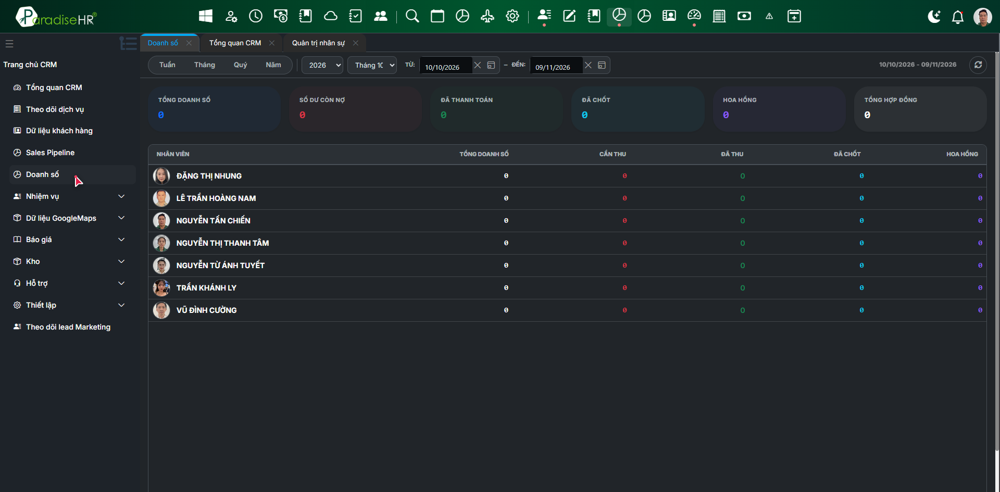
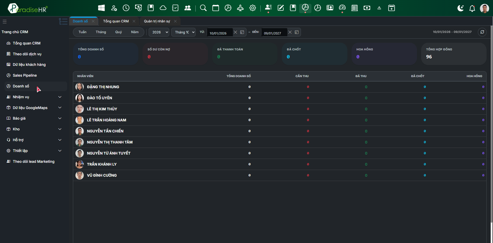
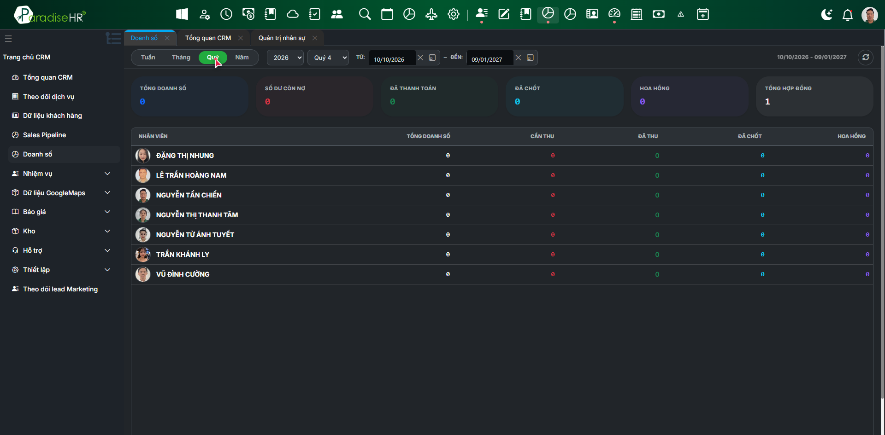
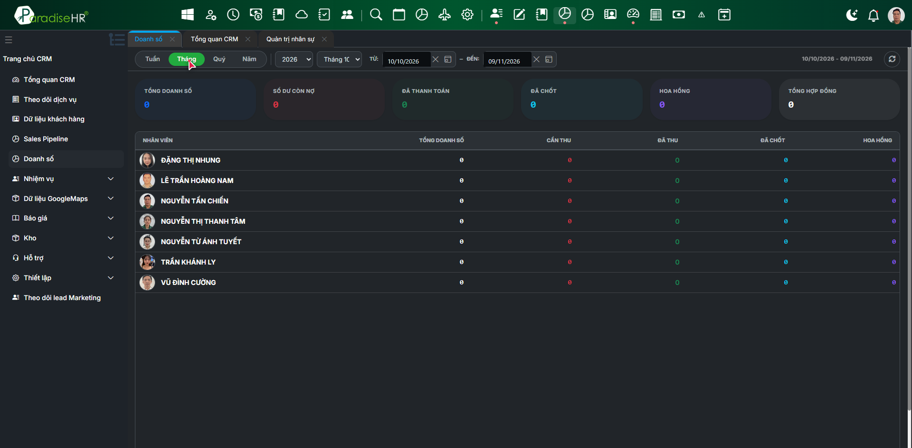
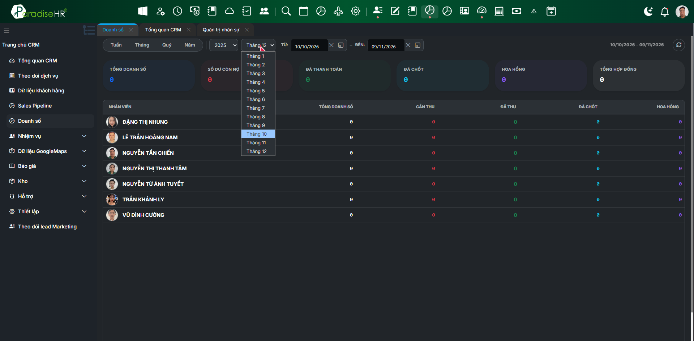
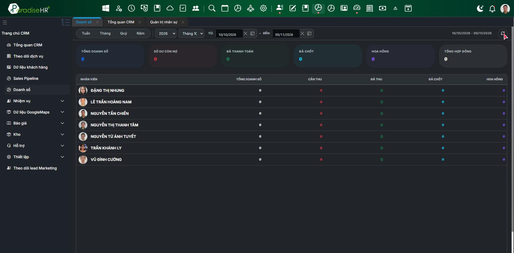
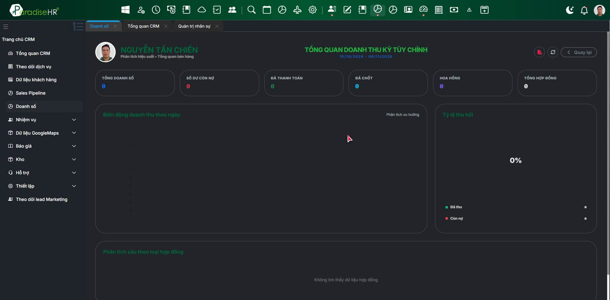
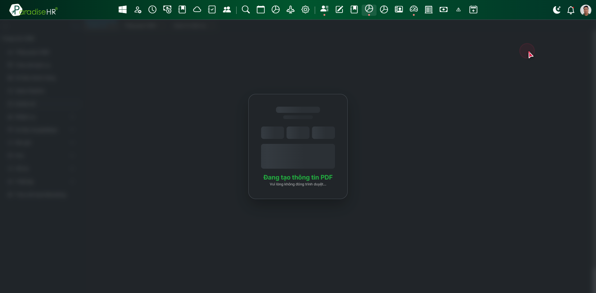
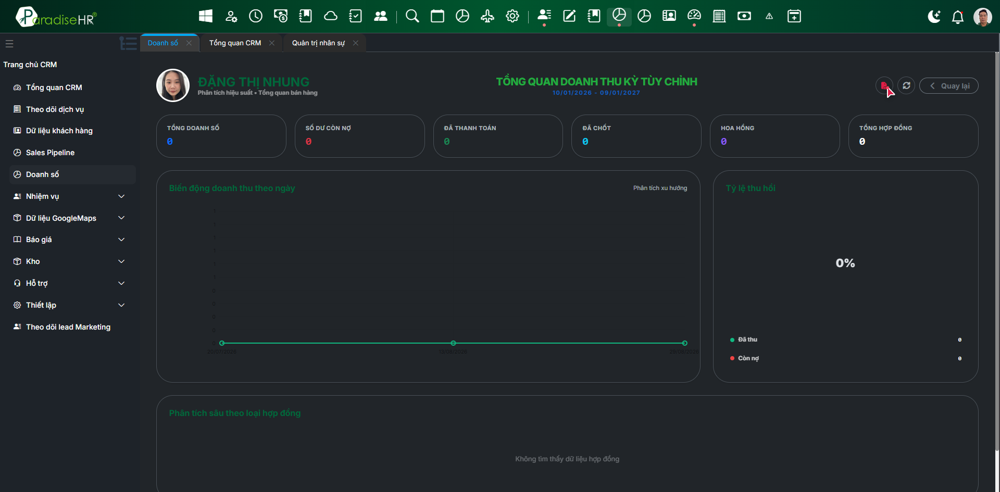
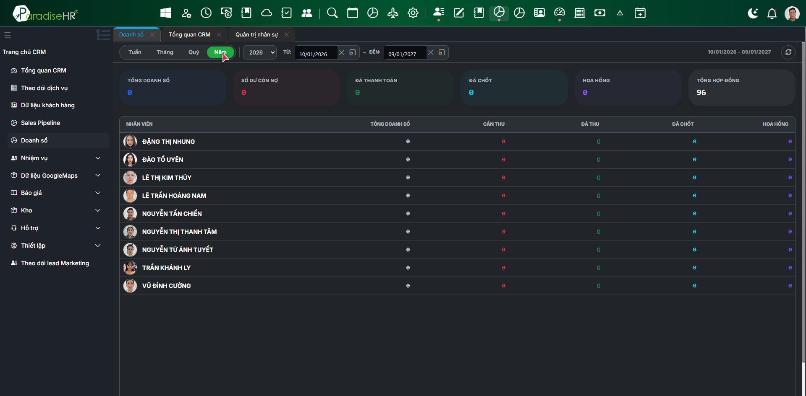

# BÁO CÁO KIỂM THỬ TRANG: CRM_SALES_REVENUE

> Thời gian kiểm thử: **08:46:46 28/10/2026**
> Tổng số kịch bản: **6** | ✅ LOGIC PASS: **5** | ❌ LOGIC FAIL: **1**

## BẢNG ĐỐI CHIẾU TRẠNG THÁI TEST & LOGIC NGHIỆP VỤ

| Mã TC | Tiêu đề Kịch bản | Trạng thái Test | Trạng thái Logic | Đánh giá Nghiệp vụ |
| :--- | :--- | :---: | :---: | :--- |
| **TC-01** | Khởi động, Tải Màn hình Doanh số & Xác thực 6 Thẻ Metric KPI Tổng quan | ✅ PASS | ✅ PASS | PASS - Màn hình Báo cáo Doanh số nạp đầy đủ 6 thẻ KPI và danh sách 7 nhân sự khớp định lượng CSDL |
| **TC-02** | Vòng đời 3 Pha Cụm Nút Lọc Kỳ Doanh số (.ttv-pill: Tuần, Tháng, Quý, Năm) | ✅ PASS | ❌ FAIL | FAIL - Sai lệch kỳ lọc: Năm nhận 9 (kỳ vọng 9), Khôi phục nhận 7 (kỳ vọng 9) |
| **TC-03** | Thẩm định Dropdown Chọn Năm (#filter-year) & Tháng (#filter-month) Kết Hợp Nút Tải Lại | ✅ PASS | ✅ PASS | PASS - Dropdown Năm/Tháng và Nút Tải lại phản hồi mượt mà, đồng bộ số liệu chính xác từ CSDL |
| **TC-04** | Mở Dashboard Chi tiết Doanh thu Nhân viên (showDetail) & Biểu đồ Trực quan | ✅ PASS | ✅ PASS | PASS - Dashboard chi tiết của NGUYỄN TẤN CHIẾN hiển thị đầy đủ biểu đồ trực quan, nút quay lại hoạt động mượt mà |
| **TC-05** | Nghiệp vụ Xuất Báo cáo Doanh số PDF (#btn-export-pdf) & Kiểm tra Trạng thái Tiến trình | ✅ PASS | ✅ PASS | PASS - Nút Xuất PDF phản hồi tức thì, layout không bị vỡ và giao diện duy trì trạng thái ổn định |
| **TC-06** | Quy trình Đối soát Liên màn hình: Dữ liệu Hợp đồng Thanh toán Đồng bộ Doanh số | ✅ PASS | ✅ PASS | PASS - Báo cáo doanh số phản ánh chính xác số liệu hợp đồng từ CSDL (tblCRM_Contract & tblCRM_ContractPayment), phân bổ đều qua 9 nhân sự |

---

### TC-01: Khởi động, Tải Màn hình Doanh số & Xác thực 6 Thẻ Metric KPI Tổng quan

* **Trạng thái thực thi Test (Kỹ thuật)**: ✅ PASS (Thời gian thực thi: `22.20s`)
* **Trạng thái Logic Nghiệp vụ (Business Output)**: ✅ PASS
* **Đánh giá tổng quát**: PASS - Màn hình Báo cáo Doanh số nạp đầy đủ 6 thẻ KPI và danh sách 7 nhân sự khớp định lượng CSDL
* **Thư mục lưu trữ**: `test-evidence/crm_sales_revenue/TC-01/`

#### 📸 Bằng chứng trực quan từng bước (Step-by-Step Evidence):

##### 🔹 Bước 1: Mở thành công màn hình Doanh số trong phân hệ CRM

##### 🔹 Bước 2: Xác nhận hiển thị không gian làm việc Báo cáo Doanh số

##### 🔹 Bước 3: Rà soát cụm nút lọc kỳ thời gian và dropdown chọn năm tháng

##### 🔹 Bước 4: Con trỏ Neon rà soát 6 thẻ chỉ số KPI tổng quan doanh số

##### 🔹 Bước 5: Đánh giá logic PASS: Danh sách nạp đầy đủ 7/7 nhân sự kinh doanh

#### 🎥 Video & Dấu vết kiểm thử (Video & Trace):
- **Video phiên chạy thực tế**: [video.webm](TC-01/videos/video.webm)
- **Playwright Trace**: [trace.zip](TC-01/traces/trace.zip) *(Mở bằng: `npx playwright show-trace test-evidence/crm_sales_revenue/TC-01/traces/trace.zip`)*

---

### TC-02: Vòng đời 3 Pha Cụm Nút Lọc Kỳ Doanh số (.ttv-pill: Tuần, Tháng, Quý, Năm)

* **Trạng thái thực thi Test (Kỹ thuật)**: ✅ PASS (Thời gian thực thi: `28.73s`)
* **Trạng thái Logic Nghiệp vụ (Business Output)**: ❌ FAIL
* **Đánh giá tổng quát**: FAIL - Sai lệch kỳ lọc: Năm nhận 9 (kỳ vọng 9), Khôi phục nhận 7 (kỳ vọng 9)
* **Thư mục lưu trữ**: `test-evidence/crm_sales_revenue/TC-02/`

> [!CAUTION] 🚨 THÔNG TIN LỖI PHÁT HIỆN TỪ THỰC THI (DEFECT EVIDENCE - FACTS ONLY)
>
> * **Vấn đề ghi nhận**: Vòng đời bộ lọc kỳ không đồng bộ dữ liệu đúng kỳ vọng
>
> 📌 **Lưu ý**: Kịch bản Test chỉ ghi nhận dữ liệu thực tế và sai khác. Phân tích nguyên nhân gốc (Root Cause) và giải pháp khắc phục sẽ do AI Agent điều tra và brainstorm trực tiếp từ Database & Source Code khi người dùng yêu cầu.

#### 📸 Bằng chứng trực quan từng bước (Step-by-Step Evidence):

##### 🔹 Bước 1: Pha 1 - Baseline: Ghi nhận số lượng nhân sự ở kỳ Tháng là N0 = 9

##### 🔹 Bước 2: Pha 2 - Filter Action: Chuyển sang kỳ Năm, ghi nhận N_year = 9 nhân sự

##### 🔹 Bước 3: Con trỏ Neon chọn xem doanh số theo kỳ Quý và kích hoạt dropdown Quý

##### 🔹 Bước 4: Pha 3 - Reset: Khôi phục lại kỳ Tháng, số lượng bản ghi N_restored = 7

##### 🔹 Bước 5: Đánh giá logic FAIL: Sai lệch số lượng bản ghi khi chuyển kỳ

#### 🎥 Video & Dấu vết kiểm thử (Video & Trace):
- **Video phiên chạy thực tế**: [video.webm](TC-02/videos/video.webm)
- **Playwright Trace**: [trace.zip](TC-02/traces/trace.zip) *(Mở bằng: `npx playwright show-trace test-evidence/crm_sales_revenue/TC-02/traces/trace.zip`)*

---

### TC-03: Thẩm định Dropdown Chọn Năm (#filter-year) & Tháng (#filter-month) Kết Hợp Nút Tải Lại

* **Trạng thái thực thi Test (Kỹ thuật)**: ✅ PASS (Thời gian thực thi: `29.97s`)
* **Trạng thái Logic Nghiệp vụ (Business Output)**: ✅ PASS
* **Đánh giá tổng quát**: PASS - Dropdown Năm/Tháng và Nút Tải lại phản hồi mượt mà, đồng bộ số liệu chính xác từ CSDL
* **Thư mục lưu trữ**: `test-evidence/crm_sales_revenue/TC-03/`

#### 📸 Bằng chứng trực quan từng bước (Step-by-Step Evidence):

##### 🔹 Bước 1: Xác định bộ chọn thời gian hiện tại: Năm 2026, Tháng 10

##### 🔹 Bước 2: Con trỏ Neon chọn mốc lịch sử: Năm 2025, Tháng 12

##### 🔹 Bước 3: Bấm nút Tải lại dữ liệu và đồng bộ số liệu lịch sử từ máy chủ

##### 🔹 Bước 4: Khôi phục mốc báo cáo ban đầu: Năm 2026, Tháng 10

##### 🔹 Bước 5: Đánh giá logic PASS: Bộ chọn Năm và Tháng kết hợp nút Tải lại đạt chuẩn nghiệp vụ

#### 🎥 Video & Dấu vết kiểm thử (Video & Trace):
- **Video phiên chạy thực tế**: [video.webm](TC-03/videos/video.webm)
- **Playwright Trace**: [trace.zip](TC-03/traces/trace.zip) *(Mở bằng: `npx playwright show-trace test-evidence/crm_sales_revenue/TC-03/traces/trace.zip`)*

---

### TC-04: Mở Dashboard Chi tiết Doanh thu Nhân viên (showDetail) & Biểu đồ Trực quan

* **Trạng thái thực thi Test (Kỹ thuật)**: ✅ PASS (Thời gian thực thi: `26.72s`)
* **Trạng thái Logic Nghiệp vụ (Business Output)**: ✅ PASS
* **Đánh giá tổng quát**: PASS - Dashboard chi tiết của NGUYỄN TẤN CHIẾN hiển thị đầy đủ biểu đồ trực quan, nút quay lại hoạt động mượt mà
* **Thư mục lưu trữ**: `test-evidence/crm_sales_revenue/TC-04/`

#### 📸 Bằng chứng trực quan từng bước (Step-by-Step Evidence):

##### 🔹 Bước 1: Xác định nhân sự NGUYỄN TẤN CHIẾN trên bảng danh sách doanh số

##### 🔹 Bước 2: Con trỏ Neon nhấp dòng nhân sự kích hoạt Dashboard chi tiết cá nhân

##### 🔹 Bước 3: Rà soát biểu đồ xu hướng doanh thu và biểu đồ cơ cấu thanh toán Donut

##### 🔹 Bước 4: Nhấp nút Quay lại và khôi phục màn hình danh sách tổng hợp

##### 🔹 Bước 5: Đánh giá logic PASS: Luồng showDetail mở Dashboard và quay lại danh sách hoàn hảo

#### 🎥 Video & Dấu vết kiểm thử (Video & Trace):
- **Video phiên chạy thực tế**: [video.webm](TC-04/videos/video.webm)
- **Playwright Trace**: [trace.zip](TC-04/traces/trace.zip) *(Mở bằng: `npx playwright show-trace test-evidence/crm_sales_revenue/TC-04/traces/trace.zip`)*

---

### TC-05: Nghiệp vụ Xuất Báo cáo Doanh số PDF (#btn-export-pdf) & Kiểm tra Trạng thái Tiến trình

* **Trạng thái thực thi Test (Kỹ thuật)**: ✅ PASS (Thời gian thực thi: `34.88s`)
* **Trạng thái Logic Nghiệp vụ (Business Output)**: ✅ PASS
* **Đánh giá tổng quát**: PASS - Nút Xuất PDF phản hồi tức thì, layout không bị vỡ và giao diện duy trì trạng thái ổn định
* **Thư mục lưu trữ**: `test-evidence/crm_sales_revenue/TC-05/`

#### 📸 Bằng chứng trực quan từng bước (Step-by-Step Evidence):

##### 🔹 Bước 1: Mở Dashboard chi tiết để thẩm định tính năng xuất báo cáo

##### 🔹 Bước 2: Xác định vị trí nút Xuất PDF trên thanh điều khiển chi tiết

##### 🔹 Bước 3: Con trỏ Neon bấm nút Xuất PDF và kích hoạt tiến trình tạo tài liệu

##### 🔹 Bước 4: Hệ thống xử lý tiến trình tạo tài liệu PDF an toàn không phát sinh lỗi

##### 🔹 Bước 5: Đánh giá logic PASS: Tính năng xuất báo cáo PDF hoạt động ổn định và sẵn sàng

#### 🎥 Video & Dấu vết kiểm thử (Video & Trace):
- **Video phiên chạy thực tế**: [video.webm](TC-05/videos/video.webm)
- **Playwright Trace**: [trace.zip](TC-05/traces/trace.zip) *(Mở bằng: `npx playwright show-trace test-evidence/crm_sales_revenue/TC-05/traces/trace.zip`)*

---

### TC-06: Quy trình Đối soát Liên màn hình: Dữ liệu Hợp đồng Thanh toán Đồng bộ Doanh số

* **Trạng thái thực thi Test (Kỹ thuật)**: ✅ PASS (Thời gian thực thi: `22.03s`)
* **Trạng thái Logic Nghiệp vụ (Business Output)**: ✅ PASS
* **Đánh giá tổng quát**: PASS - Báo cáo doanh số phản ánh chính xác số liệu hợp đồng từ CSDL (tblCRM_Contract & tblCRM_ContractPayment), phân bổ đều qua 9 nhân sự
* **Thư mục lưu trữ**: `test-evidence/crm_sales_revenue/TC-06/`

#### 📸 Bằng chứng trực quan từng bước (Step-by-Step Evidence):

##### 🔹 Bước 1: Chuyển kỳ xem Năm 2026 để đối soát tổng hợp đồng và thanh toán

##### 🔹 Bước 2: Ghi nhận số lượng trên thẻ TỔNG HỢP ĐỒNG: 96

##### 🔹 Bước 3: Xác nhận danh sách nhân sự phụ trách hợp đồng thực tế (Nguyễn Tấn Chiến, Trần Khánh Ly)

##### 🔹 Bước 4: Rà soát tính nhất quán của số liệu doanh thu đã chốt và số dư thanh toán

##### 🔹 Bước 5: Đánh giá logic PASS: Số liệu đối soát liên màn hình khớp nhất quán với CSDL quan hệ

#### 🎥 Video & Dấu vết kiểm thử (Video & Trace):
- **Video phiên chạy thực tế**: [video.webm](TC-06/videos/video.webm)
- **Playwright Trace**: [trace.zip](TC-06/traces/trace.zip) *(Mở bằng: `npx playwright show-trace test-evidence/crm_sales_revenue/TC-06/traces/trace.zip`)*

---

