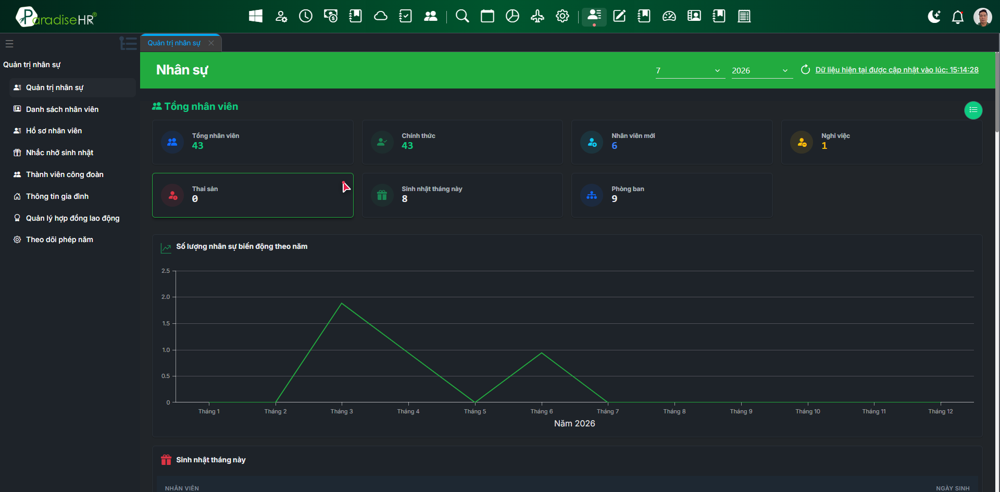

# BÁO CÁO KIỂM THỬ TRANG: DASHBOARD_OVERVIEW

> Thời gian kiểm thử: 15:14:33 15/10/2026
> Tổng số kịch bản: **1** | ✅ PASS: **1** | ❌ FAIL: **0**

---

### TC-01: TC-01: Kiểm tra nạp bảng điều khiển & Menu hệ thống

* **Kết quả**: ✅ PASS (Thời gian: `11.69s`)
* **Thư mục lưu trữ**: `test-evidence/dashboard_overview/TC-01/`

#### Bằng chứng kiểm thử (Evidence):
- **Ảnh chụp màn hình (Screenshots)**:
  - 
- **Video quay trực tiếp (Video)**:
  - [video.webm](TC-01/videos/video.webm)
- **Playwright Trace**:
  - [trace.zip](TC-01/traces/trace.zip) *(Mở bằng: `npx playwright show-trace test-evidence/dashboard_overview/TC-01/traces/trace.zip`)*

---

