# BÁO CÁO KIỂM THỬ TRANG: QUY_TRINH_TINH_LUONG_NV_MOI

> Thời gian kiểm thử: **21:31:18 12/11/2026**
> Tổng số kịch bản: **20** | ✅ LOGIC PASS: **19** | ❌ LOGIC FAIL: **1**

## BẢNG ĐỐI CHIẾU TRẠNG THÁI TEST & LOGIC NGHIỆP VỤ

| Mã TC | Tiêu đề Kịch bản | Trạng thái Test | Trạng thái Logic | Đánh giá Nghiệp vụ |
| :--- | :--- | :---: | :---: | :--- |
| **TC-01** | fix-4 | TC-01: Tạo mới hồ sơ nhân viên Nguyễn Văn Test (Role: cuong.vu) | ✅ PASS | ✅ PASS | Đạt yêu cầu logic nghiệp vụ mong đợi |
| **TC-02** | fix-4 | TC-02: Cấp tài khoản đăng nhập ESS Portal test.nv (Role: cuong.vu) | ✅ PASS | ✅ PASS | Đạt yêu cầu logic nghiệp vụ mong đợi |
| **TC-03** | fix-4 | TC-03: Thiết lập HĐLĐ và Mức lương 10,000,000 VNĐ (Role: cuong.vu) | ✅ PASS | ✅ PASS | Đạt yêu cầu logic nghiệp vụ mong đợi |
| **TC-04** | fix-4 | TC-04: Đăng ký 1 Người phụ thuộc giảm trừ gia cảnh (Role: cuong.vu) | ✅ PASS | ✅ PASS | Đạt yêu cầu logic nghiệp vụ mong đợi |
| **TC-05** | fix-4 | TC-05: Phân ca làm việc hành chính chuẩn cho NV 099 (Role: cuong.vu) | ✅ PASS | ✅ PASS | Đạt yêu cầu logic nghiệp vụ mong đợi |
| **TC-06** | fix-5 | TC-06: Khảo sát hiện trạng 5 ngày công trên Bảng công chi tiết (Role: test.nv) | ✅ PASS | ✅ PASS | PASS - Khảo sát Baseline Before 5 ngày công Tháng 10/2026 của NV 099 trên Bảng công cá nhân (5 ngày công trong CSDL). |
| **TC-07** | fix-5 | TC-07: Nộp và Hủy đơn ngày 14/10; Nộp 2 đơn bù công ngày 15/10 và 16/10/2026 (Role: test.nv) | ❌ FAIL | ❌ FAIL | Error: page.waitForTimeout: Target page, context or browser has been closed |
| **TC-08** | fix-5 | TC-08: Nộp đơn Xin nghỉ phép năm AL hưởng nguyên lương ngày 24/10 (Role: test.nv) | ✅ PASS | ✅ PASS | PASS - Đơn Xin nghỉ phép năm AL ngày 24/10/2026 đã được nộp thành công và ghi nhận vào CSDL. |
| **TC-09** | fix-5 | TC-09: Nộp đơn Xin tăng ca OT 2.0h ngày 20/10/2026 & Đăng xuất (Role: test.nv) | ✅ PASS | ✅ PASS | PASS - Đơn Xin tăng ca OT 2.0h ngày 20/10/2026 đã được nộp thành công và đăng xuất an toàn. Hoàn tất bàn giao cho fix-6! |
| **TC-10** | fix-6 | TC-10: Quản lý Trí Nguyễn duyệt Cấp 1 (Nghỉ phép 24/10, Bù công 15/10 & 16/10, Xin hủy 14/10) và Đăng xuất (Role: tri.nguyen) | ✅ PASS | ✅ PASS | Đạt yêu cầu logic nghiệp vụ mong đợi |
| **TC-11** | fix-6 | TC-11: Quản lý Trường Long duyệt Cấp 1 đơn Tăng ca OT 20/10 & kiểm tra tab Lịch sử (Role: LongKa) | ✅ PASS | ✅ PASS | Đạt yêu cầu logic nghiệp vụ mong đợi |
| **TC-12** | fix-6 | TC-12: Quản lý Trường Long duyệt Cấp 2 (Nghỉ phép 24/10, Bù công 15/10 & 16/10, Xin hủy 14/10), xem Lịch sử và Đăng xuất (Role: LongKa) | ✅ PASS | ✅ PASS | Đạt yêu cầu logic nghiệp vụ mong đợi |
| **TC-13** | fix-6 | TC-13: Nhân viên Nguyễn Văn Test mở Bảng công cá nhân (MnuWPT010) chọn Tháng 10 xem kết quả (Role: test.nv) | ✅ PASS | ✅ PASS | Đạt yêu cầu logic nghiệp vụ mong đợi |
| **TC-14** | fix-7 | TC-14: Mô phỏng thao tác nạp Thưởng KPI 1,000,000 VNĐ trên Thu nhập không cố định (MnuPRL036) | ✅ PASS | ✅ PASS | Đạt yêu cầu logic nghiệp vụ mong đợi |
| **TC-15** | fix-7 | TC-15: Mô phỏng thao tác nạp Tạm ứng lương 2,000,000 VNĐ & Khóa phiếu (MnuPRL070) | ✅ PASS | ✅ PASS | Đạt yêu cầu logic nghiệp vụ mong đợi |
| **TC-16** | fix-7 | TC-16: Mô phỏng thao tác chạy Tính tiền lương Tháng 10/2026 (MnuPRL040) | ✅ PASS | ✅ PASS | Đạt yêu cầu logic nghiệp vụ mong đợi |
| **TC-17** | fix-7 | TC-17: Mô phỏng thao tác Khóa chấm công (MnuTAD125), Khóa lương (MnuPRL080) & Đăng xuất | ✅ PASS | ✅ PASS | Đạt yêu cầu logic nghiệp vụ mong đợi |
| **TC-18** | fix-8 | TC-18: Replay Kế toán mở Danh sách trả lương, xem Bảng lương tổng hợp (trượt ngang NV 099), nhảy Phiếu lương & Đăng xuất (Role: Chien.nguyen) | ✅ PASS | ✅ PASS | Đạt yêu cầu logic nghiệp vụ mong đợi |
| **TC-19** | fix-8 | TC-19: Replay Nhân viên test.nv mở Phiếu lương, cuộn từng mục & khoanh vùng pause 5s (Role: test.nv) | ✅ PASS | ✅ PASS | Đạt yêu cầu logic nghiệp vụ mong đợi |
| **TC-20** | fix-8 | TC-20: Replay Nhân viên test.nv mở Tab Lịch sử, bấm Xem & mở/khoanh vùng 5s 3 Modal chi tiết (Role: test.nv) | ✅ PASS | ✅ PASS | Đạt yêu cầu logic nghiệp vụ mong đợi |

---

### TC-01: fix-4 | TC-01: Tạo mới hồ sơ nhân viên Nguyễn Văn Test (Role: cuong.vu)

* **Trạng thái thực thi Test (Kỹ thuật)**: ✅ PASS (Thời gian thực thi: `25.42s`)
* **Trạng thái Logic Nghiệp vụ (Business Output)**: ✅ PASS
* **Đánh giá tổng quát**: Đạt yêu cầu logic nghiệp vụ mong đợi
* **Thư mục lưu trữ**: `test-evidence/quy_trinh_tinh_luong_nv_moi/TC-01/`

#### 📸 Bằng chứng trực quan từng bước (Step-by-Step Evidence):

*(Không có ảnh chụp màn hình)*

#### 🎥 Video & Dấu vết kiểm thử (Video & Trace):
- **Video phiên chạy thực tế**: [video.webm](TC-01/videos/video.webm)

---

### TC-02: fix-4 | TC-02: Cấp tài khoản đăng nhập ESS Portal test.nv (Role: cuong.vu)

* **Trạng thái thực thi Test (Kỹ thuật)**: ✅ PASS (Thời gian thực thi: `28.45s`)
* **Trạng thái Logic Nghiệp vụ (Business Output)**: ✅ PASS
* **Đánh giá tổng quát**: Đạt yêu cầu logic nghiệp vụ mong đợi
* **Thư mục lưu trữ**: `test-evidence/quy_trinh_tinh_luong_nv_moi/TC-02/`

#### 📸 Bằng chứng trực quan từng bước (Step-by-Step Evidence):

*(Không có ảnh chụp màn hình)*

#### 🎥 Video & Dấu vết kiểm thử (Video & Trace):
- **Video phiên chạy thực tế**: [video.webm](TC-02/videos/video.webm)

---

### TC-03: fix-4 | TC-03: Thiết lập HĐLĐ và Mức lương 10,000,000 VNĐ (Role: cuong.vu)

* **Trạng thái thực thi Test (Kỹ thuật)**: ✅ PASS (Thời gian thực thi: `39.38s`)
* **Trạng thái Logic Nghiệp vụ (Business Output)**: ✅ PASS
* **Đánh giá tổng quát**: Đạt yêu cầu logic nghiệp vụ mong đợi
* **Thư mục lưu trữ**: `test-evidence/quy_trinh_tinh_luong_nv_moi/TC-03/`

#### 📸 Bằng chứng trực quan từng bước (Step-by-Step Evidence):

*(Không có ảnh chụp màn hình)*

#### 🎥 Video & Dấu vết kiểm thử (Video & Trace):
- **Video phiên chạy thực tế**: [video.webm](TC-03/videos/video.webm)

---

### TC-04: fix-4 | TC-04: Đăng ký 1 Người phụ thuộc giảm trừ gia cảnh (Role: cuong.vu)

* **Trạng thái thực thi Test (Kỹ thuật)**: ✅ PASS (Thời gian thực thi: `70.18s`)
* **Trạng thái Logic Nghiệp vụ (Business Output)**: ✅ PASS
* **Đánh giá tổng quát**: Đạt yêu cầu logic nghiệp vụ mong đợi
* **Thư mục lưu trữ**: `test-evidence/quy_trinh_tinh_luong_nv_moi/TC-04/`

#### 📸 Bằng chứng trực quan từng bước (Step-by-Step Evidence):

*(Không có ảnh chụp màn hình)*

#### 🎥 Video & Dấu vết kiểm thử (Video & Trace):
- **Video phiên chạy thực tế**: [video.webm](TC-04/videos/video.webm)

---

### TC-05: fix-4 | TC-05: Phân ca làm việc hành chính chuẩn cho NV 099 (Role: cuong.vu)

* **Trạng thái thực thi Test (Kỹ thuật)**: ✅ PASS (Thời gian thực thi: `30.98s`)
* **Trạng thái Logic Nghiệp vụ (Business Output)**: ✅ PASS
* **Đánh giá tổng quát**: Đạt yêu cầu logic nghiệp vụ mong đợi
* **Thư mục lưu trữ**: `test-evidence/quy_trinh_tinh_luong_nv_moi/TC-05/`

#### 📸 Bằng chứng trực quan từng bước (Step-by-Step Evidence):

*(Không có ảnh chụp màn hình)*

#### 🎥 Video & Dấu vết kiểm thử (Video & Trace):
- **Video phiên chạy thực tế**: [video.webm](TC-05/videos/video.webm)

---

### TC-06: fix-5 | TC-06: Khảo sát hiện trạng 5 ngày công trên Bảng công chi tiết (Role: test.nv)

* **Trạng thái thực thi Test (Kỹ thuật)**: ✅ PASS (Thời gian thực thi: `28.93s`)
* **Trạng thái Logic Nghiệp vụ (Business Output)**: ✅ PASS
* **Đánh giá tổng quát**: PASS - Khảo sát Baseline Before 5 ngày công Tháng 10/2026 của NV 099 trên Bảng công cá nhân (5 ngày công trong CSDL).
* **Thư mục lưu trữ**: `test-evidence/quy_trinh_tinh_luong_nv_moi/TC-06/`

#### 📸 Bằng chứng trực quan từng bước (Step-by-Step Evidence):

##### 🔹 Bước 1: Dang nhap tai khoan nhan vien moi test nv
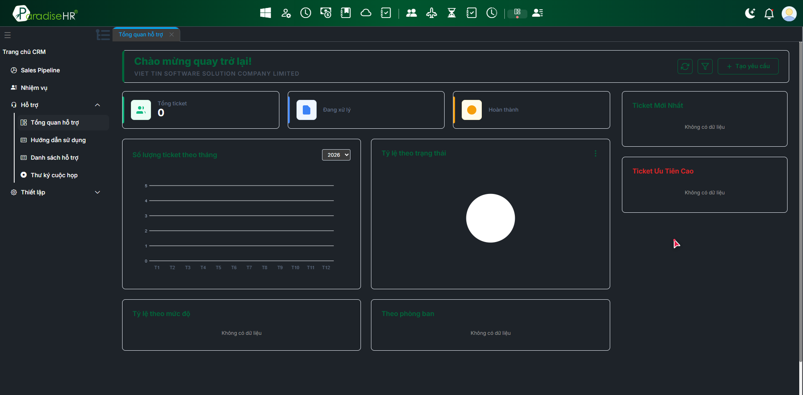

##### 🔹 Bước 2: Mo man hinh Cham cong ca nhan MnuWPT010
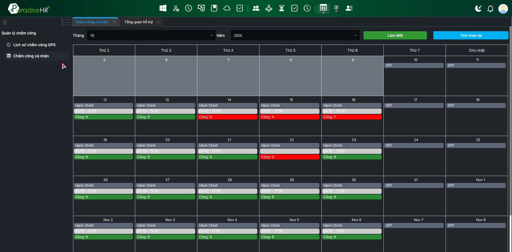

##### 🔹 Bước 3: Khao sat truc quan 5 ngay cong mau thang 10-2026
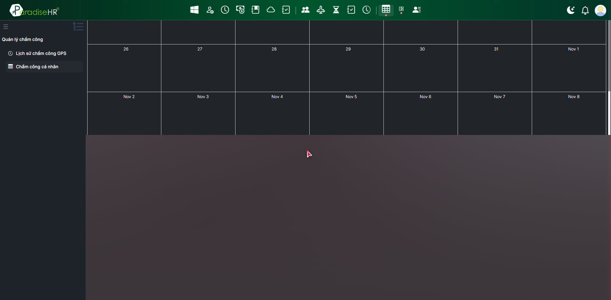

#### 🎥 Video & Dấu vết kiểm thử (Video & Trace):
- **Video phiên chạy thực tế**: [video.webm](TC-06/videos/video.webm)

---

### TC-07: fix-5 | TC-07: Nộp và Hủy đơn ngày 14/10; Nộp 2 đơn bù công ngày 15/10 và 16/10/2026 (Role: test.nv)

* **Trạng thái thực thi Test (Kỹ thuật)**: ❌ FAIL (Thời gian thực thi: `3.87s`)
* **Trạng thái Logic Nghiệp vụ (Business Output)**: ❌ FAIL
* **Đánh giá tổng quát**: Error: page.waitForTimeout: Target page, context or browser has been closed
* **Thư mục lưu trữ**: `test-evidence/quy_trinh_tinh_luong_nv_moi/TC-07/`

> [!CAUTION] 🚨 THÔNG TIN LỖI PHÁT HIỆN TỪ THỰC THI (DEFECT EVIDENCE - FACTS ONLY)
>
> * **Vấn đề ghi nhận**: Error: page.waitForTimeout: Target page, context or browser has been closed
> * **Kỳ vọng nghiệp vụ (Expected Output)**: Theo đặc tả chuẩn của hệ thống
> * **Thực tế hệ thống (Actual Output)**: Thực tế phát sinh lỗi hoặc không đạt điều kiện kiểm tra
>
> 📌 **Lưu ý**: Kịch bản Test chỉ ghi nhận dữ liệu thực tế và sai khác. Phân tích nguyên nhân gốc (Root Cause) và giải pháp khắc phục sẽ do AI Agent điều tra và brainstorm trực tiếp từ Database & Source Code khi người dùng yêu cầu.

> [!WARNING] Lỗi Kỹ Thuật (System/Playwright Error):
```
Error: page.waitForTimeout: Target page, context or browser has been closed
```

#### 📸 Bằng chứng trực quan từng bước (Step-by-Step Evidence):

*(Không có ảnh chụp màn hình)*

#### 🎥 Video & Dấu vết kiểm thử (Video & Trace):
- **Video phiên chạy thực tế**: [video.webm](TC-07/videos/video.webm)

---

### TC-08: fix-5 | TC-08: Nộp đơn Xin nghỉ phép năm AL hưởng nguyên lương ngày 24/10 (Role: test.nv)

* **Trạng thái thực thi Test (Kỹ thuật)**: ✅ PASS (Thời gian thực thi: `67.91s`)
* **Trạng thái Logic Nghiệp vụ (Business Output)**: ✅ PASS
* **Đánh giá tổng quát**: PASS - Đơn Xin nghỉ phép năm AL ngày 24/10/2026 đã được nộp thành công và ghi nhận vào CSDL.
* **Thư mục lưu trữ**: `test-evidence/quy_trinh_tinh_luong_nv_moi/TC-08/`

#### 📸 Bằng chứng trực quan từng bước (Step-by-Step Evidence):

##### 🔹 Bước 1: Mo man hinh Xin nghi phep MnuWPT315
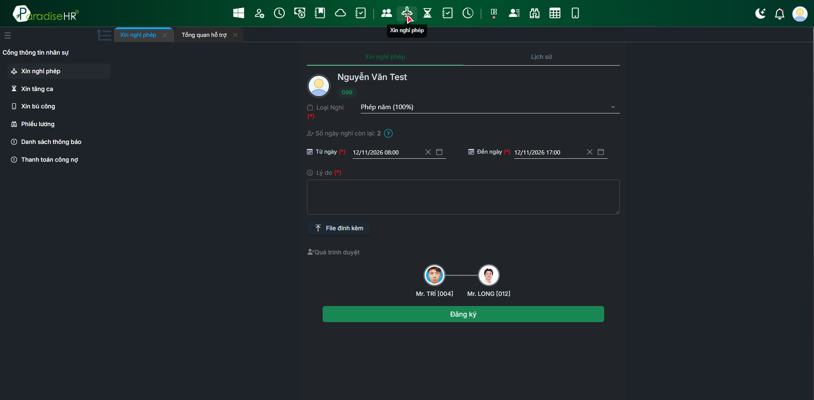

##### 🔹 Bước 2: Dien form Xin nghi phep nam AL ngay 24-10
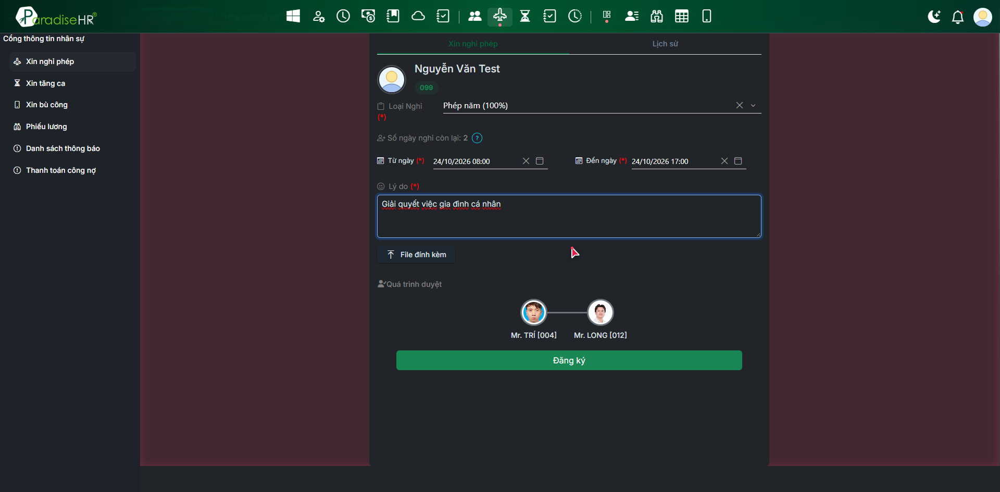

##### 🔹 Bước 3: Bam nut Gui don va xac nhan popup
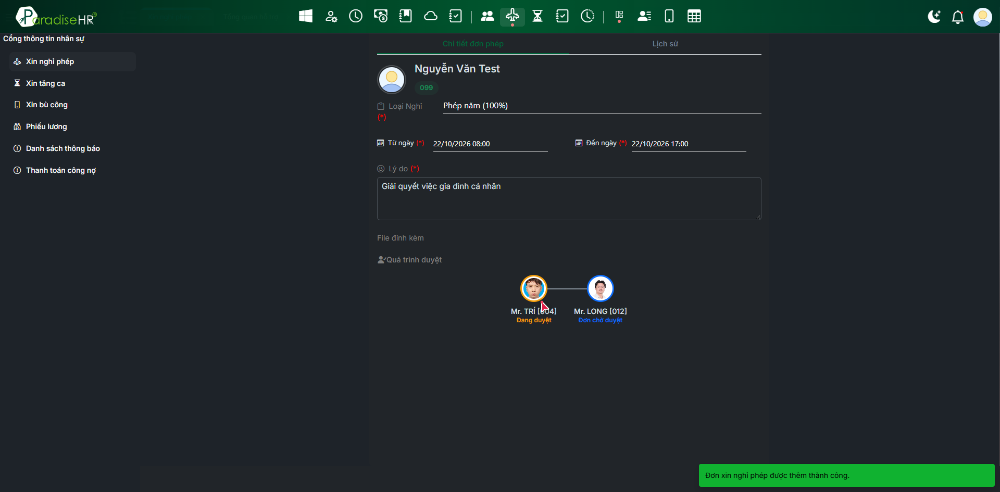

##### 🔹 Bước 4: Tab Lich su don Nghi phep ngay 24-10
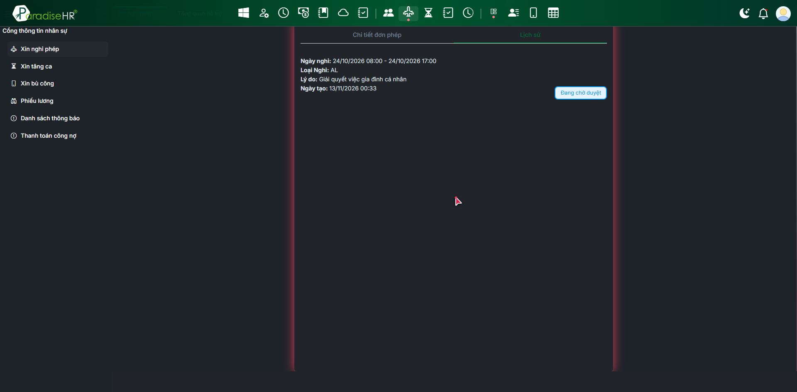

#### 🎥 Video & Dấu vết kiểm thử (Video & Trace):
- **Video phiên chạy thực tế**: [video.webm](TC-08/videos/video.webm)

---

### TC-09: fix-5 | TC-09: Nộp đơn Xin tăng ca OT 2.0h ngày 20/10/2026 & Đăng xuất (Role: test.nv)

* **Trạng thái thực thi Test (Kỹ thuật)**: ✅ PASS (Thời gian thực thi: `65.23s`)
* **Trạng thái Logic Nghiệp vụ (Business Output)**: ✅ PASS
* **Đánh giá tổng quát**: PASS - Đơn Xin tăng ca OT 2.0h ngày 20/10/2026 đã được nộp thành công và đăng xuất an toàn. Hoàn tất bàn giao cho fix-6!
* **Thư mục lưu trữ**: `test-evidence/quy_trinh_tinh_luong_nv_moi/TC-09/`

#### 📸 Bằng chứng trực quan từng bước (Step-by-Step Evidence):

##### 🔹 Bước 1: Mo man hinh Xin tang ca MnuWPT316
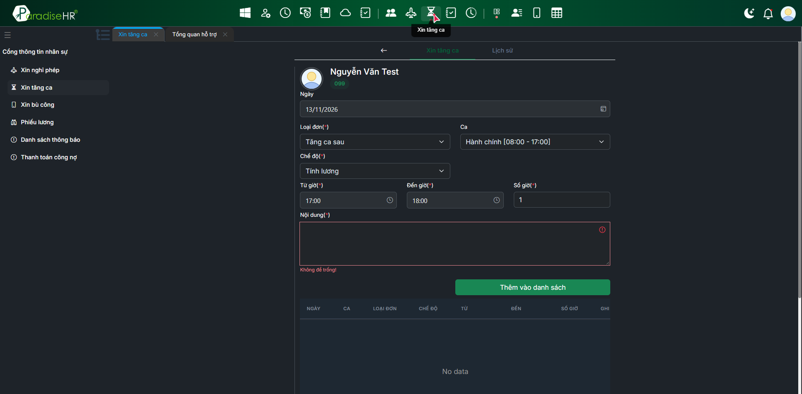

##### 🔹 Bước 2: Dien form Xin tang ca OT 2h ngay 20-10
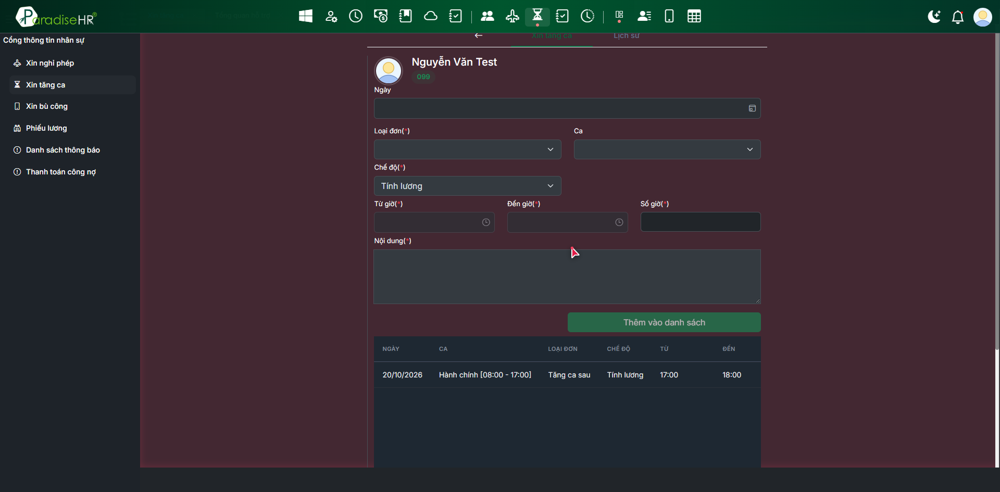

##### 🔹 Bước 3: Bam nut Gui don tang ca va xac nhan popup
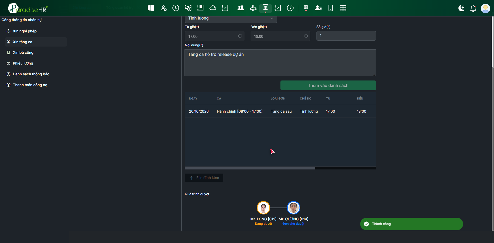

##### 🔹 Bước 4: Tab Lich su don Tang ca OT ngay 20-10
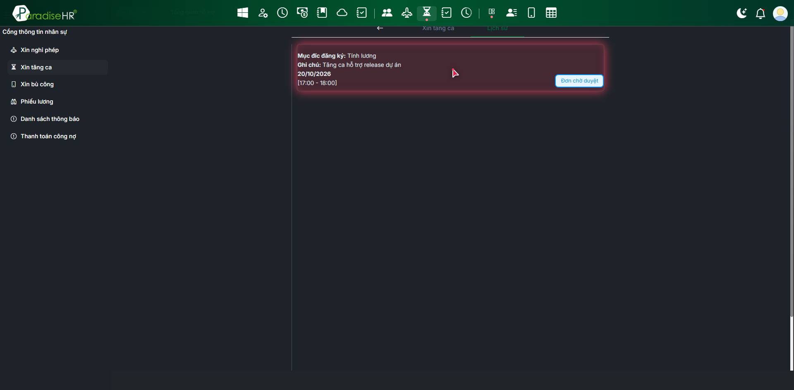

##### 🔹 Bước 5: Dang xuat hoan tat chu trinh nop don ESS


#### 🎥 Video & Dấu vết kiểm thử (Video & Trace):
- **Video phiên chạy thực tế**: [video.webm](TC-09/videos/video.webm)

---

### TC-10: fix-6 | TC-10: Quản lý Trí Nguyễn duyệt Cấp 1 (Nghỉ phép 24/10, Bù công 15/10 & 16/10, Xin hủy 14/10) và Đăng xuất (Role: tri.nguyen)

* **Trạng thái thực thi Test (Kỹ thuật)**: ✅ PASS (Thời gian thực thi: `122.39s`)
* **Trạng thái Logic Nghiệp vụ (Business Output)**: ✅ PASS
* **Đánh giá tổng quát**: Đạt yêu cầu logic nghiệp vụ mong đợi
* **Thư mục lưu trữ**: `test-evidence/quy_trinh_tinh_luong_nv_moi/TC-10/`

#### 📸 Bằng chứng trực quan từng bước (Step-by-Step Evidence):

##### 🔹 Bước 1: Dang nhap tri.nguyen
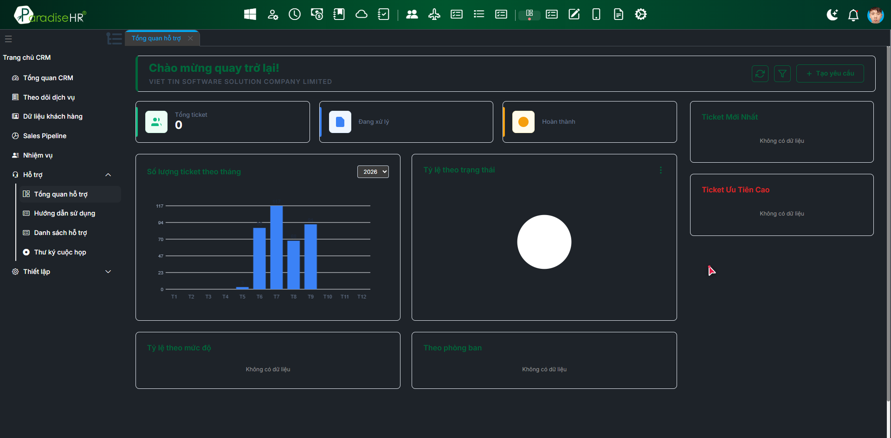

##### 🔹 Bước 2: Mo MnuWPT037 qua Launchpad
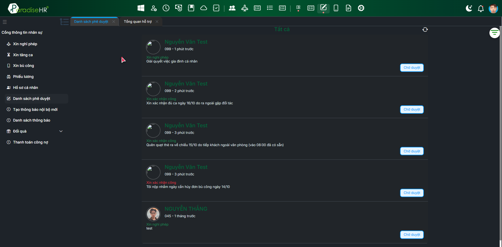

##### 🔹 Bước 3: Duyet Cap 1 Đơn Nghỉ phép 24/10
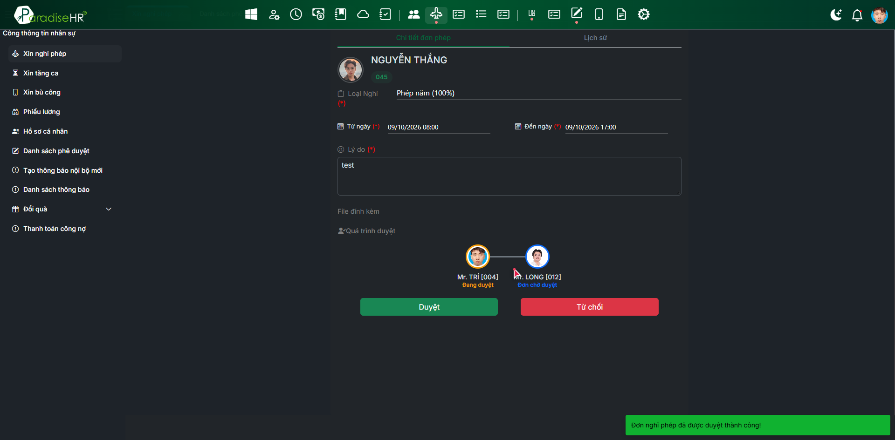

##### 🔹 Bước 4: Duyet Cap 1 Đơn Bù công 15/10
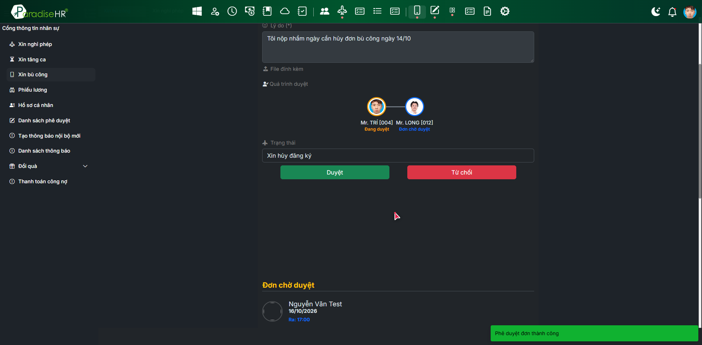

##### 🔹 Bước 5: Duyet Cap 1 Đơn Bù công 16/10
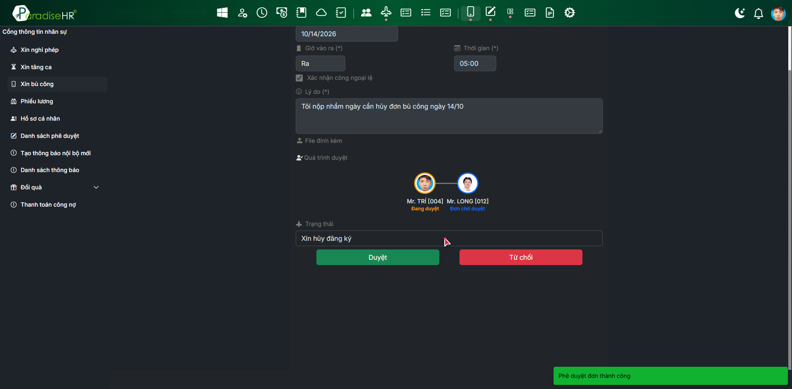

##### 🔹 Bước 6: Duyet Cap 1 Đơn Xin hủy Bù công 14/10
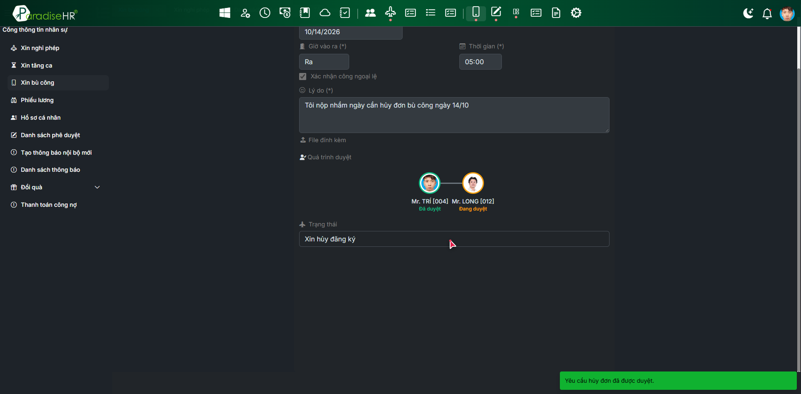

##### 🔹 Bước 7: Dang xuat tri.nguyen thanh cong


#### 🎥 Video & Dấu vết kiểm thử (Video & Trace):
- **Video phiên chạy thực tế**: [video.webm](TC-10/videos/video.webm)

---

### TC-11: fix-6 | TC-11: Quản lý Trường Long duyệt Cấp 1 đơn Tăng ca OT 20/10 & kiểm tra tab Lịch sử (Role: LongKa)

* **Trạng thái thực thi Test (Kỹ thuật)**: ✅ PASS (Thời gian thực thi: `57.67s`)
* **Trạng thái Logic Nghiệp vụ (Business Output)**: ✅ PASS
* **Đánh giá tổng quát**: Đạt yêu cầu logic nghiệp vụ mong đợi
* **Thư mục lưu trữ**: `test-evidence/quy_trinh_tinh_luong_nv_moi/TC-11/`

#### 📸 Bằng chứng trực quan từng bước (Step-by-Step Evidence):

##### 🔹 Bước 1: Dang nhap LongKa
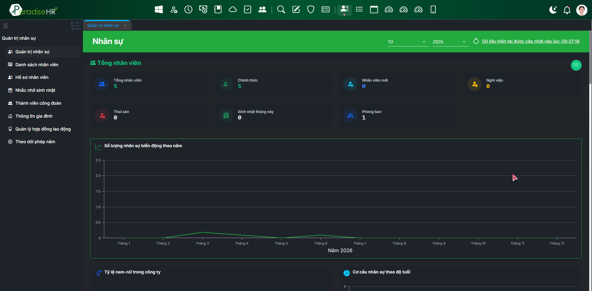

##### 🔹 Bước 2: Mo MnuWPT037 tu Launchpad
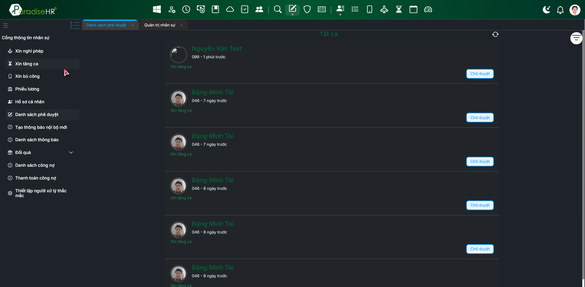

##### 🔹 Bước 3: Chon the don Tang ca OT 099
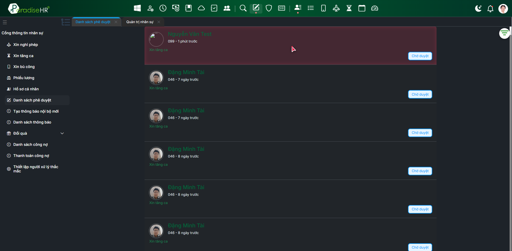

##### 🔹 Bước 4: Duyet OT va xem tab Lich su
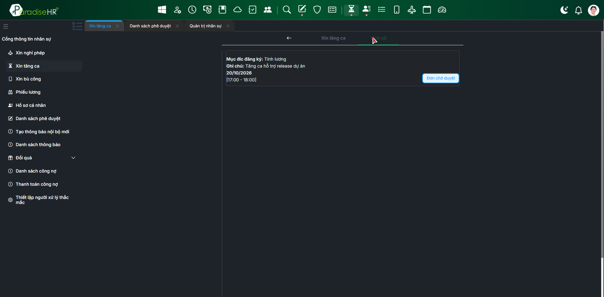

##### 🔹 Bước 5: Quay lai MnuWPT037 va reloadData
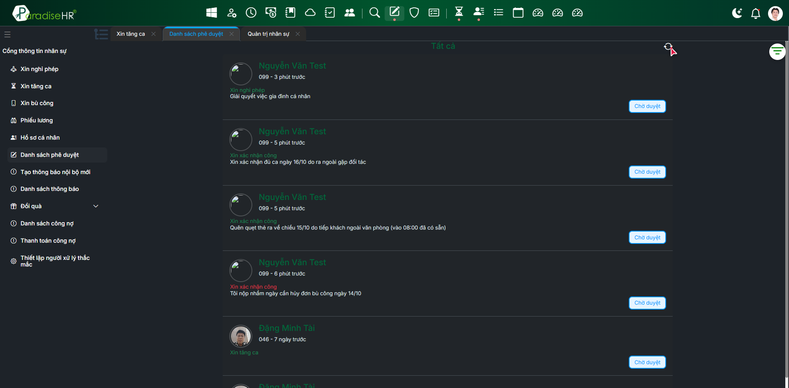

#### 🎥 Video & Dấu vết kiểm thử (Video & Trace):
- **Video phiên chạy thực tế**: [video.webm](TC-11/videos/video.webm)

---

### TC-12: fix-6 | TC-12: Quản lý Trường Long duyệt Cấp 2 (Nghỉ phép 24/10, Bù công 15/10 & 16/10, Xin hủy 14/10), xem Lịch sử và Đăng xuất (Role: LongKa)

* **Trạng thái thực thi Test (Kỹ thuật)**: ✅ PASS (Thời gian thực thi: `138.76s`)
* **Trạng thái Logic Nghiệp vụ (Business Output)**: ✅ PASS
* **Đánh giá tổng quát**: Đạt yêu cầu logic nghiệp vụ mong đợi
* **Thư mục lưu trữ**: `test-evidence/quy_trinh_tinh_luong_nv_moi/TC-12/`

#### 📸 Bằng chứng trực quan từng bước (Step-by-Step Evidence):

##### 🔹 Bước 1: LongKa mo MnuWPT037 duyet Cap 2
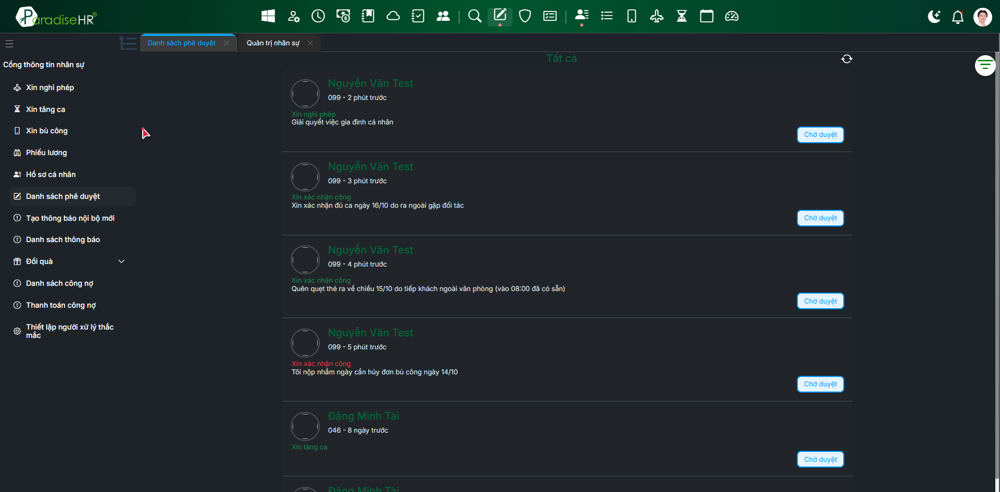

##### 🔹 Bước 2: Duyet Cap 2 va kiem tra tab Nghỉ phép 24/10
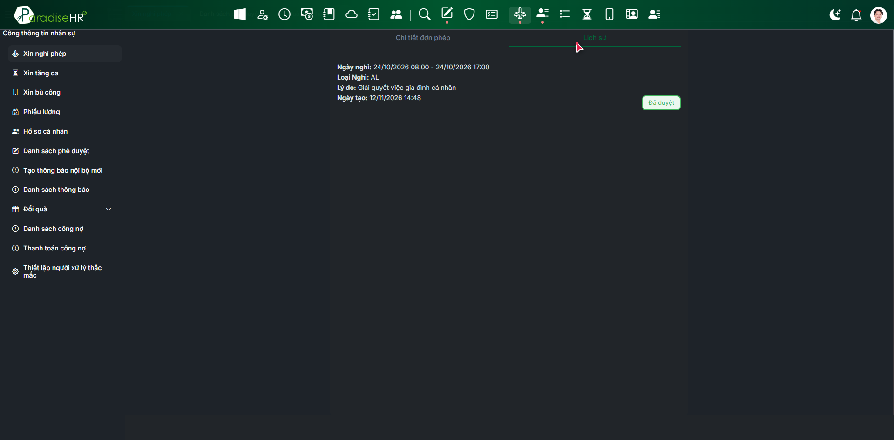

##### 🔹 Bước 3: Duyet Cap 2 va kiem tra tab Bù công 15/10
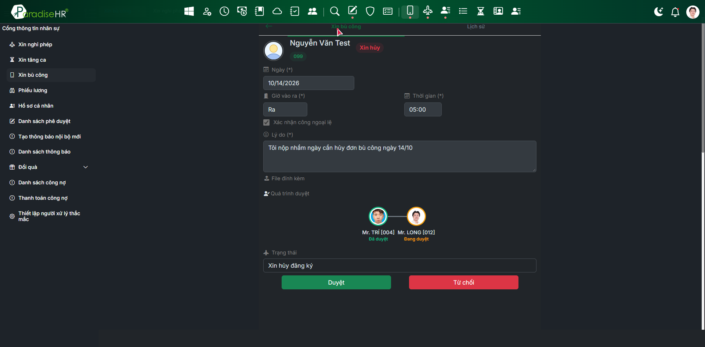

##### 🔹 Bước 4: Duyet Cap 2 va kiem tra tab Bù công 16/10
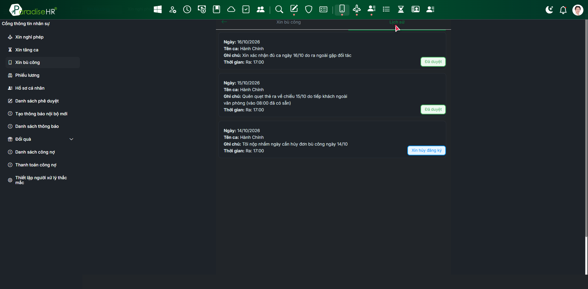

##### 🔹 Bước 5: Duyet Cap 2 va kiem tra tab Xin hủy Bù công 14/10
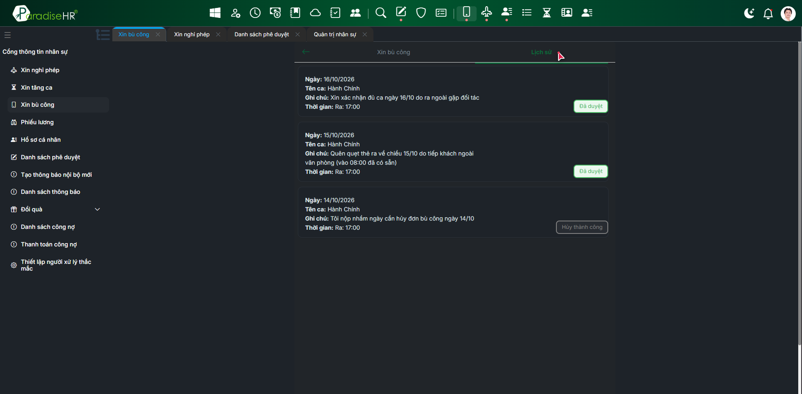

##### 🔹 Bước 6: Dang xuat LongKa thanh cong


#### 🎥 Video & Dấu vết kiểm thử (Video & Trace):
- **Video phiên chạy thực tế**: [video.webm](TC-12/videos/video.webm)

---

### TC-13: fix-6 | TC-13: Nhân viên Nguyễn Văn Test mở Bảng công cá nhân (MnuWPT010) chọn Tháng 10 xem kết quả (Role: test.nv)

* **Trạng thái thực thi Test (Kỹ thuật)**: ✅ PASS (Thời gian thực thi: `28.05s`)
* **Trạng thái Logic Nghiệp vụ (Business Output)**: ✅ PASS
* **Đánh giá tổng quát**: Đạt yêu cầu logic nghiệp vụ mong đợi
* **Thư mục lưu trữ**: `test-evidence/quy_trinh_tinh_luong_nv_moi/TC-13/`

#### 📸 Bằng chứng trực quan từng bước (Step-by-Step Evidence):

##### 🔹 Bước 1: Dang nhap test.nv
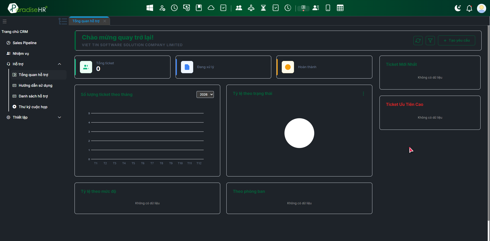

##### 🔹 Bước 2: Mo Bang cong ca nhan MnuWPT010
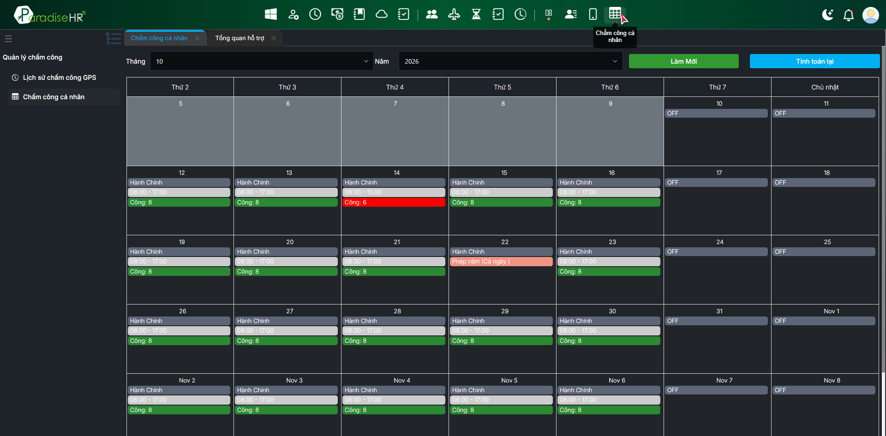

##### 🔹 Bước 3: Chon Thang 10 xem Bang cong ca nhan NV 099


#### 🎥 Video & Dấu vết kiểm thử (Video & Trace):
- **Video phiên chạy thực tế**: [video.webm](TC-13/videos/video.webm)

---

### TC-14: fix-7 | TC-14: Mô phỏng thao tác nạp Thưởng KPI 1,000,000 VNĐ trên Thu nhập không cố định (MnuPRL036)

* **Trạng thái thực thi Test (Kỹ thuật)**: ✅ PASS (Thời gian thực thi: `72.31s`)
* **Trạng thái Logic Nghiệp vụ (Business Output)**: ✅ PASS
* **Đánh giá tổng quát**: Đạt yêu cầu logic nghiệp vụ mong đợi
* **Thư mục lưu trữ**: `test-evidence/quy_trinh_tinh_luong_nv_moi/TC-14/`

#### 📸 Bằng chứng trực quan từng bước (Step-by-Step Evidence):

##### 🔹 Bước 1: Dang nhap Chien nguyen
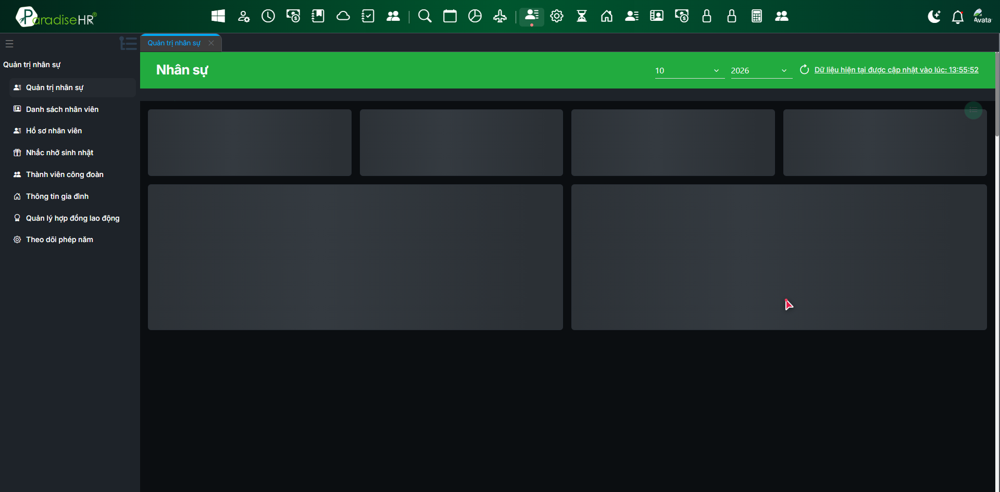

##### 🔹 Bước 2: Mo menu Thu nhap khong co dinh MnuPRL036
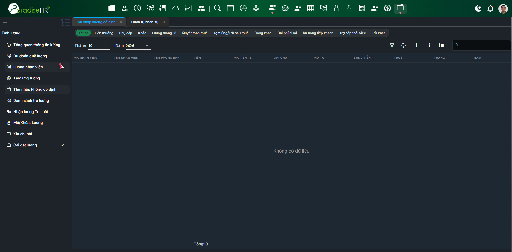

##### 🔹 Bước 3: Luu Thuong KPI 1M thanh cong tren MnuPRL036
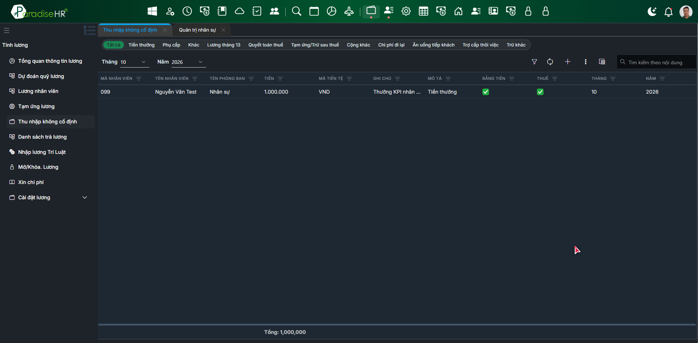

#### 🎥 Video & Dấu vết kiểm thử (Video & Trace):
- **Video phiên chạy thực tế**: [video.webm](TC-14/videos/video.webm)

---

### TC-15: fix-7 | TC-15: Mô phỏng thao tác nạp Tạm ứng lương 2,000,000 VNĐ & Khóa phiếu (MnuPRL070)

* **Trạng thái thực thi Test (Kỹ thuật)**: ✅ PASS (Thời gian thực thi: `59.90s`)
* **Trạng thái Logic Nghiệp vụ (Business Output)**: ✅ PASS
* **Đánh giá tổng quát**: Đạt yêu cầu logic nghiệp vụ mong đợi
* **Thư mục lưu trữ**: `test-evidence/quy_trinh_tinh_luong_nv_moi/TC-15/`

#### 📸 Bằng chứng trực quan từng bước (Step-by-Step Evidence):

##### 🔹 Bước 1: Dang nhap Chien nguyen
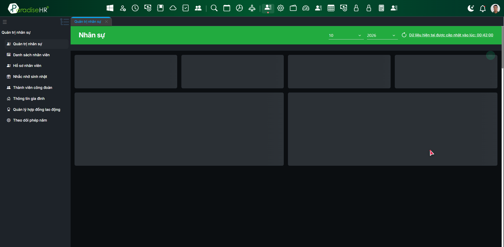

##### 🔹 Bước 2: Mo menu Tam ung luong MnuPRL070
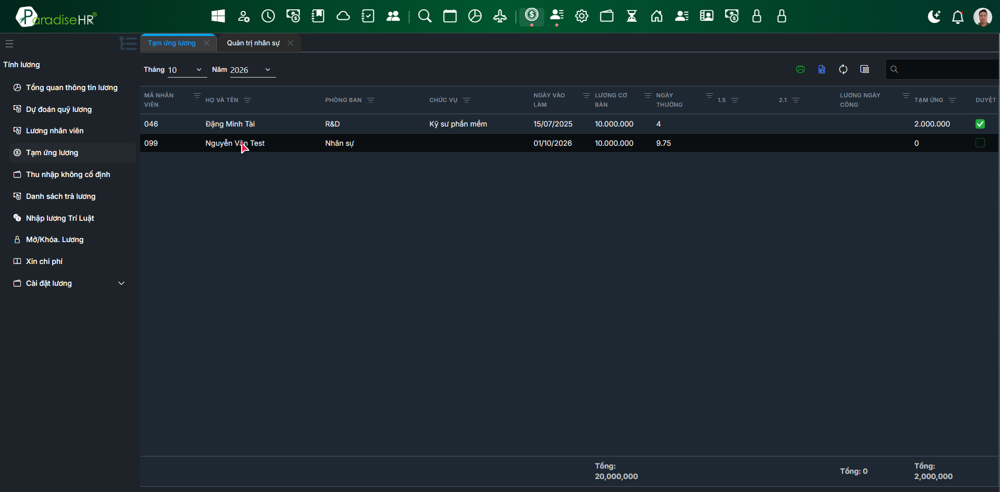

##### 🔹 Bước 3: Luu va khoa Tam ung 2M tren MnuPRL070
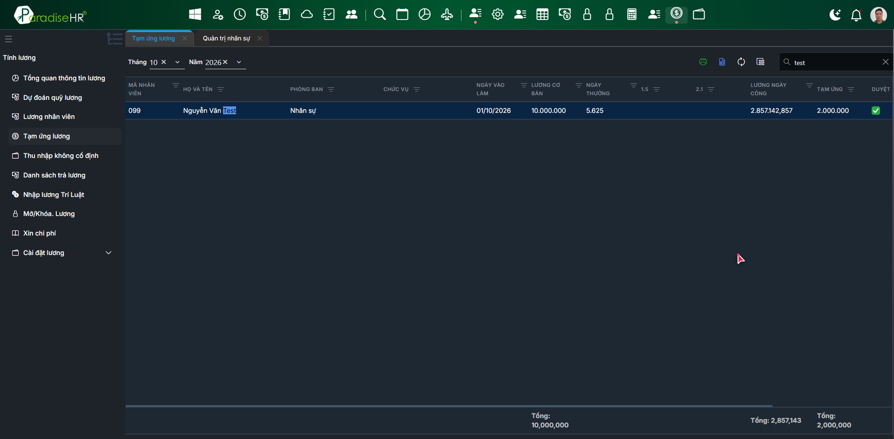

#### 🎥 Video & Dấu vết kiểm thử (Video & Trace):
- **Video phiên chạy thực tế**: [video.webm](TC-15/videos/video.webm)

---

### TC-16: fix-7 | TC-16: Mô phỏng thao tác chạy Tính tiền lương Tháng 10/2026 (MnuPRL040)

* **Trạng thái thực thi Test (Kỹ thuật)**: ✅ PASS (Thời gian thực thi: `69.77s`)
* **Trạng thái Logic Nghiệp vụ (Business Output)**: ✅ PASS
* **Đánh giá tổng quát**: Đạt yêu cầu logic nghiệp vụ mong đợi
* **Thư mục lưu trữ**: `test-evidence/quy_trinh_tinh_luong_nv_moi/TC-16/`

#### 📸 Bằng chứng trực quan từng bước (Step-by-Step Evidence):

##### 🔹 Bước 1: Dang nhap Chien nguyen
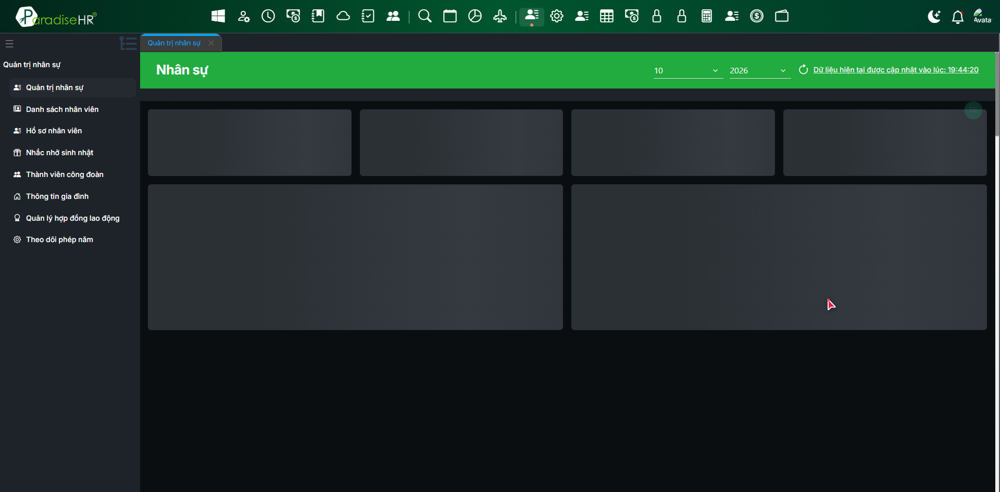

##### 🔹 Bước 2: Mo menu Tinh tien luong MnuPRL040
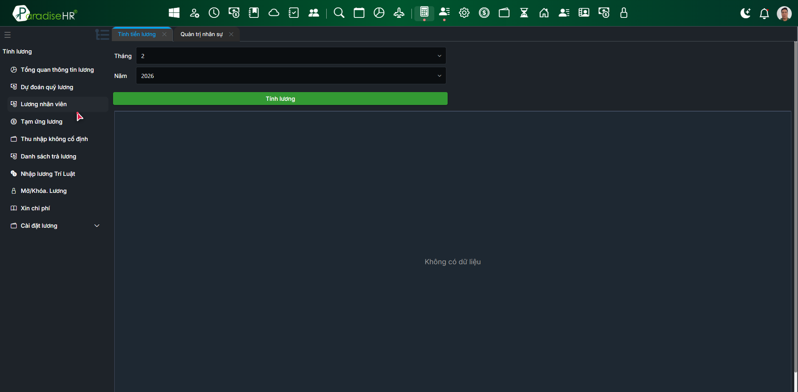

##### 🔹 Bước 3: Chay xong Tinh tien luong MnuPRL040
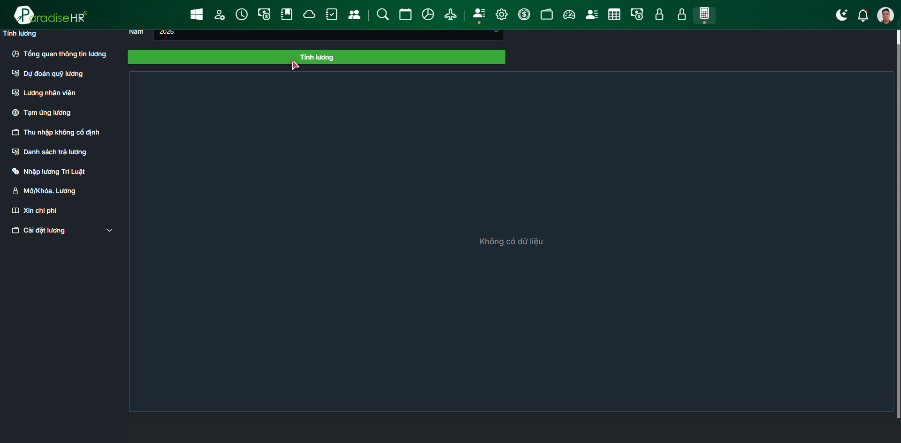

#### 🎥 Video & Dấu vết kiểm thử (Video & Trace):
- **Video phiên chạy thực tế**: [video.webm](TC-16/videos/video.webm)

---

### TC-17: fix-7 | TC-17: Mô phỏng thao tác Khóa chấm công (MnuTAD125), Khóa lương (MnuPRL080) & Đăng xuất

* **Trạng thái thực thi Test (Kỹ thuật)**: ✅ PASS (Thời gian thực thi: `85.19s`)
* **Trạng thái Logic Nghiệp vụ (Business Output)**: ✅ PASS
* **Đánh giá tổng quát**: Đạt yêu cầu logic nghiệp vụ mong đợi
* **Thư mục lưu trữ**: `test-evidence/quy_trinh_tinh_luong_nv_moi/TC-17/`

#### 📸 Bằng chứng trực quan từng bước (Step-by-Step Evidence):

##### 🔹 Bước 1: Dang nhap Chien nguyen
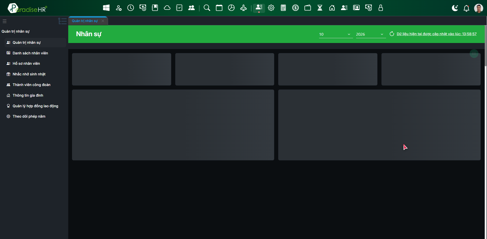

##### 🔹 Bước 2: Khoa cham cong NV 099 tren MnuTAD125
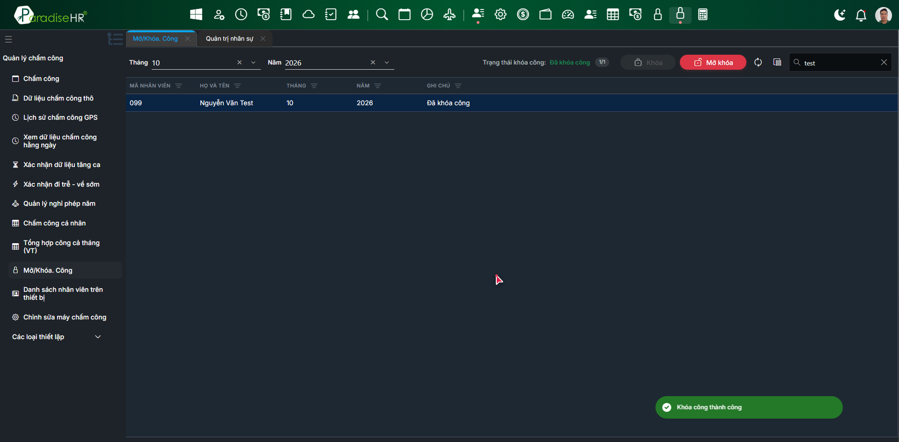

##### 🔹 Bước 3: Khoa so ky luong NV 099 tren MnuPRL080
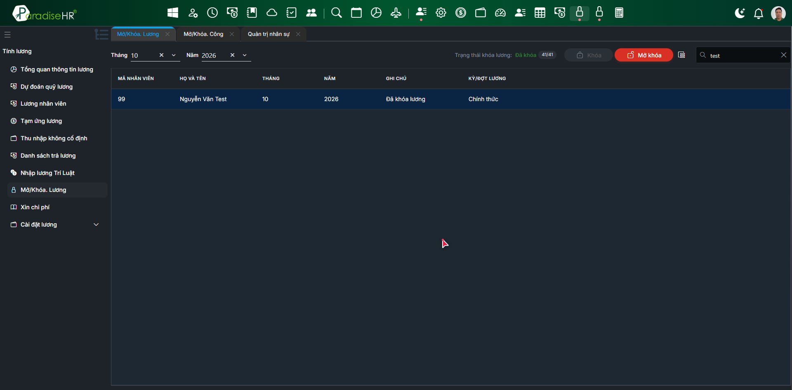

##### 🔹 Bước 4: Dang xuat ve man hinh Login


#### 🎥 Video & Dấu vết kiểm thử (Video & Trace):
- **Video phiên chạy thực tế**: [video.webm](TC-17/videos/video.webm)

---

### TC-18: fix-8 | TC-18: Replay Kế toán mở Danh sách trả lương, xem Bảng lương tổng hợp (trượt ngang NV 099), nhảy Phiếu lương & Đăng xuất (Role: Chien.nguyen)

* **Trạng thái thực thi Test (Kỹ thuật)**: ✅ PASS (Thời gian thực thi: `106.28s`)
* **Trạng thái Logic Nghiệp vụ (Business Output)**: ✅ PASS
* **Đánh giá tổng quát**: Đạt yêu cầu logic nghiệp vụ mong đợi
* **Thư mục lưu trữ**: `test-evidence/quy_trinh_tinh_luong_nv_moi/TC-18/`

#### 📸 Bằng chứng trực quan từng bước (Step-by-Step Evidence):

##### 🔹 Bước 1: Dang nhap tai khoan Chien nguyen
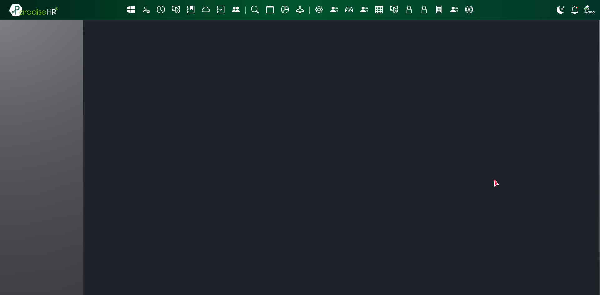

##### 🔹 Bước 2: Mo man hinh Danh sach tra luong MnuPRL092 qua Launchpad
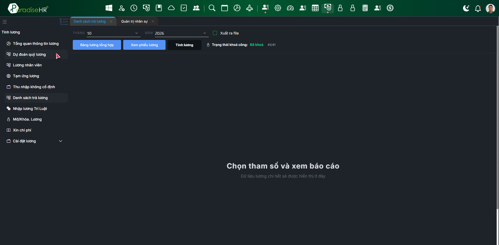

##### 🔹 Bước 3: Chon ky luong Thang 10
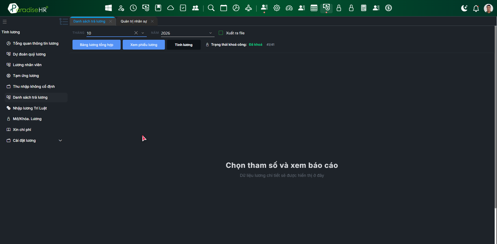

##### 🔹 Bước 4: Bang luong tong hop - Khoanh vung NV 099 (Cot trai)
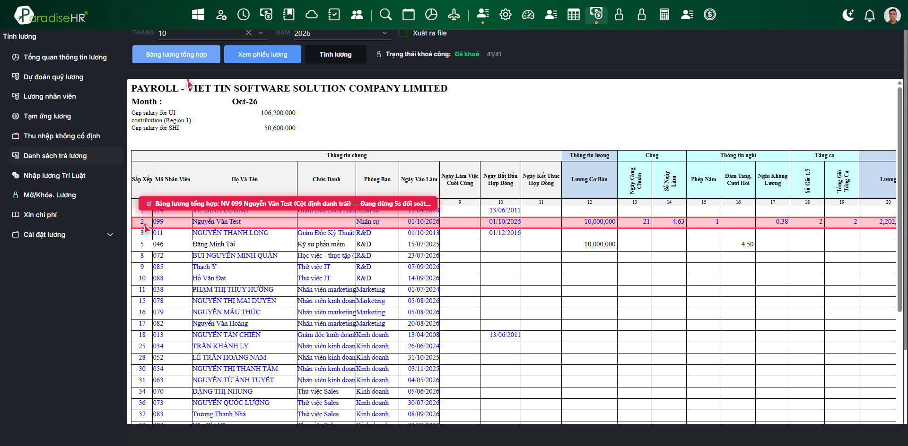

##### 🔹 Bước 5: Bang luong tong hop - Truot ngang giua bang NV 099
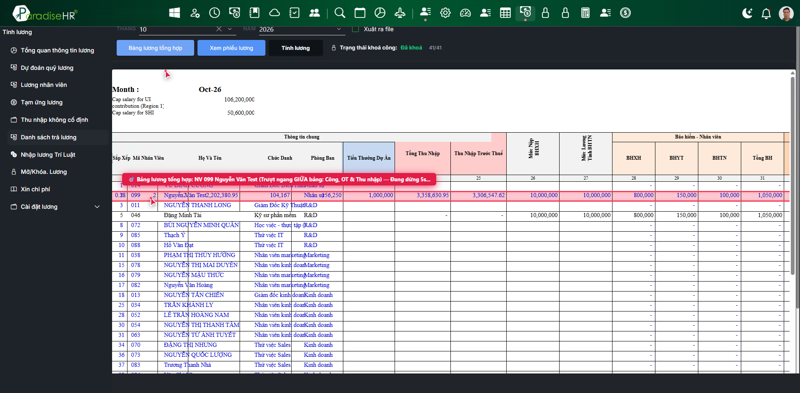

##### 🔹 Bước 6: Bang luong tong hop - Truot ngang cuoi phai NV 099
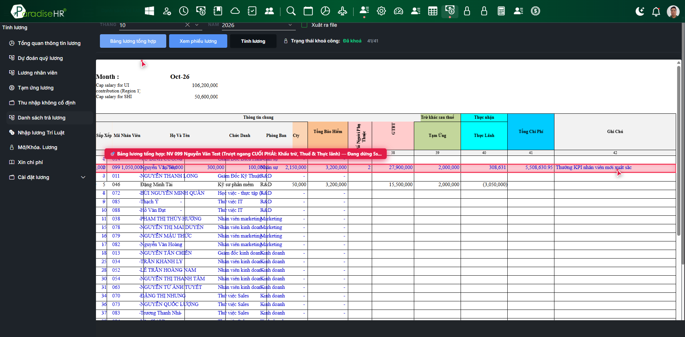

##### 🔹 Bước 7: Phieu luong trang 82 - Khoanh vung thong tin NV 099
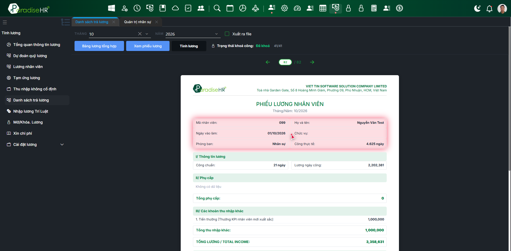

##### 🔹 Bước 8: Phieu luong trang 82 - Khoanh vung Thuc lanh NV 099
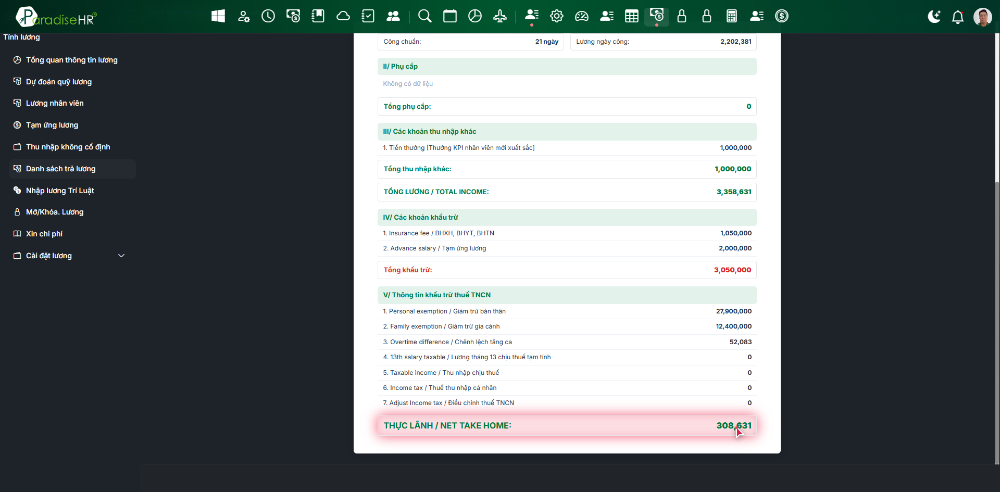

##### 🔹 Bước 9: Dang xuat khoi tai khoan Chien nguyen thanh cong


#### 🎥 Video & Dấu vết kiểm thử (Video & Trace):
- **Video phiên chạy thực tế**: [video.webm](TC-18/videos/video.webm)

---

### TC-19: fix-8 | TC-19: Replay Nhân viên test.nv mở Phiếu lương, cuộn từng mục & khoanh vùng pause 5s (Role: test.nv)

* **Trạng thái thực thi Test (Kỹ thuật)**: ✅ PASS (Thời gian thực thi: `65.62s`)
* **Trạng thái Logic Nghiệp vụ (Business Output)**: ✅ PASS
* **Đánh giá tổng quát**: Đạt yêu cầu logic nghiệp vụ mong đợi
* **Thư mục lưu trữ**: `test-evidence/quy_trinh_tinh_luong_nv_moi/TC-19/`

#### 📸 Bằng chứng trực quan từng bước (Step-by-Step Evidence):

##### 🔹 Bước 1: Dang nhap tai khoan nhan vien test nv
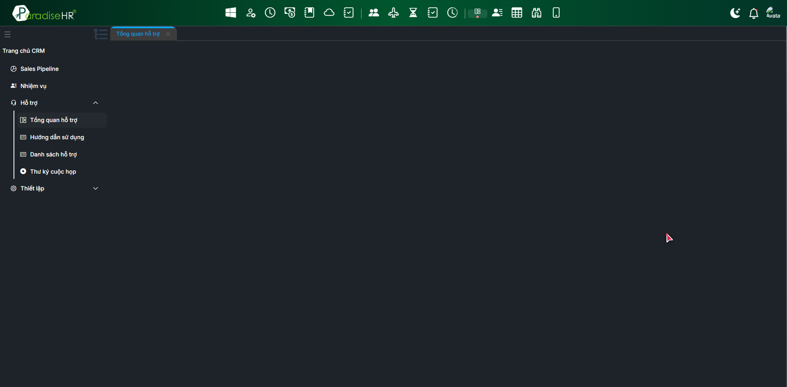

##### 🔹 Bước 2: Mo man hinh Phieu luong MnuPRL445 qua Launchpad


##### 🔹 Bước 3: Khoanh vung 5s Thong tin nhan vien 099


##### 🔹 Bước 4: Scroll + Khoanh vung 5s Muc I Thong tin luong


##### 🔹 Bước 5: Scroll + Khoanh vung 5s Thu nhap khac va Tong thu nhap


##### 🔹 Bước 6: Scroll + Khoanh vung 5s Cac khoan giam tru


##### 🔹 Bước 7: Scroll + Khoanh vung 5s Luong thuc lanh


#### 🎥 Video & Dấu vết kiểm thử (Video & Trace):
- **Video phiên chạy thực tế**: [video.webm](TC-19/videos/video.webm)

---

### TC-20: fix-8 | TC-20: Replay Nhân viên test.nv mở Tab Lịch sử, bấm Xem & mở/khoanh vùng 5s 3 Modal chi tiết (Role: test.nv)

* **Trạng thái thực thi Test (Kỹ thuật)**: ✅ PASS (Thời gian thực thi: `65.50s`)
* **Trạng thái Logic Nghiệp vụ (Business Output)**: ✅ PASS
* **Đánh giá tổng quát**: Đạt yêu cầu logic nghiệp vụ mong đợi
* **Thư mục lưu trữ**: `test-evidence/quy_trinh_tinh_luong_nv_moi/TC-20/`

#### 📸 Bằng chứng trực quan từng bước (Step-by-Step Evidence):

##### 🔹 Bước 1: Dang nhap test nv va mo man hinh Phieu luong


##### 🔹 Bước 2: Tab Lich Su - Khoanh vung 5s ky luong 10/2026


##### 🔹 Bước 3: Bam nut Xem tu Lich Su quay ve Phieu luong


##### 🔹 Bước 4: Modal Tang ca - Khoanh vung 5s quan sat chi tiet


##### 🔹 Bước 5: Modal Di tre Ve som - Khoanh vung 5s quan sat chi tiet


##### 🔹 Bước 6: Modal Ngay nghi - Khoanh vung 5s quan sat chi tiet


#### 🎥 Video & Dấu vết kiểm thử (Video & Trace):
- **Video phiên chạy thực tế**: [video.webm](TC-20/videos/video.webm)

---

