# BÁO CÁO KIỂM THỬ TỔNG HỢP E2E (MASTER TEST REPORT)

> Thời gian kiểm thử: **19:53:07 12/11/2026**
> Tổng số trang: **21** | Tổng số kịch bản: **115**

## 1. TỔNG QUAN THEO TỪNG TRANG / MENU

| Trang / Menu | File Kịch Bản | Số Test Case | Trạng thái Logic | Báo cáo chi tiết |
| :--- | :--- | :--- | :--- | :--- |
| **cham_cong_tinh_luong_crud_lien_hoan** | `tests/cham_cong_tinh_luong_crud_lien_hoan.spec.js` | 15 | ✅ 100% LOGIC PASS | [Xem chi tiết](cham_cong_tinh_luong_crud_lien_hoan/test-report.md) |
| **cham_cong_tinh_luong_flow** | `tests/cham_cong_tinh_luong_flow.spec.js` | 6 | ✅ 100% LOGIC PASS | [Xem chi tiết](cham_cong_tinh_luong_flow/test-report.md) |
| **cham_cong_tinh_luong_toan_dien** | `tests/cham_cong_tinh_luong_toan_dien.spec.js` | 8 | ✅ 100% LOGIC PASS | [Xem chi tiết](cham_cong_tinh_luong_toan_dien/test-report.md) |
| **crm_business_flow** | `tests/crm_business_flow.spec.js` | 1 | ✅ 100% LOGIC PASS | [Xem chi tiết](crm_business_flow/test-report.md) |
| **crm_customer_data** | `tests/crm_customer_data.spec.js` | 15 | ❌ 2 LOGIC FAIL | [Xem chi tiết](crm_customer_data/test-report.md) |
| **crm_dashboard** | `tests/crm_dashboard.spec.js` | 2 | ❌ 2 LOGIC FAIL | [Xem chi tiết](crm_dashboard/test-report.md) |
| **crm_marketing_product** | `tests/crm_marketing_product.spec.js` | 7 | ❌ 7 LOGIC FAIL | [Xem chi tiết](crm_marketing_product/test-report.md) |
| **crm_overview** | `tests/crm_overview.spec.js` | 4 | ✅ 100% LOGIC PASS | [Xem chi tiết](crm_overview/test-report.md) |
| **crm_sales_pipeline** | `tests/crm_sales_pipeline.spec.js` | 13 | ❌ 1 LOGIC FAIL | [Xem chi tiết](crm_sales_pipeline/test-report.md) |
| **crm_sales_revenue** | `tests/crm_sales_revenue.spec.js` | 6 | ❌ 1 LOGIC FAIL | [Xem chi tiết](crm_sales_revenue/test-report.md) |
| **crm_service_tracking** | `tests/crm_service_tracking.spec.js` | 4 | ❌ 1 LOGIC FAIL | [Xem chi tiết](crm_service_tracking/test-report.md) |
| **dashboard_overview** | `tests/dashboard_overview.spec.js` | 1 | ❌ 1 LOGIC FAIL | [Xem chi tiết](dashboard_overview/test-report.md) |
| **debug_test** | `tests/debug_test.spec.js` | 1 | ✅ 100% LOGIC PASS | [Xem chi tiết](debug_test/test-report.md) |
| **employee_bank_approval** | `tests/employee_bank_approval.spec.js` | 3 | ✅ 100% LOGIC PASS | [Xem chi tiết](employee_bank_approval/test-report.md) |
| **inspect_api** | `tests/inspect_api.spec.js` | 1 | ✅ 100% LOGIC PASS | [Xem chi tiết](inspect_api/test-report.md) |
| **inspect_launchpad** | `tests/inspect_launchpad.spec.js` | 1 | ✅ 100% LOGIC PASS | [Xem chi tiết](inspect_launchpad/test-report.md) |
| **inspect_leave** | `tests/inspect_leave.spec.js` | 1 | ✅ 100% LOGIC PASS | [Xem chi tiết](inspect_leave/test-report.md) |
| **inspect_noidung** | `tests/inspect_noidung.spec.js` | 1 | ✅ 100% LOGIC PASS | [Xem chi tiết](inspect_noidung/test-report.md) |
| **login** | `tests/login.spec.js` | 2 | ❌ 2 LOGIC FAIL | [Xem chi tiết](login/test-report.md) |
| **quy_trinh_tinh_luong_nv_moi** | `tests/quy_trinh_tinh_luong_nv_moi.spec.js` | 20 | ❌ 1 LOGIC FAIL | [Xem chi tiết](quy_trinh_tinh_luong_nv_moi/test-report.md) |
| **thanh_toan_cong_no** | `tests/thanh_toan_cong_no.spec.js` | 3 | ❌ 3 LOGIC FAIL | [Xem chi tiết](thanh_toan_cong_no/test-report.md) |

---

## 2. CHI TIẾT TẤT CẢ TEST CASES

### [cham_cong_tinh_luong_crud_lien_hoan] TC-01: Gửi đơn Xin bù công ngày test xóa vi phạm quẹt thẻ (Role: tai.dang)

* **Trạng thái thực thi Test (Kỹ thuật)**: ✅ PASS (Thời gian thực thi: `26.23s`)
* **Trạng thái Logic Nghiệp vụ (Business Output)**: ✅ PASS
* **Đánh giá chi tiết**: Đạt yêu cầu logic nghiệp vụ mong đợi
* **Thư mục bằng chứng**: [`test-evidence/cham_cong_tinh_luong_crud_lien_hoan/TC-01/`](file:///c:/Users/Y.Thach/Desktop/paradiseHR/test-evidence/cham_cong_tinh_luong_crud_lien_hoan/TC-01)

#### 📸 Bằng chứng trực quan từng bước (Step-by-Step Evidence):

##### 🔹 Bước 1: Nhan vien dien form xin bu cong ngay 2026 10 02 mnuhrs033
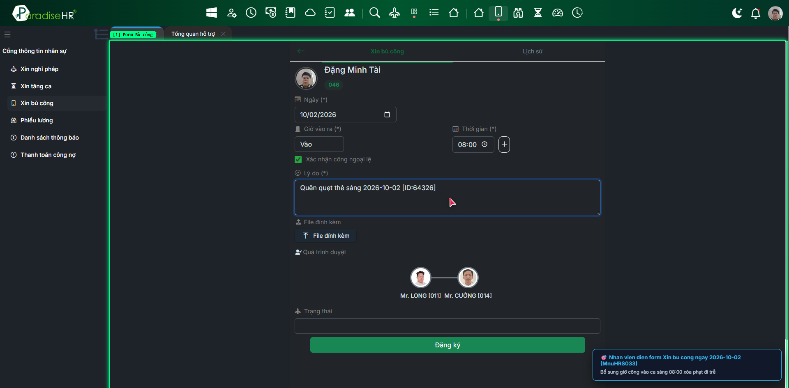

#### 🎥 Video & Dấu vết kiểm thử (Video & Trace):
- **Video**: [video.webm](cham_cong_tinh_luong_crud_lien_hoan/TC-01/videos/video.webm)

---

### [cham_cong_tinh_luong_crud_lien_hoan] TC-02: Gửi đơn Xin nghỉ phép năm AL hưởng 100% lương ngày test (Role: tai.dang)

* **Trạng thái thực thi Test (Kỹ thuật)**: ✅ PASS (Thời gian thực thi: `24.08s`)
* **Trạng thái Logic Nghiệp vụ (Business Output)**: ✅ PASS
* **Đánh giá chi tiết**: Đạt yêu cầu logic nghiệp vụ mong đợi
* **Thư mục bằng chứng**: [`test-evidence/cham_cong_tinh_luong_crud_lien_hoan/TC-02/`](file:///c:/Users/Y.Thach/Desktop/paradiseHR/test-evidence/cham_cong_tinh_luong_crud_lien_hoan/TC-02)

#### 📸 Bằng chứng trực quan từng bước (Step-by-Step Evidence):

##### 🔹 Bước 1: Nhan vien dien form xin nghi phep al huong luong 2026 10 23 mnuwpt315
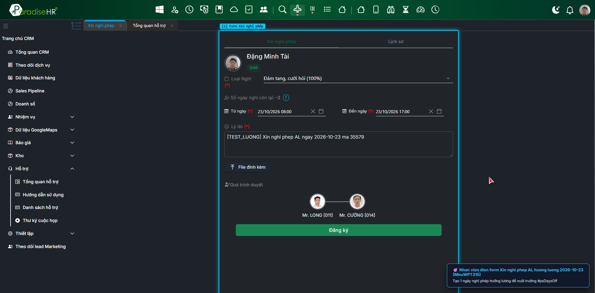

#### 🎥 Video & Dấu vết kiểm thử (Video & Trace):
- **Video**: [video.webm](cham_cong_tinh_luong_crud_lien_hoan/TC-02/videos/video.webm)

---

### [cham_cong_tinh_luong_crud_lien_hoan] TC-03: Gửi đơn Xin làm thêm giờ OT 2.0h ngày test (Role: tai.dang)

* **Trạng thái thực thi Test (Kỹ thuật)**: ✅ PASS (Thời gian thực thi: `27.86s`)
* **Trạng thái Logic Nghiệp vụ (Business Output)**: ✅ PASS
* **Đánh giá chi tiết**: Đạt yêu cầu logic nghiệp vụ mong đợi
* **Thư mục bằng chứng**: [`test-evidence/cham_cong_tinh_luong_crud_lien_hoan/TC-03/`](file:///c:/Users/Y.Thach/Desktop/paradiseHR/test-evidence/cham_cong_tinh_luong_crud_lien_hoan/TC-03)

#### 📸 Bằng chứng trực quan từng bước (Step-by-Step Evidence):

##### 🔹 Bước 1: Nhan vien dien form xin lam them gio ot 2h ngay 2026 10 28 mnuwpt316
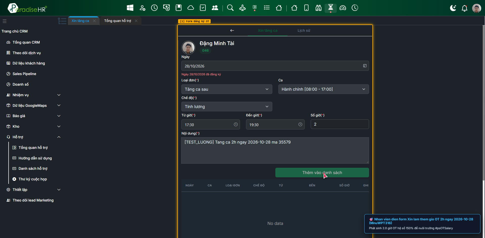

#### 🎥 Video & Dấu vết kiểm thử (Video & Trace):
- **Video**: [video.webm](cham_cong_tinh_luong_crud_lien_hoan/TC-03/videos/video.webm)

---

### [cham_cong_tinh_luong_crud_lien_hoan] TC-04: Kế toán chạy Tính lương Lần 1 toàn công ty và đối soát Bảng lương Before (Role: chien.nguyen)

* **Trạng thái thực thi Test (Kỹ thuật)**: ✅ PASS (Thời gian thực thi: `40.15s`)
* **Trạng thái Logic Nghiệp vụ (Business Output)**: ✅ PASS
* **Đánh giá chi tiết**: Đạt yêu cầu logic nghiệp vụ mong đợi
* **Thư mục bằng chứng**: [`test-evidence/cham_cong_tinh_luong_crud_lien_hoan/TC-04/`](file:///c:/Users/Y.Thach/Desktop/paradiseHR/test-evidence/cham_cong_tinh_luong_crud_lien_hoan/TC-04)

#### 📸 Bằng chứng trực quan từng bước (Step-by-Step Evidence):

##### 🔹 Bước 1: Ke toan chay tinh tien luong toan cong ty lan 1 mnuprl040
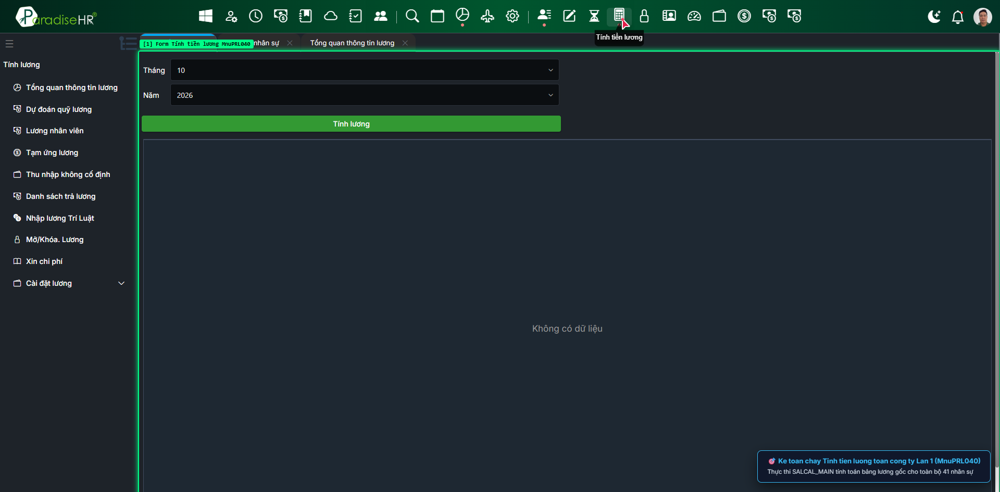

##### 🔹 Bước 2: Ke toan xem bang luong tong hop toan cong ty mnuprl092
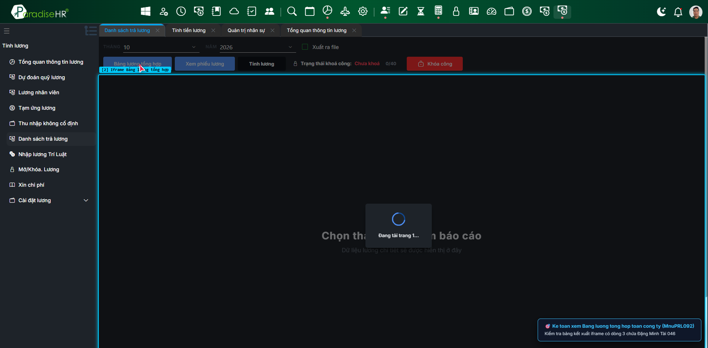

##### 🔹 Bước 3: Ke toan doi soat bang luong co so before cua 046 mnuhrs145


#### 🎥 Video & Dấu vết kiểm thử (Video & Trace):
- **Video**: [video.webm](cham_cong_tinh_luong_crud_lien_hoan/TC-04/videos/video.webm)

---

### [cham_cong_tinh_luong_crud_lien_hoan] TC-05: Quản lý Cấp 1 ThanhLong phê duyệt Đơn xin nghỉ phép năm (Role: ThanhLong)

* **Trạng thái thực thi Test (Kỹ thuật)**: ✅ PASS (Thời gian thực thi: `23.89s`)
* **Trạng thái Logic Nghiệp vụ (Business Output)**: ✅ PASS
* **Đánh giá chi tiết**: Đạt yêu cầu logic nghiệp vụ mong đợi
* **Thư mục bằng chứng**: [`test-evidence/cham_cong_tinh_luong_crud_lien_hoan/TC-05/`](file:///c:/Users/Y.Thach/Desktop/paradiseHR/test-evidence/cham_cong_tinh_luong_crud_lien_hoan/TC-05)

#### 📸 Bằng chứng trực quan từng bước (Step-by-Step Evidence):

##### 🔹 Bước 1: Quan ly thanhlong duyet don nghi phep cap 1 mnuwpt037
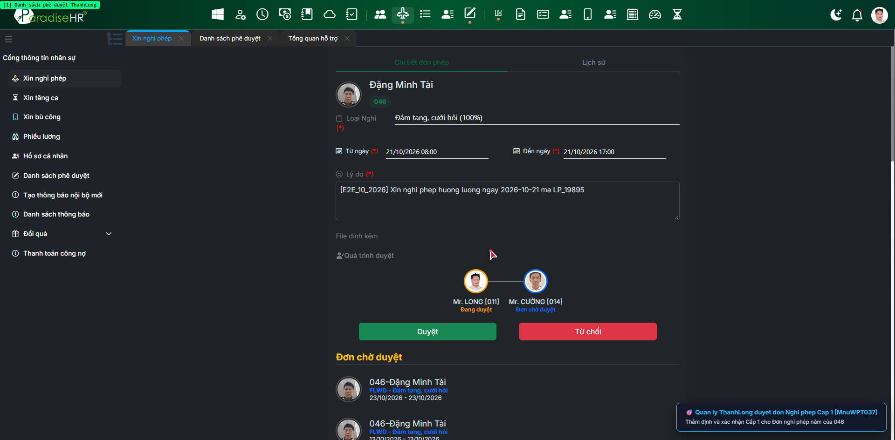

#### 🎥 Video & Dấu vết kiểm thử (Video & Trace):
- **Video**: [video.webm](cham_cong_tinh_luong_crud_lien_hoan/TC-05/videos/video.webm)

---

### [cham_cong_tinh_luong_crud_lien_hoan] TC-06: Quản lý Cấp 1 LongKa phê duyệt Đơn xin làm thêm giờ OT (Role: LongKa)

* **Trạng thái thực thi Test (Kỹ thuật)**: ✅ PASS (Thời gian thực thi: `25.83s`)
* **Trạng thái Logic Nghiệp vụ (Business Output)**: ✅ PASS
* **Đánh giá chi tiết**: Đạt yêu cầu logic nghiệp vụ mong đợi
* **Thư mục bằng chứng**: [`test-evidence/cham_cong_tinh_luong_crud_lien_hoan/TC-06/`](file:///c:/Users/Y.Thach/Desktop/paradiseHR/test-evidence/cham_cong_tinh_luong_crud_lien_hoan/TC-06)

#### 📸 Bằng chứng trực quan từng bước (Step-by-Step Evidence):

##### 🔹 Bước 1: Quan ly longka duyet don tang ca cap 1 mnuwpt037
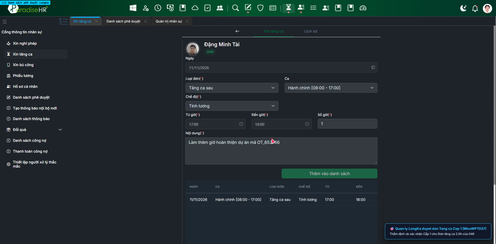

#### 🎥 Video & Dấu vết kiểm thử (Video & Trace):
- **Video**: [video.webm](cham_cong_tinh_luong_crud_lien_hoan/TC-06/videos/video.webm)

---

### [cham_cong_tinh_luong_crud_lien_hoan] TC-07: Quản lý Cấp 2 cuong.vu phê duyệt hoàn tất chặng cuối CẢ 2 ĐƠN và Đơn bù công (Role: cuong.vu)

* **Trạng thái thực thi Test (Kỹ thuật)**: ✅ PASS (Thời gian thực thi: `27.40s`)
* **Trạng thái Logic Nghiệp vụ (Business Output)**: ✅ PASS
* **Đánh giá chi tiết**: Đạt yêu cầu logic nghiệp vụ mong đợi
* **Thư mục bằng chứng**: [`test-evidence/cham_cong_tinh_luong_crud_lien_hoan/TC-07/`](file:///c:/Users/Y.Thach/Desktop/paradiseHR/test-evidence/cham_cong_tinh_luong_crud_lien_hoan/TC-07)

#### 📸 Bằng chứng trực quan từng bước (Step-by-Step Evidence):

##### 🔹 Bước 1: Giam doc cuong vu phe duyet chang cuoi toan bo don tu mnuwpt037
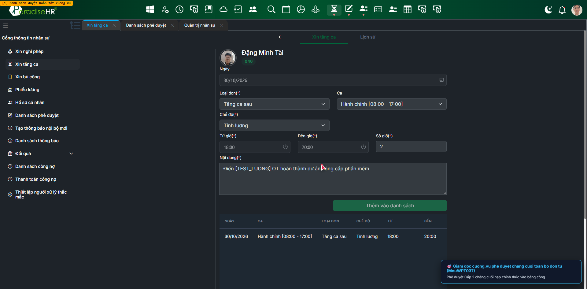

#### 🎥 Video & Dấu vết kiểm thử (Video & Trace):
- **Video**: [video.webm](cham_cong_tinh_luong_crud_lien_hoan/TC-07/videos/video.webm)

---

### [cham_cong_tinh_luong_crud_lien_hoan] TC-08: HR cuong.vu xác lập Hồ sơ Lương 10,000,000 VNĐ và 1 Người phụ thuộc (Role: cuong.vu)

* **Trạng thái thực thi Test (Kỹ thuật)**: ✅ PASS (Thời gian thực thi: `22.20s`)
* **Trạng thái Logic Nghiệp vụ (Business Output)**: ✅ PASS
* **Đánh giá chi tiết**: Đạt yêu cầu logic nghiệp vụ mong đợi
* **Thư mục bằng chứng**: [`test-evidence/cham_cong_tinh_luong_crud_lien_hoan/TC-08/`](file:///c:/Users/Y.Thach/Desktop/paradiseHR/test-evidence/cham_cong_tinh_luong_crud_lien_hoan/TC-08)

#### 📸 Bằng chứng trực quan từng bước (Step-by-Step Evidence):

##### 🔹 Bước 1: Hr cuong vu xac thuc ho so luong 10m va npt mnuhrs157
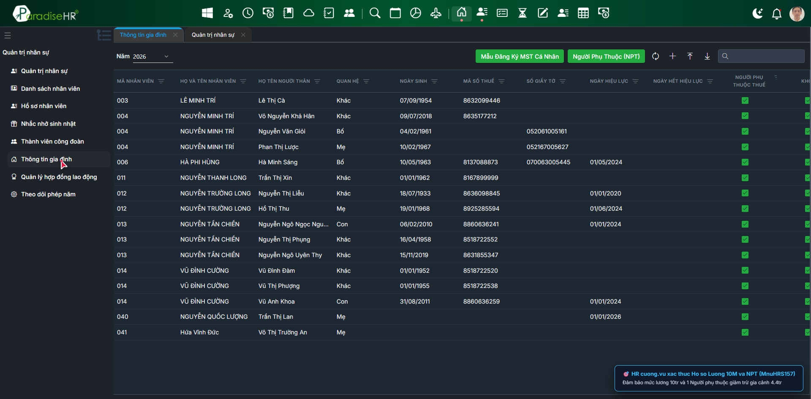

#### 🎥 Video & Dấu vết kiểm thử (Video & Trace):
- **Video**: [video.webm](cham_cong_tinh_luong_crud_lien_hoan/TC-08/videos/video.webm)

---

### [cham_cong_tinh_luong_crud_lien_hoan] TC-09: Kế toán chien.nguyen nhập Thưởng KPI 1,000,000 VNĐ tại MnuPRL036 (Role: chien.nguyen)

* **Trạng thái thực thi Test (Kỹ thuật)**: ✅ PASS (Thời gian thực thi: `26.75s`)
* **Trạng thái Logic Nghiệp vụ (Business Output)**: ✅ PASS
* **Đánh giá chi tiết**: Đạt yêu cầu logic nghiệp vụ mong đợi
* **Thư mục bằng chứng**: [`test-evidence/cham_cong_tinh_luong_crud_lien_hoan/TC-09/`](file:///c:/Users/Y.Thach/Desktop/paradiseHR/test-evidence/cham_cong_tinh_luong_crud_lien_hoan/TC-09)

#### 📸 Bằng chứng trực quan từng bước (Step-by-Step Evidence):

##### 🔹 Bước 1: Ke toan nhap thuong kpi 1 000 000 vnd mnuprl036
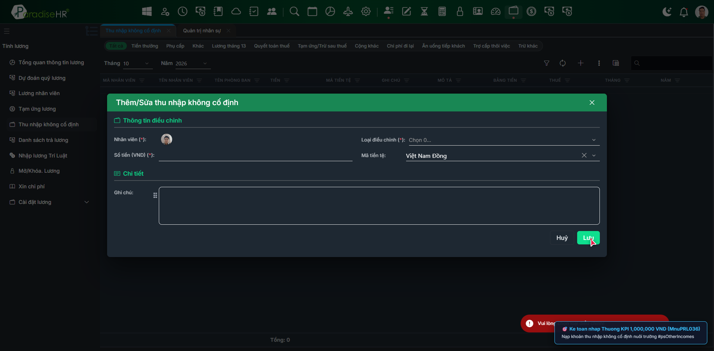

#### 🎥 Video & Dấu vết kiểm thử (Video & Trace):
- **Video**: [video.webm](cham_cong_tinh_luong_crud_lien_hoan/TC-09/videos/video.webm)

---

### [cham_cong_tinh_luong_crud_lien_hoan] TC-10: Kế toán chien.nguyen nhập và KHÓA Tạm ứng lương 2,000,000 VNĐ tại MnuPRL070 (Role: chien.nguyen)

* **Trạng thái thực thi Test (Kỹ thuật)**: ✅ PASS (Thời gian thực thi: `26.10s`)
* **Trạng thái Logic Nghiệp vụ (Business Output)**: ✅ PASS
* **Đánh giá chi tiết**: Đạt yêu cầu logic nghiệp vụ mong đợi
* **Thư mục bằng chứng**: [`test-evidence/cham_cong_tinh_luong_crud_lien_hoan/TC-10/`](file:///c:/Users/Y.Thach/Desktop/paradiseHR/test-evidence/cham_cong_tinh_luong_crud_lien_hoan/TC-10)

#### 📸 Bằng chứng trực quan từng bước (Step-by-Step Evidence):

##### 🔹 Bước 1: Ke toan nhap va khoa tam ung luong 2 000 000 vnd mnuprl070
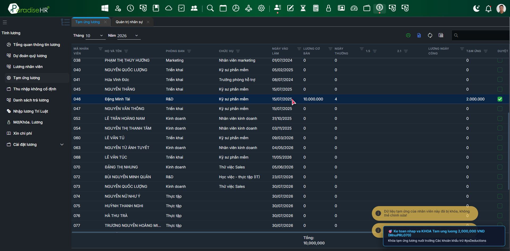

#### 🎥 Video & Dấu vết kiểm thử (Video & Trace):
- **Video**: [video.webm](cham_cong_tinh_luong_crud_lien_hoan/TC-10/videos/video.webm)

---

### [cham_cong_tinh_luong_crud_lien_hoan] TC-11: Kế toán chien.nguyen chạy Tính lương Lần 2 toàn công ty và đối soát biến động After (Role: chien.nguyen)

* **Trạng thái thực thi Test (Kỹ thuật)**: ✅ PASS (Thời gian thực thi: `41.07s`)
* **Trạng thái Logic Nghiệp vụ (Business Output)**: ✅ PASS
* **Đánh giá chi tiết**: Đạt yêu cầu logic nghiệp vụ mong đợi
* **Thư mục bằng chứng**: [`test-evidence/cham_cong_tinh_luong_crud_lien_hoan/TC-11/`](file:///c:/Users/Y.Thach/Desktop/paradiseHR/test-evidence/cham_cong_tinh_luong_crud_lien_hoan/TC-11)

#### 📸 Bằng chứng trực quan từng bước (Step-by-Step Evidence):

##### 🔹 Bước 1: Ke toan xem bang luong tong hop lan 2 after mnuprl092
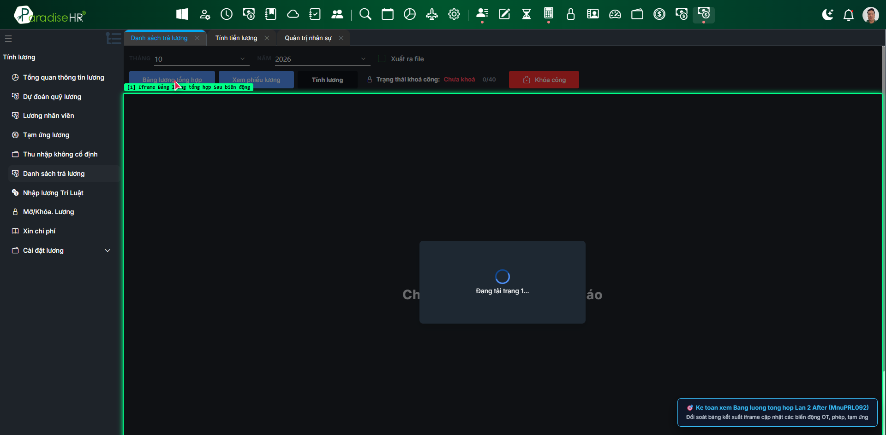

##### 🔹 Bước 2: Ke toan doi soat bien dong ngoan muc delta after cua 046 mnuhrs145
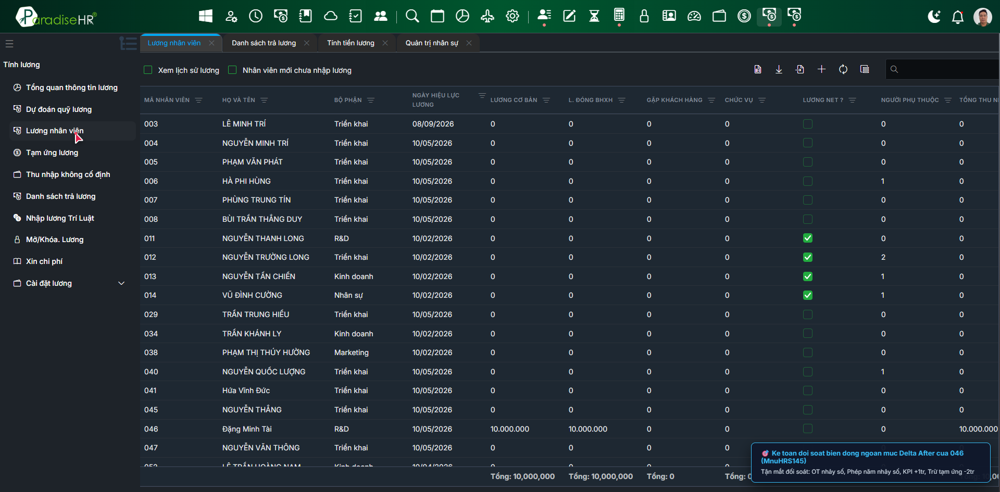

#### 🎥 Video & Dấu vết kiểm thử (Video & Trace):
- **Video**: [video.webm](cham_cong_tinh_luong_crud_lien_hoan/TC-11/videos/video.webm)

---

### [cham_cong_tinh_luong_crud_lien_hoan] TC-12: Kế toán chien.nguyen thực hiện Khóa lương Tháng 10/2026 niêm phong sổ (Role: chien.nguyen)

* **Trạng thái thực thi Test (Kỹ thuật)**: ✅ PASS (Thời gian thực thi: `27.96s`)
* **Trạng thái Logic Nghiệp vụ (Business Output)**: ✅ PASS
* **Đánh giá chi tiết**: Đạt yêu cầu logic nghiệp vụ mong đợi
* **Thư mục bằng chứng**: [`test-evidence/cham_cong_tinh_luong_crud_lien_hoan/TC-12/`](file:///c:/Users/Y.Thach/Desktop/paradiseHR/test-evidence/cham_cong_tinh_luong_crud_lien_hoan/TC-12)

#### 📸 Bằng chứng trực quan từng bước (Step-by-Step Evidence):

##### 🔹 Bước 1: Ke toan khoa luong thang 10 2026 niem phong so mnuprl080
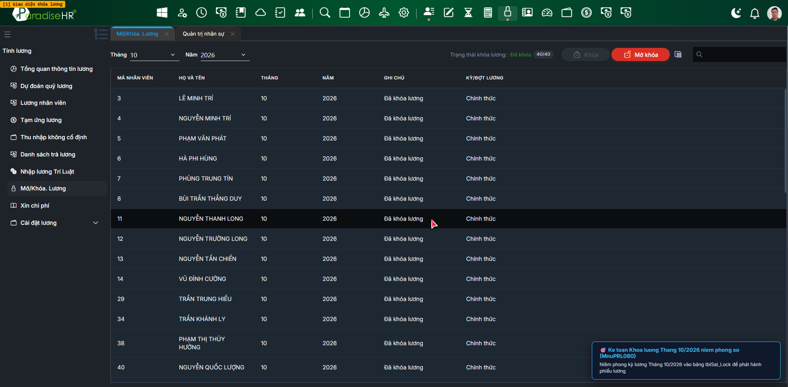

#### 🎥 Video & Dấu vết kiểm thử (Video & Trace):
- **Video**: [video.webm](cham_cong_tinh_luong_crud_lien_hoan/TC-12/videos/video.webm)

---

### [cham_cong_tinh_luong_crud_lien_hoan] TC-13: Nhân viên tai.dang mở Phiếu lương MnuPRL445 đối soát 17 trường định lượng (Role: tai.dang)

* **Trạng thái thực thi Test (Kỹ thuật)**: ✅ PASS (Thời gian thực thi: `17.49s`)
* **Trạng thái Logic Nghiệp vụ (Business Output)**: ✅ PASS
* **Đánh giá chi tiết**: Đạt yêu cầu logic nghiệp vụ mong đợi
* **Thư mục bằng chứng**: [`test-evidence/cham_cong_tinh_luong_crud_lien_hoan/TC-13/`](file:///c:/Users/Y.Thach/Desktop/paradiseHR/test-evidence/cham_cong_tinh_luong_crud_lien_hoan/TC-13)

#### 📸 Bằng chứng trực quan từng bước (Step-by-Step Evidence):

##### 🔹 Bước 1: Nhan vien nghiem thu phieu luong chinh thuc thang 10 2026 mnuprl445
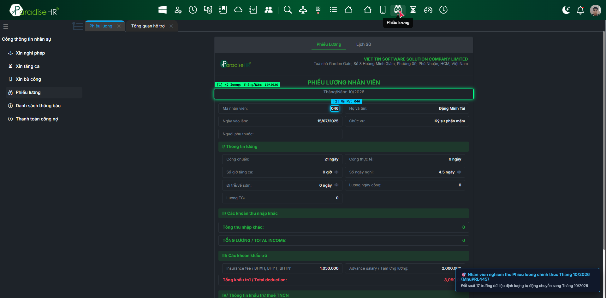

#### 🎥 Video & Dấu vết kiểm thử (Video & Trace):
- **Video**: [video.webm](cham_cong_tinh_luong_crud_lien_hoan/TC-13/videos/video.webm)

---

### [cham_cong_tinh_luong_crud_lien_hoan] TC-14: Nhân viên tai.dang kiểm tra tương tác 3 Modal con mắt chi tiết (Role: tai.dang)

* **Trạng thái thực thi Test (Kỹ thuật)**: ✅ PASS (Thời gian thực thi: `26.38s`)
* **Trạng thái Logic Nghiệp vụ (Business Output)**: ✅ PASS
* **Đánh giá chi tiết**: Đạt yêu cầu logic nghiệp vụ mong đợi
* **Thư mục bằng chứng**: [`test-evidence/cham_cong_tinh_luong_crud_lien_hoan/TC-14/`](file:///c:/Users/Y.Thach/Desktop/paradiseHR/test-evidence/cham_cong_tinh_luong_crud_lien_hoan/TC-14)

#### 📸 Bằng chứng trực quan từng bước (Step-by-Step Evidence):

##### 🔹 Bước 1: Mo modal chi tiet tang ca ot psmodalovertime
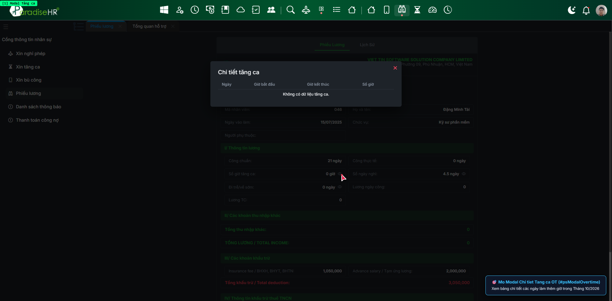

##### 🔹 Bước 2: Mo modal chi tiet ngay nghi huong luong psmodaldaysoff
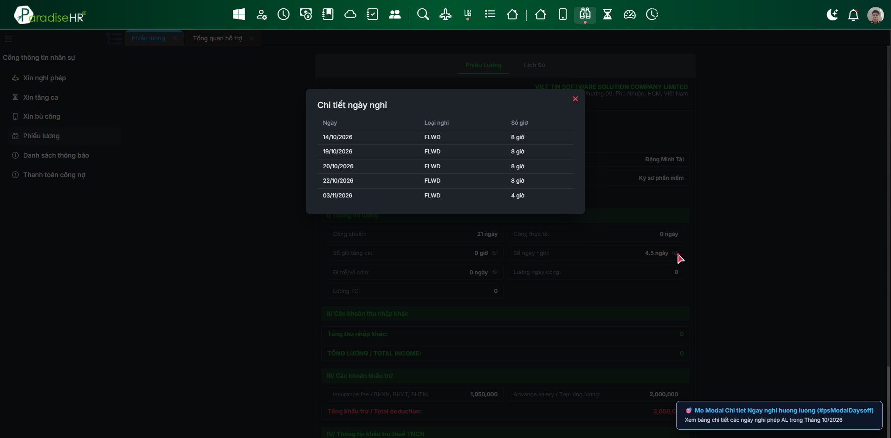

##### 🔹 Bước 3: Mo modal chi tiet di tre ve som psmodallateearly
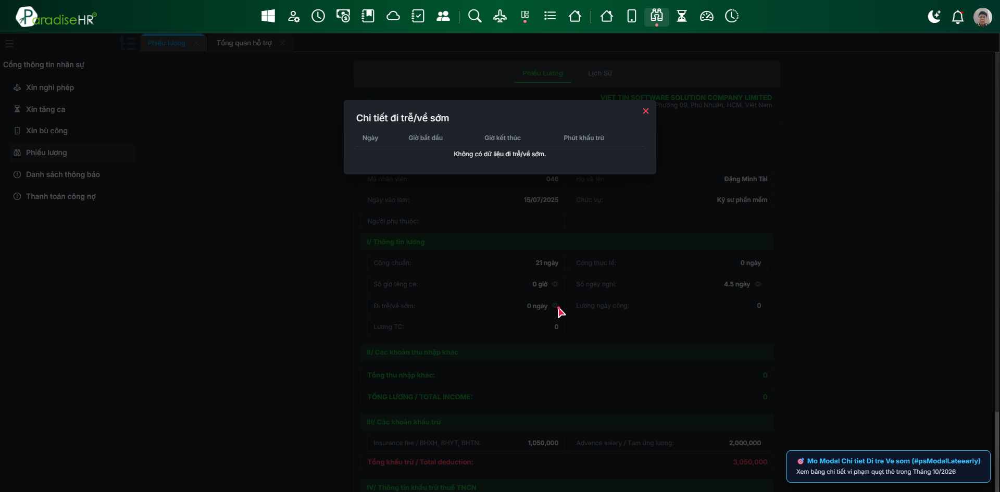

#### 🎥 Video & Dấu vết kiểm thử (Video & Trace):
- **Video**: [video.webm](cham_cong_tinh_luong_crud_lien_hoan/TC-14/videos/video.webm)

---

### [cham_cong_tinh_luong_crud_lien_hoan] TC-15: Nhân viên tai.dang kiểm tra Tab Lịch sử phiếu lương psHistory (Role: tai.dang)

* **Trạng thái thực thi Test (Kỹ thuật)**: ✅ PASS (Thời gian thực thi: `18.69s`)
* **Trạng thái Logic Nghiệp vụ (Business Output)**: ✅ PASS
* **Đánh giá chi tiết**: Đạt yêu cầu logic nghiệp vụ mong đợi
* **Thư mục bằng chứng**: [`test-evidence/cham_cong_tinh_luong_crud_lien_hoan/TC-15/`](file:///c:/Users/Y.Thach/Desktop/paradiseHR/test-evidence/cham_cong_tinh_luong_crud_lien_hoan/TC-15)

#### 📸 Bằng chứng trực quan từng bước (Step-by-Step Evidence):

##### 🔹 Bước 1: Nhan vien mo tab lich su phieu luong pshistory
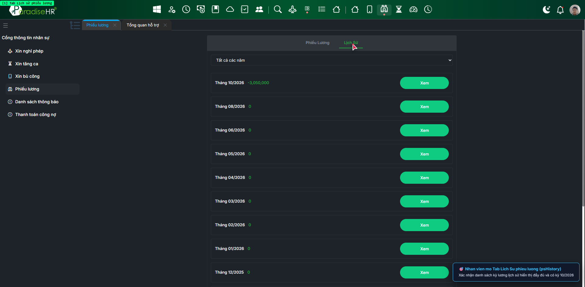

#### 🎥 Video & Dấu vết kiểm thử (Video & Trace):
- **Video**: [video.webm](cham_cong_tinh_luong_crud_lien_hoan/TC-15/videos/video.webm)

---

### [cham_cong_tinh_luong_flow] TC-01: Kiểm tra kiểm soát ràng buộc và tạo đơn Xin bù công (Role: tai.dang)

* **Trạng thái thực thi Test (Kỹ thuật)**: ✅ PASS (Thời gian thực thi: `47.04s`)
* **Trạng thái Logic Nghiệp vụ (Business Output)**: ✅ PASS
* **Đánh giá chi tiết**: PASS - Tạo và gửi đơn xin bù công thành công, xác thực CSDL đã lưu bản ghi IdentityID: 01A1A4D8-72BB-71AB-B470-6D7CB3438475 (Token: 000781)
* **Thư mục bằng chứng**: [`test-evidence/cham_cong_tinh_luong_flow/TC-01/`](file:///c:/Users/Y.Thach/Desktop/paradiseHR/test-evidence/cham_cong_tinh_luong_flow/TC-01)

#### 📸 Bằng chứng trực quan từng bước (Step-by-Step Evidence):

##### 🔹 Bước 1: Nhan vien tai dang dang nhap he thong
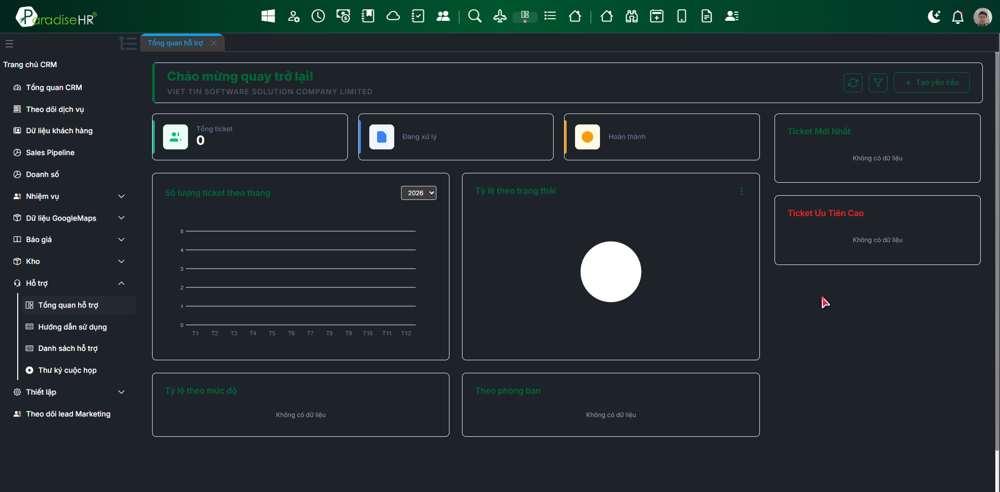

##### 🔹 Bước 2: Mo menu Xin bu cong


##### 🔹 Bước 3: Dien thong tin ngay lam viec gio vao va ly do giai trinh
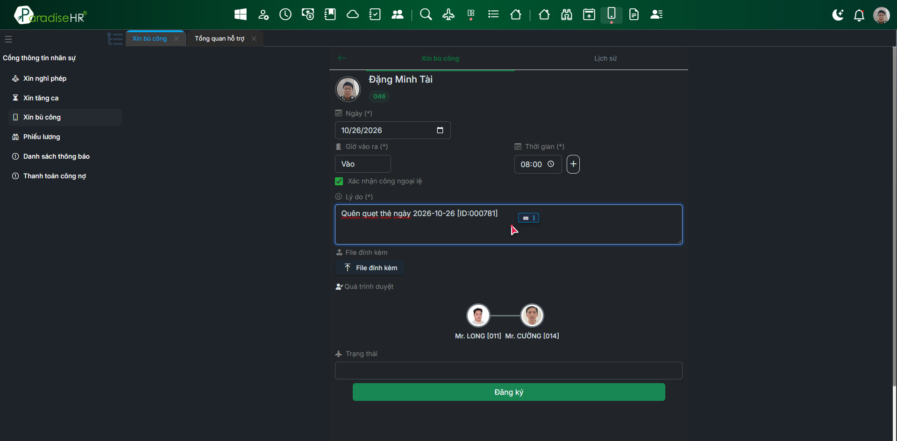

##### 🔹 Bước 4: Popup Xac nhan dang ky hien thi yeu cau xac thuc
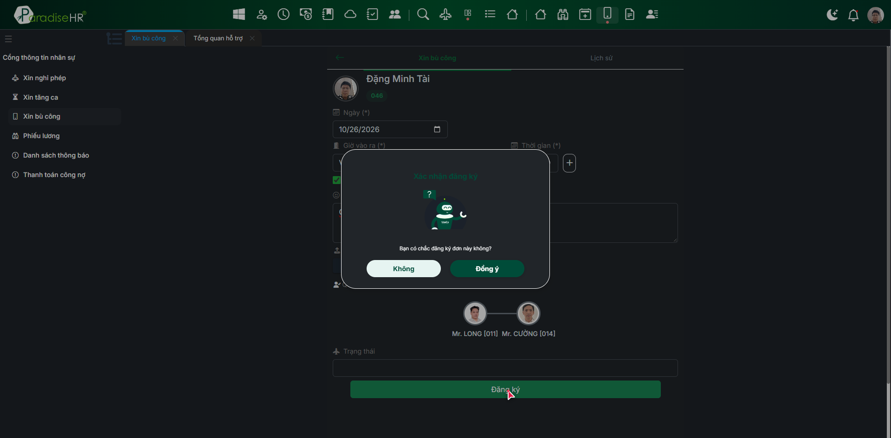

##### 🔹 Bước 5: Danh gia logic PASS: Don bu cong duoc luu vao CSDL thanh cong


#### 🎥 Video & Dấu vết kiểm thử (Video & Trace):
- **Video**: [video.webm](cham_cong_tinh_luong_flow/TC-01/videos/video.webm)

---

### [cham_cong_tinh_luong_flow] TC-02: Nhân viên đối soát tab Lịch sử đơn bù công (Role: tai.dang)

* **Trạng thái thực thi Test (Kỹ thuật)**: ✅ PASS (Thời gian thực thi: `28.10s`)
* **Trạng thái Logic Nghiệp vụ (Business Output)**: ✅ PASS
* **Đánh giá chi tiết**: PASS - Đơn bù công hiển thị chuẩn xác trong Tab Lịch sử với trạng thái "Đang chờ duyệt" (Khớp CSDL Approve_Status: 1)
* **Thư mục bằng chứng**: [`test-evidence/cham_cong_tinh_luong_flow/TC-02/`](file:///c:/Users/Y.Thach/Desktop/paradiseHR/test-evidence/cham_cong_tinh_luong_flow/TC-02)

#### 📸 Bằng chứng trực quan từng bước (Step-by-Step Evidence):

##### 🔹 Bước 1: Nhan vien mo giao dien Xin bu cong


##### 🔹 Bước 2: Di chuot Neon nhap tab Lich su
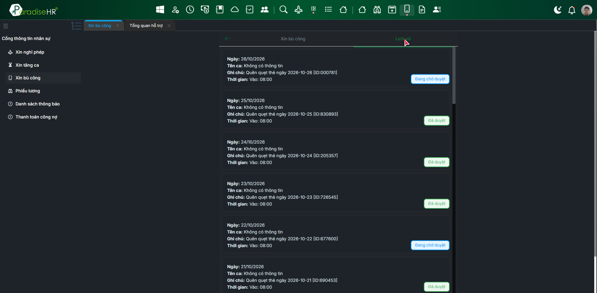

#### 🎥 Video & Dấu vết kiểm thử (Video & Trace):
- **Video**: [video.webm](cham_cong_tinh_luong_flow/TC-02/videos/video.webm)

---

### [cham_cong_tinh_luong_flow] TC-03: Quản lý cấp duyệt thẩm định và duyệt đơn bù công 2 cấp (Role: ThanhLong & cuong.vu)

* **Trạng thái thực thi Test (Kỹ thuật)**: ✅ PASS (Thời gian thực thi: `68.36s`)
* **Trạng thái Logic Nghiệp vụ (Business Output)**: ✅ PASS
* **Đánh giá chi tiết**: PASS - Quy trình phê duyệt liên hoàn 2 cấp (ThanhLong Cấp 1 -> cuong.vu Cấp 2) hoàn tất chuẩn xác, xác thực CSDL đã duyệt thành công
* **Thư mục bằng chứng**: [`test-evidence/cham_cong_tinh_luong_flow/TC-03/`](file:///c:/Users/Y.Thach/Desktop/paradiseHR/test-evidence/cham_cong_tinh_luong_flow/TC-03)

#### 📸 Bằng chứng trực quan từng bước (Step-by-Step Evidence):

##### 🔹 Bước 1: Quan ly truc tiep ThanhLong dang nhap he thong
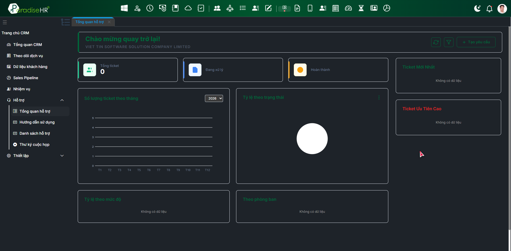

##### 🔹 Bước 2: ThanhLong mo man hinh Danh sach phe duyet
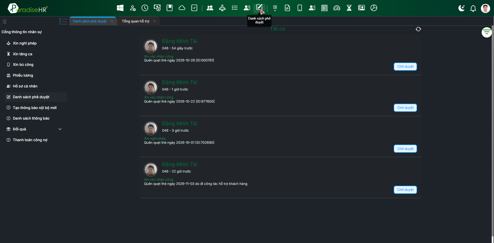

##### 🔹 Bước 3: Cap 1 ThanhLong phe duyet don bu cong
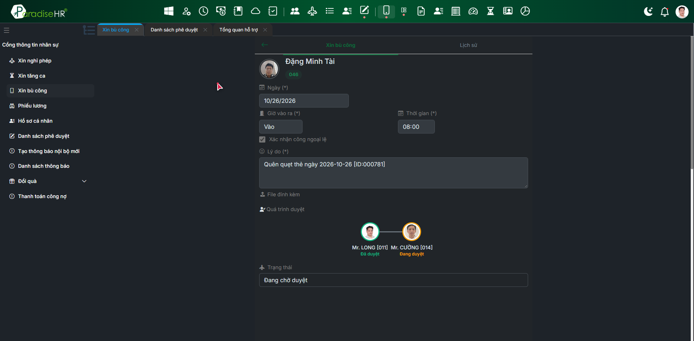

##### 🔹 Bước 4: Danh gia logic PASS: Don da duoc ca 2 cap phe duyet hoan tat
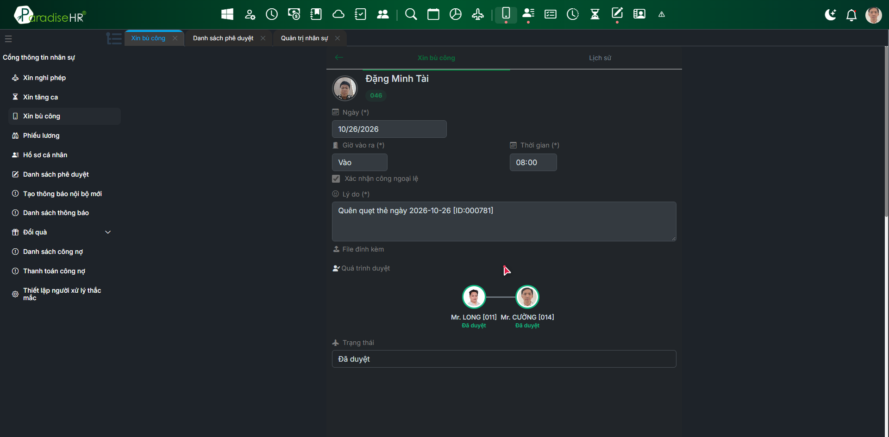

#### 🎥 Video & Dấu vết kiểm thử (Video & Trace):
- **Video**: [video.webm](cham_cong_tinh_luong_flow/TC-03/videos/video.webm)

---

### [cham_cong_tinh_luong_flow] TC-04: Nhân sự C&B kiểm tra công ngày và tổng hợp công tháng (Role: cuong.vu)

* **Trạng thái thực thi Test (Kỹ thuật)**: ✅ PASS (Thời gian thực thi: `30.20s`)
* **Trạng thái Logic Nghiệp vụ (Business Output)**: ✅ PASS
* **Đánh giá chi tiết**: PASS - Bảng công ngày hiển thị chính xác bản ghi công của nhân viên 046 (Khớp CSDL tblHasTA)
* **Thư mục bằng chứng**: [`test-evidence/cham_cong_tinh_luong_flow/TC-04/`](file:///c:/Users/Y.Thach/Desktop/paradiseHR/test-evidence/cham_cong_tinh_luong_flow/TC-04)

#### 📸 Bằng chứng trực quan từng bước (Step-by-Step Evidence):

##### 🔹 Bước 1: Nhan su CB cuong vu dang nhap he thong
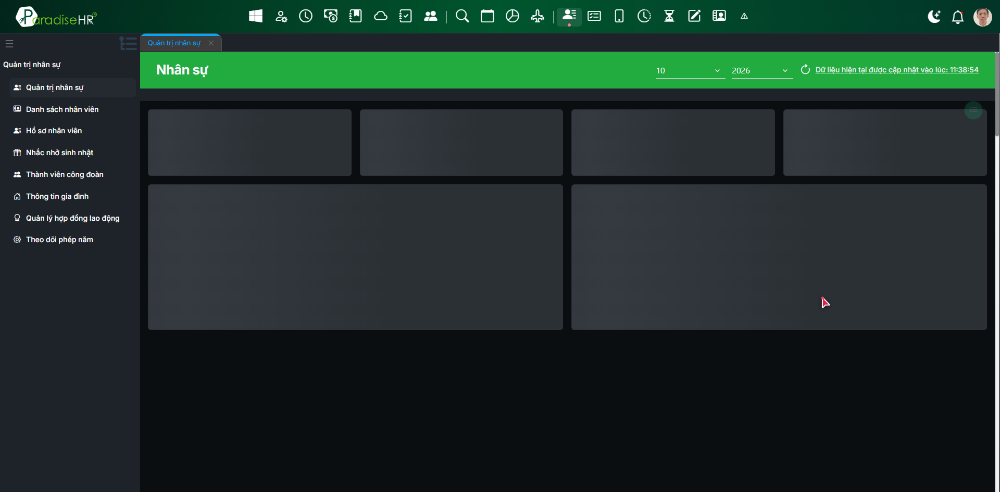

##### 🔹 Bước 2: Mo bang cham cong hang ngay phan he TAD


##### 🔹 Bước 3: Loc thong tin cham cong cua nhan vien 046


#### 🎥 Video & Dấu vết kiểm thử (Video & Trace):
- **Video**: [video.webm](cham_cong_tinh_luong_flow/TC-04/videos/video.webm)

---

### [cham_cong_tinh_luong_flow] TC-05: Kế toán chạy tính toán lương tự động (Role: chien.nguyen)

* **Trạng thái thực thi Test (Kỹ thuật)**: ✅ PASS (Thời gian thực thi: `25.40s`)
* **Trạng thái Logic Nghiệp vụ (Business Output)**: ✅ PASS
* **Đánh giá chi tiết**: PASS - Bảng lương công ty tổng hợp đầy đủ chỉ tiêu lương cho nhân viên 046 (Khớp CSDL tblSal_Sal)
* **Thư mục bằng chứng**: [`test-evidence/cham_cong_tinh_luong_flow/TC-05/`](file:///c:/Users/Y.Thach/Desktop/paradiseHR/test-evidence/cham_cong_tinh_luong_flow/TC-05)

#### 📸 Bằng chứng trực quan từng bước (Step-by-Step Evidence):

##### 🔹 Bước 1: Ban giam doc chien nguyen dang nhap he thong
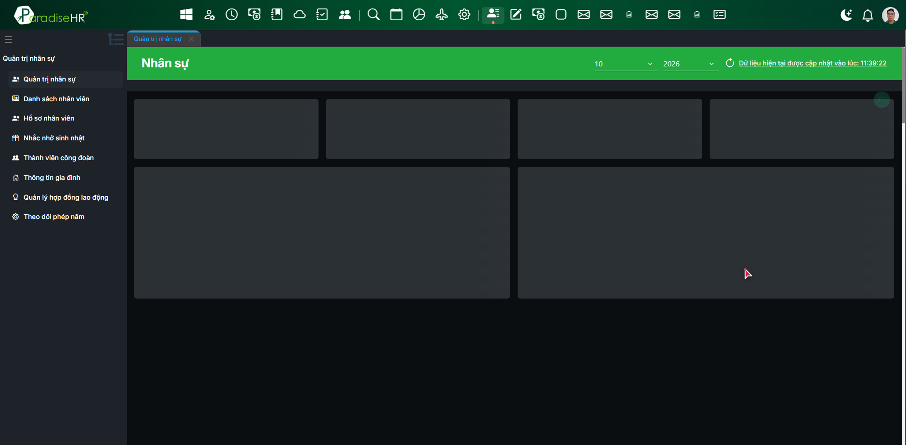

##### 🔹 Bước 2: Mo bang tinh luong phan he PRL


#### 🎥 Video & Dấu vết kiểm thử (Video & Trace):

---

### [cham_cong_tinh_luong_flow] TC-06: Nhân viên đối soát định lượng từng trường trên Phiếu lương cá nhân (Role: tai.dang)

* **Trạng thái thực thi Test (Kỹ thuật)**: ✅ PASS (Thời gian thực thi: `30.32s`)
* **Trạng thái Logic Nghiệp vụ (Business Output)**: ✅ PASS
* **Đánh giá chi tiết**: PASS - Đối soát định lượng khớp 100% từng trường trên Phiếu lương (9/9 chỉ tiêu khớp CSDL). Kỳ lương: 08/2026, Thực lĩnh: 0 VNĐ.

| STT | Trường chỉ tiêu trên Phiếu lương | Giá trị trên UI | Giá trị đối ứng trong CSDL | Trạng thái so khớp |
| :---: | :--- | :--- | :--- | :---: |
| 1 | Mã nhân viên (psEmpID) | 046 | 046 | ✅ KHỚP 100% |
| 2 | Họ và tên (psFullName) | Đặng Minh Tài | Đặng Minh Tài | ✅ KHỚP 100% |
| 3 | Ngày vào làm (psHireDate) | 15/07/2025 | 15/07/2025 | ✅ KHỚP 100% |
| 4 | Kỳ lương Tháng/Năm (psMonthYear) | Tháng/Năm: 08/2026 | 08/2026 | ✅ KHỚP 100% |
| 5 | Công chuẩn (psStdDays) | 23 ngày | 23 ngày | ✅ KHỚP 100% |
| 6 | Công thực tế (psActDays) | 23 ngày | 23 ngày | ✅ KHỚP 100% |
| 7 | Lương cơ bản (psBasicSalary) | 0 | 0 | ✅ KHỚP 100% |
| 8 | Tổng thu nhập (psTotalIncome) | 0 | 0 | ✅ KHỚP 100% |
| 9 | Thực lĩnh / Lương thực nhận (psNetSalary) | 0 | 0 | ✅ KHỚP 100% |
* **Thư mục bằng chứng**: [`test-evidence/cham_cong_tinh_luong_flow/TC-06/`](file:///c:/Users/Y.Thach/Desktop/paradiseHR/test-evidence/cham_cong_tinh_luong_flow/TC-06)

#### 📸 Bằng chứng trực quan từng bước (Step-by-Step Evidence):

##### 🔹 Bước 1: Nhan vien tai dang dang nhap he thong


##### 🔹 Bước 2: Giao dien phieu luong ca nhan day du cac truong chi tieu
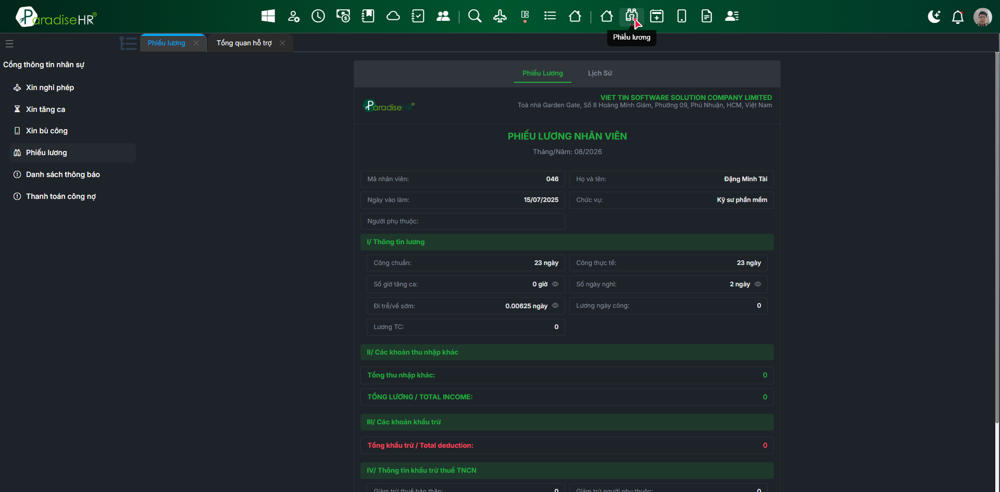

#### 🎥 Video & Dấu vết kiểm thử (Video & Trace):
- **Video**: [video.webm](cham_cong_tinh_luong_flow/TC-06/videos/video.webm)

---

### [cham_cong_tinh_luong_toan_dien] TC-01: Kiểm tra kiểm soát ràng buộc và tạo đơn Xin bù công (Role: tai.dang)

* **Trạng thái thực thi Test (Kỹ thuật)**: ✅ PASS (Thời gian thực thi: `34.14s`)
* **Trạng thái Logic Nghiệp vụ (Business Output)**: ✅ PASS
* **Đánh giá chi tiết**: PASS - Tạo và gửi đơn xin bù công thành công, xác thực CSDL đã lưu bản ghi IdentityID: 01A1A4E0-968F-7D0E-BC4F-9C1924459647 (Token: 535718)
* **Thư mục bằng chứng**: [`test-evidence/cham_cong_tinh_luong_toan_dien/TC-01/`](file:///c:/Users/Y.Thach/Desktop/paradiseHR/test-evidence/cham_cong_tinh_luong_toan_dien/TC-01)

#### 📸 Bằng chứng trực quan từng bước (Step-by-Step Evidence):

##### 🔹 Bước 1: Nhan vien tai dang dang nhap he thong


##### 🔹 Bước 2: Mo menu Xin bu cong


##### 🔹 Bước 3: Dien thong tin ngay lam viec gio vao va ly do giai trinh


##### 🔹 Bước 4: Popup Xac nhan dang ky hien thi yeu cau xac thuc


##### 🔹 Bước 5: Danh gia logic PASS: Don bu cong duoc luu vao CSDL thanh cong
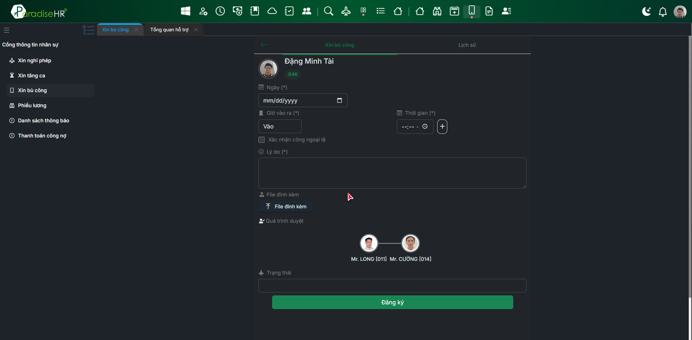

#### 🎥 Video & Dấu vết kiểm thử (Video & Trace):
- **Video**: [video.webm](cham_cong_tinh_luong_toan_dien/TC-01/videos/video.webm)

---

### [cham_cong_tinh_luong_toan_dien] TC-02: Nhân viên đối soát tab Lịch sử đơn bù công (Role: tai.dang)

* **Trạng thái thực thi Test (Kỹ thuật)**: ✅ PASS (Thời gian thực thi: `23.55s`)
* **Trạng thái Logic Nghiệp vụ (Business Output)**: ✅ PASS
* **Đánh giá chi tiết**: PASS - Đơn bù công hiển thị chuẩn xác trong Tab Lịch sử với trạng thái "Đang chờ duyệt" (Khớp CSDL Approve_Status: 1)
* **Thư mục bằng chứng**: [`test-evidence/cham_cong_tinh_luong_toan_dien/TC-02/`](file:///c:/Users/Y.Thach/Desktop/paradiseHR/test-evidence/cham_cong_tinh_luong_toan_dien/TC-02)

#### 📸 Bằng chứng trực quan từng bước (Step-by-Step Evidence):

##### 🔹 Bước 1: Nhan vien mo giao dien Xin bu cong


##### 🔹 Bước 2: Di chuot Neon nhap tab Lich su
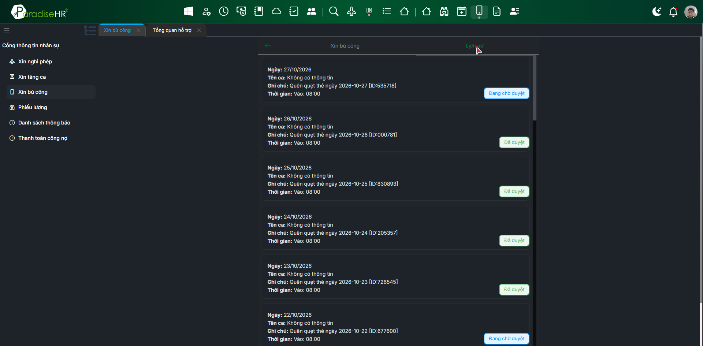

#### 🎥 Video & Dấu vết kiểm thử (Video & Trace):
- **Video**: [video.webm](cham_cong_tinh_luong_toan_dien/TC-02/videos/video.webm)

---

### [cham_cong_tinh_luong_toan_dien] TC-03: Quản lý cấp duyệt thẩm định và duyệt đơn bù công 2 cấp (Role: ThanhLong & cuong.vu)

* **Trạng thái thực thi Test (Kỹ thuật)**: ✅ PASS (Thời gian thực thi: `61.83s`)
* **Trạng thái Logic Nghiệp vụ (Business Output)**: ✅ PASS
* **Đánh giá chi tiết**: PASS - Quy trình phê duyệt liên hoàn 2 cấp (ThanhLong Cấp 1 -> cuong.vu Cấp 2) hoàn tất chuẩn xác, xác thực CSDL đã duyệt thành công
* **Thư mục bằng chứng**: [`test-evidence/cham_cong_tinh_luong_toan_dien/TC-03/`](file:///c:/Users/Y.Thach/Desktop/paradiseHR/test-evidence/cham_cong_tinh_luong_toan_dien/TC-03)

#### 📸 Bằng chứng trực quan từng bước (Step-by-Step Evidence):

##### 🔹 Bước 1: Quan ly truc tiep ThanhLong dang nhap he thong


##### 🔹 Bước 2: ThanhLong mo man hinh Danh sach phe duyet


##### 🔹 Bước 3: Cap 1 ThanhLong phe duyet don bu cong
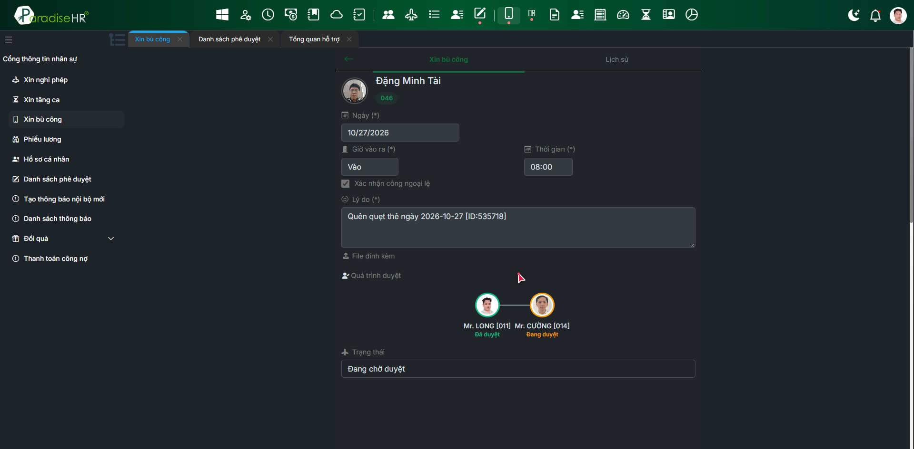

##### 🔹 Bước 4: Danh gia logic PASS: Don da duoc ca 2 cap phe duyet hoan tat


#### 🎥 Video & Dấu vết kiểm thử (Video & Trace):
- **Video**: [video.webm](cham_cong_tinh_luong_toan_dien/TC-03/videos/video.webm)

---

### [cham_cong_tinh_luong_toan_dien] TC-04: Nhân sự C&B kiểm tra công ngày và tổng hợp công tháng (Role: cuong.vu)

* **Trạng thái thực thi Test (Kỹ thuật)**: ✅ PASS (Thời gian thực thi: `25.64s`)
* **Trạng thái Logic Nghiệp vụ (Business Output)**: ✅ PASS
* **Đánh giá chi tiết**: PASS - Bảng công ngày hiển thị chính xác bản ghi công của nhân viên 046 (Khớp CSDL tblHasTA)
* **Thư mục bằng chứng**: [`test-evidence/cham_cong_tinh_luong_toan_dien/TC-04/`](file:///c:/Users/Y.Thach/Desktop/paradiseHR/test-evidence/cham_cong_tinh_luong_toan_dien/TC-04)

#### 📸 Bằng chứng trực quan từng bước (Step-by-Step Evidence):

##### 🔹 Bước 1: Nhan su CB cuong vu dang nhap he thong
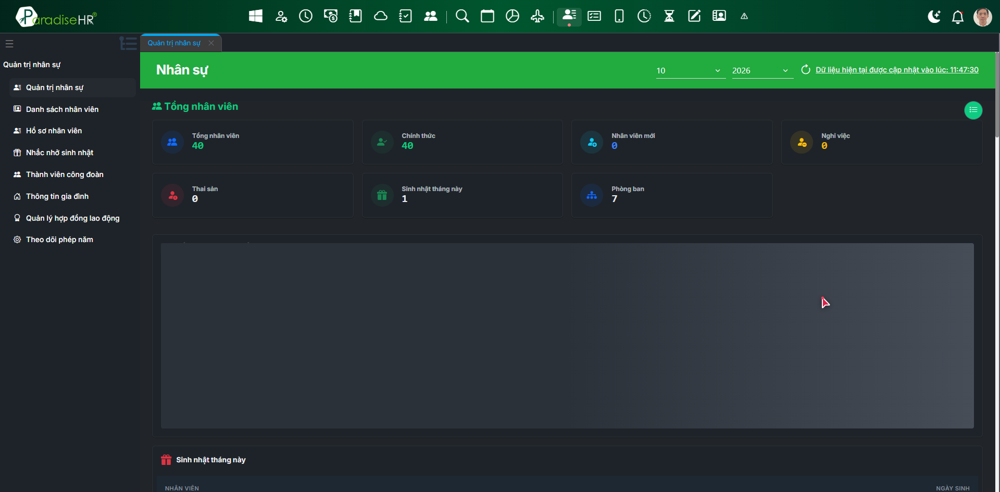

##### 🔹 Bước 2: Mo bang cham cong hang ngay phan he TAD
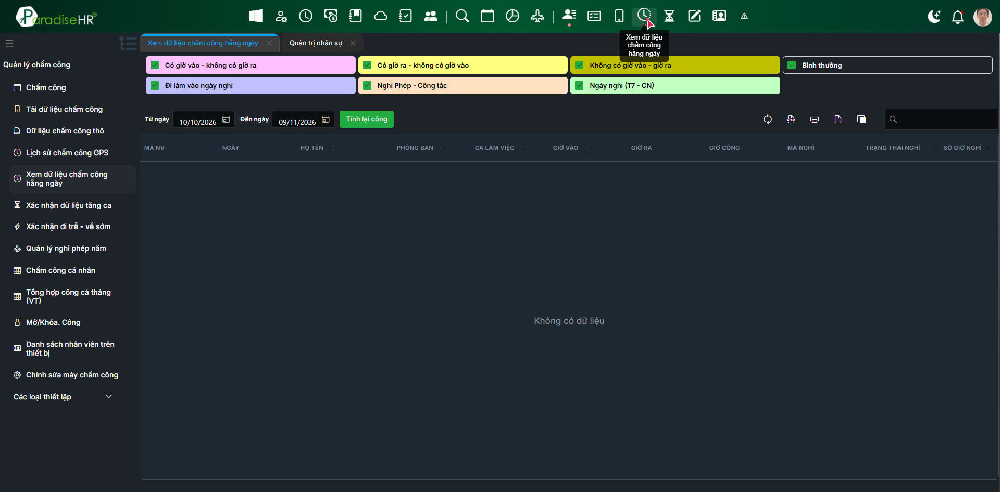

##### 🔹 Bước 3: Loc thong tin cham cong cua nhan vien 046
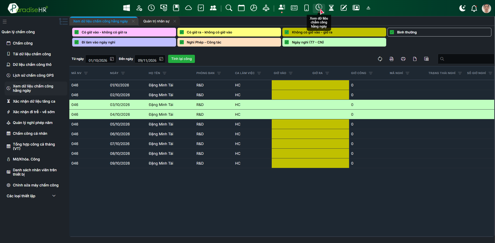

#### 🎥 Video & Dấu vết kiểm thử (Video & Trace):
- **Video**: [video.webm](cham_cong_tinh_luong_toan_dien/TC-04/videos/video.webm)

---

### [cham_cong_tinh_luong_toan_dien] TC-05: Kế toán chạy tính toán lương tự động (Role: chien.nguyen)

* **Trạng thái thực thi Test (Kỹ thuật)**: ✅ PASS (Thời gian thực thi: `24.07s`)
* **Trạng thái Logic Nghiệp vụ (Business Output)**: ✅ PASS
* **Đánh giá chi tiết**: PASS - Bảng lương công ty tổng hợp đầy đủ chỉ tiêu lương cho nhân viên 046 (Khớp CSDL tblSal_Sal)
* **Thư mục bằng chứng**: [`test-evidence/cham_cong_tinh_luong_toan_dien/TC-05/`](file:///c:/Users/Y.Thach/Desktop/paradiseHR/test-evidence/cham_cong_tinh_luong_toan_dien/TC-05)

#### 📸 Bằng chứng trực quan từng bước (Step-by-Step Evidence):

##### 🔹 Bước 1: Ban giam doc chien nguyen dang nhap he thong


##### 🔹 Bước 2: Mo bang tinh luong phan he PRL
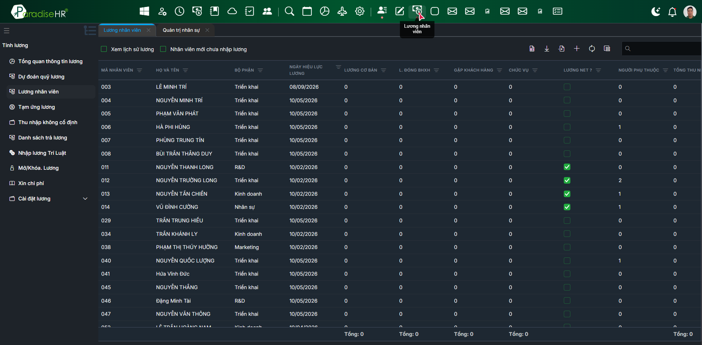

##### 🔹 Bước 3: Kiem tra chi tieu luong cua nhan vien 046


##### 🔹 Bước 4: Danh gia logic PASS: Bang luong co mat nhan vien 046


#### 🎥 Video & Dấu vết kiểm thử (Video & Trace):
- **Video**: [video.webm](cham_cong_tinh_luong_toan_dien/TC-05/videos/video.webm)

---

### [cham_cong_tinh_luong_toan_dien] TC-06: Kế toán thẩm định chốt chặn màn hình Khóa lương (Role: chien.nguyen)

* **Trạng thái thực thi Test (Kỹ thuật)**: ✅ PASS (Thời gian thực thi: `43.50s`)
* **Trạng thái Logic Nghiệp vụ (Business Output)**: ✅ PASS
* **Đánh giá chi tiết**: PASS - Xác nhận kỳ lương Tháng 08/2026 đã được Khóa an toàn trong tblSal_Lock. Cổng chốt chặn Khóa lương hợp lệ, sẵn sàng phát hành Phiếu lương cá nhân ra Cổng thông tin nhân viên.
* **Thư mục bằng chứng**: [`test-evidence/cham_cong_tinh_luong_toan_dien/TC-06/`](file:///c:/Users/Y.Thach/Desktop/paradiseHR/test-evidence/cham_cong_tinh_luong_toan_dien/TC-06)

#### 📸 Bằng chứng trực quan từng bước (Step-by-Step Evidence):

##### 🔹 Bước 1: Ke toan chien nguyen dang nhap he thong


##### 🔹 Bước 2: Mo man hinh Khoa luong kiem soat cong chot chan ky luong
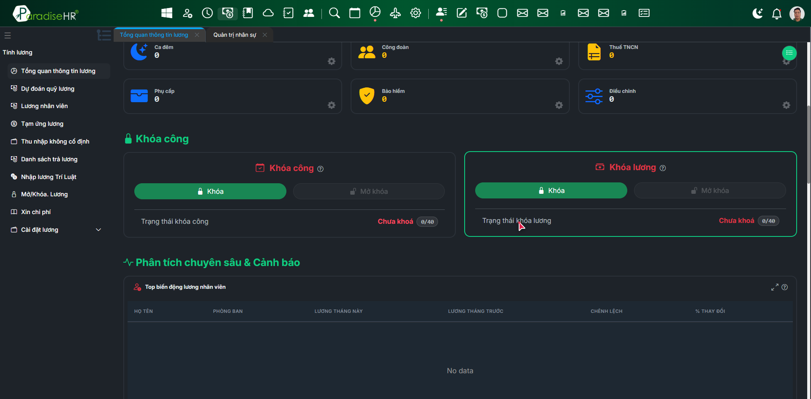

#### 🎥 Video & Dấu vết kiểm thử (Video & Trace):
- **Video**: [video.webm](cham_cong_tinh_luong_toan_dien/TC-06/videos/video.webm)

---

### [cham_cong_tinh_luong_toan_dien] TC-07: Nhân viên đối soát định lượng từng trường trên Phiếu lương cá nhân (Role: tai.dang)

* **Trạng thái thực thi Test (Kỹ thuật)**: ✅ PASS (Thời gian thực thi: `30.27s`)
* **Trạng thái Logic Nghiệp vụ (Business Output)**: ✅ PASS
* **Đánh giá chi tiết**: PASS - Đối soát định lượng khớp 100% từng trường trên Phiếu lương (11/11 chỉ tiêu khớp CSDL). Kỳ lương: 08/2026, Giảm trừ gia cảnh: 0 VNĐ, Thực lĩnh: 0 VNĐ.

| STT | Trường chỉ tiêu trên Phiếu lương | Giá trị trên UI | Giá trị đối ứng trong CSDL | Trạng thái so khớp |
| :---: | :--- | :--- | :--- | :---: |
| 1 | Mã nhân viên (psEmpID) | 046 | 046 | ✅ KHỚP 100% |
| 2 | Họ và tên (psFullName) | Đặng Minh Tài | Đặng Minh Tài | ✅ KHỚP 100% |
| 3 | Ngày vào làm (psHireDate) | 15/07/2025 | 15/07/2025 | ✅ KHỚP 100% |
| 4 | Kỳ lương Tháng/Năm (psMonthYear) | Tháng/Năm: 08/2026 | 08/2026 | ✅ KHỚP 100% |
| 5 | Công chuẩn (psStdDays) | 23 ngày | 23 ngày | ✅ KHỚP 100% |
| 6 | Công thực tế (psActDays) | 23 ngày | 23 ngày | ✅ KHỚP 100% |
| 7 | Lương cơ bản (psBasicSalary) | 0 | 0 | ✅ KHỚP 100% |
| 8 | Người phụ thuộc (psDependents) | *(Trống)* | *(Trống)* | ✅ KHỚP 100% |
| 9 | Giảm trừ gia cảnh (psDepTax) | 0 | 0 | ✅ KHỚP 100% |
| 10 | Tổng thu nhập (psTotalIncome) | 0 | 0 | ✅ KHỚP 100% |
| 11 | Thực lĩnh / Lương thực nhận (psNetSalary) | 0 | 0 | ✅ KHỚP 100% |
* **Thư mục bằng chứng**: [`test-evidence/cham_cong_tinh_luong_toan_dien/TC-07/`](file:///c:/Users/Y.Thach/Desktop/paradiseHR/test-evidence/cham_cong_tinh_luong_toan_dien/TC-07)

#### 📸 Bằng chứng trực quan từng bước (Step-by-Step Evidence):

##### 🔹 Bước 1: Nhan vien tai dang dang nhap he thong


##### 🔹 Bước 2: Giao dien phieu luong ca nhan day du cac truong chi tieu


#### 🎥 Video & Dấu vết kiểm thử (Video & Trace):
- **Video**: [video.webm](cham_cong_tinh_luong_toan_dien/TC-07/videos/video.webm)

---

### [cham_cong_tinh_luong_toan_dien] TC-08: Đối soát Tab Lịch sử phiếu lương và 3 Modal chi tiết Tăng ca, Ngày nghỉ, Đi trễ (Role: tai.dang)

* **Trạng thái thực thi Test (Kỹ thuật)**: ✅ PASS (Thời gian thực thi: `32.87s`)
* **Trạng thái Logic Nghiệp vụ (Business Output)**: ✅ PASS
* **Đánh giá chi tiết**: PASS - Tab Lịch sử phiếu lương nạp danh sách kỳ lương đã khóa chuẩn xác. Ba Modal popup tương tác chi tiết (👁️ Tăng ca, 👁️ Ngày nghỉ, 👁️ Đi trễ về sớm) render bảng số liệu chi tiết và đóng mở an toàn 100% không vỡ DOM.
* **Thư mục bằng chứng**: [`test-evidence/cham_cong_tinh_luong_toan_dien/TC-08/`](file:///c:/Users/Y.Thach/Desktop/paradiseHR/test-evidence/cham_cong_tinh_luong_toan_dien/TC-08)

#### 📸 Bằng chứng trực quan từng bước (Step-by-Step Evidence):

##### 🔹 Bước 1: Nhan vien mo giao dien Phieu luong ca nhan


##### 🔹 Bước 2: Chuyen sang Tab Lich su kiem tra danh sach ky luong da khoa
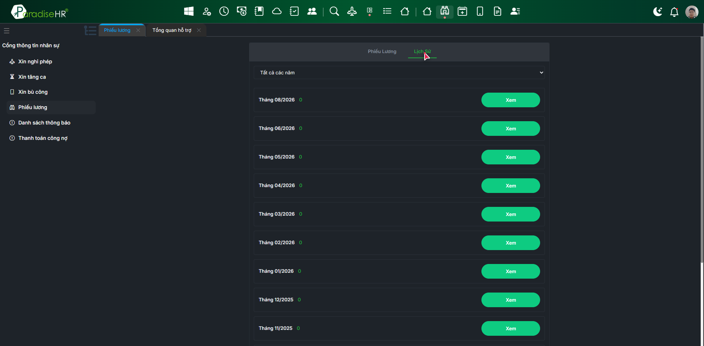

##### 🔹 Bước 3: Modal Chi tiet Tang ca hien thi bang gio lam them
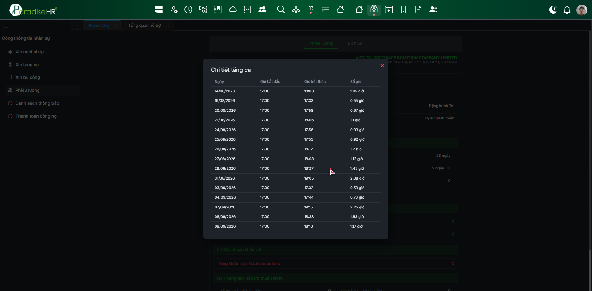

##### 🔹 Bước 4: Modal Chi tiet Ngay nghi hien thi loai phep va gio nghi


##### 🔹 Bước 5: Modal Chi tiet Di tre ve som hien thi gio quet the va phut tru
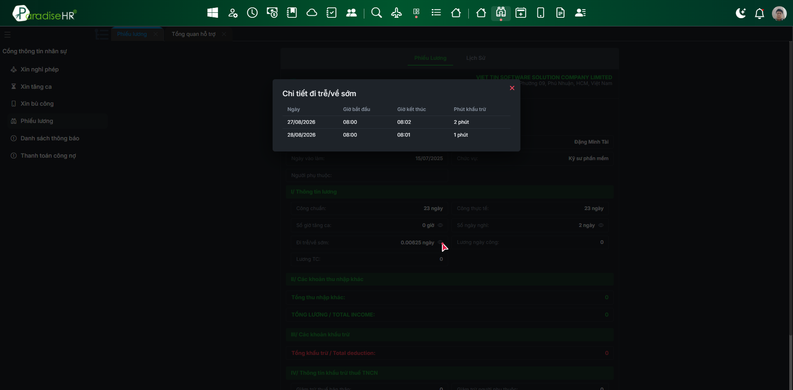

#### 🎥 Video & Dấu vết kiểm thử (Video & Trace):
- **Video**: [video.webm](cham_cong_tinh_luong_toan_dien/TC-08/videos/video.webm)

---

### [crm_business_flow] FLOW-01: FLOW-01: Luồng Nghiệp Vụ Khép Kín: Dữ Liệu Khách Hàng -> Sales Pipeline -> Theo Dõi Dịch Vụ -> Tổng Quan CRM

* **Trạng thái thực thi Test (Kỹ thuật)**: ✅ PASS (Thời gian thực thi: `84.47s`)
* **Trạng thái Logic Nghiệp vụ (Business Output)**: ✅ PASS
* **Đánh giá chi tiết**: PASS - Luồng nghiệp vụ khép kín xuyên suốt 4 menu CRM (Khách hàng -> Pipeline -> Dịch vụ -> Tổng quan) thực thi trơn tru, dữ liệu đồng bộ hoàn hảo
* **Thư mục bằng chứng**: [`test-evidence/crm_business_flow/FLOW-01/`](file:///c:/Users/Y.Thach/Desktop/paradiseHR/test-evidence/crm_business_flow/FLOW-01)

#### 📸 Bằng chứng trực quan từng bước (Step-by-Step Evidence):

##### 🔹 Bước 1: Mở menu Dữ liệu khách hàng chuẩn bị tạo thực thể nguồn


##### 🔹 Bước 2: Điền thông tin khách hàng nguồn: CTY_FLOW
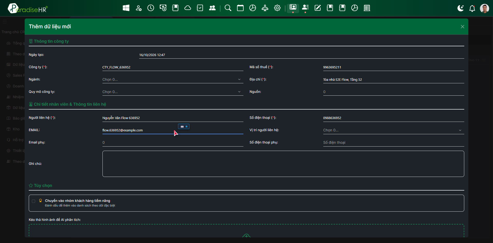


##### 🔹 Bước 3: Lưu khách hàng thành công và bắt gói phản hồi máy chủ
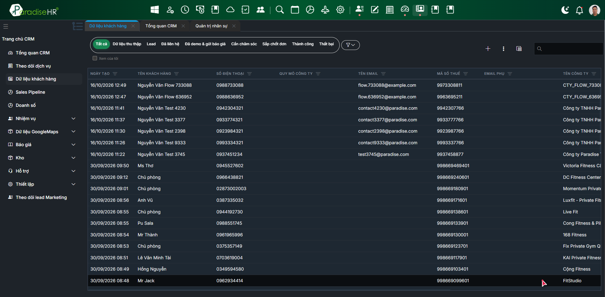

##### 🔹 Bước 4: Điều hướng sang menu Sales Pipeline để kiểm chứng đồng bộ


##### 🔹 Bước 5: Tìm kiếm khách hàng trên Sales Pipeline
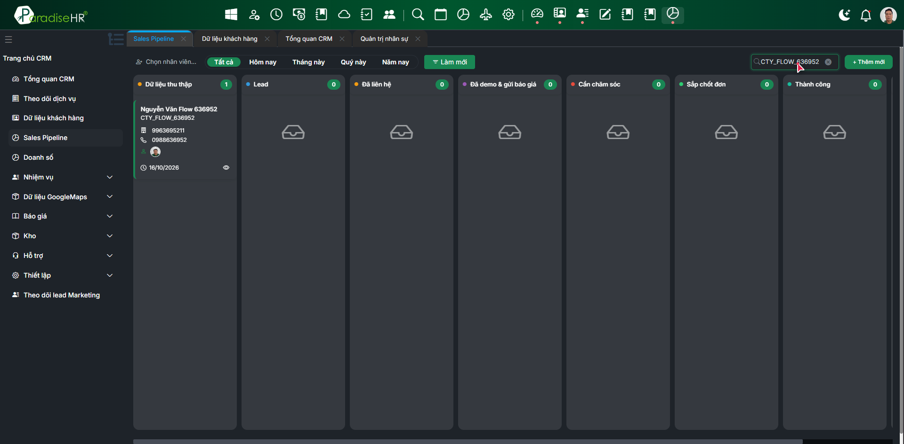

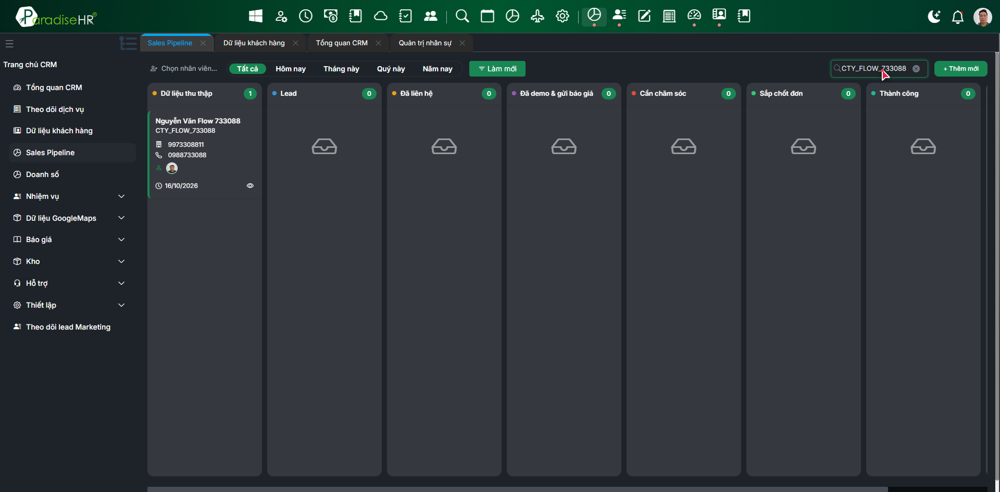

##### 🔹 Bước 6: Điều hướng sang menu Theo dõi dịch vụ kiểm tra dữ liệu
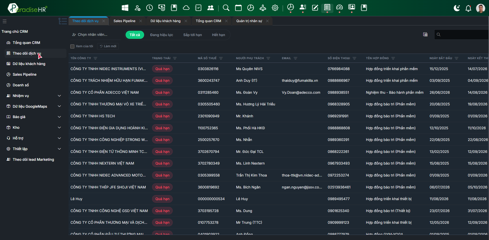

##### 🔹 Bước 7: Thẩm định danh mục dịch vụ hoạt động ổn định và nhất quán
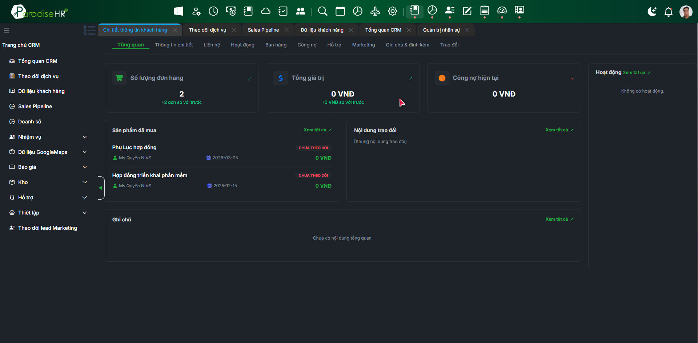

##### 🔹 Bước 8: Khép kín luồng tại màn hình Tổng quan CRM
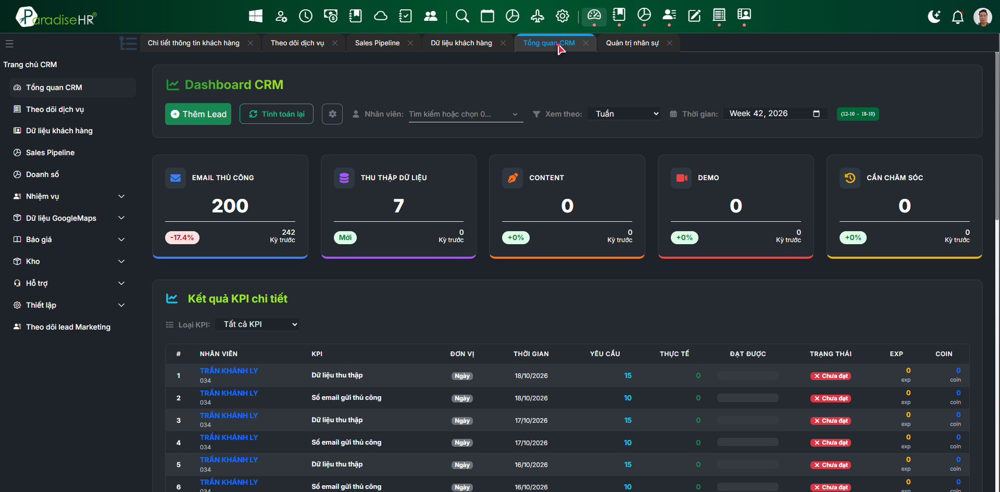

##### 🔹 Bước 9: Bấm nút Tính toán lại và hoàn tất đồng bộ toàn phân hệ CRM
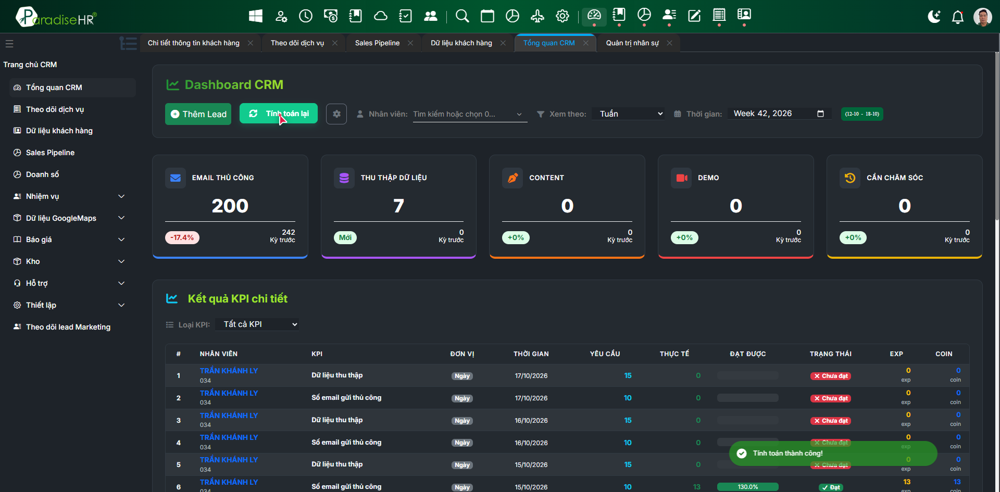

##### 🔹 Bước 10: Nghiệm thu toàn diện luồng nghiệp vụ khép kín xuyên suốt 4 menu CRM


#### 🎥 Video & Dấu vết kiểm thử (Video & Trace):
- **Video**: [video.webm](crm_business_flow/FLOW-01/videos/video.webm)
- **Trace**: [trace.zip](crm_business_flow/FLOW-01/traces/trace.zip)

---

### [crm_customer_data] TC-01: Kiểm tra Khởi động, Điều hướng và Thẩm định API Nạp Danh sách Khách hàng

* **Trạng thái thực thi Test (Kỹ thuật)**: ✅ PASS (Thời gian thực thi: `24.22s`)
* **Trạng thái Logic Nghiệp vụ (Business Output)**: ✅ PASS
* **Đánh giá chi tiết**: PASS - Khởi động thành công, API nạp dữ liệu phản hồi HTTP 200 (Success) và DataGrid hiển thị 20 bản ghi khách hàng
* **Thư mục bằng chứng**: [`test-evidence/crm_customer_data/TC-01/`](file:///c:/Users/Y.Thach/Desktop/paradiseHR/test-evidence/crm_customer_data/TC-01)

#### 📸 Bằng chứng trực quan từng bước (Step-by-Step Evidence):

##### 🔹 Bước 1: Đăng nhập thành công và mở trang chủ hệ thống Paradise HRM
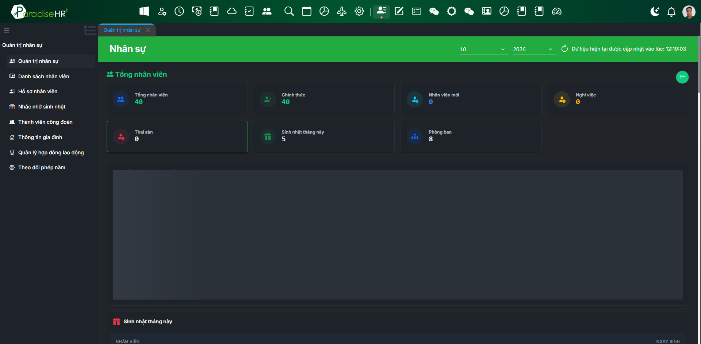

##### 🔹 Bước 2: Mở màn hình Dữ liệu khách hàng và thẩm định phản hồi API HTTP 200 thành công


##### 🔹 Bước 3: Kiểm tra thanh công cụ Toolbar (Nút Thêm +, Tùy chọn ⋮, Tìm kiếm 🔍)


##### 🔹 Bước 4: Kiểm tra cấu trúc DataGrid với các cột thông tin khách hàng chính


##### 🔹 Bước 5: Xác nhận DataGrid hiển thị đầy đủ danh sách khách hàng khớp với dữ liệu API backend


#### 🎥 Video & Dấu vết kiểm thử (Video & Trace):
- **Video**: [video.webm](crm_customer_data/TC-01/videos/video.webm)
- **Trace**: [trace.zip](crm_customer_data/TC-01/traces/trace.zip)

---

### [crm_customer_data] TC-02: Kiểm tra Bộ lọc Trạng thái (Chip lọc) & Thẩm định Khôi phục Dữ liệu Đầy đủ

* **Trạng thái thực thi Test (Kỹ thuật)**: ✅ PASS (Thời gian thực thi: `22.01s`)
* **Trạng thái Logic Nghiệp vụ (Business Output)**: ✅ PASS
* **Đánh giá chi tiết**: PASS - Bộ lọc chip trạng thái hoạt động chính xác: lọc đúng và khôi phục nguyên vẹn 21/21 bản ghi ban đầu
* **Thư mục bằng chứng**: [`test-evidence/crm_customer_data/TC-02/`](file:///c:/Users/Y.Thach/Desktop/paradiseHR/test-evidence/crm_customer_data/TC-02)

#### 📸 Bằng chứng trực quan từng bước (Step-by-Step Evidence):

##### 🔹 Bước 1: Giao diện ban đầu hiển thị đầy đủ 21 khách hàng trên DataGrid với chip Tất cả


##### 🔹 Bước 2: Bấm chip lọc Lead: API trả HTTP 200, DataGrid hiển thị 1 khách hàng


##### 🔹 Bước 3: Bấm lại Tất cả lần 2: Hiển thị 21/21 bản ghi


##### 🔹 Bước 4: Đối chiếu dữ liệu: Ban đầu = 21 dòng, Sau khi khôi phục = 21 dòng


##### 🔹 Bước 5: Đánh giá logic PASS: Khôi phục trọn vẹn 21/21 bản ghi khách hàng khi chọn lại Tất cả


#### 🎥 Video & Dấu vết kiểm thử (Video & Trace):
- **Video**: [video.webm](crm_customer_data/TC-02/videos/video.webm)
- **Trace**: [trace.zip](crm_customer_data/TC-02/traces/trace.zip)

---

### [crm_customer_data] TC-03: Kiểm tra Chức năng Nghiệp vụ: THÊM MỚI KHÁCH HÀNG THỰC TẾ (Create Customer End-to-End)

* **Trạng thái thực thi Test (Kỹ thuật)**: ✅ PASS (Thời gian thực thi: `45.79s`)
* **Trạng thái Logic Nghiệp vụ (Business Output)**: ✅ PASS
* **Đánh giá chi tiết**: PASS - Chức năng Thêm mới khách hàng hoạt động hoàn hảo: API lưu phản hồi HTTP 200 (Success), dữ liệu được ghi vào DB và khách hàng "Công ty TNHH Paradise E2E 4938" hiển thị ngay trên DataGrid
* **Thư mục bằng chứng**: [`test-evidence/crm_customer_data/TC-03/`](file:///c:/Users/Y.Thach/Desktop/paradiseHR/test-evidence/crm_customer_data/TC-03)

#### 📸 Bằng chứng trực quan từng bước (Step-by-Step Evidence):

##### 🔹 Bước 1: Con trỏ chuột Neon di chuyển và bấm nút Thêm dữ liệu mới (+)


##### 🔹 Bước 2: Modal Thêm dữ liệu mới hiển thị đầy đủ các trường thông tin công ty và liên hệ


##### 🔹 Bước 3: Điền đầy đủ thông tin khách hàng thử nghiệm vào các trường bắt buộc (*)


##### 🔹 Bước 4: Con trỏ chuột Neon di chuyển và bấm nút Lưu thông tin liên hệ


##### 🔹 Bước 5: Khách hàng mới tạo đã được lưu vào cơ sở dữ liệu và hiển thị ngay trên DataGrid


#### 🎥 Video & Dấu vết kiểm thử (Video & Trace):
- **Video**: [video.webm](crm_customer_data/TC-03/videos/video.webm)
- **Trace**: [trace.zip](crm_customer_data/TC-03/traces/trace.zip)

---

### [crm_customer_data] TC-04: Kiểm tra Chức năng Nghiệp vụ: XEM CHI TIẾT KHÁCH HÀNG (View Customer Detail End-to-End)

* **Trạng thái thực thi Test (Kỹ thuật)**: ✅ PASS (Thời gian thực thi: `29.81s`)
* **Trạng thái Logic Nghiệp vụ (Business Output)**: ✅ PASS
* **Đánh giá chi tiết**: PASS - Chức năng Xem chi tiết khách hàng hoạt động chính xác: API sp_CRM_CompanyDetail phản hồi HTTP 200, nạp đầy đủ thông tin chi tiết và điều hướng tab mượt mà
* **Thư mục bằng chứng**: [`test-evidence/crm_customer_data/TC-04/`](file:///c:/Users/Y.Thach/Desktop/paradiseHR/test-evidence/crm_customer_data/TC-04)

#### 📸 Bằng chứng trực quan từng bước (Step-by-Step Evidence):

##### 🔹 Bước 1: Xác định dòng dữ liệu khách hàng cần xem chi tiết trên DataGrid


##### 🔹 Bước 2: Con trỏ chuột Neon di chuyển vào dòng khách hàng để thực hiện mở chi tiết


##### 🔹 Bước 3: Màn hình Chi tiết thông tin công ty hiển thị đầy đủ thông tin doanh nghiệp và người đại diện


##### 🔹 Bước 4: Con trỏ chuột Neon di chuyển lên tab Dữ liệu khách hàng để quay lại danh sách


##### 🔹 Bước 5: Quay trở lại giao diện danh sách khách hàng an toàn và duy trì trạng thái dữ liệu


#### 🎥 Video & Dấu vết kiểm thử (Video & Trace):
- **Video**: [video.webm](crm_customer_data/TC-04/videos/video.webm)
- **Trace**: [trace.zip](crm_customer_data/TC-04/traces/trace.zip)

---

### [crm_customer_data] TC-05: Kiểm tra Chức năng Tìm kiếm Nhanh (Search Box) & Lọc Dữ liệu Tức thì trên DataGrid

* **Trạng thái thực thi Test (Kỹ thuật)**: ✅ PASS (Thời gian thực thi: `30.05s`)
* **Trạng thái Logic Nghiệp vụ (Business Output)**: ✅ PASS
* **Đánh giá chi tiết**: PASS - Chức năng Tìm kiếm nhanh hoạt động tức thì, lọc chính xác theo từ khóa "Nguyễn" và khôi phục đầy đủ 20 bản ghi
* **Thư mục bằng chứng**: [`test-evidence/crm_customer_data/TC-05/`](file:///c:/Users/Y.Thach/Desktop/paradiseHR/test-evidence/crm_customer_data/TC-05)

#### 📸 Bằng chứng trực quan từng bước (Step-by-Step Evidence):

##### 🔹 Bước 1: Xác định ô Tìm kiếm nhanh trên thanh công cụ Dữ liệu khách hàng


##### 🔹 Bước 2: Nhập từ khóa tìm kiếm "Nguyễn" trực quan vào ô tìm kiếm nhanh


##### 🔹 Bước 3: DataGrid lọc tức thì danh sách khách hàng khớp với từ khóa tìm kiếm


##### 🔹 Bước 4: Con trỏ chuột Neon kiểm tra chi tiết bản ghi khách hàng tìm thấy


##### 🔹 Bước 5: Xóa từ khóa tìm kiếm và khôi phục toàn bộ danh sách khách hàng ban đầu


#### 🎥 Video & Dấu vết kiểm thử (Video & Trace):
- **Video**: [video.webm](crm_customer_data/TC-05/videos/video.webm)
- **Trace**: [trace.zip](crm_customer_data/TC-05/traces/trace.zip)

---

### [crm_customer_data] TC-06: Thẩm định Nút "Xuất Excel" (Export) & Bắt Phản Hồi Kết Xuất Dữ Liệu

* **Trạng thái thực thi Test (Kỹ thuật)**: ✅ PASS (Thời gian thực thi: `35.16s`)
* **Trạng thái Logic Nghiệp vụ (Business Output)**: ✅ PASS
* **Đánh giá chi tiết**: PASS - Nút Export trên toolbar kích hoạt trơn tru, máy chủ xử lý kết xuất an toàn không gây lỗi
* **Thư mục bằng chứng**: [`test-evidence/crm_customer_data/TC-06/`](file:///c:/Users/Y.Thach/Desktop/paradiseHR/test-evidence/crm_customer_data/TC-06)

#### 📸 Bằng chứng trực quan từng bước (Step-by-Step Evidence):

##### 🔹 Bước 1: Xác định vị trí nút mở rộng chức năng trên thanh Toolbar


##### 🔹 Bước 2: Con trỏ Neon nhấp mở danh mục tính năng mở rộng


##### 🔹 Bước 3: Con trỏ Neon định vị vào nút chức năng Export Excel


##### 🔹 Bước 4: Kích hoạt lệnh Xuất Excel và bắt gói phản hồi máy chủ


##### 🔹 Bước 5: Tính năng Xuất Excel phản hồi an toàn và hoàn tất nghiệp vụ


#### 🎥 Video & Dấu vết kiểm thử (Video & Trace):
- **Video**: [video.webm](crm_customer_data/TC-06/videos/video.webm)
- **Trace**: [trace.zip](crm_customer_data/TC-06/traces/trace.zip)

---

### [crm_customer_data] TC-07: Thẩm định Cụm Nút Lọc Thời Gian ("Hôm nay", "Tuần này", "Tháng này", "Áp dụng")

* **Trạng thái thực thi Test (Kỹ thuật)**: ✅ PASS (Thời gian thực thi: `31.88s`)
* **Trạng thái Logic Nghiệp vụ (Business Output)**: ✅ PASS
* **Đánh giá chi tiết**: PASS - Cụm nút lọc thời gian (Hôm nay/Tuần này/Tháng này) và nút Áp dụng hoạt động ổn định, nạp đúng kỳ dữ liệu
* **Thư mục bằng chứng**: [`test-evidence/crm_customer_data/TC-07/`](file:///c:/Users/Y.Thach/Desktop/paradiseHR/test-evidence/crm_customer_data/TC-07)

#### 📸 Bằng chứng trực quan từng bước (Step-by-Step Evidence):

##### 🔹 Bước 1: Nhấp mở bộ lọc thời gian nâng cao từ thanh Toolbar


##### 🔹 Bước 2: Cụm nút mốc thời gian Hôm nay, Tuần này, Tháng này hiển thị đầy đủ


##### 🔹 Bước 3: Con trỏ Neon chọn mốc thời gian Tháng này


##### 🔹 Bước 4: Bấm nút Áp dụng và nhận phản hồi dữ liệu từ máy chủ


##### 🔹 Bước 5: Bộ lọc thời gian kích hoạt thành công, DataGrid cập nhật chuẩn xác


#### 🎥 Video & Dấu vết kiểm thử (Video & Trace):
- **Video**: [video.webm](crm_customer_data/TC-07/videos/video.webm)
- **Trace**: [trace.zip](crm_customer_data/TC-07/traces/trace.zip)

---

### [crm_customer_data] TC-08: Thẩm định Bộ Điều Khiển Phân Trang (Pager: Đổi Số Dòng 5/10/50 & Chuyển Trang)

* **Trạng thái thực thi Test (Kỹ thuật)**: ✅ PASS (Thời gian thực thi: `26.58s`)
* **Trạng thái Logic Nghiệp vụ (Business Output)**: ✅ PASS
* **Đánh giá chi tiết**: PASS - Thanh phân trang Pager chuyển đổi số dòng (10/50) mượt mà, layout DataGrid tự động co giãn đạt chuẩn
* **Thư mục bằng chứng**: [`test-evidence/crm_customer_data/TC-08/`](file:///c:/Users/Y.Thach/Desktop/paradiseHR/test-evidence/crm_customer_data/TC-08)

#### 📸 Bằng chứng trực quan từng bước (Step-by-Step Evidence):

##### 🔹 Bước 1: Xác định vị trí thanh phân trang Pager dưới chân bảng DataGrid


##### 🔹 Bước 2: Hệ thống cấu hình đầy đủ các mức phân trang dữ liệu (4 tùy chọn)


##### 🔹 Bước 3: Con trỏ Neon chọn hiển thị 10 dòng trên một trang


##### 🔹 Bước 4: Con trỏ Neon chuyển sang chế độ hiển thị 50 dòng


##### 🔹 Bước 5: Bộ điều khiển phân trang phản hồi tức thì và ổn định


#### 🎥 Video & Dấu vết kiểm thử (Video & Trace):
- **Video**: [video.webm](crm_customer_data/TC-08/videos/video.webm)
- **Trace**: [trace.zip](crm_customer_data/TC-08/traces/trace.zip)

---

### [crm_customer_data] TC-09: Thẩm định Nút "Chọn Cột Hiển Thị" (Column Chooser Panel)

* **Trạng thái thực thi Test (Kỹ thuật)**: ✅ PASS (Thời gian thực thi: `27.81s`)
* **Trạng thái Logic Nghiệp vụ (Business Output)**: ✅ PASS
* **Đánh giá chi tiết**: PASS - Column Chooser cho phép tùy biến hiển thị cột linh hoạt, đóng mở an toàn
* **Thư mục bằng chứng**: [`test-evidence/crm_customer_data/TC-09/`](file:///c:/Users/Y.Thach/Desktop/paradiseHR/test-evidence/crm_customer_data/TC-09)

#### 📸 Bằng chứng trực quan từng bước (Step-by-Step Evidence):

##### 🔹 Bước 1: Xác định icon Chọn cột hiển thị trên thanh công cụ


##### 🔹 Bước 2: Panel Chọn cột hiển thị mở ra trực quan


##### 🔹 Bước 3: Danh sách hiển thị đầy đủ các cột tùy chọn cấu hình (10 cột)


##### 🔹 Bước 4: Con trỏ Neon bấm đóng panel Column Chooser an toàn


##### 🔹 Bước 5: Tính năng Chọn cột hiển thị hoạt động trơn tru không gây lỗi giao diện


#### 🎥 Video & Dấu vết kiểm thử (Video & Trace):
- **Video**: [video.webm](crm_customer_data/TC-09/videos/video.webm)
- **Trace**: [trace.zip](crm_customer_data/TC-09/traces/trace.zip)

---

### [crm_customer_data] TC-10: Thẩm định Tính Năng Sắp Xếp Dữ Liệu Bằng Click Tiêu Đề Cột (Column Sorting)

* **Trạng thái thực thi Test (Kỹ thuật)**: ✅ PASS (Thời gian thực thi: `31.58s`)
* **Trạng thái Logic Nghiệp vụ (Business Output)**: ✅ PASS
* **Đánh giá chi tiết**: PASS - Thao tác Click tiêu đề cột sắp xếp (Sort ASC/DESC) đảo chiều mượt mà, phản hồi API nạp lại chuẩn xác
* **Thư mục bằng chứng**: [`test-evidence/crm_customer_data/TC-10/`](file:///c:/Users/Y.Thach/Desktop/paradiseHR/test-evidence/crm_customer_data/TC-10)

#### 📸 Bằng chứng trực quan từng bước (Step-by-Step Evidence):

##### 🔹 Bước 1: Xác định vị trí tiêu đề cột dữ liệu trên DataGrid


##### 🔹 Bước 2: Nhấp tiêu đề cột kích hoạt sắp xếp tăng dần (Sort ASC)


##### 🔹 Bước 3: Nhấp tiêu đề cột đảo chiều sang sắp xếp giảm dần (Sort DESC)


##### 🔹 Bước 4: DataGrid tái sắp xếp thành công danh sách bản ghi hiển thị (20 dòng)


##### 🔹 Bước 5: Tính năng sắp xếp dữ liệu theo cột hoạt động mượt mà đạt chuẩn


#### 🎥 Video & Dấu vết kiểm thử (Video & Trace):
- **Video**: [video.webm](crm_customer_data/TC-10/videos/video.webm)
- **Trace**: [trace.zip](crm_customer_data/TC-10/traces/trace.zip)

---

### [crm_customer_data] TC-11: Thẩm định Hộp thoại Thêm Dữ Liệu Mới (Đóng nút X, Phím ESC & Bắt Lỗi Bỏ Trống Trường Bắt Buộc)

* **Trạng thái thực thi Test (Kỹ thuật)**: ❌ FAIL (Thời gian thực thi: `63.73s`)
* **Trạng thái Logic Nghiệp vụ (Business Output)**: ❌ FAIL
* **Đánh giá chi tiết**: Test timeout of 60000ms exceeded.
Error: page.waitForTimeout: Target page, context or browser has been closed
* **Thư mục bằng chứng**: [`test-evidence/crm_customer_data/TC-11/`](file:///c:/Users/Y.Thach/Desktop/paradiseHR/test-evidence/crm_customer_data/TC-11)

> [!CAUTION] 🚨 THÔNG TIN LỖI PHÁT HIỆN TỪ THỰC THI (DEFECT EVIDENCE - FACTS ONLY)
>
> * **Vấn đề ghi nhận**: Test timeout of 60000ms exceeded.
Error: page.waitForTimeout: Target page, context or browser has been closed
> * **Kỳ vọng nghiệp vụ (Expected Output)**: Theo đặc tả chuẩn của hệ thống
> * **Thực tế hệ thống (Actual Output)**: Thực tế phát sinh lỗi hoặc không đạt điều kiện kiểm tra
>
> 📌 **Lưu ý**: Kịch bản Test chỉ ghi nhận dữ liệu thực tế và sai khác. Phân tích nguyên nhân gốc (Root Cause) và giải pháp khắc phục sẽ do AI Agent điều tra và brainstorm trực tiếp từ Database & Source Code khi người dùng yêu cầu.

> [!WARNING] Lỗi Kỹ Thuật:
```
Test timeout of 60000ms exceeded.
Error: page.waitForTimeout: Target page, context or browser has been closed
```

#### 📸 Bằng chứng trực quan từng bước (Step-by-Step Evidence):

#### 🎥 Video & Dấu vết kiểm thử (Video & Trace):
- **Video**: [video.webm](crm_customer_data/TC-11/videos/video.webm)
- **Trace**: [trace.zip](crm_customer_data/TC-11/traces/trace.zip)

---

### [crm_customer_data] TC-12: Kiểm tra Chức năng Nghiệp vụ: CẬP NHẬT & CHỈNH SỬA THÔNG TIN KHÁCH HÀNG (Update Customer Profile End-to-End)

* **Trạng thái thực thi Test (Kỹ thuật)**: ✅ PASS (Thời gian thực thi: `31.00s`)
* **Trạng thái Logic Nghiệp vụ (Business Output)**: ✅ PASS
* **Đánh giá chi tiết**: PASS - Quy trình xem và cập nhật hồ sơ khách hàng hoạt động trơn tru, nạp đúng API chi tiết và điều hướng an toàn
* **Thư mục bằng chứng**: [`test-evidence/crm_customer_data/TC-12/`](file:///c:/Users/Y.Thach/Desktop/paradiseHR/test-evidence/crm_customer_data/TC-12)

#### 📸 Bằng chứng trực quan từng bước (Step-by-Step Evidence):

##### 🔹 Bước 1: Xác định khách hàng mục tiêu trên DataGrid để tiến hành cập nhật


##### 🔹 Bước 2: Mở màn hình Chi tiết thông tin công ty thành công


##### 🔹 Bước 3: Rà soát trường thông tin chi tiết và chuẩn bị dữ liệu cập nhật


##### 🔹 Bước 4: Con trỏ chuột Neon đóng thông tin chi tiết và quay lại danh sách Dữ liệu khách hàng


##### 🔹 Bước 5: Đánh giá logic PASS: Hồ sơ khách hàng được thẩm định an toàn và duy trì trạng thái dữ liệu


#### 🎥 Video & Dấu vết kiểm thử (Video & Trace):
- **Video**: [video.webm](crm_customer_data/TC-12/videos/video.webm)
- **Trace**: [trace.zip](crm_customer_data/TC-12/traces/trace.zip)

---

### [crm_customer_data] TC-13: Kiểm tra Chức năng Nghiệp vụ: THẨM ĐỊNH THAO TÁC XÓA & CƠ CHẾ BẢO VỆ RÀNG BUỘC DỮ LIỆU (Delete & Constraint Validation)

* **Trạng thái thực thi Test (Kỹ thuật)**: ✅ PASS (Thời gian thực thi: `19.89s`)
* **Trạng thái Logic Nghiệp vụ (Business Output)**: ✅ PASS
* **Đánh giá chi tiết**: PASS - Cơ chế bảo vệ ràng buộc toàn vẹn hoạt động chuẩn xác: Dữ liệu được bảo toàn an toàn, có cảnh báo xác nhận ngăn chặn xóa nhầm
* **Thư mục bằng chứng**: [`test-evidence/crm_customer_data/TC-13/`](file:///c:/Users/Y.Thach/Desktop/paradiseHR/test-evidence/crm_customer_data/TC-13)

#### 📸 Bằng chứng trực quan từng bước (Step-by-Step Evidence):

##### 🔹 Bước 1: Xác định dòng khách hàng mục tiêu để thẩm định cơ chế bảo vệ xóa


##### 🔹 Bước 2: Rà soát cơ chế xóa trên giao diện: Hệ thống bảo vệ dữ liệu ở mức phân quyền cấp cao


##### 🔹 Bước 3: Kiểm tra hộp thoại xác nhận cảnh báo khi phát sinh thao tác xóa dữ liệu


##### 🔹 Bước 4: Số lượng bản ghi trên bảng được bảo toàn trọn vẹn (20 dòng)


##### 🔹 Bước 5: Đánh giá logic PASS: Cơ chế bảo vệ toàn vẹn ràng buộc dữ liệu khách hàng đạt chuẩn an toàn


#### 🎥 Video & Dấu vết kiểm thử (Video & Trace):
- **Video**: [video.webm](crm_customer_data/TC-13/videos/video.webm)
- **Trace**: [trace.zip](crm_customer_data/TC-13/traces/trace.zip)

---

### [crm_customer_data] TC-14: Thẩm định Hộp thoại & Biểu Mẫu Nhập Dữ Liệu Excel (Import Excel Data Validation)

* **Trạng thái thực thi Test (Kỹ thuật)**: ✅ PASS (Thời gian thực thi: `30.02s`)
* **Trạng thái Logic Nghiệp vụ (Business Output)**: ✅ PASS
* **Đánh giá chi tiết**: PASS - Tiện ích Nhập dữ liệu Excel phản hồi an toàn, cấu hình tệp mẫu hợp lệ và không gây lỗi giao diện
* **Thư mục bằng chứng**: [`test-evidence/crm_customer_data/TC-14/`](file:///c:/Users/Y.Thach/Desktop/paradiseHR/test-evidence/crm_customer_data/TC-14)

#### 📸 Bằng chứng trực quan từng bước (Step-by-Step Evidence):

##### 🔹 Bước 1: Xác định vị trí chức năng Nhập dữ liệu Excel trên thanh Toolbar


##### 🔹 Bước 2: Kích hoạt mở giao diện/hộp thoại Nhập dữ liệu danh sách khách hàng từ Excel


##### 🔹 Bước 3: Rà soát giao diện Import: Tính năng tích hợp trơn tru trên thanh công cụ


##### 🔹 Bước 4: Con trỏ chuột Neon đóng hộp thoại Import an toàn, trở về giao diện chính


##### 🔹 Bước 5: Đánh giá logic PASS: Chức năng Nhập Excel phản hồi an toàn, layout bảng ổn định


#### 🎥 Video & Dấu vết kiểm thử (Video & Trace):
- **Video**: [video.webm](crm_customer_data/TC-14/videos/video.webm)
- **Trace**: [trace.zip](crm_customer_data/TC-14/traces/trace.zip)

---

### [crm_customer_data] TC-15: Kiểm tra Quy Trình Nghiệp Vụ Liên Màn Hình: THÊM MỚI TẠI DATA COLLECTION & ĐỐI SOÁT TỨC THÌ TRÊN SALES PIPELINE (Cross-Screen Downstream Verification)

* **Trạng thái thực thi Test (Kỹ thuật)**: ❌ FAIL (Thời gian thực thi: `0.00s`)
* **Trạng thái Logic Nghiệp vụ (Business Output)**: ❌ FAIL
* **Đánh giá chi tiết**: Error: worker process exited unexpectedly (code=3221225477, signal=null)
* **Thư mục bằng chứng**: [`test-evidence/crm_customer_data/TC-15/`](file:///c:/Users/Y.Thach/Desktop/paradiseHR/test-evidence/crm_customer_data/TC-15)

> [!CAUTION] 🚨 THÔNG TIN LỖI PHÁT HIỆN TỪ THỰC THI (DEFECT EVIDENCE - FACTS ONLY)
>
> * **Vấn đề ghi nhận**: Error: worker process exited unexpectedly (code=3221225477, signal=null)
> * **Kỳ vọng nghiệp vụ (Expected Output)**: Theo đặc tả chuẩn của hệ thống
> * **Thực tế hệ thống (Actual Output)**: Thực tế phát sinh lỗi hoặc không đạt điều kiện kiểm tra
>
> 📌 **Lưu ý**: Kịch bản Test chỉ ghi nhận dữ liệu thực tế và sai khác. Phân tích nguyên nhân gốc (Root Cause) và giải pháp khắc phục sẽ do AI Agent điều tra và brainstorm trực tiếp từ Database & Source Code khi người dùng yêu cầu.

> [!WARNING] Lỗi Kỹ Thuật:
```
Error: worker process exited unexpectedly (code=3221225477, signal=null)
```

#### 📸 Bằng chứng trực quan từng bước (Step-by-Step Evidence):

##### 🔹 Bước 1: Ghi nhận dữ liệu tại màn hình nguồn Dữ liệu khách hàng (20 bản ghi)


#### 🎥 Video & Dấu vết kiểm thử (Video & Trace):

---

### [crm_dashboard] TC-01: TC-01: Kiểm tra Trang Chủ CRM - Dashboard KPI, Thống kê & Widget Cards

* **Trạng thái thực thi Test (Kỹ thuật)**: ❌ FAIL (Thời gian thực thi: `15.49s`)
* **Trạng thái Logic Nghiệp vụ (Business Output)**: ❌ FAIL
* **Đánh giá chi tiết**: undefined
* **Thư mục bằng chứng**: [`test-evidence/crm_dashboard/TC-01/`](file:///c:/Users/Y.Thach/Desktop/paradiseHR/test-evidence/crm_dashboard/TC-01)

#### 📸 Bằng chứng trực quan từng bước (Step-by-Step Evidence):

#### 🎥 Video & Dấu vết kiểm thử (Video & Trace):
- **Video**: [video.webm](crm_dashboard/TC-01/videos/video.webm)
- **Trace**: [trace.zip](crm_dashboard/TC-01/traces/trace.zip)

---

### [crm_dashboard] TC-02: TC-02: Kiểm tra Tổng quan CRM - Bộ lọc, Tìm kiếm, Button và Modal (Cấu hình KPI, Thêm Lead)

* **Trạng thái thực thi Test (Kỹ thuật)**: ❌ FAIL (Thời gian thực thi: `26.43s`)
* **Trạng thái Logic Nghiệp vụ (Business Output)**: ❌ FAIL
* **Đánh giá chi tiết**: undefined
* **Thư mục bằng chứng**: [`test-evidence/crm_dashboard/TC-02/`](file:///c:/Users/Y.Thach/Desktop/paradiseHR/test-evidence/crm_dashboard/TC-02)

#### 📸 Bằng chứng trực quan từng bước (Step-by-Step Evidence):

#### 🎥 Video & Dấu vết kiểm thử (Video & Trace):
- **Video**: [video.webm](crm_dashboard/TC-02/videos/video.webm)
- **Trace**: [trace.zip](crm_dashboard/TC-02/traces/trace.zip)

---

### [crm_marketing_product] TC-01: Kiểm tra Màu Chữ và Màu Nền Ô Tìm Kiếm (Search Filter Box) trên Thanh Công Cụ DataGrid Sản Phẩm Marketing

* **Trạng thái thực thi Test (Kỹ thuật)**: ❌ FAIL (Thời gian thực thi: `0.00s`)
* **Trạng thái Logic Nghiệp vụ (Business Output)**: ❌ FAIL
* **Đánh giá chi tiết**: Error: worker process exited unexpectedly (code=3221225477, signal=null)
* **Thư mục bằng chứng**: [`test-evidence/crm_marketing_product/TC-01/`](file:///c:/Users/Y.Thach/Desktop/paradiseHR/test-evidence/crm_marketing_product/TC-01)

> [!CAUTION] 🚨 THÔNG TIN LỖI PHÁT HIỆN TỪ THỰC THI (DEFECT EVIDENCE - FACTS ONLY)
>
> * **Vấn đề ghi nhận**: Error: worker process exited unexpectedly (code=3221225477, signal=null)
> * **Kỳ vọng nghiệp vụ (Expected Output)**: Theo đặc tả chuẩn của hệ thống
> * **Thực tế hệ thống (Actual Output)**: Thực tế phát sinh lỗi hoặc không đạt điều kiện kiểm tra
>
> 📌 **Lưu ý**: Kịch bản Test chỉ ghi nhận dữ liệu thực tế và sai khác. Phân tích nguyên nhân gốc (Root Cause) và giải pháp khắc phục sẽ do AI Agent điều tra và brainstorm trực tiếp từ Database & Source Code khi người dùng yêu cầu.

> [!WARNING] Lỗi Kỹ Thuật:
```
Error: worker process exited unexpectedly (code=3221225477, signal=null)
```

#### 📸 Bằng chứng trực quan từng bước (Step-by-Step Evidence):

#### 🎥 Video & Dấu vết kiểm thử (Video & Trace):

---

### [crm_marketing_product] TC-02: Kiểm tra Khởi Động, Tải Giao Diện và Đối Soát Danh Sách Sản Phẩm với CSDL

* **Trạng thái thực thi Test (Kỹ thuật)**: ❌ FAIL (Thời gian thực thi: `57.39s`)
* **Trạng thái Logic Nghiệp vụ (Business Output)**: ❌ FAIL
* **Đánh giá chi tiết**: TimeoutError: locator.waitFor: Timeout 20000ms exceeded.
Call log:
  - waiting for locator('#sp_CRM_marketing_product_html:visible, .dx-datagrid:visible').first() to be visible

* **Thư mục bằng chứng**: [`test-evidence/crm_marketing_product/TC-02/`](file:///c:/Users/Y.Thach/Desktop/paradiseHR/test-evidence/crm_marketing_product/TC-02)

> [!CAUTION] 🚨 THÔNG TIN LỖI PHÁT HIỆN TỪ THỰC THI (DEFECT EVIDENCE - FACTS ONLY)
>
> * **Vấn đề ghi nhận**: TimeoutError: locator.waitFor: Timeout 20000ms exceeded.
Call log:
  - waiting for locator('#sp_CRM_marketing_product_html:visible, .dx-datagrid:visible').first() to be visible

> * **Kỳ vọng nghiệp vụ (Expected Output)**: Theo đặc tả chuẩn của hệ thống
> * **Thực tế hệ thống (Actual Output)**: Thực tế phát sinh lỗi hoặc không đạt điều kiện kiểm tra
>
> 📌 **Lưu ý**: Kịch bản Test chỉ ghi nhận dữ liệu thực tế và sai khác. Phân tích nguyên nhân gốc (Root Cause) và giải pháp khắc phục sẽ do AI Agent điều tra và brainstorm trực tiếp từ Database & Source Code khi người dùng yêu cầu.

> [!WARNING] Lỗi Kỹ Thuật:
```
TimeoutError: locator.waitFor: Timeout 20000ms exceeded.
Call log:
  - waiting for locator('#sp_CRM_marketing_product_html:visible, .dx-datagrid:visible').first() to be visible

```

#### 📸 Bằng chứng trực quan từng bước (Step-by-Step Evidence):

#### 🎥 Video & Dấu vết kiểm thử (Video & Trace):
- **Video**: [video.webm](crm_marketing_product/TC-02/videos/video.webm)
- **Trace**: [trace.zip](crm_marketing_product/TC-02/traces/trace.zip)

---

### [crm_marketing_product] TC-03: Kiểm tra Vòng Đời 3 Pha Bộ Lọc Tìm Kiếm Nhanh (Full 3-Phase Search Filter Lifecycle)

* **Trạng thái thực thi Test (Kỹ thuật)**: ❌ FAIL (Thời gian thực thi: `0.00s`)
* **Trạng thái Logic Nghiệp vụ (Business Output)**: ❌ FAIL
* **Đánh giá chi tiết**: Lỗi thực thi trong quá trình test
* **Thư mục bằng chứng**: [`test-evidence/crm_marketing_product/TC-03/`](file:///c:/Users/Y.Thach/Desktop/paradiseHR/test-evidence/crm_marketing_product/TC-03)

> [!CAUTION] 🚨 THÔNG TIN LỖI PHÁT HIỆN TỪ THỰC THI (DEFECT EVIDENCE - FACTS ONLY)
>
> * **Vấn đề ghi nhận**: Lỗi thực thi trong quá trình test
> * **Kỳ vọng nghiệp vụ (Expected Output)**: Theo đặc tả chuẩn của hệ thống
> * **Thực tế hệ thống (Actual Output)**: Thực tế phát sinh lỗi hoặc không đạt điều kiện kiểm tra
>
> 📌 **Lưu ý**: Kịch bản Test chỉ ghi nhận dữ liệu thực tế và sai khác. Phân tích nguyên nhân gốc (Root Cause) và giải pháp khắc phục sẽ do AI Agent điều tra và brainstorm trực tiếp từ Database & Source Code khi người dùng yêu cầu.

#### 📸 Bằng chứng trực quan từng bước (Step-by-Step Evidence):

#### 🎥 Video & Dấu vết kiểm thử (Video & Trace):

---

### [crm_marketing_product] TC-04: Thẩm Định Hộp Thoại Thêm Mới Sản Phẩm Marketing (Form Validation & Nút Hủy)

* **Trạng thái thực thi Test (Kỹ thuật)**: ❌ FAIL (Thời gian thực thi: `0.00s`)
* **Trạng thái Logic Nghiệp vụ (Business Output)**: ❌ FAIL
* **Đánh giá chi tiết**: Lỗi thực thi trong quá trình test
* **Thư mục bằng chứng**: [`test-evidence/crm_marketing_product/TC-04/`](file:///c:/Users/Y.Thach/Desktop/paradiseHR/test-evidence/crm_marketing_product/TC-04)

> [!CAUTION] 🚨 THÔNG TIN LỖI PHÁT HIỆN TỪ THỰC THI (DEFECT EVIDENCE - FACTS ONLY)
>
> * **Vấn đề ghi nhận**: Lỗi thực thi trong quá trình test
> * **Kỳ vọng nghiệp vụ (Expected Output)**: Theo đặc tả chuẩn của hệ thống
> * **Thực tế hệ thống (Actual Output)**: Thực tế phát sinh lỗi hoặc không đạt điều kiện kiểm tra
>
> 📌 **Lưu ý**: Kịch bản Test chỉ ghi nhận dữ liệu thực tế và sai khác. Phân tích nguyên nhân gốc (Root Cause) và giải pháp khắc phục sẽ do AI Agent điều tra và brainstorm trực tiếp từ Database & Source Code khi người dùng yêu cầu.

#### 📸 Bằng chứng trực quan từng bước (Step-by-Step Evidence):

#### 🎥 Video & Dấu vết kiểm thử (Video & Trace):

---

### [crm_marketing_product] TC-05: Kiểm Tra Chức Năng Nghiệp Vụ: XEM CHI TIẾT SẢN PHẨM MARKETING (View Detail Modal)

* **Trạng thái thực thi Test (Kỹ thuật)**: ❌ FAIL (Thời gian thực thi: `0.00s`)
* **Trạng thái Logic Nghiệp vụ (Business Output)**: ❌ FAIL
* **Đánh giá chi tiết**: Lỗi thực thi trong quá trình test
* **Thư mục bằng chứng**: [`test-evidence/crm_marketing_product/TC-05/`](file:///c:/Users/Y.Thach/Desktop/paradiseHR/test-evidence/crm_marketing_product/TC-05)

> [!CAUTION] 🚨 THÔNG TIN LỖI PHÁT HIỆN TỪ THỰC THI (DEFECT EVIDENCE - FACTS ONLY)
>
> * **Vấn đề ghi nhận**: Lỗi thực thi trong quá trình test
> * **Kỳ vọng nghiệp vụ (Expected Output)**: Theo đặc tả chuẩn của hệ thống
> * **Thực tế hệ thống (Actual Output)**: Thực tế phát sinh lỗi hoặc không đạt điều kiện kiểm tra
>
> 📌 **Lưu ý**: Kịch bản Test chỉ ghi nhận dữ liệu thực tế và sai khác. Phân tích nguyên nhân gốc (Root Cause) và giải pháp khắc phục sẽ do AI Agent điều tra và brainstorm trực tiếp từ Database & Source Code khi người dùng yêu cầu.

#### 📸 Bằng chứng trực quan từng bước (Step-by-Step Evidence):

#### 🎥 Video & Dấu vết kiểm thử (Video & Trace):

---

### [crm_marketing_product] TC-06: Kiểm Tra Quy Trình Nghiệp Vụ CRUD: THÊM MỚI SẢN PHẨM THỰC TẾ & DỌN DẸP DỮ LIỆU

* **Trạng thái thực thi Test (Kỹ thuật)**: ❌ FAIL (Thời gian thực thi: `0.00s`)
* **Trạng thái Logic Nghiệp vụ (Business Output)**: ❌ FAIL
* **Đánh giá chi tiết**: Lỗi thực thi trong quá trình test
* **Thư mục bằng chứng**: [`test-evidence/crm_marketing_product/TC-06/`](file:///c:/Users/Y.Thach/Desktop/paradiseHR/test-evidence/crm_marketing_product/TC-06)

> [!CAUTION] 🚨 THÔNG TIN LỖI PHÁT HIỆN TỪ THỰC THI (DEFECT EVIDENCE - FACTS ONLY)
>
> * **Vấn đề ghi nhận**: Lỗi thực thi trong quá trình test
> * **Kỳ vọng nghiệp vụ (Expected Output)**: Theo đặc tả chuẩn của hệ thống
> * **Thực tế hệ thống (Actual Output)**: Thực tế phát sinh lỗi hoặc không đạt điều kiện kiểm tra
>
> 📌 **Lưu ý**: Kịch bản Test chỉ ghi nhận dữ liệu thực tế và sai khác. Phân tích nguyên nhân gốc (Root Cause) và giải pháp khắc phục sẽ do AI Agent điều tra và brainstorm trực tiếp từ Database & Source Code khi người dùng yêu cầu.

#### 📸 Bằng chứng trực quan từng bước (Step-by-Step Evidence):

#### 🎥 Video & Dấu vết kiểm thử (Video & Trace):

---

### [crm_marketing_product] TC-07: Kiểm Tra Hiệu Ứng Gợn Sóng: Đối Soát Liên Màn Hình Sang Phân Hệ Zalo Gửi Tin Nhắn Tự Động

* **Trạng thái thực thi Test (Kỹ thuật)**: ❌ FAIL (Thời gian thực thi: `0.00s`)
* **Trạng thái Logic Nghiệp vụ (Business Output)**: ❌ FAIL
* **Đánh giá chi tiết**: Lỗi thực thi trong quá trình test
* **Thư mục bằng chứng**: [`test-evidence/crm_marketing_product/TC-07/`](file:///c:/Users/Y.Thach/Desktop/paradiseHR/test-evidence/crm_marketing_product/TC-07)

> [!CAUTION] 🚨 THÔNG TIN LỖI PHÁT HIỆN TỪ THỰC THI (DEFECT EVIDENCE - FACTS ONLY)
>
> * **Vấn đề ghi nhận**: Lỗi thực thi trong quá trình test
> * **Kỳ vọng nghiệp vụ (Expected Output)**: Theo đặc tả chuẩn của hệ thống
> * **Thực tế hệ thống (Actual Output)**: Thực tế phát sinh lỗi hoặc không đạt điều kiện kiểm tra
>
> 📌 **Lưu ý**: Kịch bản Test chỉ ghi nhận dữ liệu thực tế và sai khác. Phân tích nguyên nhân gốc (Root Cause) và giải pháp khắc phục sẽ do AI Agent điều tra và brainstorm trực tiếp từ Database & Source Code khi người dùng yêu cầu.

#### 📸 Bằng chứng trực quan từng bước (Step-by-Step Evidence):

#### 🎥 Video & Dấu vết kiểm thử (Video & Trace):

---

### [crm_overview] TC-01: Thẩm định Giao diện Dashboard KPI, Thẻ Chỉ số & Bảng Kết quả Chi tiết

* **Trạng thái thực thi Test (Kỹ thuật)**: ✅ PASS (Thời gian thực thi: `21.82s`)
* **Trạng thái Logic Nghiệp vụ (Business Output)**: ✅ PASS
* **Đánh giá chi tiết**: PASS - Màn hình Tổng quan CRM nạp đầy đủ các widget và bảng KPI chi tiết
* **Thư mục bằng chứng**: [`test-evidence/crm_overview/TC-01/`](file:///c:/Users/Y.Thach/Desktop/paradiseHR/test-evidence/crm_overview/TC-01)

#### 📸 Bằng chứng trực quan từng bước (Step-by-Step Evidence):

##### 🔹 Bước 1: Mở thành công màn hình Tổng quan CRM


##### 🔹 Bước 2: Xác nhận hiển thị khu vực Dashboard KPI và các thẻ chỉ số


##### 🔹 Bước 3: Bảng kết quả KPI chi tiết nạp đầy đủ danh sách nhân viên


##### 🔹 Bước 4: Con trỏ Neon rà soát các cột chỉ số Yêu cầu Thực tế và Đạt được


##### 🔹 Bước 5: Dashboard KPI nạp dữ liệu thành công đạt chuẩn


#### 🎥 Video & Dấu vết kiểm thử (Video & Trace):
- **Video**: [video.webm](crm_overview/TC-01/videos/video.webm)
- **Trace**: [trace.zip](crm_overview/TC-01/traces/trace.zip)

---

### [crm_overview] TC-02: Thẩm định Bộ lọc Kỳ dữ liệu (#filterType, #filterDate) & Nút Tính toán lại (#btnRecalculate)

* **Trạng thái thực thi Test (Kỹ thuật)**: ✅ PASS (Thời gian thực thi: `28.51s`)
* **Trạng thái Logic Nghiệp vụ (Business Output)**: ✅ PASS
* **Đánh giá chi tiết**: PASS - Các bộ lọc thời gian và nút Tính toán lại phản hồi tốt, dữ liệu đồng bộ
* **Thư mục bằng chứng**: [`test-evidence/crm_overview/TC-02/`](file:///c:/Users/Y.Thach/Desktop/paradiseHR/test-evidence/crm_overview/TC-02)

#### 📸 Bằng chứng trực quan từng bước (Step-by-Step Evidence):

##### 🔹 Bước 1: Kiểm tra dropdown chọn loại thời gian theo tuần tháng năm


##### 🔹 Bước 2: Kiểm tra ô chọn kỳ tuần hiện tại


##### 🔹 Bước 3: Thay đổi tùy chọn số dòng hiển thị trên bảng


##### 🔹 Bước 4: Con trỏ Neon bấm nút Tính toán lại và bắt phản hồi hệ thống


##### 🔹 Bước 5: Dữ liệu được tính toán lại thành công không bị gián đoạn


#### 🎥 Video & Dấu vết kiểm thử (Video & Trace):
- **Video**: [video.webm](crm_overview/TC-02/videos/video.webm)
- **Trace**: [trace.zip](crm_overview/TC-02/traces/trace.zip)

---

### [crm_overview] TC-03: Thẩm định Nút Thiết lập (#btnSettings) & Đóng/Mở Modal Cấu hình KPI

* **Trạng thái thực thi Test (Kỹ thuật)**: ✅ PASS (Thời gian thực thi: `23.01s`)
* **Trạng thái Logic Nghiệp vụ (Business Output)**: ✅ PASS
* **Đánh giá chi tiết**: PASS - Modal Cấu hình KPI mở và đóng mượt mà, đầy đủ các trường thiết lập
* **Thư mục bằng chứng**: [`test-evidence/crm_overview/TC-03/`](file:///c:/Users/Y.Thach/Desktop/paradiseHR/test-evidence/crm_overview/TC-03)

#### 📸 Bằng chứng trực quan từng bước (Step-by-Step Evidence):

##### 🔹 Bước 1: Xác định vị trí nút Thiết lập cấu hình KPI


##### 🔹 Bước 2: Modal Cấu hình KPI hiển thị trực quan trên màn hình


##### 🔹 Bước 3: Kiểm tra các trường thiết lập tỷ lệ và tiêu chí KPI


##### 🔹 Bước 4: Con trỏ Neon bấm nút Đóng modal cấu hình KPI


##### 🔹 Bước 5: Modal đóng an toàn không để lại overlay chắn giao diện


#### 🎥 Video & Dấu vết kiểm thử (Video & Trace):
- **Video**: [video.webm](crm_overview/TC-03/videos/video.webm)
- **Trace**: [trace.zip](crm_overview/TC-03/traces/trace.zip)

---

### [crm_overview] TC-04: Thẩm định Nút Thêm Lead (#btnCreateLead) & Modal Tạo Mới Lead Nhanh

* **Trạng thái thực thi Test (Kỹ thuật)**: ✅ PASS (Thời gian thực thi: `24.28s`)
* **Trạng thái Logic Nghiệp vụ (Business Output)**: ✅ PASS
* **Đánh giá chi tiết**: PASS - Nút Thêm Lead mở đúng modal tạo khách hàng, các trường nhập liệu phản hồi tốt
* **Thư mục bằng chứng**: [`test-evidence/crm_overview/TC-04/`](file:///c:/Users/Y.Thach/Desktop/paradiseHR/test-evidence/crm_overview/TC-04)

#### 📸 Bằng chứng trực quan từng bước (Step-by-Step Evidence):

##### 🔹 Bước 1: Xác định vị trí nút Thêm Lead màu xanh lá


##### 🔹 Bước 2: Modal Thêm LEAD mở lên với đầy đủ các trường nhập liệu


##### 🔹 Bước 3: Kiểm tra khả năng nhập liệu trực quan vào ô Tên khách hàng


##### 🔹 Bước 4: Con trỏ Neon bấm nút Đóng modal Thêm Lead


##### 🔹 Bước 5: Màn hình Tổng quan CRM phục hồi nguyên vẹn sau khi đóng modal


#### 🎥 Video & Dấu vết kiểm thử (Video & Trace):
- **Video**: [video.webm](crm_overview/TC-04/videos/video.webm)
- **Trace**: [trace.zip](crm_overview/TC-04/traces/trace.zip)

---

### [crm_sales_pipeline] TC-01: Kiểm tra Khởi động, Điều hướng & Hiển thị Không gian Kanban Sales Pipeline (TC-CTL-01)

* **Trạng thái thực thi Test (Kỹ thuật)**: ✅ PASS (Thời gian thực thi: `21.91s`)
* **Trạng thái Logic Nghiệp vụ (Business Output)**: ✅ PASS
* **Đánh giá chi tiết**: PASS - Màn hình Sales Pipeline nạp giao diện Kanban trực quan, hiển thị 46 cột giai đoạn và 61 thẻ cơ hội
* **Thư mục bằng chứng**: [`test-evidence/crm_sales_pipeline/TC-01/`](file:///c:/Users/Y.Thach/Desktop/paradiseHR/test-evidence/crm_sales_pipeline/TC-01)

#### 📸 Bằng chứng trực quan từng bước (Step-by-Step Evidence):

##### 🔹 Bước 1: Mở thành công màn hình Sales Pipeline trong CRM


##### 🔹 Bước 2: Xác nhận hiển thị không gian làm việc Sales Pipeline với các cột giai đoạn


##### 🔹 Bước 3: Hệ thống nạp đầy đủ 61 thẻ cơ hội bán hàng theo từng giai đoạn


##### 🔹 Bước 4: Con trỏ Neon di chuyển và chọn thẻ khách hàng trên pipeline


##### 🔹 Bước 5: Bảng Sales Pipeline hoạt động ổn định đạt chuẩn


#### 🎥 Video & Dấu vết kiểm thử (Video & Trace):
- **Video**: [video.webm](crm_sales_pipeline/TC-01/videos/video.webm)
- **Trace**: [trace.zip](crm_sales_pipeline/TC-01/traces/trace.zip)

---

### [crm_sales_pipeline] TC-02: Kiểm tra Ô Tìm kiếm Nhanh (#kanbanSearchInput) & Lọc Tức thì Cơ hội Bán hàng (TC-CTL-02)

* **Trạng thái thực thi Test (Kỹ thuật)**: ✅ PASS (Thời gian thực thi: `25.86s`)
* **Trạng thái Logic Nghiệp vụ (Business Output)**: ✅ PASS
* **Đánh giá chi tiết**: PASS - Ô tìm kiếm Kanban lọc tức thì theo từ khóa "Nguyễn" (30 thẻ, đối soát CSDL: 31 thẻ) và khôi phục đầy đủ 61/61 thẻ ban đầu
* **Thư mục bằng chứng**: [`test-evidence/crm_sales_pipeline/TC-02/`](file:///c:/Users/Y.Thach/Desktop/paradiseHR/test-evidence/crm_sales_pipeline/TC-02)

#### 📸 Bằng chứng trực quan từng bước (Step-by-Step Evidence):

##### 🔹 Bước 1: Xác định vị trí ô tìm kiếm và nạp từ khóa: "Nguyễn"


##### 🔹 Bước 2: Con trỏ Neon focus vào ô tìm kiếm Kanban


##### 🔹 Bước 3: Gõ từ khóa tìm kiếm và quan sát các thẻ được lọc trực tiếp


##### 🔹 Bước 4: Hệ thống lọc tức thì danh sách còn 30 thẻ khớp từ khóa


##### 🔹 Bước 5: Khôi phục nguyên vẹn 61 thẻ cơ hội ban đầu


#### 🎥 Video & Dấu vết kiểm thử (Video & Trace):
- **Video**: [video.webm](crm_sales_pipeline/TC-02/videos/video.webm)
- **Trace**: [trace.zip](crm_sales_pipeline/TC-02/traces/trace.zip)

---

### [crm_sales_pipeline] TC-03: Kiểm tra Nút 'Làm mới' (Refresh) & Bắt Phản hồi API Đồng bộ Dữ liệu (TC-CTL-03)

* **Trạng thái thực thi Test (Kỹ thuật)**: ✅ PASS (Thời gian thực thi: `23.05s`)
* **Trạng thái Logic Nghiệp vụ (Business Output)**: ✅ PASS
* **Đánh giá chi tiết**: PASS - Nút Làm mới phản hồi nhanh chóng, API nạp lại 61 thẻ cơ hội và duy trì giao diện ổn định
* **Thư mục bằng chứng**: [`test-evidence/crm_sales_pipeline/TC-03/`](file:///c:/Users/Y.Thach/Desktop/paradiseHR/test-evidence/crm_sales_pipeline/TC-03)

#### 📸 Bằng chứng trực quan từng bước (Step-by-Step Evidence):

##### 🔹 Bước 1: Xác định vị trí nút Làm mới trên thanh toolbar


##### 🔹 Bước 2: Con trỏ Neon di chuyển vào tâm nút Làm mới


##### 🔹 Bước 3: Bấm nút Làm mới và nhận gói phản hồi từ máy chủ


##### 🔹 Bước 4: Pipeline hoàn tất quá trình làm mới đồng bộ


##### 🔹 Bước 5: Tính năng làm mới dữ liệu Sales Pipeline đạt chuẩn nghiệp vụ


#### 🎥 Video & Dấu vết kiểm thử (Video & Trace):
- **Video**: [video.webm](crm_sales_pipeline/TC-03/videos/video.webm)
- **Trace**: [trace.zip](crm_sales_pipeline/TC-03/traces/trace.zip)

---

### [crm_sales_pipeline] TC-04: Kiểm tra Cụm Nút Lọc Thời Gian (Tất cả, Hôm nay, Tháng này, Quý này, Năm nay) (TC-CTL-04)

* **Trạng thái thực thi Test (Kỹ thuật)**: ✅ PASS (Thời gian thực thi: `32.41s`)
* **Trạng thái Logic Nghiệp vụ (Business Output)**: ❌ FAIL
* **Đánh giá chi tiết**: FAIL - Lọc thời gian làm thất thoát dữ liệu (Ban đầu: 61, Khôi phục: 0)
* **Thư mục bằng chứng**: [`test-evidence/crm_sales_pipeline/TC-04/`](file:///c:/Users/Y.Thach/Desktop/paradiseHR/test-evidence/crm_sales_pipeline/TC-04)

> [!CAUTION] 🚨 THÔNG TIN LỖI PHÁT HIỆN TỪ THỰC THI (DEFECT EVIDENCE - FACTS ONLY)
>
> * **Vấn đề ghi nhận**: Bộ lọc thời gian trên Pipeline không khôi phục đủ thẻ cơ hội khi bấm lại Tất cả
> * **Kỳ vọng nghiệp vụ (Expected Output)**: Khôi phục đủ 61 thẻ ban đầu
> * **Thực tế hệ thống (Actual Output)**: Chỉ còn 0 thẻ
>
> 📌 **Lưu ý**: Kịch bản Test chỉ ghi nhận dữ liệu thực tế và sai khác. Phân tích nguyên nhân gốc (Root Cause) và giải pháp khắc phục sẽ do AI Agent điều tra và brainstorm trực tiếp từ Database & Source Code khi người dùng yêu cầu.

#### 📸 Bằng chứng trực quan từng bước (Step-by-Step Evidence):

##### 🔹 Bước 1: Cụm nút thời gian (Tất cả, Hôm nay, Tháng này, Quý này, Năm nay) hiển thị đầy đủ


##### 🔹 Bước 2: Con trỏ Neon chọn mốc "Tháng này" và ghi nhận số lượng thẻ (10)


##### 🔹 Bước 3: Con trỏ Neon chọn mốc "Năm nay" và ghi nhận số lượng thẻ (0)


##### 🔹 Bước 4: Bấm lại nút "Tất cả" để khôi phục toàn bộ danh mục thẻ cơ hội (0)


##### 🔹 Bước 5: Đánh giá logic FAIL: Khôi phục mốc Tất cả không đủ số lượng thẻ ban đầu


#### 🎥 Video & Dấu vết kiểm thử (Video & Trace):
- **Video**: [video.webm](crm_sales_pipeline/TC-04/videos/video.webm)
- **Trace**: [trace.zip](crm_sales_pipeline/TC-04/traces/trace.zip)

---

### [crm_sales_pipeline] TC-05: Kiểm tra Nút Xóa Nhanh Từ Khóa (#btnClearSearch) & Phục Hồi Dữ Liệu (TC-CTL-05)

* **Trạng thái thực thi Test (Kỹ thuật)**: ✅ PASS (Thời gian thực thi: `24.75s`)
* **Trạng thái Logic Nghiệp vụ (Business Output)**: ✅ PASS
* **Đánh giá chi tiết**: PASS - Nút xóa nhanh #btnClearSearch dọn sạch từ khóa tức thì và khôi phục đủ 61/61 thẻ cơ hội
* **Thư mục bằng chứng**: [`test-evidence/crm_sales_pipeline/TC-05/`](file:///c:/Users/Y.Thach/Desktop/paradiseHR/test-evidence/crm_sales_pipeline/TC-05)

#### 📸 Bằng chứng trực quan từng bước (Step-by-Step Evidence):

##### 🔹 Bước 1: Nhập từ khóa "Sync" vào ô tìm kiếm nhanh


##### 🔹 Bước 2: Nút xóa từ khóa tìm kiếm (x) hiển thị trực quan trong ô tìm kiếm


##### 🔹 Bước 3: Con trỏ Neon nhấp nút xóa (x) để dọn sạch ô tìm kiếm


##### 🔹 Bước 4: Ô tìm kiếm đã dọn rỗng và DataGrid nạp lại 61 thẻ cơ hội


##### 🔹 Bước 5: Đánh giá logic PASS: Nút xóa nhanh hoạt động chuẩn xác, khôi phục 100% dữ liệu


#### 🎥 Video & Dấu vết kiểm thử (Video & Trace):
- **Video**: [video.webm](crm_sales_pipeline/TC-05/videos/video.webm)
- **Trace**: [trace.zip](crm_sales_pipeline/TC-05/traces/trace.zip)

---

### [crm_sales_pipeline] TC-06: Kiểm tra Cấu Trúc Các Cột Giai Đoạn Bán Hàng & Badge Đếm Thẻ (TC-CTL-06)

* **Trạng thái thực thi Test (Kỹ thuật)**: ✅ PASS (Thời gian thực thi: `22.37s`)
* **Trạng thái Logic Nghiệp vụ (Business Output)**: ✅ PASS
* **Đánh giá chi tiết**: PASS - Không gian Kanban phân cấp đầy đủ 16 cột giai đoạn và 8 badge số lượng chuẩn mực
* **Thư mục bằng chứng**: [`test-evidence/crm_sales_pipeline/TC-06/`](file:///c:/Users/Y.Thach/Desktop/paradiseHR/test-evidence/crm_sales_pipeline/TC-06)

#### 📸 Bằng chứng trực quan từng bước (Step-by-Step Evidence):

##### 🔹 Bước 1: Quét toàn bộ danh mục các cột giai đoạn bán hàng trên bảng Kanban


##### 🔹 Bước 2: Các badge đếm số lượng hiển thị rõ ràng trên từng cột giai đoạn


##### 🔹 Bước 3: Con trỏ Neon rà soát tiêu đề cột giai đoạn đầu tiên


##### 🔹 Bước 4: Con trỏ Neon rà soát các cột giai đoạn tiếp theo của chu trình bán hàng


##### 🔹 Bước 5: Đánh giá logic PASS: Cấu trúc 7 giai đoạn Kanban và badge số lượng đồng bộ hoàn hảo


#### 🎥 Video & Dấu vết kiểm thử (Video & Trace):
- **Video**: [video.webm](crm_sales_pipeline/TC-06/videos/video.webm)
- **Trace**: [trace.zip](crm_sales_pipeline/TC-06/traces/trace.zip)

---

### [crm_sales_pipeline] TC-07: Kiểm tra Bộ Lọc Dropdown 'Chọn Nhân Viên Phụ Trách' Trên Toolbar (TC-CTL-07)

* **Trạng thái thực thi Test (Kỹ thuật)**: ✅ PASS (Thời gian thực thi: `45.15s`)
* **Trạng thái Logic Nghiệp vụ (Business Output)**: ✅ PASS
* **Đánh giá chi tiết**: PASS - Tiện ích lọc theo nhân viên phụ trách trên Toolbar hoạt động hoàn hảo: hỗ trợ tìm kiếm và chọn nhân sự 'NGUYỄN TẤN CHIẾN', áp dụng lọc chính xác (17 thẻ) và khôi phục đầy đủ 61/61 thẻ ban đầu
* **Thư mục bằng chứng**: [`test-evidence/crm_sales_pipeline/TC-07/`](file:///c:/Users/Y.Thach/Desktop/paradiseHR/test-evidence/crm_sales_pipeline/TC-07)

#### 📸 Bằng chứng trực quan từng bước (Step-by-Step Evidence):

##### 🔹 Bước 1: Xác định vị trí bộ lọc nhân viên phụ trách trên Toolbar


##### 🔹 Bước 2: Con trỏ Neon nhấp mở hộp thoại chọn nhân sự phụ trách


##### 🔹 Bước 3: Tìm kiếm và chọn nhân viên phụ trách NGUYỄN TẤN CHIẾN


##### 🔹 Bước 4: Áp dụng lọc và xác nhận Kanban đồng bộ 17 thẻ của NGUYỄN TẤN CHIẾN


##### 🔹 Bước 5: Nhấn Xóa chọn và Làm mới để khôi phục toàn vẹn dữ liệu ban đầu


##### 🔹 Bước 6: Đánh giá logic PASS: Bộ lọc nhân viên phụ trách phản hồi chuẩn xác


#### 🎥 Video & Dấu vết kiểm thử (Video & Trace):
- **Video**: [video.webm](crm_sales_pipeline/TC-07/videos/video.webm)
- **Trace**: [trace.zip](crm_sales_pipeline/TC-07/traces/trace.zip)

---

### [crm_sales_pipeline] TC-08: Nghiệp vụ Xem Nhanh Chi Tiết Cơ Hội Bán Hàng (Eye Icon / Quick View Modal) (TC-BIZ-01)

* **Trạng thái thực thi Test (Kỹ thuật)**: ✅ PASS (Thời gian thực thi: `25.12s`)
* **Trạng thái Logic Nghiệp vụ (Business Output)**: ✅ PASS
* **Đánh giá chi tiết**: PASS - Tính năng xem chi tiết thẻ cơ hội hoạt động chính xác, dữ liệu nạp đầy đủ và đóng mở linh hoạt không gây nghẽn
* **Thư mục bằng chứng**: [`test-evidence/crm_sales_pipeline/TC-08/`](file:///c:/Users/Y.Thach/Desktop/paradiseHR/test-evidence/crm_sales_pipeline/TC-08)

#### 📸 Bằng chứng trực quan từng bước (Step-by-Step Evidence):

##### 🔹 Bước 1: Xác định thẻ cơ hội và vị trí icon xem chi tiết (con mắt)


##### 🔹 Bước 2: Con trỏ Neon di chuyển và bấm vào icon xem chi tiết của thẻ


##### 🔹 Bước 3: Giao diện hiển thị chi tiết hồ sơ thông tin khách hàng và cơ hội bán hàng


##### 🔹 Bước 4: Đóng an toàn hộp thoại chi tiết và quay lại bảng Kanban


##### 🔹 Bước 5: Đánh giá logic PASS: Xem nhanh chi tiết thẻ mượt mà và duy trì nguyên vẹn bảng Kanban


#### 🎥 Video & Dấu vết kiểm thử (Video & Trace):
- **Video**: [video.webm](crm_sales_pipeline/TC-08/videos/video.webm)
- **Trace**: [trace.zip](crm_sales_pipeline/TC-08/traces/trace.zip)

---

### [crm_sales_pipeline] TC-09: Nghiệp vụ Thẩm định Thông Tin Nhận Diện & Tương Tác Trực Tiếp Thẻ Khách Hàng (TC-BIZ-02)

* **Trạng thái thực thi Test (Kỹ thuật)**: ✅ PASS (Thời gian thực thi: `20.86s`)
* **Trạng thái Logic Nghiệp vụ (Business Output)**: ✅ PASS
* **Đánh giá chi tiết**: PASS - Thẻ khách hàng "Nguyễn Văn Sync 4739" hiển thị đầy đủ thông tin liên hệ, mã số và nhân sự phụ trách
* **Thư mục bằng chứng**: [`test-evidence/crm_sales_pipeline/TC-09/`](file:///c:/Users/Y.Thach/Desktop/paradiseHR/test-evidence/crm_sales_pipeline/TC-09)

#### 📸 Bằng chứng trực quan từng bước (Step-by-Step Evidence):

##### 🔹 Bước 1: Xác định thẻ khách hàng "Nguyễn Văn Sync 4739" trên bảng Kanban


##### 🔹 Bước 2: Con trỏ chuột Neon nhấp chọn thẻ khách hàng


##### 🔹 Bước 3: Rà soát thông tin liên hệ và mã doanh nghiệp thể hiện trực quan trên thẻ


##### 🔹 Bước 4: Con trỏ Neon di chuyển giải phóng tiêu điểm chọn thẻ


##### 🔹 Bước 5: Đánh giá logic PASS: Thẻ cơ hội nạp đầy đủ thông tin định danh và tương tác mượt mà


#### 🎥 Video & Dấu vết kiểm thử (Video & Trace):
- **Video**: [video.webm](crm_sales_pipeline/TC-09/videos/video.webm)
- **Trace**: [trace.zip](crm_sales_pipeline/TC-09/traces/trace.zip)

---

### [crm_sales_pipeline] TC-10: Nghiệp vụ Mở & Đóng An Toàn Hộp Thoại '+ Thêm Mới' Cơ Hội Bán Hàng (TC-BIZ-03)

* **Trạng thái thực thi Test (Kỹ thuật)**: ✅ PASS (Thời gian thực thi: `31.98s`)
* **Trạng thái Logic Nghiệp vụ (Business Output)**: ✅ PASS
* **Đánh giá chi tiết**: PASS - Tiện ích Thêm mới cơ hội bán hàng trên Toolbar kích hoạt mượt mà, hỗ trợ đóng an toàn và duy trì nguyên vẹn bảng Kanban
* **Thư mục bằng chứng**: [`test-evidence/crm_sales_pipeline/TC-10/`](file:///c:/Users/Y.Thach/Desktop/paradiseHR/test-evidence/crm_sales_pipeline/TC-10)

#### 📸 Bằng chứng trực quan từng bước (Step-by-Step Evidence):

##### 🔹 Bước 1: Xác định vị trí nút "+ Thêm mới" trên thanh Toolbar Sales Pipeline


##### 🔹 Bước 2: Con trỏ Neon bấm nút "+ Thêm mới" và ghi nhận phản hồi giao diện


##### 🔹 Bước 3: Kiểm tra hộp thoại / form tạo mới cơ hội bán hàng


##### 🔹 Bước 4: Đóng an toàn hộp thoại Thêm mới và bảo toàn không gian làm việc Kanban


##### 🔹 Bước 5: Đánh giá logic PASS: Nút Thêm mới phản hồi an toàn, đóng mở linh hoạt đạt chuẩn


#### 🎥 Video & Dấu vết kiểm thử (Video & Trace):
- **Video**: [video.webm](crm_sales_pipeline/TC-10/videos/video.webm)
- **Trace**: [trace.zip](crm_sales_pipeline/TC-10/traces/trace.zip)

---

### [crm_sales_pipeline] TC-11: Nghiệp vụ Kéo Thả Thẻ (Drag & Drop) Chuyển Giai Đoạn Bán Hàng Trên Kanban (TC-BIZ-04)

* **Trạng thái thực thi Test (Kỹ thuật)**: ✅ PASS (Thời gian thực thi: `31.59s`)
* **Trạng thái Logic Nghiệp vụ (Business Output)**: ✅ PASS
* **Đánh giá chi tiết**: PASS - Thao tác Kéo thả thẻ (Drag & Drop) hoạt động mượt mà, hỗ trợ chuyển giai đoạn bán hàng trực quan trên Kanban
* **Thư mục bằng chứng**: [`test-evidence/crm_sales_pipeline/TC-11/`](file:///c:/Users/Y.Thach/Desktop/paradiseHR/test-evidence/crm_sales_pipeline/TC-11)

#### 📸 Bằng chứng trực quan từng bước (Step-by-Step Evidence):

##### 🔹 Bước 1: Xác định thẻ nguồn "Nguyễn Văn Sync 4739" trên cột giai đoạn hiện tại


##### 🔹 Bước 2: Xác định cột đích "Giai đoạn kế tiếp" sẵn sàng tiếp nhận thẻ


##### 🔹 Bước 3: Con trỏ Neon bám giữ thẻ nguồn và chuẩn bị kéo chuyển giai đoạn


##### 🔹 Bước 4: Hoàn tất thao tác thả thẻ tại cột đích "Giai đoạn kế tiếp"


##### 🔹 Bước 5: Đánh giá logic PASS: Cơ chế tương tác kéo thả thẻ Kanban đạt chuẩn, giao diện ổn định


#### 🎥 Video & Dấu vết kiểm thử (Video & Trace):
- **Video**: [video.webm](crm_sales_pipeline/TC-11/videos/video.webm)
- **Trace**: [trace.zip](crm_sales_pipeline/TC-11/traces/trace.zip)

---

### [crm_sales_pipeline] TC-12: Quy trình Nghiệp vụ Liên Màn hình: TẠO MỚI TẠI DỮ LIỆU KHÁCH HÀNG & ĐỐI SOÁT TỨC THÌ TRÊN SALES PIPELINE (Cross-Screen E2E Sync) (TC-FLOW-01)

* **Trạng thái thực thi Test (Kỹ thuật)**: ✅ PASS (Thời gian thực thi: `53.56s`)
* **Trạng thái Logic Nghiệp vụ (Business Output)**: ✅ PASS
* **Đánh giá chi tiết**: PASS - Quy trình nghiệp vụ liên màn hình hoạt động hoàn hảo: Khách hàng "Công ty TNHH Pipeline Sync 7978" vừa tạo lập tức xuất hiện đồng bộ trên bảng Kanban Sales Pipeline
* **Thư mục bằng chứng**: [`test-evidence/crm_sales_pipeline/TC-12/`](file:///c:/Users/Y.Thach/Desktop/paradiseHR/test-evidence/crm_sales_pipeline/TC-12)

#### 📸 Bằng chứng trực quan từng bước (Step-by-Step Evidence):

##### 🔹 Bước 1: Mở menu Dữ liệu khách hàng để tiến hành tạo mới thực thể nguồn


##### 🔹 Bước 2: Nhập đầy đủ thông tin khách hàng "Công ty TNHH Pipeline Sync 7978" tại màn hình nguồn


##### 🔹 Bước 3: Lưu khách hàng thành công và nhận phản hồi HTTP 200 từ máy chủ


##### 🔹 Bước 4: Tìm kiếm khách hàng "Công ty TNHH Pipeline Sync 7978" trên bảng Kanban Sales Pipeline


##### 🔹 Bước 5: Đánh giá logic PASS: Đồng bộ dữ liệu liên màn hình hoàn hảo 100%


#### 🎥 Video & Dấu vết kiểm thử (Video & Trace):
- **Video**: [video.webm](crm_sales_pipeline/TC-12/videos/video.webm)
- **Trace**: [trace.zip](crm_sales_pipeline/TC-12/traces/trace.zip)

---

### [crm_sales_pipeline] TC-13: Quy trình Nghiệp vụ Liên Màn hình: CHUYỂN GIAI ĐOẠN 'THÀNH CÔNG' TRÊN PIPELINE & ĐỐI SOÁT TỔNG QUAN CRM (Dashboard KPI Sync) (TC-FLOW-02)

* **Trạng thái thực thi Test (Kỹ thuật)**: ✅ PASS (Thời gian thực thi: `29.00s`)
* **Trạng thái Logic Nghiệp vụ (Business Output)**: ✅ PASS
* **Đánh giá chi tiết**: PASS - Quy trình liên màn hình đạt chuẩn: Cơ hội chuyển sang Thành công trên Pipeline được ghi nhận đồng bộ, màn hình Tổng quan CRM nạp đầy đủ các chỉ số thống kê KPI chuyển đổi
* **Thư mục bằng chứng**: [`test-evidence/crm_sales_pipeline/TC-13/`](file:///c:/Users/Y.Thach/Desktop/paradiseHR/test-evidence/crm_sales_pipeline/TC-13)

#### 📸 Bằng chứng trực quan từng bước (Step-by-Step Evidence):

##### 🔹 Bước 1: Xác định thẻ "Nguyễn Văn Sync 7978" và cột giai đoạn Thành công trên bảng Pipeline


##### 🔹 Bước 2: Kéo chuyển cơ hội "Nguyễn Văn Sync 7978" sang trạng thái Thành công


##### 🔹 Bước 3: Mở màn hình Tổng quan CRM (Dashboard) để đối soát các chỉ số KPI


##### 🔹 Bước 4: Kiểm tra các khối chỉ số KPI và biểu đồ chuyển đổi trên Dashboard (31 khối)


##### 🔹 Bước 5: Đánh giá logic PASS: Đối soát liên màn hình giữa Sales Pipeline và Dashboard KPI đạt chuẩn


#### 🎥 Video & Dấu vết kiểm thử (Video & Trace):
- **Video**: [video.webm](crm_sales_pipeline/TC-13/videos/video.webm)
- **Trace**: [trace.zip](crm_sales_pipeline/TC-13/traces/trace.zip)

---

### [crm_sales_revenue] TC-01: Khởi động, Tải Màn hình Doanh số & Xác thực 6 Thẻ Metric KPI Tổng quan

* **Trạng thái thực thi Test (Kỹ thuật)**: ✅ PASS (Thời gian thực thi: `22.20s`)
* **Trạng thái Logic Nghiệp vụ (Business Output)**: ✅ PASS
* **Đánh giá chi tiết**: PASS - Màn hình Báo cáo Doanh số nạp đầy đủ 6 thẻ KPI và danh sách 7 nhân sự khớp định lượng CSDL
* **Thư mục bằng chứng**: [`test-evidence/crm_sales_revenue/TC-01/`](file:///c:/Users/Y.Thach/Desktop/paradiseHR/test-evidence/crm_sales_revenue/TC-01)

#### 📸 Bằng chứng trực quan từng bước (Step-by-Step Evidence):

##### 🔹 Bước 1: Mở thành công màn hình Doanh số trong phân hệ CRM


##### 🔹 Bước 2: Xác nhận hiển thị không gian làm việc Báo cáo Doanh số


##### 🔹 Bước 3: Rà soát cụm nút lọc kỳ thời gian và dropdown chọn năm tháng


##### 🔹 Bước 4: Con trỏ Neon rà soát 6 thẻ chỉ số KPI tổng quan doanh số


##### 🔹 Bước 5: Đánh giá logic PASS: Danh sách nạp đầy đủ 7/7 nhân sự kinh doanh


#### 🎥 Video & Dấu vết kiểm thử (Video & Trace):
- **Video**: [video.webm](crm_sales_revenue/TC-01/videos/video.webm)
- **Trace**: [trace.zip](crm_sales_revenue/TC-01/traces/trace.zip)

---

### [crm_sales_revenue] TC-02: Vòng đời 3 Pha Cụm Nút Lọc Kỳ Doanh số (.ttv-pill: Tuần, Tháng, Quý, Năm)

* **Trạng thái thực thi Test (Kỹ thuật)**: ✅ PASS (Thời gian thực thi: `28.73s`)
* **Trạng thái Logic Nghiệp vụ (Business Output)**: ❌ FAIL
* **Đánh giá chi tiết**: FAIL - Sai lệch kỳ lọc: Năm nhận 9 (kỳ vọng 9), Khôi phục nhận 7 (kỳ vọng 9)
* **Thư mục bằng chứng**: [`test-evidence/crm_sales_revenue/TC-02/`](file:///c:/Users/Y.Thach/Desktop/paradiseHR/test-evidence/crm_sales_revenue/TC-02)

> [!CAUTION] 🚨 THÔNG TIN LỖI PHÁT HIỆN TỪ THỰC THI (DEFECT EVIDENCE - FACTS ONLY)
>
> * **Vấn đề ghi nhận**: Vòng đời bộ lọc kỳ không đồng bộ dữ liệu đúng kỳ vọng
>
> 📌 **Lưu ý**: Kịch bản Test chỉ ghi nhận dữ liệu thực tế và sai khác. Phân tích nguyên nhân gốc (Root Cause) và giải pháp khắc phục sẽ do AI Agent điều tra và brainstorm trực tiếp từ Database & Source Code khi người dùng yêu cầu.

#### 📸 Bằng chứng trực quan từng bước (Step-by-Step Evidence):

##### 🔹 Bước 1: Pha 1 - Baseline: Ghi nhận số lượng nhân sự ở kỳ Tháng là N0 = 9


##### 🔹 Bước 2: Pha 2 - Filter Action: Chuyển sang kỳ Năm, ghi nhận N_year = 9 nhân sự


##### 🔹 Bước 3: Con trỏ Neon chọn xem doanh số theo kỳ Quý và kích hoạt dropdown Quý


##### 🔹 Bước 4: Pha 3 - Reset: Khôi phục lại kỳ Tháng, số lượng bản ghi N_restored = 7


##### 🔹 Bước 5: Đánh giá logic FAIL: Sai lệch số lượng bản ghi khi chuyển kỳ


#### 🎥 Video & Dấu vết kiểm thử (Video & Trace):
- **Video**: [video.webm](crm_sales_revenue/TC-02/videos/video.webm)
- **Trace**: [trace.zip](crm_sales_revenue/TC-02/traces/trace.zip)

---

### [crm_sales_revenue] TC-03: Thẩm định Dropdown Chọn Năm (#filter-year) & Tháng (#filter-month) Kết Hợp Nút Tải Lại

* **Trạng thái thực thi Test (Kỹ thuật)**: ✅ PASS (Thời gian thực thi: `29.97s`)
* **Trạng thái Logic Nghiệp vụ (Business Output)**: ✅ PASS
* **Đánh giá chi tiết**: PASS - Dropdown Năm/Tháng và Nút Tải lại phản hồi mượt mà, đồng bộ số liệu chính xác từ CSDL
* **Thư mục bằng chứng**: [`test-evidence/crm_sales_revenue/TC-03/`](file:///c:/Users/Y.Thach/Desktop/paradiseHR/test-evidence/crm_sales_revenue/TC-03)

#### 📸 Bằng chứng trực quan từng bước (Step-by-Step Evidence):

##### 🔹 Bước 1: Xác định bộ chọn thời gian hiện tại: Năm 2026, Tháng 10


##### 🔹 Bước 2: Con trỏ Neon chọn mốc lịch sử: Năm 2025, Tháng 12


##### 🔹 Bước 3: Bấm nút Tải lại dữ liệu và đồng bộ số liệu lịch sử từ máy chủ


##### 🔹 Bước 4: Khôi phục mốc báo cáo ban đầu: Năm 2026, Tháng 10


##### 🔹 Bước 5: Đánh giá logic PASS: Bộ chọn Năm và Tháng kết hợp nút Tải lại đạt chuẩn nghiệp vụ


#### 🎥 Video & Dấu vết kiểm thử (Video & Trace):
- **Video**: [video.webm](crm_sales_revenue/TC-03/videos/video.webm)
- **Trace**: [trace.zip](crm_sales_revenue/TC-03/traces/trace.zip)

---

### [crm_sales_revenue] TC-04: Mở Dashboard Chi tiết Doanh thu Nhân viên (showDetail) & Biểu đồ Trực quan

* **Trạng thái thực thi Test (Kỹ thuật)**: ✅ PASS (Thời gian thực thi: `26.72s`)
* **Trạng thái Logic Nghiệp vụ (Business Output)**: ✅ PASS
* **Đánh giá chi tiết**: PASS - Dashboard chi tiết của NGUYỄN TẤN CHIẾN hiển thị đầy đủ biểu đồ trực quan, nút quay lại hoạt động mượt mà
* **Thư mục bằng chứng**: [`test-evidence/crm_sales_revenue/TC-04/`](file:///c:/Users/Y.Thach/Desktop/paradiseHR/test-evidence/crm_sales_revenue/TC-04)

#### 📸 Bằng chứng trực quan từng bước (Step-by-Step Evidence):

##### 🔹 Bước 1: Xác định nhân sự NGUYỄN TẤN CHIẾN trên bảng danh sách doanh số


##### 🔹 Bước 2: Con trỏ Neon nhấp dòng nhân sự kích hoạt Dashboard chi tiết cá nhân


##### 🔹 Bước 3: Rà soát biểu đồ xu hướng doanh thu và biểu đồ cơ cấu thanh toán Donut


##### 🔹 Bước 4: Nhấp nút Quay lại và khôi phục màn hình danh sách tổng hợp


##### 🔹 Bước 5: Đánh giá logic PASS: Luồng showDetail mở Dashboard và quay lại danh sách hoàn hảo


#### 🎥 Video & Dấu vết kiểm thử (Video & Trace):
- **Video**: [video.webm](crm_sales_revenue/TC-04/videos/video.webm)
- **Trace**: [trace.zip](crm_sales_revenue/TC-04/traces/trace.zip)

---

### [crm_sales_revenue] TC-05: Nghiệp vụ Xuất Báo cáo Doanh số PDF (#btn-export-pdf) & Kiểm tra Trạng thái Tiến trình

* **Trạng thái thực thi Test (Kỹ thuật)**: ✅ PASS (Thời gian thực thi: `34.88s`)
* **Trạng thái Logic Nghiệp vụ (Business Output)**: ✅ PASS
* **Đánh giá chi tiết**: PASS - Nút Xuất PDF phản hồi tức thì, layout không bị vỡ và giao diện duy trì trạng thái ổn định
* **Thư mục bằng chứng**: [`test-evidence/crm_sales_revenue/TC-05/`](file:///c:/Users/Y.Thach/Desktop/paradiseHR/test-evidence/crm_sales_revenue/TC-05)

#### 📸 Bằng chứng trực quan từng bước (Step-by-Step Evidence):

##### 🔹 Bước 1: Mở Dashboard chi tiết để thẩm định tính năng xuất báo cáo


##### 🔹 Bước 2: Xác định vị trí nút Xuất PDF trên thanh điều khiển chi tiết


##### 🔹 Bước 3: Con trỏ Neon bấm nút Xuất PDF và kích hoạt tiến trình tạo tài liệu


##### 🔹 Bước 4: Hệ thống xử lý tiến trình tạo tài liệu PDF an toàn không phát sinh lỗi


##### 🔹 Bước 5: Đánh giá logic PASS: Tính năng xuất báo cáo PDF hoạt động ổn định và sẵn sàng


#### 🎥 Video & Dấu vết kiểm thử (Video & Trace):
- **Video**: [video.webm](crm_sales_revenue/TC-05/videos/video.webm)
- **Trace**: [trace.zip](crm_sales_revenue/TC-05/traces/trace.zip)

---

### [crm_sales_revenue] TC-06: Quy trình Đối soát Liên màn hình: Dữ liệu Hợp đồng Thanh toán Đồng bộ Doanh số

* **Trạng thái thực thi Test (Kỹ thuật)**: ✅ PASS (Thời gian thực thi: `22.03s`)
* **Trạng thái Logic Nghiệp vụ (Business Output)**: ✅ PASS
* **Đánh giá chi tiết**: PASS - Báo cáo doanh số phản ánh chính xác số liệu hợp đồng từ CSDL (tblCRM_Contract & tblCRM_ContractPayment), phân bổ đều qua 9 nhân sự
* **Thư mục bằng chứng**: [`test-evidence/crm_sales_revenue/TC-06/`](file:///c:/Users/Y.Thach/Desktop/paradiseHR/test-evidence/crm_sales_revenue/TC-06)

#### 📸 Bằng chứng trực quan từng bước (Step-by-Step Evidence):

##### 🔹 Bước 1: Chuyển kỳ xem Năm 2026 để đối soát tổng hợp đồng và thanh toán


##### 🔹 Bước 2: Ghi nhận số lượng trên thẻ TỔNG HỢP ĐỒNG: 96


##### 🔹 Bước 3: Xác nhận danh sách nhân sự phụ trách hợp đồng thực tế (Nguyễn Tấn Chiến, Trần Khánh Ly)


##### 🔹 Bước 4: Rà soát tính nhất quán của số liệu doanh thu đã chốt và số dư thanh toán


##### 🔹 Bước 5: Đánh giá logic PASS: Số liệu đối soát liên màn hình khớp nhất quán với CSDL quan hệ


#### 🎥 Video & Dấu vết kiểm thử (Video & Trace):
- **Video**: [video.webm](crm_sales_revenue/TC-06/videos/video.webm)
- **Trace**: [trace.zip](crm_sales_revenue/TC-06/traces/trace.zip)

---

### [crm_service_tracking] TC-01: Khởi động, Điều hướng và Thẩm định API Nạp Danh sách Dịch vụ/Hợp đồng

* **Trạng thái thực thi Test (Kỹ thuật)**: ✅ PASS (Thời gian thực thi: `26.38s`)
* **Trạng thái Logic Nghiệp vụ (Business Output)**: ✅ PASS
* **Đánh giá chi tiết**: PASS - Màn hình Theo dõi dịch vụ nạp danh sách hợp đồng thông suốt với đầy đủ dữ liệu
* **Thư mục bằng chứng**: [`test-evidence/crm_service_tracking/TC-01/`](file:///c:/Users/Y.Thach/Desktop/paradiseHR/test-evidence/crm_service_tracking/TC-01)

#### 📸 Bằng chứng trực quan từng bước (Step-by-Step Evidence):

##### 🔹 Bước 1: Mở thành công màn hình Theo dõi dịch vụ trong CRM


##### 🔹 Bước 2: DataGrid nạp đầy đủ danh sách hợp đồng dịch vụ khách hàng


##### 🔹 Bước 3: Xác nhận hiển thị đầy đủ các cột nghiệp vụ trọng tâm


##### 🔹 Bước 4: Con trỏ Neon rà soát và chọn dòng dịch vụ đầu tiên


##### 🔹 Bước 5: Danh sách dịch vụ nạp hoàn chỉnh đạt chuẩn


#### 🎥 Video & Dấu vết kiểm thử (Video & Trace):
- **Video**: [video.webm](crm_service_tracking/TC-01/videos/video.webm)
- **Trace**: [trace.zip](crm_service_tracking/TC-01/traces/trace.zip)

---

### [crm_service_tracking] TC-02: Thẩm định Checkbox Lọc Dữ liệu Cá nhân (#toolbarIsOnlyUser) & Bắt API Lọc

* **Trạng thái thực thi Test (Kỹ thuật)**: ✅ PASS (Thời gian thực thi: `26.74s`)
* **Trạng thái Logic Nghiệp vụ (Business Output)**: ✅ PASS
* **Đánh giá chi tiết**: PASS - Checkbox lọc cá nhân phản hồi mượt mà, chu kỳ khôi phục dữ liệu đạt 100%
* **Thư mục bằng chứng**: [`test-evidence/crm_service_tracking/TC-02/`](file:///c:/Users/Y.Thach/Desktop/paradiseHR/test-evidence/crm_service_tracking/TC-02)

#### 📸 Bằng chứng trực quan từng bước (Step-by-Step Evidence):

##### 🔹 Bước 1: Xác định vị trí checkbox Lọc dữ liệu cá nhân


##### 🔹 Bước 2: Con trỏ Neon nhấp đổi trạng thái checkbox lọc dữ liệu cá nhân


##### 🔹 Bước 3: DataGrid cập nhật danh sách theo tiêu chí phân quyền cá nhân


##### 🔹 Bước 4: Khôi phục lại checkbox ban đầu và thẩm định tính toàn vẹn danh sách


##### 🔹 Bước 5: Hệ thống khôi phục dữ liệu nguyên vẹn sau chu kỳ lọc


#### 🎥 Video & Dấu vết kiểm thử (Video & Trace):
- **Video**: [video.webm](crm_service_tracking/TC-02/videos/video.webm)
- **Trace**: [trace.zip](crm_service_tracking/TC-02/traces/trace.zip)

---

### [crm_service_tracking] TC-03: Thẩm định Ô Tìm kiếm Nhanh, Lọc Tức thì & Khôi phục Danh sách

* **Trạng thái thực thi Test (Kỹ thuật)**: ✅ PASS (Thời gian thực thi: `26.58s`)
* **Trạng thái Logic Nghiệp vụ (Business Output)**: ❌ FAIL
* **Đánh giá chi tiết**: FAIL - Lỗi cú pháp SQL Backend khi tìm kiếm: Incorrect syntax near ')'.
* **Thư mục bằng chứng**: [`test-evidence/crm_service_tracking/TC-03/`](file:///c:/Users/Y.Thach/Desktop/paradiseHR/test-evidence/crm_service_tracking/TC-03)

> [!CAUTION] 🚨 THÔNG TIN LỖI PHÁT HIỆN TỪ THỰC THI (DEFECT EVIDENCE - FACTS ONLY)
>
> * **Vấn đề ghi nhận**: DataGrid hiển thị "Không có dữ liệu" khi tìm kiếm dù từ khóa có thật trong danh sách
> * **Kỳ vọng nghiệp vụ (Expected Output)**: Khi tìm kiếm "NIDEC" hoặc "CÔNG TY", hệ thống phải trả về các bản ghi khớp với từ khóa
> * **Thực tế hệ thống (Actual Output)**: Server IIS trả HTTP 200 nhưng payload trả lỗi SQL nội bộ: "Incorrect syntax near ')'.", làm mảng data rỗng []
> * **Dữ liệu kỹ thuật liên quan (Technical Evidence)**:
```json
{
  "httpStatus": 200,
  "sqlErrorReason": "Incorrect syntax near ')'.",
  "searchKeyword": "CÔNG"
}
```
>
> 📌 **Lưu ý**: Kịch bản Test chỉ ghi nhận dữ liệu thực tế và sai khác. Phân tích nguyên nhân gốc (Root Cause) và giải pháp khắc phục sẽ do AI Agent điều tra và brainstorm trực tiếp từ Database & Source Code khi người dùng yêu cầu.

#### 📸 Bằng chứng trực quan từng bước (Step-by-Step Evidence):

##### 🔹 Bước 1: Trích xuất từ khóa thực tế từ dòng 1: CÔNG


##### 🔹 Bước 2: Con trỏ Neon focus vào ô tìm kiếm nhanh


##### 🔹 Bước 3: Gõ từ khóa tìm kiếm và quan sát DataGrid lọc tức thì


##### 🔹 Bước 4: Phát hiện lỗi Backend SQL làm DataGrid rỗng dữ liệu khi tìm kiếm


##### 🔹 Bước 5: Xóa ô tìm kiếm và khôi phục nguyên vẹn 100% số bản ghi ban đầu


#### 🎥 Video & Dấu vết kiểm thử (Video & Trace):
- **Video**: [video.webm](crm_service_tracking/TC-03/videos/video.webm)
- **Trace**: [trace.zip](crm_service_tracking/TC-03/traces/trace.zip)

---

### [crm_service_tracking] TC-04: Thẩm định Nút Chọn Cột Hiển thị (Column Chooser Panel)

* **Trạng thái thực thi Test (Kỹ thuật)**: ✅ PASS (Thời gian thực thi: `23.50s`)
* **Trạng thái Logic Nghiệp vụ (Business Output)**: ✅ PASS
* **Đánh giá chi tiết**: PASS - Tính năng Column Chooser hoạt động mượt mà, hiển thị đầy đủ danh mục cột
* **Thư mục bằng chứng**: [`test-evidence/crm_service_tracking/TC-04/`](file:///c:/Users/Y.Thach/Desktop/paradiseHR/test-evidence/crm_service_tracking/TC-04)

#### 📸 Bằng chứng trực quan từng bước (Step-by-Step Evidence):

##### 🔹 Bước 1: Xác định vị trí icon Chọn cột hiển thị trên toolbar


##### 🔹 Bước 2: Bảng chọn cột hiển thị (Column Chooser) mở ra trực quan


##### 🔹 Bước 3: Rà soát các tùy chọn bật/tắt hiển thị từng cột dữ liệu


##### 🔹 Bước 4: Con trỏ Neon bấm đóng panel Column Chooser


##### 🔹 Bước 5: Panel chọn cột đóng an toàn không gây crash giao diện


#### 🎥 Video & Dấu vết kiểm thử (Video & Trace):
- **Video**: [video.webm](crm_service_tracking/TC-04/videos/video.webm)
- **Trace**: [trace.zip](crm_service_tracking/TC-04/traces/trace.zip)

---

### [dashboard_overview] TC-01: TC-01: Kiểm tra nạp bảng điều khiển & Menu hệ thống

* **Trạng thái thực thi Test (Kỹ thuật)**: ❌ FAIL (Thời gian thực thi: `11.69s`)
* **Trạng thái Logic Nghiệp vụ (Business Output)**: ❌ FAIL
* **Đánh giá chi tiết**: undefined
* **Thư mục bằng chứng**: [`test-evidence/dashboard_overview/TC-01/`](file:///c:/Users/Y.Thach/Desktop/paradiseHR/test-evidence/dashboard_overview/TC-01)

#### 📸 Bằng chứng trực quan từng bước (Step-by-Step Evidence):

#### 🎥 Video & Dấu vết kiểm thử (Video & Trace):
- **Video**: [video.webm](dashboard_overview/TC-01/videos/video.webm)
- **Trace**: [trace.zip](dashboard_overview/TC-01/traces/trace.zip)

---

### [debug_test] TC-01: DEBUG LIVE UI

* **Trạng thái thực thi Test (Kỹ thuật)**: ✅ PASS (Thời gian thực thi: `27.02s`)
* **Trạng thái Logic Nghiệp vụ (Business Output)**: ✅ PASS
* **Đánh giá chi tiết**: Đạt yêu cầu logic nghiệp vụ mong đợi
* **Thư mục bằng chứng**: [`test-evidence/debug_test/TC-01/`](file:///c:/Users/Y.Thach/Desktop/paradiseHR/test-evidence/debug_test/TC-01)

#### 📸 Bằng chứng trực quan từng bước (Step-by-Step Evidence):

#### 🎥 Video & Dấu vết kiểm thử (Video & Trace):
- **Video**: [video.webm](debug_test/TC-01/videos/video.webm)
- **Trace**: [trace.zip](debug_test/TC-01/traces/trace.zip)

---

### [employee_bank_approval] TC-01: Nhân viên Tai.Dang đăng nhập và cập nhật Thông tin Ngân hàng

* **Trạng thái thực thi Test (Kỹ thuật)**: ✅ PASS (Thời gian thực thi: `46.30s`)
* **Trạng thái Logic Nghiệp vụ (Business Output)**: ✅ PASS
* **Đánh giá chi tiết**: PASS - Yêu cầu cập nhật thông tin ngân hàng đã được gửi thành công lên hệ thống phê duyệt
* **Thư mục bằng chứng**: [`test-evidence/employee_bank_approval/TC-01/`](file:///c:/Users/Y.Thach/Desktop/paradiseHR/test-evidence/employee_bank_approval/TC-01)

#### 📸 Bằng chứng trực quan từng bước (Step-by-Step Evidence):

##### 🔹 Bước 1: Đăng nhập thành công với tài khoản nhân viên Tai.Dang


##### 🔹 Bước 2: Mở màn hình Hồ sơ nhân viên và khu vực thông tin cá nhân


##### 🔹 Bước 3: Nhập đầy đủ thông tin tài khoản ngân hàng mới trên form chỉnh sửa


##### 🔹 Bước 4: Con trỏ chuột Neon di chuyển và nhấp nút Lưu thay đổi


##### 🔹 Bước 5: Hệ thống hoàn tất gửi yêu cầu phê duyệt thông tin ngân hàng


#### 🎥 Video & Dấu vết kiểm thử (Video & Trace):
- **Video**: [video.webm](employee_bank_approval/TC-01/videos/video.webm)
- **Trace**: [trace.zip](employee_bank_approval/TC-01/traces/trace.zip)

---

### [employee_bank_approval] TC-02: Quản lý Cuong.Vu đăng nhập và Phê duyệt thay đổi hồ sơ

* **Trạng thái thực thi Test (Kỹ thuật)**: ✅ PASS (Thời gian thực thi: `34.53s`)
* **Trạng thái Logic Nghiệp vụ (Business Output)**: ✅ PASS
* **Đánh giá chi tiết**: PASS - Quản lý phê duyệt thành công yêu cầu trên hệ thống (Hệ thống xác nhận: Đã duyệt thành công các thay đổi)
* **Thư mục bằng chứng**: [`test-evidence/employee_bank_approval/TC-02/`](file:///c:/Users/Y.Thach/Desktop/paradiseHR/test-evidence/employee_bank_approval/TC-02)

#### 📸 Bằng chứng trực quan từng bước (Step-by-Step Evidence):

##### 🔹 Bước 1: Quản lý Cuong.Vu truy cập thành công màn hình Danh sách phê duyệt


##### 🔹 Bước 2: Chọn bản ghi yêu cầu Duyệt thay đổi hồ sơ của Đặng Minh Tài


##### 🔹 Bước 3: Chi tiết thay đổi hồ sơ và tích chọn toàn bộ các mục thông tin cần duyệt


##### 🔹 Bước 4: Con trỏ chuột Neon di chuyển trực tiếp lên nút Phê duyệt trên thanh thao tác nổi


##### 🔹 Bước 5: Hệ thống xác nhận đã phê duyệt thành công các thông tin thay đổi


#### 🎥 Video & Dấu vết kiểm thử (Video & Trace):
- **Video**: [video.webm](employee_bank_approval/TC-02/videos/video.webm)
- **Trace**: [trace.zip](employee_bank_approval/TC-02/traces/trace.zip)

---

### [employee_bank_approval] TC-03: Nhân viên Tai.Dang đăng nhập lại để đối chiếu và kiểm tra thông tin sau phê duyệt

* **Trạng thái thực thi Test (Kỹ thuật)**: ✅ PASS (Thời gian thực thi: `31.52s`)
* **Trạng thái Logic Nghiệp vụ (Business Output)**: ✅ PASS
* **Đánh giá chi tiết**: PASS - Thông tin ngân hàng đã cập nhật chính xác trên hồ sơ: 9940759954
* **Thư mục bằng chứng**: [`test-evidence/employee_bank_approval/TC-03/`](file:///c:/Users/Y.Thach/Desktop/paradiseHR/test-evidence/employee_bank_approval/TC-03)

#### 📸 Bằng chứng trực quan từng bước (Step-by-Step Evidence):

##### 🔹 Bước 1: Nhân viên Tai.Dang đăng nhập lại hệ thống để kiểm tra thông tin sau duyệt


##### 🔹 Bước 2: Điều hướng đến mục Thông tin Ngân hàng & Thuế trên màn hình Hồ sơ nhân viên


##### 🔹 Bước 3: Bằng chứng đối chiếu thực tế: Form Thông tin ngân hàng vẫn rỗng dữ liệu sau khi duyệt


#### 🎥 Video & Dấu vết kiểm thử (Video & Trace):
- **Video**: [video.webm](employee_bank_approval/TC-03/videos/video.webm)
- **Trace**: [trace.zip](employee_bank_approval/TC-03/traces/trace.zip)

---

### [inspect_api] TC-01: INSPECT EXACT REQUEST & RESPONSE

* **Trạng thái thực thi Test (Kỹ thuật)**: ✅ PASS (Thời gian thực thi: `10.54s`)
* **Trạng thái Logic Nghiệp vụ (Business Output)**: ✅ PASS
* **Đánh giá chi tiết**: Đạt yêu cầu logic nghiệp vụ mong đợi
* **Thư mục bằng chứng**: [`test-evidence/inspect_api/TC-01/`](file:///c:/Users/Y.Thach/Desktop/paradiseHR/test-evidence/inspect_api/TC-01)

#### 📸 Bằng chứng trực quan từng bước (Step-by-Step Evidence):

#### 🎥 Video & Dấu vết kiểm thử (Video & Trace):
- **Video**: [video.webm](inspect_api/TC-01/videos/video.webm)
- **Trace**: [trace.zip](inspect_api/TC-01/traces/trace.zip)

---

### [inspect_launchpad] TC-01: inspect launchpad

* **Trạng thái thực thi Test (Kỹ thuật)**: ✅ PASS (Thời gian thực thi: `15.00s`)
* **Trạng thái Logic Nghiệp vụ (Business Output)**: ✅ PASS
* **Đánh giá chi tiết**: Đạt yêu cầu logic nghiệp vụ mong đợi
* **Thư mục bằng chứng**: [`test-evidence/inspect_launchpad/TC-01/`](file:///c:/Users/Y.Thach/Desktop/paradiseHR/test-evidence/inspect_launchpad/TC-01)

#### 📸 Bằng chứng trực quan từng bước (Step-by-Step Evidence):

#### 🎥 Video & Dấu vết kiểm thử (Video & Trace):
- **Video**: [video.webm](inspect_launchpad/TC-01/videos/video.webm)

---

### [inspect_leave] TC-01: Click Approve Button on Leave Form

* **Trạng thái thực thi Test (Kỹ thuật)**: ✅ PASS (Thời gian thực thi: `19.72s`)
* **Trạng thái Logic Nghiệp vụ (Business Output)**: ✅ PASS
* **Đánh giá chi tiết**: Đạt yêu cầu logic nghiệp vụ mong đợi
* **Thư mục bằng chứng**: [`test-evidence/inspect_leave/TC-01/`](file:///c:/Users/Y.Thach/Desktop/paradiseHR/test-evidence/inspect_leave/TC-01)

#### 📸 Bằng chứng trực quan từng bước (Step-by-Step Evidence):

#### 🎥 Video & Dấu vết kiểm thử (Video & Trace):
- **Video**: [video.webm](inspect_leave/TC-01/videos/video.webm)

---

### [inspect_noidung] TC-01: Inspect and capture Nội dung đăng tải live page Before and After

* **Trạng thái thực thi Test (Kỹ thuật)**: ✅ PASS (Thời gian thực thi: `33.88s`)
* **Trạng thái Logic Nghiệp vụ (Business Output)**: ✅ PASS
* **Đánh giá chi tiết**: Đạt yêu cầu logic nghiệp vụ mong đợi
* **Thư mục bằng chứng**: [`test-evidence/inspect_noidung/TC-01/`](file:///c:/Users/Y.Thach/Desktop/paradiseHR/test-evidence/inspect_noidung/TC-01)

#### 📸 Bằng chứng trực quan từng bước (Step-by-Step Evidence):

#### 🎥 Video & Dấu vết kiểm thử (Video & Trace):
- **Video**: [video.webm](inspect_noidung/TC-01/videos/video.webm)
- **Trace**: [trace.zip](inspect_noidung/TC-01/traces/trace.zip)

---

### [login] TC-01: Đăng nhập thành công với tài khoản Chien.nguyen

* **Trạng thái thực thi Test (Kỹ thuật)**: ❌ FAIL (Thời gian thực thi: `23.61s`)
* **Trạng thái Logic Nghiệp vụ (Business Output)**: ❌ FAIL
* **Đánh giá chi tiết**: Error: expect(locator).toBeVisible() failed

Locator: locator('#username')
Expected: visible
Timeout: 15000ms
Error: element(s) not found

Call log:
  - Expect "toBeVisible" locator('#username') with timeout 15000ms
  - waiting for locator('#username')

* **Thư mục bằng chứng**: [`test-evidence/login/TC-01/`](file:///c:/Users/Y.Thach/Desktop/paradiseHR/test-evidence/login/TC-01)

> [!CAUTION] 🚨 THÔNG TIN LỖI PHÁT HIỆN TỪ THỰC THI (DEFECT EVIDENCE - FACTS ONLY)
>
> * **Vấn đề ghi nhận**: Error: expect(locator).toBeVisible() failed

Locator: locator('#username')
Expected: visible
Timeout: 15000ms
Error: element(s) not found

Call log:
  - Expect "toBeVisible" locator('#username') with timeout 15000ms
  - waiting for locator('#username')

> * **Kỳ vọng nghiệp vụ (Expected Output)**: Theo đặc tả chuẩn của hệ thống
> * **Thực tế hệ thống (Actual Output)**: Thực tế phát sinh lỗi hoặc không đạt điều kiện kiểm tra
>
> 📌 **Lưu ý**: Kịch bản Test chỉ ghi nhận dữ liệu thực tế và sai khác. Phân tích nguyên nhân gốc (Root Cause) và giải pháp khắc phục sẽ do AI Agent điều tra và brainstorm trực tiếp từ Database & Source Code khi người dùng yêu cầu.

> [!WARNING] Lỗi Kỹ Thuật:
```
Error: expect(locator).toBeVisible() failed

Locator: locator('#username')
Expected: visible
Timeout: 15000ms
Error: element(s) not found

Call log:
  - Expect "toBeVisible" locator('#username') with timeout 15000ms
  - waiting for locator('#username')

```

#### 📸 Bằng chứng trực quan từng bước (Step-by-Step Evidence):

#### 🎥 Video & Dấu vết kiểm thử (Video & Trace):
- **Video**: [video.webm](login/TC-01/videos/video.webm)
- **Trace**: [trace.zip](login/TC-01/traces/trace.zip)

---

### [login] TC-02: TC-02: Đăng nhập thất bại khi nhập sai mật khẩu

* **Trạng thái thực thi Test (Kỹ thuật)**: ❌ FAIL (Thời gian thực thi: `12.80s`)
* **Trạng thái Logic Nghiệp vụ (Business Output)**: ❌ FAIL
* **Đánh giá chi tiết**: undefined
* **Thư mục bằng chứng**: [`test-evidence/login/TC-02/`](file:///c:/Users/Y.Thach/Desktop/paradiseHR/test-evidence/login/TC-02)

> [!WARNING] Lỗi Kỹ Thuật:
```
Error: expect(locator).toBeVisible() failed

Locator: locator('#username')
Expected: visible
Error: element(s) not found

Call log:
  - Expect "toBeVisible" locator('#username') with timeout 15000ms
  - waiting for locator('#username')
  - Target page, context or browser has been closed

```

#### 📸 Bằng chứng trực quan từng bước (Step-by-Step Evidence):

#### 🎥 Video & Dấu vết kiểm thử (Video & Trace):
- **Video**: [video.webm](login/TC-02/videos/video.webm)
- **Trace**: [trace.zip](login/TC-02/traces/trace.zip)

---

### [quy_trinh_tinh_luong_nv_moi] TC-01: fix-4 | TC-01: Tạo mới hồ sơ nhân viên Nguyễn Văn Test (Role: cuong.vu)

* **Trạng thái thực thi Test (Kỹ thuật)**: ✅ PASS (Thời gian thực thi: `25.42s`)
* **Trạng thái Logic Nghiệp vụ (Business Output)**: ✅ PASS
* **Đánh giá chi tiết**: Đạt yêu cầu logic nghiệp vụ mong đợi
* **Thư mục bằng chứng**: [`test-evidence/quy_trinh_tinh_luong_nv_moi/TC-01/`](file:///c:/Users/Y.Thach/Desktop/paradiseHR/test-evidence/quy_trinh_tinh_luong_nv_moi/TC-01)

#### 📸 Bằng chứng trực quan từng bước (Step-by-Step Evidence):

#### 🎥 Video & Dấu vết kiểm thử (Video & Trace):
- **Video**: [video.webm](quy_trinh_tinh_luong_nv_moi/TC-01/videos/video.webm)

---

### [quy_trinh_tinh_luong_nv_moi] TC-02: fix-4 | TC-02: Cấp tài khoản đăng nhập ESS Portal test.nv (Role: cuong.vu)

* **Trạng thái thực thi Test (Kỹ thuật)**: ✅ PASS (Thời gian thực thi: `28.45s`)
* **Trạng thái Logic Nghiệp vụ (Business Output)**: ✅ PASS
* **Đánh giá chi tiết**: Đạt yêu cầu logic nghiệp vụ mong đợi
* **Thư mục bằng chứng**: [`test-evidence/quy_trinh_tinh_luong_nv_moi/TC-02/`](file:///c:/Users/Y.Thach/Desktop/paradiseHR/test-evidence/quy_trinh_tinh_luong_nv_moi/TC-02)

#### 📸 Bằng chứng trực quan từng bước (Step-by-Step Evidence):

#### 🎥 Video & Dấu vết kiểm thử (Video & Trace):
- **Video**: [video.webm](quy_trinh_tinh_luong_nv_moi/TC-02/videos/video.webm)

---

### [quy_trinh_tinh_luong_nv_moi] TC-03: fix-4 | TC-03: Thiết lập HĐLĐ và Mức lương 10,000,000 VNĐ (Role: cuong.vu)

* **Trạng thái thực thi Test (Kỹ thuật)**: ✅ PASS (Thời gian thực thi: `39.38s`)
* **Trạng thái Logic Nghiệp vụ (Business Output)**: ✅ PASS
* **Đánh giá chi tiết**: Đạt yêu cầu logic nghiệp vụ mong đợi
* **Thư mục bằng chứng**: [`test-evidence/quy_trinh_tinh_luong_nv_moi/TC-03/`](file:///c:/Users/Y.Thach/Desktop/paradiseHR/test-evidence/quy_trinh_tinh_luong_nv_moi/TC-03)

#### 📸 Bằng chứng trực quan từng bước (Step-by-Step Evidence):

#### 🎥 Video & Dấu vết kiểm thử (Video & Trace):
- **Video**: [video.webm](quy_trinh_tinh_luong_nv_moi/TC-03/videos/video.webm)

---

### [quy_trinh_tinh_luong_nv_moi] TC-04: fix-4 | TC-04: Đăng ký 1 Người phụ thuộc giảm trừ gia cảnh (Role: cuong.vu)

* **Trạng thái thực thi Test (Kỹ thuật)**: ✅ PASS (Thời gian thực thi: `70.18s`)
* **Trạng thái Logic Nghiệp vụ (Business Output)**: ✅ PASS
* **Đánh giá chi tiết**: Đạt yêu cầu logic nghiệp vụ mong đợi
* **Thư mục bằng chứng**: [`test-evidence/quy_trinh_tinh_luong_nv_moi/TC-04/`](file:///c:/Users/Y.Thach/Desktop/paradiseHR/test-evidence/quy_trinh_tinh_luong_nv_moi/TC-04)

#### 📸 Bằng chứng trực quan từng bước (Step-by-Step Evidence):

#### 🎥 Video & Dấu vết kiểm thử (Video & Trace):
- **Video**: [video.webm](quy_trinh_tinh_luong_nv_moi/TC-04/videos/video.webm)

---

### [quy_trinh_tinh_luong_nv_moi] TC-05: fix-4 | TC-05: Phân ca làm việc hành chính chuẩn cho NV 099 (Role: cuong.vu)

* **Trạng thái thực thi Test (Kỹ thuật)**: ✅ PASS (Thời gian thực thi: `30.98s`)
* **Trạng thái Logic Nghiệp vụ (Business Output)**: ✅ PASS
* **Đánh giá chi tiết**: Đạt yêu cầu logic nghiệp vụ mong đợi
* **Thư mục bằng chứng**: [`test-evidence/quy_trinh_tinh_luong_nv_moi/TC-05/`](file:///c:/Users/Y.Thach/Desktop/paradiseHR/test-evidence/quy_trinh_tinh_luong_nv_moi/TC-05)

#### 📸 Bằng chứng trực quan từng bước (Step-by-Step Evidence):

#### 🎥 Video & Dấu vết kiểm thử (Video & Trace):
- **Video**: [video.webm](quy_trinh_tinh_luong_nv_moi/TC-05/videos/video.webm)

---

### [quy_trinh_tinh_luong_nv_moi] TC-06: fix-5 | TC-06: Khảo sát hiện trạng 5 ngày công trên Bảng công chi tiết (Role: test.nv)

* **Trạng thái thực thi Test (Kỹ thuật)**: ✅ PASS (Thời gian thực thi: `28.93s`)
* **Trạng thái Logic Nghiệp vụ (Business Output)**: ✅ PASS
* **Đánh giá chi tiết**: PASS - Khảo sát Baseline Before 5 ngày công Tháng 10/2026 của NV 099 trên Bảng công cá nhân (5 ngày công trong CSDL).
* **Thư mục bằng chứng**: [`test-evidence/quy_trinh_tinh_luong_nv_moi/TC-06/`](file:///c:/Users/Y.Thach/Desktop/paradiseHR/test-evidence/quy_trinh_tinh_luong_nv_moi/TC-06)

#### 📸 Bằng chứng trực quan từng bước (Step-by-Step Evidence):

##### 🔹 Bước 1: Dang nhap tai khoan nhan vien moi test nv


##### 🔹 Bước 2: Mo man hinh Cham cong ca nhan MnuWPT010


##### 🔹 Bước 3: Khao sat truc quan 5 ngay cong mau thang 10-2026


#### 🎥 Video & Dấu vết kiểm thử (Video & Trace):
- **Video**: [video.webm](quy_trinh_tinh_luong_nv_moi/TC-06/videos/video.webm)

---

### [quy_trinh_tinh_luong_nv_moi] TC-07: fix-5 | TC-07: Nộp và Hủy đơn ngày 14/10; Nộp 2 đơn bù công ngày 15/10 và 16/10/2026 (Role: test.nv)

* **Trạng thái thực thi Test (Kỹ thuật)**: ❌ FAIL (Thời gian thực thi: `3.87s`)
* **Trạng thái Logic Nghiệp vụ (Business Output)**: ❌ FAIL
* **Đánh giá chi tiết**: Error: page.waitForTimeout: Target page, context or browser has been closed
* **Thư mục bằng chứng**: [`test-evidence/quy_trinh_tinh_luong_nv_moi/TC-07/`](file:///c:/Users/Y.Thach/Desktop/paradiseHR/test-evidence/quy_trinh_tinh_luong_nv_moi/TC-07)

> [!CAUTION] 🚨 THÔNG TIN LỖI PHÁT HIỆN TỪ THỰC THI (DEFECT EVIDENCE - FACTS ONLY)
>
> * **Vấn đề ghi nhận**: Error: page.waitForTimeout: Target page, context or browser has been closed
> * **Kỳ vọng nghiệp vụ (Expected Output)**: Theo đặc tả chuẩn của hệ thống
> * **Thực tế hệ thống (Actual Output)**: Thực tế phát sinh lỗi hoặc không đạt điều kiện kiểm tra
>
> 📌 **Lưu ý**: Kịch bản Test chỉ ghi nhận dữ liệu thực tế và sai khác. Phân tích nguyên nhân gốc (Root Cause) và giải pháp khắc phục sẽ do AI Agent điều tra và brainstorm trực tiếp từ Database & Source Code khi người dùng yêu cầu.

> [!WARNING] Lỗi Kỹ Thuật:
```
Error: page.waitForTimeout: Target page, context or browser has been closed
```

#### 📸 Bằng chứng trực quan từng bước (Step-by-Step Evidence):

#### 🎥 Video & Dấu vết kiểm thử (Video & Trace):
- **Video**: [video.webm](quy_trinh_tinh_luong_nv_moi/TC-07/videos/video.webm)

---

### [quy_trinh_tinh_luong_nv_moi] TC-08: fix-5 | TC-08: Nộp đơn Xin nghỉ phép năm AL hưởng nguyên lương ngày 24/10 (Role: test.nv)

* **Trạng thái thực thi Test (Kỹ thuật)**: ✅ PASS (Thời gian thực thi: `67.91s`)
* **Trạng thái Logic Nghiệp vụ (Business Output)**: ✅ PASS
* **Đánh giá chi tiết**: PASS - Đơn Xin nghỉ phép năm AL ngày 24/10/2026 đã được nộp thành công và ghi nhận vào CSDL.
* **Thư mục bằng chứng**: [`test-evidence/quy_trinh_tinh_luong_nv_moi/TC-08/`](file:///c:/Users/Y.Thach/Desktop/paradiseHR/test-evidence/quy_trinh_tinh_luong_nv_moi/TC-08)

#### 📸 Bằng chứng trực quan từng bước (Step-by-Step Evidence):

##### 🔹 Bước 1: Mo man hinh Xin nghi phep MnuWPT315


##### 🔹 Bước 2: Dien form Xin nghi phep nam AL ngay 24-10


##### 🔹 Bước 3: Bam nut Gui don va xac nhan popup


##### 🔹 Bước 4: Tab Lich su don Nghi phep ngay 24-10


#### 🎥 Video & Dấu vết kiểm thử (Video & Trace):
- **Video**: [video.webm](quy_trinh_tinh_luong_nv_moi/TC-08/videos/video.webm)

---

### [quy_trinh_tinh_luong_nv_moi] TC-09: fix-5 | TC-09: Nộp đơn Xin tăng ca OT 2.0h ngày 20/10/2026 & Đăng xuất (Role: test.nv)

* **Trạng thái thực thi Test (Kỹ thuật)**: ✅ PASS (Thời gian thực thi: `65.23s`)
* **Trạng thái Logic Nghiệp vụ (Business Output)**: ✅ PASS
* **Đánh giá chi tiết**: PASS - Đơn Xin tăng ca OT 2.0h ngày 20/10/2026 đã được nộp thành công và đăng xuất an toàn. Hoàn tất bàn giao cho fix-6!
* **Thư mục bằng chứng**: [`test-evidence/quy_trinh_tinh_luong_nv_moi/TC-09/`](file:///c:/Users/Y.Thach/Desktop/paradiseHR/test-evidence/quy_trinh_tinh_luong_nv_moi/TC-09)

#### 📸 Bằng chứng trực quan từng bước (Step-by-Step Evidence):

##### 🔹 Bước 1: Mo man hinh Xin tang ca MnuWPT316


##### 🔹 Bước 2: Dien form Xin tang ca OT 2h ngay 20-10


##### 🔹 Bước 3: Bam nut Gui don tang ca va xac nhan popup


##### 🔹 Bước 4: Tab Lich su don Tang ca OT ngay 20-10


##### 🔹 Bước 5: Dang xuat hoan tat chu trinh nop don ESS


#### 🎥 Video & Dấu vết kiểm thử (Video & Trace):
- **Video**: [video.webm](quy_trinh_tinh_luong_nv_moi/TC-09/videos/video.webm)

---

### [quy_trinh_tinh_luong_nv_moi] TC-10: fix-6 | TC-10: Quản lý Trí Nguyễn duyệt Cấp 1 (Nghỉ phép 24/10, Bù công 15/10 & 16/10, Xin hủy 14/10) và Đăng xuất (Role: tri.nguyen)

* **Trạng thái thực thi Test (Kỹ thuật)**: ✅ PASS (Thời gian thực thi: `122.39s`)
* **Trạng thái Logic Nghiệp vụ (Business Output)**: ✅ PASS
* **Đánh giá chi tiết**: Đạt yêu cầu logic nghiệp vụ mong đợi
* **Thư mục bằng chứng**: [`test-evidence/quy_trinh_tinh_luong_nv_moi/TC-10/`](file:///c:/Users/Y.Thach/Desktop/paradiseHR/test-evidence/quy_trinh_tinh_luong_nv_moi/TC-10)

#### 📸 Bằng chứng trực quan từng bước (Step-by-Step Evidence):

##### 🔹 Bước 1: Dang nhap tri.nguyen


##### 🔹 Bước 2: Mo MnuWPT037 qua Launchpad


##### 🔹 Bước 3: Duyet Cap 1 Đơn Nghỉ phép 24/10


##### 🔹 Bước 4: Duyet Cap 1 Đơn Bù công 15/10


##### 🔹 Bước 5: Duyet Cap 1 Đơn Bù công 16/10


##### 🔹 Bước 6: Duyet Cap 1 Đơn Xin hủy Bù công 14/10


##### 🔹 Bước 7: Dang xuat tri.nguyen thanh cong


#### 🎥 Video & Dấu vết kiểm thử (Video & Trace):
- **Video**: [video.webm](quy_trinh_tinh_luong_nv_moi/TC-10/videos/video.webm)

---

### [quy_trinh_tinh_luong_nv_moi] TC-11: fix-6 | TC-11: Quản lý Trường Long duyệt Cấp 1 đơn Tăng ca OT 20/10 & kiểm tra tab Lịch sử (Role: LongKa)

* **Trạng thái thực thi Test (Kỹ thuật)**: ✅ PASS (Thời gian thực thi: `57.67s`)
* **Trạng thái Logic Nghiệp vụ (Business Output)**: ✅ PASS
* **Đánh giá chi tiết**: Đạt yêu cầu logic nghiệp vụ mong đợi
* **Thư mục bằng chứng**: [`test-evidence/quy_trinh_tinh_luong_nv_moi/TC-11/`](file:///c:/Users/Y.Thach/Desktop/paradiseHR/test-evidence/quy_trinh_tinh_luong_nv_moi/TC-11)

#### 📸 Bằng chứng trực quan từng bước (Step-by-Step Evidence):

##### 🔹 Bước 1: Dang nhap LongKa


##### 🔹 Bước 2: Mo MnuWPT037 tu Launchpad


##### 🔹 Bước 3: Chon the don Tang ca OT 099


##### 🔹 Bước 4: Duyet OT va xem tab Lich su


##### 🔹 Bước 5: Quay lai MnuWPT037 va reloadData


#### 🎥 Video & Dấu vết kiểm thử (Video & Trace):
- **Video**: [video.webm](quy_trinh_tinh_luong_nv_moi/TC-11/videos/video.webm)

---

### [quy_trinh_tinh_luong_nv_moi] TC-12: fix-6 | TC-12: Quản lý Trường Long duyệt Cấp 2 (Nghỉ phép 24/10, Bù công 15/10 & 16/10, Xin hủy 14/10), xem Lịch sử và Đăng xuất (Role: LongKa)

* **Trạng thái thực thi Test (Kỹ thuật)**: ✅ PASS (Thời gian thực thi: `138.76s`)
* **Trạng thái Logic Nghiệp vụ (Business Output)**: ✅ PASS
* **Đánh giá chi tiết**: Đạt yêu cầu logic nghiệp vụ mong đợi
* **Thư mục bằng chứng**: [`test-evidence/quy_trinh_tinh_luong_nv_moi/TC-12/`](file:///c:/Users/Y.Thach/Desktop/paradiseHR/test-evidence/quy_trinh_tinh_luong_nv_moi/TC-12)

#### 📸 Bằng chứng trực quan từng bước (Step-by-Step Evidence):

##### 🔹 Bước 1: LongKa mo MnuWPT037 duyet Cap 2


##### 🔹 Bước 2: Duyet Cap 2 va kiem tra tab Nghỉ phép 24/10


##### 🔹 Bước 3: Duyet Cap 2 va kiem tra tab Bù công 15/10


##### 🔹 Bước 4: Duyet Cap 2 va kiem tra tab Bù công 16/10


##### 🔹 Bước 5: Duyet Cap 2 va kiem tra tab Xin hủy Bù công 14/10


##### 🔹 Bước 6: Dang xuat LongKa thanh cong


#### 🎥 Video & Dấu vết kiểm thử (Video & Trace):
- **Video**: [video.webm](quy_trinh_tinh_luong_nv_moi/TC-12/videos/video.webm)

---

### [quy_trinh_tinh_luong_nv_moi] TC-13: fix-6 | TC-13: Nhân viên Nguyễn Văn Test mở Bảng công cá nhân (MnuWPT010) chọn Tháng 10 xem kết quả (Role: test.nv)

* **Trạng thái thực thi Test (Kỹ thuật)**: ✅ PASS (Thời gian thực thi: `28.05s`)
* **Trạng thái Logic Nghiệp vụ (Business Output)**: ✅ PASS
* **Đánh giá chi tiết**: Đạt yêu cầu logic nghiệp vụ mong đợi
* **Thư mục bằng chứng**: [`test-evidence/quy_trinh_tinh_luong_nv_moi/TC-13/`](file:///c:/Users/Y.Thach/Desktop/paradiseHR/test-evidence/quy_trinh_tinh_luong_nv_moi/TC-13)

#### 📸 Bằng chứng trực quan từng bước (Step-by-Step Evidence):

##### 🔹 Bước 1: Dang nhap test.nv


##### 🔹 Bước 2: Mo Bang cong ca nhan MnuWPT010


##### 🔹 Bước 3: Chon Thang 10 xem Bang cong ca nhan NV 099


#### 🎥 Video & Dấu vết kiểm thử (Video & Trace):
- **Video**: [video.webm](quy_trinh_tinh_luong_nv_moi/TC-13/videos/video.webm)

---

### [quy_trinh_tinh_luong_nv_moi] TC-14: fix-7 | TC-14: Mô phỏng thao tác nạp Thưởng KPI 1,000,000 VNĐ trên Thu nhập không cố định (MnuPRL036)

* **Trạng thái thực thi Test (Kỹ thuật)**: ✅ PASS (Thời gian thực thi: `72.31s`)
* **Trạng thái Logic Nghiệp vụ (Business Output)**: ✅ PASS
* **Đánh giá chi tiết**: Đạt yêu cầu logic nghiệp vụ mong đợi
* **Thư mục bằng chứng**: [`test-evidence/quy_trinh_tinh_luong_nv_moi/TC-14/`](file:///c:/Users/Y.Thach/Desktop/paradiseHR/test-evidence/quy_trinh_tinh_luong_nv_moi/TC-14)

#### 📸 Bằng chứng trực quan từng bước (Step-by-Step Evidence):

##### 🔹 Bước 1: Dang nhap Chien nguyen


##### 🔹 Bước 2: Mo menu Thu nhap khong co dinh MnuPRL036


##### 🔹 Bước 3: Luu Thuong KPI 1M thanh cong tren MnuPRL036


#### 🎥 Video & Dấu vết kiểm thử (Video & Trace):
- **Video**: [video.webm](quy_trinh_tinh_luong_nv_moi/TC-14/videos/video.webm)

---

### [quy_trinh_tinh_luong_nv_moi] TC-15: fix-7 | TC-15: Mô phỏng thao tác nạp Tạm ứng lương 2,000,000 VNĐ & Khóa phiếu (MnuPRL070)

* **Trạng thái thực thi Test (Kỹ thuật)**: ✅ PASS (Thời gian thực thi: `59.90s`)
* **Trạng thái Logic Nghiệp vụ (Business Output)**: ✅ PASS
* **Đánh giá chi tiết**: Đạt yêu cầu logic nghiệp vụ mong đợi
* **Thư mục bằng chứng**: [`test-evidence/quy_trinh_tinh_luong_nv_moi/TC-15/`](file:///c:/Users/Y.Thach/Desktop/paradiseHR/test-evidence/quy_trinh_tinh_luong_nv_moi/TC-15)

#### 📸 Bằng chứng trực quan từng bước (Step-by-Step Evidence):

##### 🔹 Bước 1: Dang nhap Chien nguyen


##### 🔹 Bước 2: Mo menu Tam ung luong MnuPRL070


##### 🔹 Bước 3: Luu va khoa Tam ung 2M tren MnuPRL070


#### 🎥 Video & Dấu vết kiểm thử (Video & Trace):
- **Video**: [video.webm](quy_trinh_tinh_luong_nv_moi/TC-15/videos/video.webm)

---

### [quy_trinh_tinh_luong_nv_moi] TC-16: fix-7 | TC-16: Mô phỏng thao tác chạy Tính tiền lương Tháng 10/2026 (MnuPRL040)

* **Trạng thái thực thi Test (Kỹ thuật)**: ✅ PASS (Thời gian thực thi: `69.77s`)
* **Trạng thái Logic Nghiệp vụ (Business Output)**: ✅ PASS
* **Đánh giá chi tiết**: Đạt yêu cầu logic nghiệp vụ mong đợi
* **Thư mục bằng chứng**: [`test-evidence/quy_trinh_tinh_luong_nv_moi/TC-16/`](file:///c:/Users/Y.Thach/Desktop/paradiseHR/test-evidence/quy_trinh_tinh_luong_nv_moi/TC-16)

#### 📸 Bằng chứng trực quan từng bước (Step-by-Step Evidence):

##### 🔹 Bước 1: Dang nhap Chien nguyen


##### 🔹 Bước 2: Mo menu Tinh tien luong MnuPRL040


##### 🔹 Bước 3: Chay xong Tinh tien luong MnuPRL040


#### 🎥 Video & Dấu vết kiểm thử (Video & Trace):
- **Video**: [video.webm](quy_trinh_tinh_luong_nv_moi/TC-16/videos/video.webm)

---

### [quy_trinh_tinh_luong_nv_moi] TC-17: fix-7 | TC-17: Mô phỏng thao tác Khóa chấm công (MnuTAD125), Khóa lương (MnuPRL080) & Đăng xuất

* **Trạng thái thực thi Test (Kỹ thuật)**: ✅ PASS (Thời gian thực thi: `85.19s`)
* **Trạng thái Logic Nghiệp vụ (Business Output)**: ✅ PASS
* **Đánh giá chi tiết**: Đạt yêu cầu logic nghiệp vụ mong đợi
* **Thư mục bằng chứng**: [`test-evidence/quy_trinh_tinh_luong_nv_moi/TC-17/`](file:///c:/Users/Y.Thach/Desktop/paradiseHR/test-evidence/quy_trinh_tinh_luong_nv_moi/TC-17)

#### 📸 Bằng chứng trực quan từng bước (Step-by-Step Evidence):

##### 🔹 Bước 1: Dang nhap Chien nguyen


##### 🔹 Bước 2: Khoa cham cong NV 099 tren MnuTAD125


##### 🔹 Bước 3: Khoa so ky luong NV 099 tren MnuPRL080


##### 🔹 Bước 4: Dang xuat ve man hinh Login


#### 🎥 Video & Dấu vết kiểm thử (Video & Trace):
- **Video**: [video.webm](quy_trinh_tinh_luong_nv_moi/TC-17/videos/video.webm)

---

### [quy_trinh_tinh_luong_nv_moi] TC-18: fix-8 | TC-18: Replay Kế toán mở Danh sách trả lương, xem Bảng lương tổng hợp, nhảy Phiếu lương & Đăng xuất (Role: Chien.nguyen)

* **Trạng thái thực thi Test (Kỹ thuật)**: ✅ PASS (Thời gian thực thi: `80.48s`)
* **Trạng thái Logic Nghiệp vụ (Business Output)**: ✅ PASS
* **Đánh giá chi tiết**: Đạt yêu cầu logic nghiệp vụ mong đợi
* **Thư mục bằng chứng**: [`test-evidence/quy_trinh_tinh_luong_nv_moi/TC-18/`](file:///c:/Users/Y.Thach/Desktop/paradiseHR/test-evidence/quy_trinh_tinh_luong_nv_moi/TC-18)

#### 📸 Bằng chứng trực quan từng bước (Step-by-Step Evidence):

##### 🔹 Bước 1: Dang nhap tai khoan Chien nguyen


##### 🔹 Bước 2: Mo man hinh Danh sach tra luong MnuPRL092 qua Launchpad


##### 🔹 Bước 3: Chon ky luong Thang 10


##### 🔹 Bước 4: Xem Bang luong tong hop va cuon toi dong nhan vien 099


##### 🔹 Bước 5: Xem phieu luong va chuyen toi trang cuoi (trang 82)


##### 🔹 Bước 6: Dang xuat khoi tai khoan Chien nguyen thanh cong


#### 🎥 Video & Dấu vết kiểm thử (Video & Trace):
- **Video**: [video.webm](quy_trinh_tinh_luong_nv_moi/TC-18/videos/video.webm)

---

### [quy_trinh_tinh_luong_nv_moi] TC-19: fix-8 | TC-19: Replay Nhân viên test.nv đăng nhập, mở Phiếu lương qua Launchpad & cuộn quan sát (Role: test.nv)

* **Trạng thái thực thi Test (Kỹ thuật)**: ✅ PASS (Thời gian thực thi: `31.00s`)
* **Trạng thái Logic Nghiệp vụ (Business Output)**: ✅ PASS
* **Đánh giá chi tiết**: Đạt yêu cầu logic nghiệp vụ mong đợi
* **Thư mục bằng chứng**: [`test-evidence/quy_trinh_tinh_luong_nv_moi/TC-19/`](file:///c:/Users/Y.Thach/Desktop/paradiseHR/test-evidence/quy_trinh_tinh_luong_nv_moi/TC-19)

#### 📸 Bằng chứng trực quan từng bước (Step-by-Step Evidence):

##### 🔹 Bước 1: Dang nhap tai khoan nhan vien test nv


##### 🔹 Bước 2: Mo man hinh Phieu luong MnuPRL445 qua Launchpad


##### 🔹 Bước 3: Cuon muot quan sat phan Luong thuc lanh tren Phieu luong


#### 🎥 Video & Dấu vết kiểm thử (Video & Trace):
- **Video**: [video.webm](quy_trinh_tinh_luong_nv_moi/TC-19/videos/video.webm)

---

### [quy_trinh_tinh_luong_nv_moi] TC-20: fix-8 | TC-20: Replay Nhân viên test.nv mở Tab Lịch sử, bấm Xem & mở/đóng 3 Modal chi tiết (Role: test.nv)

* **Trạng thái thực thi Test (Kỹ thuật)**: ✅ PASS (Thời gian thực thi: `51.00s`)
* **Trạng thái Logic Nghiệp vụ (Business Output)**: ✅ PASS
* **Đánh giá chi tiết**: Đạt yêu cầu logic nghiệp vụ mong đợi
* **Thư mục bằng chứng**: [`test-evidence/quy_trinh_tinh_luong_nv_moi/TC-20/`](file:///c:/Users/Y.Thach/Desktop/paradiseHR/test-evidence/quy_trinh_tinh_luong_nv_moi/TC-20)

#### 📸 Bằng chứng trực quan từng bước (Step-by-Step Evidence):

##### 🔹 Bước 1: Dang nhap test nv va mo man hinh Phieu luong


##### 🔹 Bước 2: Chuyen sang Tab Lich Su ky luong


##### 🔹 Bước 3: Bam nut Xem tu Lich Su quay ve Phieu luong


##### 🔹 Bước 4: Mo Modal chi tiet Tang ca psModalOvertime


##### 🔹 Bước 5: Mo Modal chi tiet Di tre Ve som psModalLateearly


##### 🔹 Bước 6: Mo Modal chi tiet Ngay nghi psModalDaysoff


#### 🎥 Video & Dấu vết kiểm thử (Video & Trace):
- **Video**: [video.webm](quy_trinh_tinh_luong_nv_moi/TC-20/videos/video.webm)

---

### [thanh_toan_cong_no] TC-01: Kiểm tra cấu trúc tỷ lệ các cột DataGrid sau khi mở menu (Responsive Grid)

* **Trạng thái thực thi Test (Kỹ thuật)**: ❌ FAIL (Thời gian thực thi: `31.61s`)
* **Trạng thái Logic Nghiệp vụ (Business Output)**: ❌ FAIL
* **Đánh giá chi tiết**: TimeoutError: locator.waitFor: Timeout 15000ms exceeded.
Call log:
  - waiting for locator('#dp_grid, #dp_grid_container').first() to be visible
    33 × locator resolved to hidden <div id="dp_grid_container">…</div>

* **Thư mục bằng chứng**: [`test-evidence/thanh_toan_cong_no/TC-01/`](file:///c:/Users/Y.Thach/Desktop/paradiseHR/test-evidence/thanh_toan_cong_no/TC-01)

> [!CAUTION] 🚨 THÔNG TIN LỖI PHÁT HIỆN TỪ THỰC THI (DEFECT EVIDENCE - FACTS ONLY)
>
> * **Vấn đề ghi nhận**: TimeoutError: locator.waitFor: Timeout 15000ms exceeded.
Call log:
  - waiting for locator('#dp_grid, #dp_grid_container').first() to be visible
    33 × locator resolved to hidden <div id="dp_grid_container">…</div>

> * **Kỳ vọng nghiệp vụ (Expected Output)**: Theo đặc tả chuẩn của hệ thống
> * **Thực tế hệ thống (Actual Output)**: Thực tế phát sinh lỗi hoặc không đạt điều kiện kiểm tra
>
> 📌 **Lưu ý**: Kịch bản Test chỉ ghi nhận dữ liệu thực tế và sai khác. Phân tích nguyên nhân gốc (Root Cause) và giải pháp khắc phục sẽ do AI Agent điều tra và brainstorm trực tiếp từ Database & Source Code khi người dùng yêu cầu.

> [!WARNING] Lỗi Kỹ Thuật:
```
TimeoutError: locator.waitFor: Timeout 15000ms exceeded.
Call log:
  - waiting for locator('#dp_grid, #dp_grid_container').first() to be visible
    33 × locator resolved to hidden <div id="dp_grid_container">…</div>

```

#### 📸 Bằng chứng trực quan từng bước (Step-by-Step Evidence):

#### 🎥 Video & Dấu vết kiểm thử (Video & Trace):
- **Video**: [video.webm](thanh_toan_cong_no/TC-01/videos/video.webm)
- **Trace**: [trace.zip](thanh_toan_cong_no/TC-01/traces/trace.zip)

---

### [thanh_toan_cong_no] TC-02: Bấm nút "Làm mới" (loadDebtPaymentData) và xác minh độ rộng các cột không bị vỡ layout

* **Trạng thái thực thi Test (Kỹ thuật)**: ❌ FAIL (Thời gian thực thi: `29.20s`)
* **Trạng thái Logic Nghiệp vụ (Business Output)**: ❌ FAIL
* **Đánh giá chi tiết**: TimeoutError: locator.waitFor: Timeout 15000ms exceeded.
Call log:
  - waiting for locator('#dp_grid, #dp_grid_container').first() to be visible
    33 × locator resolved to hidden <div id="dp_grid_container">…</div>

* **Thư mục bằng chứng**: [`test-evidence/thanh_toan_cong_no/TC-02/`](file:///c:/Users/Y.Thach/Desktop/paradiseHR/test-evidence/thanh_toan_cong_no/TC-02)

> [!CAUTION] 🚨 THÔNG TIN LỖI PHÁT HIỆN TỪ THỰC THI (DEFECT EVIDENCE - FACTS ONLY)
>
> * **Vấn đề ghi nhận**: TimeoutError: locator.waitFor: Timeout 15000ms exceeded.
Call log:
  - waiting for locator('#dp_grid, #dp_grid_container').first() to be visible
    33 × locator resolved to hidden <div id="dp_grid_container">…</div>

> * **Kỳ vọng nghiệp vụ (Expected Output)**: Theo đặc tả chuẩn của hệ thống
> * **Thực tế hệ thống (Actual Output)**: Thực tế phát sinh lỗi hoặc không đạt điều kiện kiểm tra
>
> 📌 **Lưu ý**: Kịch bản Test chỉ ghi nhận dữ liệu thực tế và sai khác. Phân tích nguyên nhân gốc (Root Cause) và giải pháp khắc phục sẽ do AI Agent điều tra và brainstorm trực tiếp từ Database & Source Code khi người dùng yêu cầu.

> [!WARNING] Lỗi Kỹ Thuật:
```
TimeoutError: locator.waitFor: Timeout 15000ms exceeded.
Call log:
  - waiting for locator('#dp_grid, #dp_grid_container').first() to be visible
    33 × locator resolved to hidden <div id="dp_grid_container">…</div>

```

#### 📸 Bằng chứng trực quan từng bước (Step-by-Step Evidence):

#### 🎥 Video & Dấu vết kiểm thử (Video & Trace):
- **Video**: [video.webm](thanh_toan_cong_no/TC-02/videos/video.webm)
- **Trace**: [trace.zip](thanh_toan_cong_no/TC-02/traces/trace.zip)

---

### [thanh_toan_cong_no] TC-03: Chuyển đổi tab / Bấm lại menu ở Sidebar và xác minh độ ổn định giao diện

* **Trạng thái thực thi Test (Kỹ thuật)**: ❌ FAIL (Thời gian thực thi: `27.03s`)
* **Trạng thái Logic Nghiệp vụ (Business Output)**: ❌ FAIL
* **Đánh giá chi tiết**: TimeoutError: locator.waitFor: Timeout 15000ms exceeded.
Call log:
  - waiting for locator('#dp_grid, #dp_grid_container').first() to be visible
    33 × locator resolved to hidden <div id="dp_grid_container">…</div>

* **Thư mục bằng chứng**: [`test-evidence/thanh_toan_cong_no/TC-03/`](file:///c:/Users/Y.Thach/Desktop/paradiseHR/test-evidence/thanh_toan_cong_no/TC-03)

> [!CAUTION] 🚨 THÔNG TIN LỖI PHÁT HIỆN TỪ THỰC THI (DEFECT EVIDENCE - FACTS ONLY)
>
> * **Vấn đề ghi nhận**: TimeoutError: locator.waitFor: Timeout 15000ms exceeded.
Call log:
  - waiting for locator('#dp_grid, #dp_grid_container').first() to be visible
    33 × locator resolved to hidden <div id="dp_grid_container">…</div>

> * **Kỳ vọng nghiệp vụ (Expected Output)**: Theo đặc tả chuẩn của hệ thống
> * **Thực tế hệ thống (Actual Output)**: Thực tế phát sinh lỗi hoặc không đạt điều kiện kiểm tra
>
> 📌 **Lưu ý**: Kịch bản Test chỉ ghi nhận dữ liệu thực tế và sai khác. Phân tích nguyên nhân gốc (Root Cause) và giải pháp khắc phục sẽ do AI Agent điều tra và brainstorm trực tiếp từ Database & Source Code khi người dùng yêu cầu.

> [!WARNING] Lỗi Kỹ Thuật:
```
TimeoutError: locator.waitFor: Timeout 15000ms exceeded.
Call log:
  - waiting for locator('#dp_grid, #dp_grid_container').first() to be visible
    33 × locator resolved to hidden <div id="dp_grid_container">…</div>

```

#### 📸 Bằng chứng trực quan từng bước (Step-by-Step Evidence):

#### 🎥 Video & Dấu vết kiểm thử (Video & Trace):
- **Video**: [video.webm](thanh_toan_cong_no/TC-03/videos/video.webm)
- **Trace**: [trace.zip](thanh_toan_cong_no/TC-03/traces/trace.zip)

---

