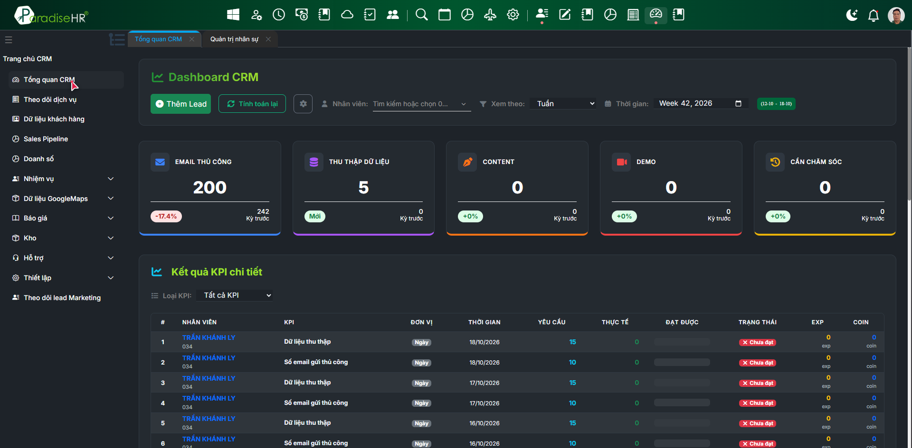
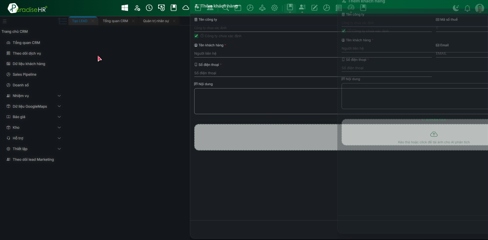
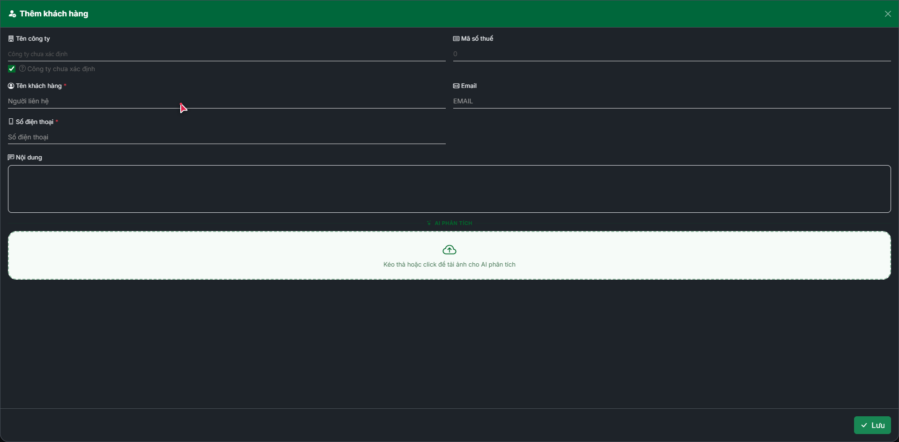

# BÁO CÁO KIỂM THỬ TRANG: CRM_OVERVIEW

> Thời gian kiểm thử: **12:31:57 16/10/2026**
> Tổng số kịch bản: **1** | ✅ LOGIC PASS: **1** | ❌ LOGIC FAIL: **0**

## BẢNG ĐỐI CHIẾU TRẠNG THÁI TEST & LOGIC NGHIỆP VỤ

| Mã TC | Tiêu đề Kịch bản | Trạng thái Test | Trạng thái Logic | Đánh giá Nghiệp vụ |
| :--- | :--- | :---: | :---: | :--- |
| **TC-04** | Thẩm định Nút Thêm Lead (#btnCreateLead) & Modal Tạo Mới Lead Nhanh | ✅ PASS | ✅ PASS | PASS - Nút Thêm Lead mở đúng modal tạo khách hàng, các trường nhập liệu phản hồi tốt |

---

### TC-04: Thẩm định Nút Thêm Lead (#btnCreateLead) & Modal Tạo Mới Lead Nhanh

* **Trạng thái thực thi Test (Kỹ thuật)**: ✅ PASS (Thời gian thực thi: `24.28s`)
* **Trạng thái Logic Nghiệp vụ (Business Output)**: ✅ PASS
* **Đánh giá tổng quát**: PASS - Nút Thêm Lead mở đúng modal tạo khách hàng, các trường nhập liệu phản hồi tốt
* **Thư mục lưu trữ**: `test-evidence/crm_overview/TC-04/`

#### 📸 Bằng chứng trực quan từng bước (Step-by-Step Evidence):

##### 🔹 Bước 1: Xác định vị trí nút Thêm Lead màu xanh lá

##### 🔹 Bước 2: Modal Thêm LEAD mở lên với đầy đủ các trường nhập liệu

##### 🔹 Bước 3: Kiểm tra khả năng nhập liệu trực quan vào ô Tên khách hàng

##### 🔹 Bước 4: Con trỏ Neon bấm nút Đóng modal Thêm Lead

##### 🔹 Bước 5: Màn hình Tổng quan CRM phục hồi nguyên vẹn sau khi đóng modal

#### 🎥 Video & Dấu vết kiểm thử (Video & Trace):
- **Video phiên chạy thực tế**: [video.webm](TC-04/videos/video.webm)
- **Playwright Trace**: [trace.zip](TC-04/traces/trace.zip) *(Mở bằng: `npx playwright show-trace test-evidence/crm_overview/TC-04/traces/trace.zip`)*

---

