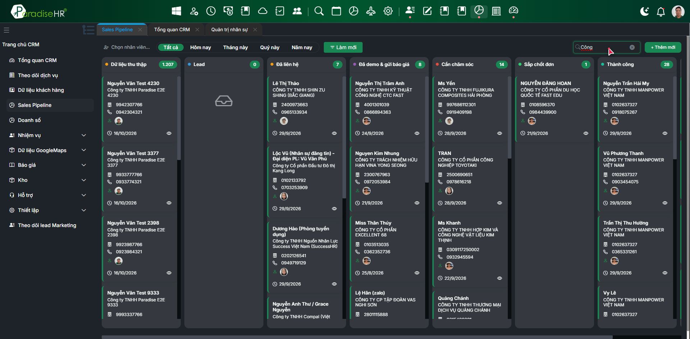
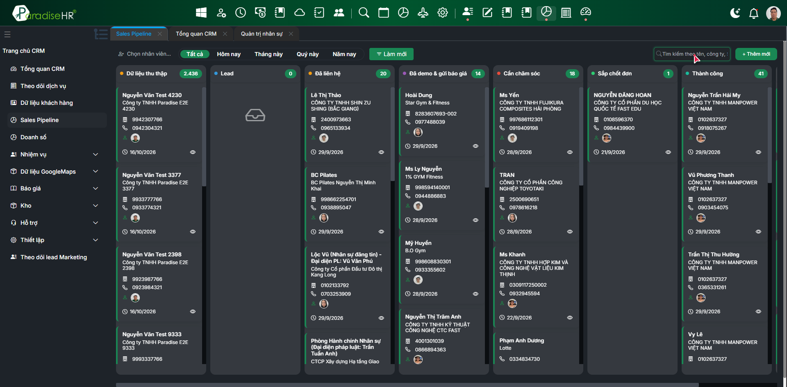

# BÁO CÁO KIỂM THỬ TRANG: CRM_SALES_PIPELINE

> Thời gian kiểm thử: **12:46:13 16/10/2026**
> Tổng số kịch bản: **1** | ✅ LOGIC PASS: **1** | ❌ LOGIC FAIL: **0**

## BẢNG ĐỐI CHIẾU TRẠNG THÁI TEST & LOGIC NGHIỆP VỤ

| Mã TC | Tiêu đề Kịch bản | Trạng thái Test | Trạng thái Logic | Đánh giá Nghiệp vụ |
| :--- | :--- | :---: | :---: | :--- |
| **TC-02** | Thẩm định Ô Tìm kiếm (#kanbanSearchInput) & Lọc Nhanh Cơ Hội | ✅ PASS | ✅ PASS | PASS - Ô tìm kiếm Kanban lọc tức thì và khôi phục dữ liệu hoàn hảo |

---

### TC-02: Thẩm định Ô Tìm kiếm (#kanbanSearchInput) & Lọc Nhanh Cơ Hội

* **Trạng thái thực thi Test (Kỹ thuật)**: ✅ PASS (Thời gian thực thi: `28.99s`)
* **Trạng thái Logic Nghiệp vụ (Business Output)**: ✅ PASS
* **Đánh giá tổng quát**: PASS - Ô tìm kiếm Kanban lọc tức thì và khôi phục dữ liệu hoàn hảo
* **Thư mục lưu trữ**: `test-evidence/crm_sales_pipeline/TC-02/`

#### 📸 Bằng chứng trực quan từng bước (Step-by-Step Evidence):

##### 🔹 Bước 1: Xác định vị trí ô tìm kiếm và trích xuất từ khóa: Công

##### 🔹 Bước 2: Con trỏ Neon focus vào ô tìm kiếm Kanban

##### 🔹 Bước 3: Gõ từ khóa tìm kiếm và quan sát các thẻ được lọc trực tiếp

##### 🔹 Bước 4: Hệ thống lọc tức thì danh sách còn 51 thẻ khớp từ khóa

##### 🔹 Bước 5: Khôi phục nguyên vẹn 61 thẻ cơ hội ban đầu

#### 🎥 Video & Dấu vết kiểm thử (Video & Trace):
- **Video phiên chạy thực tế**: [video.webm](TC-02/videos/video.webm)
- **Playwright Trace**: [trace.zip](TC-02/traces/trace.zip) *(Mở bằng: `npx playwright show-trace test-evidence/crm_sales_pipeline/TC-02/traces/trace.zip`)*

---

