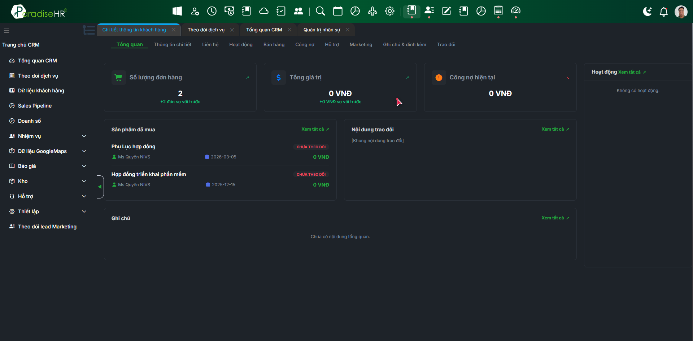
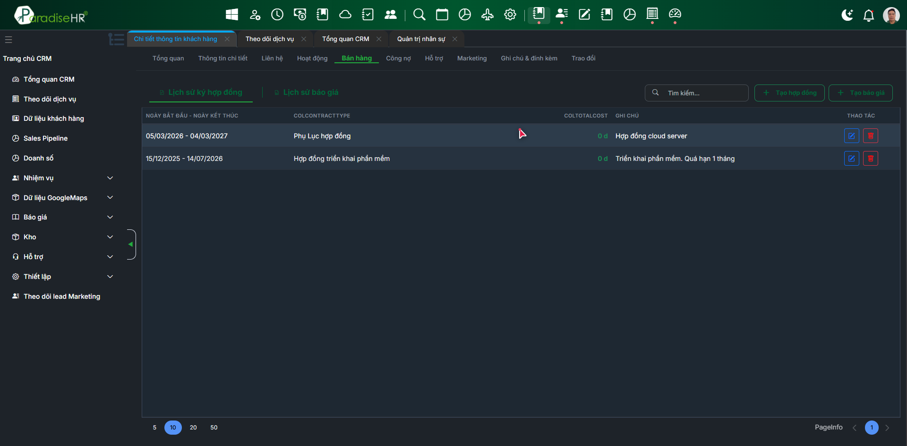
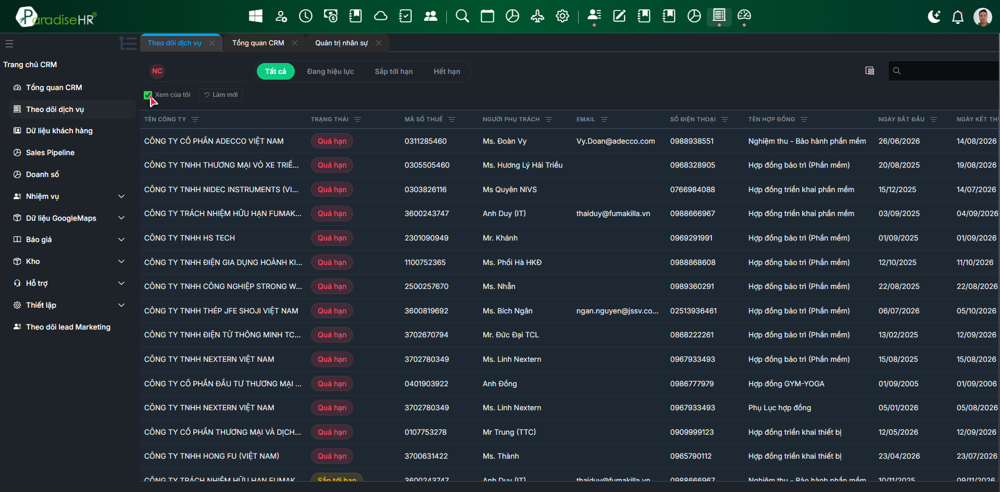
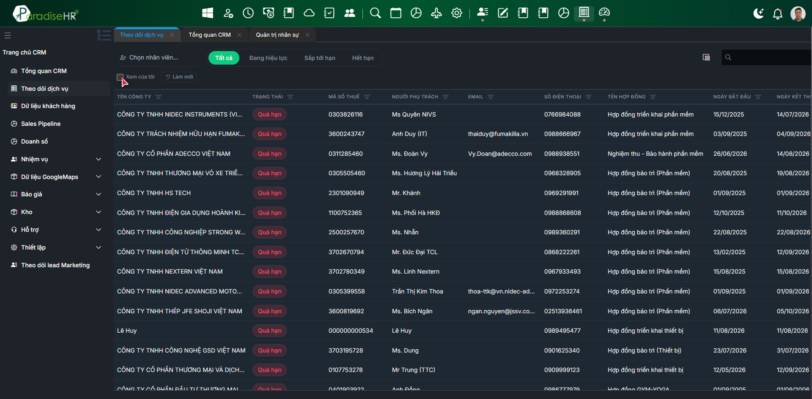
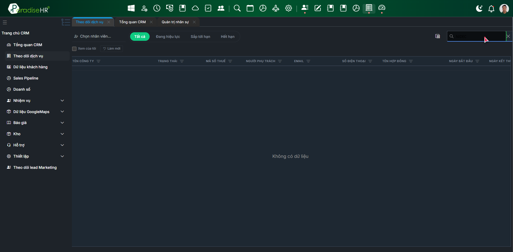
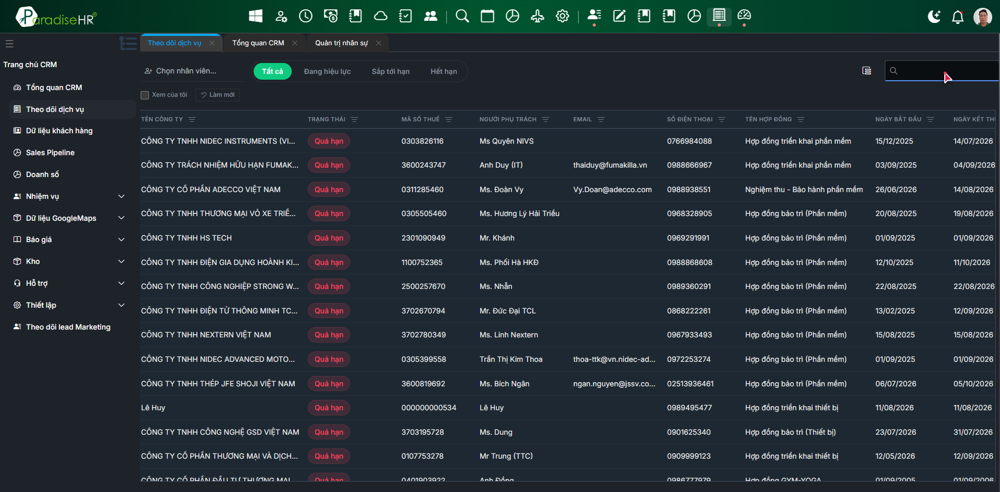
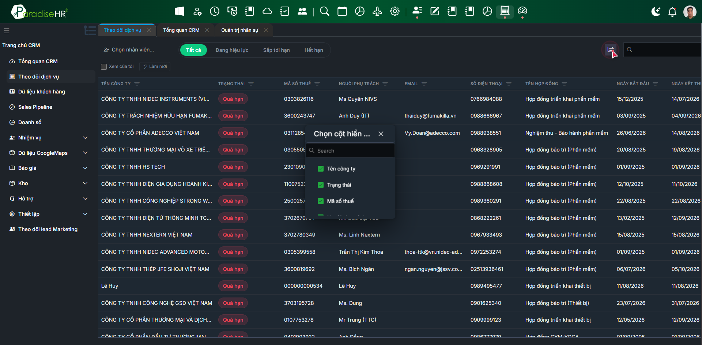
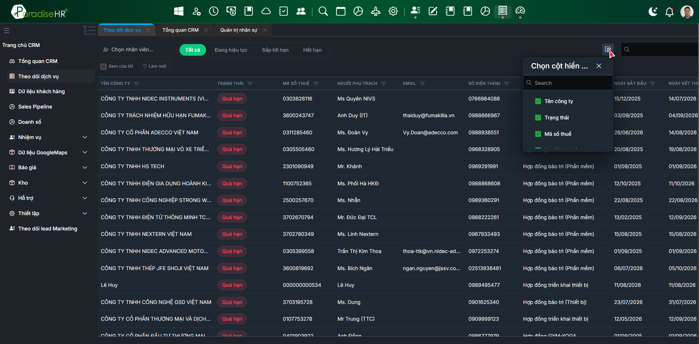

# BÁO CÁO KIỂM THỬ TRANG: CRM_SERVICE_TRACKING

> Thời gian kiểm thử: **12:41:04 16/10/2026**
> Tổng số kịch bản: **4** | ✅ LOGIC PASS: **3** | ❌ LOGIC FAIL: **1**

## BẢNG ĐỐI CHIẾU TRẠNG THÁI TEST & LOGIC NGHIỆP VỤ

| Mã TC | Tiêu đề Kịch bản | Trạng thái Test | Trạng thái Logic | Đánh giá Nghiệp vụ |
| :--- | :--- | :---: | :---: | :--- |
| **TC-01** | Khởi động, Điều hướng và Thẩm định API Nạp Danh sách Dịch vụ/Hợp đồng | ✅ PASS | ✅ PASS | PASS - Màn hình Theo dõi dịch vụ nạp danh sách hợp đồng thông suốt với đầy đủ dữ liệu |
| **TC-02** | Thẩm định Checkbox Lọc Dữ liệu Cá nhân (#toolbarIsOnlyUser) & Bắt API Lọc | ✅ PASS | ✅ PASS | PASS - Checkbox lọc cá nhân phản hồi mượt mà, chu kỳ khôi phục dữ liệu đạt 100% |
| **TC-03** | Thẩm định Ô Tìm kiếm Nhanh, Lọc Tức thì & Khôi phục Danh sách | ✅ PASS | ❌ FAIL | FAIL - Lỗi cú pháp SQL Backend khi tìm kiếm: Incorrect syntax near ')'. |
| **TC-04** | Thẩm định Nút Chọn Cột Hiển thị (Column Chooser Panel) | ✅ PASS | ✅ PASS | PASS - Tính năng Column Chooser hoạt động mượt mà, hiển thị đầy đủ danh mục cột |

---

### TC-01: Khởi động, Điều hướng và Thẩm định API Nạp Danh sách Dịch vụ/Hợp đồng

* **Trạng thái thực thi Test (Kỹ thuật)**: ✅ PASS (Thời gian thực thi: `26.38s`)
* **Trạng thái Logic Nghiệp vụ (Business Output)**: ✅ PASS
* **Đánh giá tổng quát**: PASS - Màn hình Theo dõi dịch vụ nạp danh sách hợp đồng thông suốt với đầy đủ dữ liệu
* **Thư mục lưu trữ**: `test-evidence/crm_service_tracking/TC-01/`

#### 📸 Bằng chứng trực quan từng bước (Step-by-Step Evidence):

##### 🔹 Bước 1: Mở thành công màn hình Theo dõi dịch vụ trong CRM

##### 🔹 Bước 2: DataGrid nạp đầy đủ danh sách hợp đồng dịch vụ khách hàng

##### 🔹 Bước 3: Xác nhận hiển thị đầy đủ các cột nghiệp vụ trọng tâm

##### 🔹 Bước 4: Con trỏ Neon rà soát và chọn dòng dịch vụ đầu tiên

##### 🔹 Bước 5: Danh sách dịch vụ nạp hoàn chỉnh đạt chuẩn

#### 🎥 Video & Dấu vết kiểm thử (Video & Trace):
- **Video phiên chạy thực tế**: [video.webm](TC-01/videos/video.webm)
- **Playwright Trace**: [trace.zip](TC-01/traces/trace.zip) *(Mở bằng: `npx playwright show-trace test-evidence/crm_service_tracking/TC-01/traces/trace.zip`)*

---

### TC-02: Thẩm định Checkbox Lọc Dữ liệu Cá nhân (#toolbarIsOnlyUser) & Bắt API Lọc

* **Trạng thái thực thi Test (Kỹ thuật)**: ✅ PASS (Thời gian thực thi: `26.74s`)
* **Trạng thái Logic Nghiệp vụ (Business Output)**: ✅ PASS
* **Đánh giá tổng quát**: PASS - Checkbox lọc cá nhân phản hồi mượt mà, chu kỳ khôi phục dữ liệu đạt 100%
* **Thư mục lưu trữ**: `test-evidence/crm_service_tracking/TC-02/`

#### 📸 Bằng chứng trực quan từng bước (Step-by-Step Evidence):

##### 🔹 Bước 1: Xác định vị trí checkbox Lọc dữ liệu cá nhân

##### 🔹 Bước 2: Con trỏ Neon nhấp đổi trạng thái checkbox lọc dữ liệu cá nhân

##### 🔹 Bước 3: DataGrid cập nhật danh sách theo tiêu chí phân quyền cá nhân

##### 🔹 Bước 4: Khôi phục lại checkbox ban đầu và thẩm định tính toàn vẹn danh sách

##### 🔹 Bước 5: Hệ thống khôi phục dữ liệu nguyên vẹn sau chu kỳ lọc

#### 🎥 Video & Dấu vết kiểm thử (Video & Trace):
- **Video phiên chạy thực tế**: [video.webm](TC-02/videos/video.webm)
- **Playwright Trace**: [trace.zip](TC-02/traces/trace.zip) *(Mở bằng: `npx playwright show-trace test-evidence/crm_service_tracking/TC-02/traces/trace.zip`)*

---

### TC-03: Thẩm định Ô Tìm kiếm Nhanh, Lọc Tức thì & Khôi phục Danh sách

* **Trạng thái thực thi Test (Kỹ thuật)**: ✅ PASS (Thời gian thực thi: `26.58s`)
* **Trạng thái Logic Nghiệp vụ (Business Output)**: ❌ FAIL
* **Đánh giá tổng quát**: FAIL - Lỗi cú pháp SQL Backend khi tìm kiếm: Incorrect syntax near ')'.
* **Thư mục lưu trữ**: `test-evidence/crm_service_tracking/TC-03/`

> [!CAUTION] 🚨 PHÂN TÍCH NGUYÊN NHÂN THẤT BẠI (FAILURE ANALYSIS)
>
> * **Vấn đề / Mã lỗi**: DataGrid hiển thị "Không có dữ liệu" khi tìm kiếm dù từ khóa có thật trong danh sách
> * **Kỳ vọng nghiệp vụ (Expected Output)**: Khi tìm kiếm "NIDEC" hoặc "CÔNG TY", hệ thống phải trả về các bản ghi khớp với từ khóa
> * **Thực tế hệ thống (Actual Output)**: Server IIS trả HTTP 200 nhưng payload trả lỗi SQL nội bộ: "Incorrect syntax near ')'.", làm mảng data rỗng []
> * **Nguyên nhân cốt lõi (Root Cause)**: Stored Procedure hoặc câu lệnh SQL động phía Backend xử lý tham số tìm kiếm bị sai cú pháp (Incorrect syntax near ")")
> * **Đề xuất khắc phục (Recommendation)**: Đội ngũ Backend cần kiểm tra lại câu lệnh SQL ghép chuỗi tìm kiếm trong Stored Procedure của menu Theo dõi dịch vụ

#### 📸 Bằng chứng trực quan từng bước (Step-by-Step Evidence):

##### 🔹 Bước 1: Trích xuất từ khóa thực tế từ dòng 1: CÔNG

##### 🔹 Bước 1: Trích xuất từ khóa thực tế từ dòng 1: CÔNG

##### 🔹 Bước 2: Con trỏ Neon focus vào ô tìm kiếm nhanh

##### 🔹 Bước 3: Gõ từ khóa tìm kiếm và quan sát DataGrid lọc tức thì

##### 🔹 Bước 4: Phát hiện lỗi Backend SQL làm DataGrid rỗng dữ liệu khi tìm kiếm

##### 🔹 Bước 5: Xóa ô tìm kiếm và khôi phục nguyên vẹn 100% số bản ghi ban đầu

#### 🎥 Video & Dấu vết kiểm thử (Video & Trace):
- **Video phiên chạy thực tế**: [video.webm](TC-03/videos/video.webm)
- **Playwright Trace**: [trace.zip](TC-03/traces/trace.zip) *(Mở bằng: `npx playwright show-trace test-evidence/crm_service_tracking/TC-03/traces/trace.zip`)*

---

### TC-04: Thẩm định Nút Chọn Cột Hiển thị (Column Chooser Panel)

* **Trạng thái thực thi Test (Kỹ thuật)**: ✅ PASS (Thời gian thực thi: `23.50s`)
* **Trạng thái Logic Nghiệp vụ (Business Output)**: ✅ PASS
* **Đánh giá tổng quát**: PASS - Tính năng Column Chooser hoạt động mượt mà, hiển thị đầy đủ danh mục cột
* **Thư mục lưu trữ**: `test-evidence/crm_service_tracking/TC-04/`

#### 📸 Bằng chứng trực quan từng bước (Step-by-Step Evidence):

##### 🔹 Bước 1: Xác định vị trí icon Chọn cột hiển thị trên toolbar

##### 🔹 Bước 2: Bảng chọn cột hiển thị (Column Chooser) mở ra trực quan

##### 🔹 Bước 3: Rà soát các tùy chọn bật/tắt hiển thị từng cột dữ liệu

##### 🔹 Bước 4: Con trỏ Neon bấm đóng panel Column Chooser

##### 🔹 Bước 5: Panel chọn cột đóng an toàn không gây crash giao diện

#### 🎥 Video & Dấu vết kiểm thử (Video & Trace):
- **Video phiên chạy thực tế**: [video.webm](TC-04/videos/video.webm)
- **Playwright Trace**: [trace.zip](TC-04/traces/trace.zip) *(Mở bằng: `npx playwright show-trace test-evidence/crm_service_tracking/TC-04/traces/trace.zip`)*

---

