# BÁO CÁO KIỂM THỬ TRANG: EMPLOYEE_BANK_APPROVAL

> Thời gian kiểm thử: **23:16:56 15/10/2026**
> Tổng số kịch bản: **3** | ✅ LOGIC PASS: **2** | ❌ LOGIC FAIL: **1**

## BẢNG ĐỐI CHIẾU TRẠNG THÁI TEST & LOGIC NGHIỆP VỤ

| Mã TC | Tiêu đề Kịch bản | Trạng thái Test | Trạng thái Logic | Đánh giá Nghiệp vụ |
| :--- | :--- | :---: | :---: | :--- |
| **TC-01** | Nhân viên Tai.Dang đăng nhập và cập nhật Thông tin Ngân hàng | ✅ PASS | ✅ PASS | PASS - Yêu cầu cập nhật thông tin ngân hàng đã được gửi thành công lên hệ thống phê duyệt |
| **TC-02** | Quản lý Cuong.Vu đăng nhập và Phê duyệt thay đổi hồ sơ | ✅ PASS | ✅ PASS | PASS - Quản lý phê duyệt thành công yêu cầu trên hệ thống (Hệ thống xác nhận: Đã duyệt thành công các thay đổi) |
| **TC-03** | Nhân viên Tai.Dang đăng nhập lại để đối chiếu và kiểm tra thông tin sau phê duyệt | ✅ PASS | ❌ FAIL | FAIL - Thông tin tài khoản ngân hàng không hiển thị trên hồ sơ nhân viên sau khi đã được phê duyệt |

---

### TC-01: Nhân viên Tai.Dang đăng nhập và cập nhật Thông tin Ngân hàng

* **Trạng thái thực thi Test (Kỹ thuật)**: ✅ PASS (Thời gian thực thi: `37.48s`)
* **Trạng thái Logic Nghiệp vụ (Business Output)**: ✅ PASS
* **Đánh giá tổng quát**: PASS - Yêu cầu cập nhật thông tin ngân hàng đã được gửi thành công lên hệ thống phê duyệt
* **Thư mục lưu trữ**: `test-evidence/employee_bank_approval/TC-01/`

#### 📸 Bằng chứng trực quan từng bước (Step-by-Step Evidence):

##### 🔹 Bước 1: Đăng nhập thành công với tài khoản nhân viên Tai.Dang
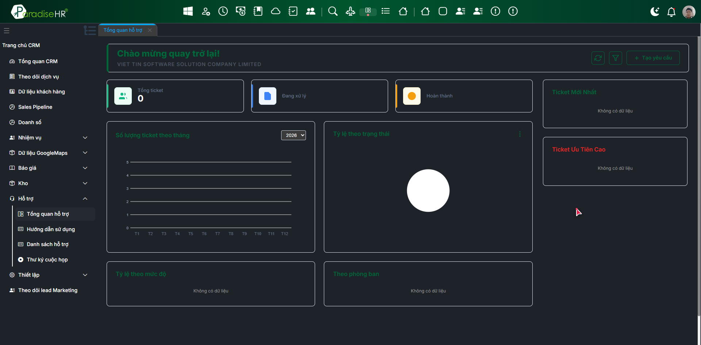

##### 🔹 Bước 2: Mở màn hình Hồ sơ nhân viên và khu vực thông tin cá nhân
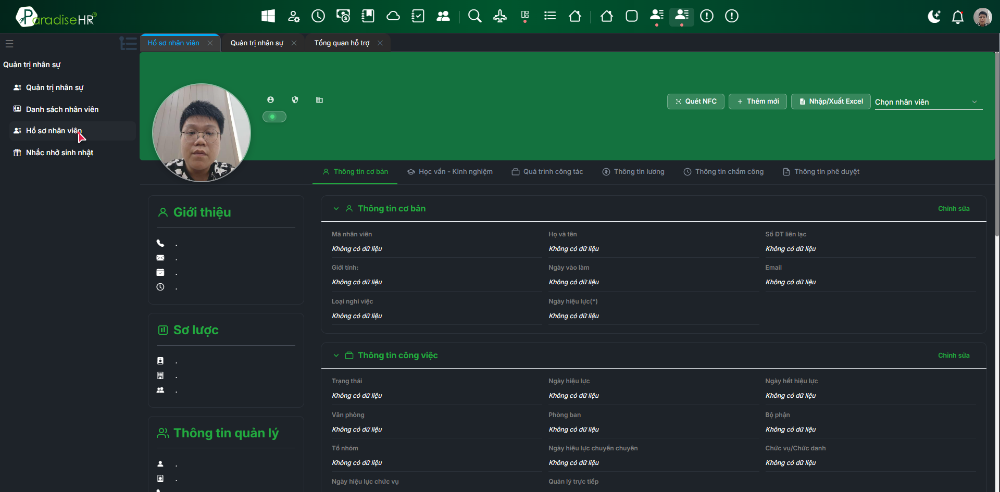

##### 🔹 Bước 3: Nhập đầy đủ thông tin tài khoản ngân hàng mới trên form chỉnh sửa
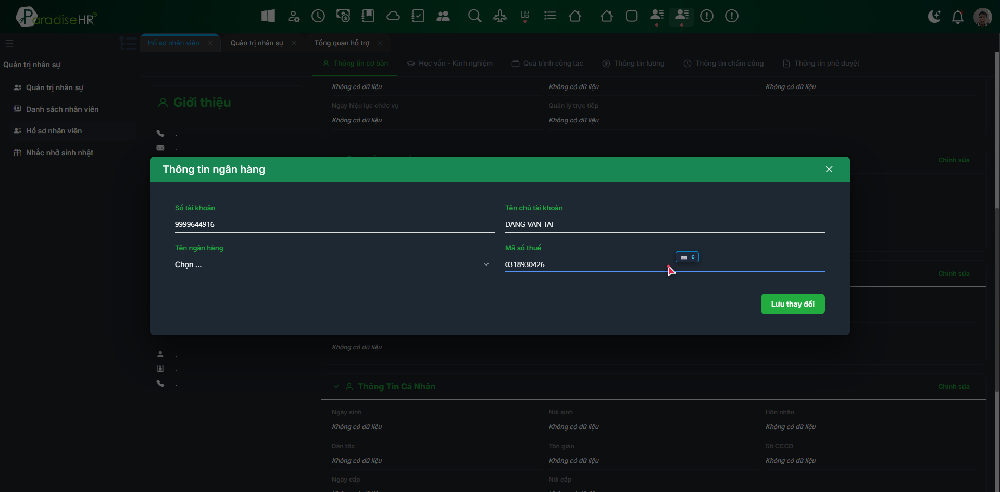

##### 🔹 Bước 4: Con trỏ chuột Neon di chuyển và nhấp nút Lưu thay đổi
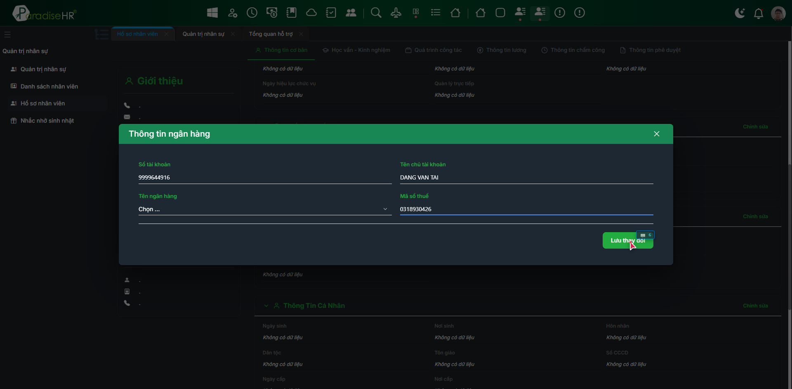

##### 🔹 Bước 5: Hệ thống hoàn tất gửi yêu cầu phê duyệt thông tin ngân hàng
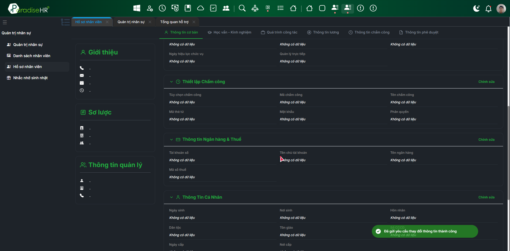

#### 🎥 Video & Dấu vết kiểm thử (Video & Trace):
- **Video phiên chạy thực tế**: [video.webm](TC-01/videos/video.webm)
- **Playwright Trace**: [trace.zip](TC-01/traces/trace.zip) *(Mở bằng: `npx playwright show-trace test-evidence/employee_bank_approval/TC-01/traces/trace.zip`)*

---

### TC-02: Quản lý Cuong.Vu đăng nhập và Phê duyệt thay đổi hồ sơ

* **Trạng thái thực thi Test (Kỹ thuật)**: ✅ PASS (Thời gian thực thi: `34.58s`)
* **Trạng thái Logic Nghiệp vụ (Business Output)**: ✅ PASS
* **Đánh giá tổng quát**: PASS - Quản lý phê duyệt thành công yêu cầu trên hệ thống (Hệ thống xác nhận: Đã duyệt thành công các thay đổi)
* **Thư mục lưu trữ**: `test-evidence/employee_bank_approval/TC-02/`

#### 📸 Bằng chứng trực quan từng bước (Step-by-Step Evidence):

##### 🔹 Bước 1: Quản lý Cuong.Vu truy cập thành công màn hình Danh sách phê duyệt
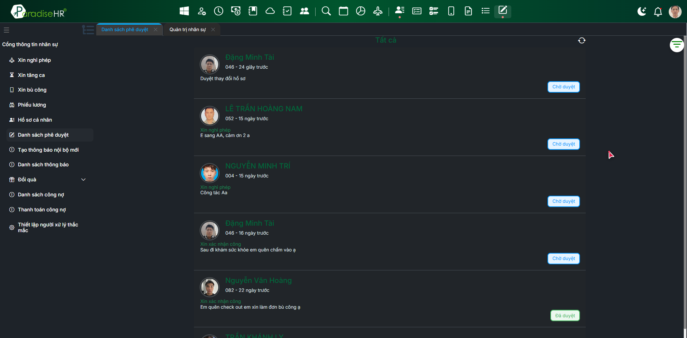

##### 🔹 Bước 2: Chọn bản ghi yêu cầu Duyệt thay đổi hồ sơ của Đặng Minh Tài
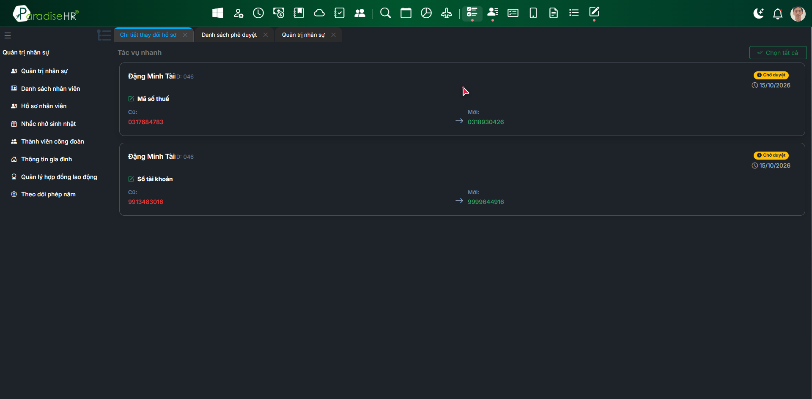

##### 🔹 Bước 3: Chi tiết thay đổi hồ sơ và tích chọn toàn bộ các mục thông tin cần duyệt
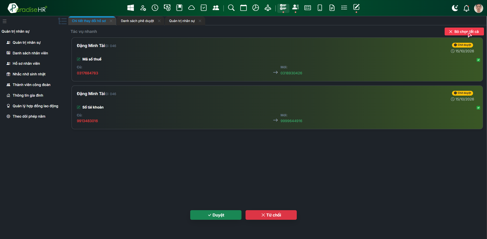

##### 🔹 Bước 4: Con trỏ chuột Neon di chuyển trực tiếp lên nút Phê duyệt trên thanh thao tác nổi
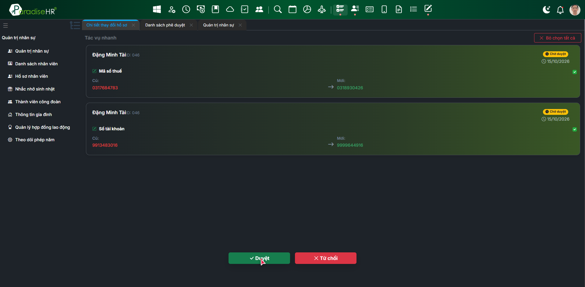

##### 🔹 Bước 5: Hệ thống xác nhận đã phê duyệt thành công các thông tin thay đổi
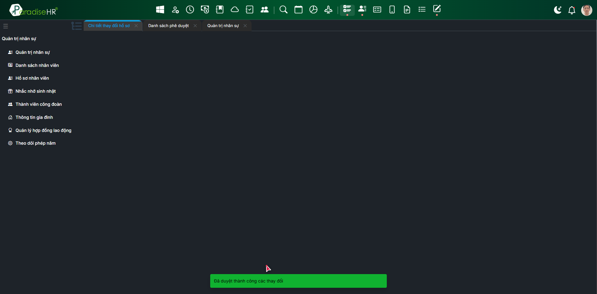

#### 🎥 Video & Dấu vết kiểm thử (Video & Trace):
- **Video phiên chạy thực tế**: [video.webm](TC-02/videos/video.webm)
- **Playwright Trace**: [trace.zip](TC-02/traces/trace.zip) *(Mở bằng: `npx playwright show-trace test-evidence/employee_bank_approval/TC-02/traces/trace.zip`)*

---

### TC-03: Nhân viên Tai.Dang đăng nhập lại để đối chiếu và kiểm tra thông tin sau phê duyệt

* **Trạng thái thực thi Test (Kỹ thuật)**: ✅ PASS (Thời gian thực thi: `29.93s`)
* **Trạng thái Logic Nghiệp vụ (Business Output)**: ❌ FAIL
* **Đánh giá tổng quát**: FAIL - Thông tin tài khoản ngân hàng không hiển thị trên hồ sơ nhân viên sau khi đã được phê duyệt
* **Thư mục lưu trữ**: `test-evidence/employee_bank_approval/TC-03/`

> [!CAUTION] 🚨 PHÂN TÍCH NGUYÊN NHÂN THẤT BẠI (FAILURE ANALYSIS)
>
> * **Vấn đề / Mã lỗi**: Dữ liệu số tài khoản và thông tin ngân hàng không cập nhật vào hồ sơ cá nhân sau khi Quản lý phê duyệt thành công
> * **Kỳ vọng nghiệp vụ (Expected Output)**: Sau khi Quản lý Cuong.Vu thực hiện duyệt ở TC-02, số tài khoản mới (ví dụ 99xxxxxxx) và ngân hàng phải được nạp đầy đủ vào form Thông tin ngân hàng của nhân viên Tai.Dang
> * **Thực tế hệ thống (Actual Output)**: Các ô nhập liệu Số tài khoản, Ngân hàng, Chi nhánh trong form Thông tin ngân hàng của nhân viên vẫn hoàn toàn rỗng ("")
> * **Nguyên nhân cốt lõi (Root Cause)**: Hệ thống Paradise HRM khi gọi sp_approve_EmployeeChange mới chỉ cập nhật cờ trạng thái trong bảng yêu cầu thay đổi (sp_EmployeeChange_Detail), nhưng chưa thực hiện câu lệnh UPDATE dữ liệu vào bảng chính của nhân viên (tbl_HRS_Employee / tbl_HRS_Employee_Bank), hoặc API lấy thông tin nhân viên chưa nạp dữ liệu từ nguồn đã duyệt.
> * **Đề xuất khắc phục (Recommendation)**: Đội ngũ Backend cần kiểm tra lại Stored Procedure sp_approve_EmployeeChange để đảm bảo dữ liệu được đồng bộ vào bảng nhân viên chính thức; đồng thời kiểm tra luồng API nạp dữ liệu lên form Hồ sơ nhân viên.

#### 📸 Bằng chứng trực quan từng bước (Step-by-Step Evidence):

##### 🔹 Bước 1: Nhân viên Tai.Dang đăng nhập lại hệ thống để kiểm tra thông tin sau duyệt

##### 🔹 Bước 2: Điều hướng đến mục Thông tin Ngân hàng & Thuế trên màn hình Hồ sơ nhân viên
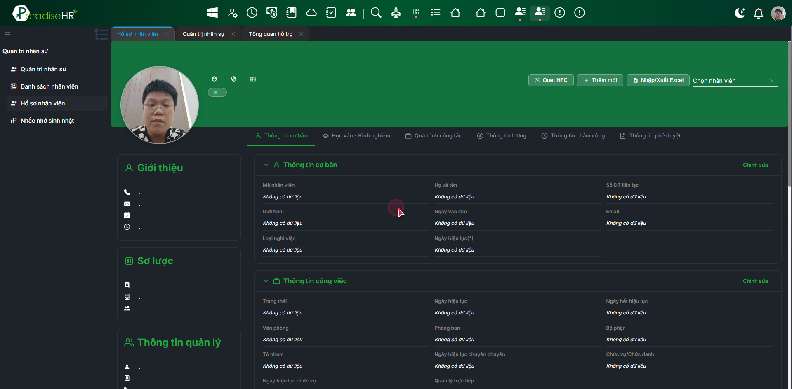

##### 🔹 Bước 3: Bằng chứng đối chiếu thực tế: Form Thông tin ngân hàng vẫn rỗng dữ liệu sau khi duyệt
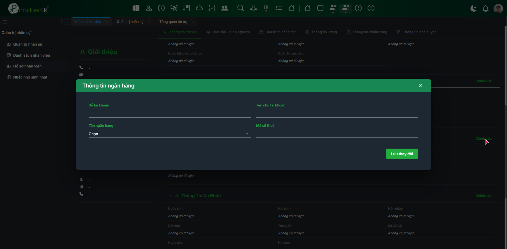

#### 🎥 Video & Dấu vết kiểm thử (Video & Trace):
- **Video phiên chạy thực tế**: [video.webm](TC-03/videos/video.webm)
- **Playwright Trace**: [trace.zip](TC-03/traces/trace.zip) *(Mở bằng: `npx playwright show-trace test-evidence/employee_bank_approval/TC-03/traces/trace.zip`)*

---

