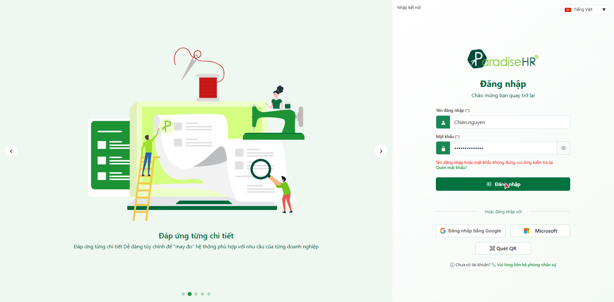

# BÁO CÁO KIỂM THỬ TRANG: LOGIN

> Thời gian kiểm thử: 14:31:53 15/10/2026
> Tổng số kịch bản: **1** | ✅ PASS: **1** | ❌ FAIL: **0**

---

### TC-02: TC-02: Đăng nhập thất bại khi nhập sai mật khẩu

* **Kết quả**: ✅ PASS (Thời gian: `17.42s`)
* **Thư mục lưu trữ**: `test-evidence/login/TC-02/`

#### Bằng chứng kiểm thử (Evidence):
- **Ảnh chụp màn hình (Screenshots)**:
  - 
- **Video quay trực tiếp (Video)**:
  - [video.webm](TC-02/videos/video.webm)
- **Playwright Trace**:
  - [trace.zip](TC-02/traces/trace.zip) *(Mở bằng: `npx playwright show-trace test-evidence/login/TC-02/traces/trace.zip`)*

---

