# BÁO CÁO KIỂM THỬ TRANG: QUY_TRINH_TINH_LUONG_NV_MOI

> Thời gian kiểm thử: **08:16:07 11/11/2026**
> Tổng số kịch bản: **17** | ✅ LOGIC PASS: **15** | ❌ LOGIC FAIL: **2**

## BẢNG ĐỐI CHIẾU TRẠNG THÁI TEST & LOGIC NGHIỆP VỤ

| Mã TC | Tiêu đề Kịch bản | Trạng thái Test | Trạng thái Logic | Đánh giá Nghiệp vụ |
| :--- | :--- | :---: | :---: | :--- |
| **TC-01** | fix-4 | TC-01: Tạo mới hồ sơ nhân viên Nguyễn Văn Test (Role: cuong.vu) | ✅ PASS | ✅ PASS | Đạt yêu cầu logic nghiệp vụ mong đợi |
| **TC-02** | fix-4 | TC-02: Cấp tài khoản đăng nhập ESS Portal test.nv (Role: cuong.vu) | ✅ PASS | ✅ PASS | Đạt yêu cầu logic nghiệp vụ mong đợi |
| **TC-03** | fix-4 | TC-03: Thiết lập HĐLĐ và Mức lương 10,000,000 VNĐ (Role: cuong.vu) | ✅ PASS | ✅ PASS | Đạt yêu cầu logic nghiệp vụ mong đợi |
| **TC-04** | fix-4 | TC-04: Đăng ký 1 Người phụ thuộc giảm trừ gia cảnh (Role: cuong.vu) | ✅ PASS | ✅ PASS | Đạt yêu cầu logic nghiệp vụ mong đợi |
| **TC-05** | fix-4 | TC-05: Phân ca làm việc hành chính chuẩn cho NV 099 (Role: cuong.vu) | ✅ PASS | ✅ PASS | Đạt yêu cầu logic nghiệp vụ mong đợi |
| **TC-06** | fix-5 | TC-06: Khảo sát hiện trạng Before ngày 15/10 và tổng công tháng 10 (Role: test.nv) | ✅ PASS | ✅ PASS | PASS - Khảo sát Baseline Before ngày 15/10 (0.0h) và tổng công Tháng 10 (21.0 công) hoàn tất thành công. |
| **TC-07** | fix-5 | TC-07: Nộp đơn Xin bù công ngày 15/10/2026 giờ vào 08:00 (Role: test.nv) | ✅ PASS | ✅ PASS | PASS - Đơn Xin bù công ngày 15/10/2026 (vào 08:00) đã được nộp thành công và ghi nhận vào CSDL. |
| **TC-08** | fix-5 | TC-08: Nộp đơn Xin nghỉ phép năm AL hưởng nguyên lương ngày 24/10 (Role: test.nv) | ❌ FAIL | ❌ FAIL | Error: 🚨 [PHÁT HIỆN KHOANH NHẦM DÒNG]: Vùng định khoanh "FORM XIN NGHỈ PHÉP NĂM AL NGÀY 24/10/2026 (1 NGÀY = 8H)" KHÔNG chứa từ khóa bắt buộc "Phép năm".
👉 Nội dung thực tế đang định khoanh bừa là: "Xin nghỉ phép
Lịch sử
Nguyễn Văn Test

099

 Loại Nghỉ (*)
Số ngày nghỉ còn lại:
2
?
 Từ ngày (*)
 Đến ngày (*)
 Lý do (..." |
| **TC-09** | fix-5 | TC-09: Nộp đơn Xin tăng ca OT 2.0h ngày 20/10/2026 (Role: test.nv) | ❌ FAIL | ❌ FAIL | Error: 🚨 [PHÁT HIỆN LỖI GÕ PHÍM]: Đã thực hiện gõ vào "Lý do tăng ca" nhưng ô input trên giao diện vẫn trống rỗng! Dừng kịch bản, cấm bấm Submit! |
| **TC-10** | fix-6 | TC-10: Quản lý ThanhLong phê duyệt Cấp 1 đơn Nghỉ phép AL 24/10 (Role: ThanhLong) | ✅ PASS | ✅ PASS | PASS - Quản lý ThanhLong đã thẩm định & duyệt Cấp 1 đơn Nghỉ phép AL ngày 24/10 của NV 099 |
| **TC-11** | fix-6 | TC-11: Quản lý LongKa phê duyệt Cấp 1 đơn Tăng ca OT 20/10 (Role: LongKa) | ✅ PASS | ✅ PASS | PASS - Quản lý LongKa đã thẩm định & duyệt Cấp 1 đơn Tăng ca OT ngày 20/10 của NV 099 |
| **TC-12** | fix-6 | TC-12: Giám đốc cuong.vu phê duyệt chặng cuối CẢ 2 ĐƠN + Đơn bù công 15/10 (Role: cuong.vu) | ✅ PASS | ✅ PASS | PASS - Giám đốc cuong.vu đã phê duyệt chặng cuối hoàn tất CẢ 3 ĐƠN (Phép AL, Tăng ca OT, Bù công) cho NV 099 |
| **TC-13** | fix-6 | TC-13: Đối soát chốt chặn Delta After công ngày 15/10 và tổng công tháng (Role: cuong.vu) | ✅ PASS | ✅ PASS | Đạt yêu cầu logic nghiệp vụ mong đợi |
| **TC-14** | fix-7 | TC-14: Kế toán chien.nguyen nạp Thưởng KPI 1,000,000 VNĐ Tháng 10/2026 (Role: chien.nguyen) | ✅ PASS | ✅ PASS | PASS - Kế toán trưởng chien.nguyen đã nạp Thưởng KPI 1.000.000 VNĐ cho nhân viên 099 trong kỳ Tháng 10/2026 trên MnuPRL036 (tblSal_Adjustment). |
| **TC-15** | fix-7 | TC-15: Kế toán chien.nguyen nạp Tạm ứng lương 2,000,000 VNĐ và Khóa phiếu (Role: chien.nguyen) | ✅ PASS | ✅ PASS | PASS - Kế toán trưởng chien.nguyen đã nạp Tạm ứng 2.000.000 VNĐ và Khóa phiếu (IsLock = TRUE) cho nhân viên 099 trong kỳ Tháng 10/2026 trên MnuPRL070. |
| **TC-16** | fix-7 | TC-16: Kế toán kích hoạt Tính tiền lương tự động toàn công ty (Role: chien.nguyen) | ✅ PASS | ✅ PASS | PASS - Thủ tục tính lương tự động SALCAL_MAIN Tháng 10/2026 đã được kích hoạt thành công trên MnuPRL040. CSDL tblSal_Sal đã ghi nhận Lương cơ bản = 10.000.000 VNĐ cho nhân viên 099. |
| **TC-17** | fix-7 | TC-17: Kế toán thực hiện Khóa sổ kỳ lương Tháng 10/2026 (Role: chien.nguyen) | ✅ PASS | ✅ PASS | PASS - Kỳ lương Tháng 10/2026 đã được niêm phong thành công trong tblSal_Lock (LockCount >= 1). Hoàn tất bàn giao cho fix-8 nghiệm thu Phiếu lương! |

---

### TC-01: fix-4 | TC-01: Tạo mới hồ sơ nhân viên Nguyễn Văn Test (Role: cuong.vu)

* **Trạng thái thực thi Test (Kỹ thuật)**: ✅ PASS (Thời gian thực thi: `25.42s`)
* **Trạng thái Logic Nghiệp vụ (Business Output)**: ✅ PASS
* **Đánh giá tổng quát**: Đạt yêu cầu logic nghiệp vụ mong đợi
* **Thư mục lưu trữ**: `test-evidence/quy_trinh_tinh_luong_nv_moi/TC-01/`

#### 📸 Bằng chứng trực quan từng bước (Step-by-Step Evidence):

*(Không có ảnh chụp màn hình)*

#### 🎥 Video & Dấu vết kiểm thử (Video & Trace):
- **Video phiên chạy thực tế**: [video.webm](TC-01/videos/video.webm)

---

### TC-02: fix-4 | TC-02: Cấp tài khoản đăng nhập ESS Portal test.nv (Role: cuong.vu)

* **Trạng thái thực thi Test (Kỹ thuật)**: ✅ PASS (Thời gian thực thi: `28.45s`)
* **Trạng thái Logic Nghiệp vụ (Business Output)**: ✅ PASS
* **Đánh giá tổng quát**: Đạt yêu cầu logic nghiệp vụ mong đợi
* **Thư mục lưu trữ**: `test-evidence/quy_trinh_tinh_luong_nv_moi/TC-02/`

#### 📸 Bằng chứng trực quan từng bước (Step-by-Step Evidence):

*(Không có ảnh chụp màn hình)*

#### 🎥 Video & Dấu vết kiểm thử (Video & Trace):
- **Video phiên chạy thực tế**: [video.webm](TC-02/videos/video.webm)

---

### TC-03: fix-4 | TC-03: Thiết lập HĐLĐ và Mức lương 10,000,000 VNĐ (Role: cuong.vu)

* **Trạng thái thực thi Test (Kỹ thuật)**: ✅ PASS (Thời gian thực thi: `64.25s`)
* **Trạng thái Logic Nghiệp vụ (Business Output)**: ✅ PASS
* **Đánh giá tổng quát**: Đạt yêu cầu logic nghiệp vụ mong đợi
* **Thư mục lưu trữ**: `test-evidence/quy_trinh_tinh_luong_nv_moi/TC-03/`

#### 📸 Bằng chứng trực quan từng bước (Step-by-Step Evidence):

*(Không có ảnh chụp màn hình)*

#### 🎥 Video & Dấu vết kiểm thử (Video & Trace):
- **Video phiên chạy thực tế**: [video.webm](TC-03/videos/video.webm)

---

### TC-04: fix-4 | TC-04: Đăng ký 1 Người phụ thuộc giảm trừ gia cảnh (Role: cuong.vu)

* **Trạng thái thực thi Test (Kỹ thuật)**: ✅ PASS (Thời gian thực thi: `66.23s`)
* **Trạng thái Logic Nghiệp vụ (Business Output)**: ✅ PASS
* **Đánh giá tổng quát**: Đạt yêu cầu logic nghiệp vụ mong đợi
* **Thư mục lưu trữ**: `test-evidence/quy_trinh_tinh_luong_nv_moi/TC-04/`

#### 📸 Bằng chứng trực quan từng bước (Step-by-Step Evidence):

*(Không có ảnh chụp màn hình)*

#### 🎥 Video & Dấu vết kiểm thử (Video & Trace):
- **Video phiên chạy thực tế**: [video.webm](TC-04/videos/video.webm)

---

### TC-05: fix-4 | TC-05: Phân ca làm việc hành chính chuẩn cho NV 099 (Role: cuong.vu)

* **Trạng thái thực thi Test (Kỹ thuật)**: ✅ PASS (Thời gian thực thi: `28.70s`)
* **Trạng thái Logic Nghiệp vụ (Business Output)**: ✅ PASS
* **Đánh giá tổng quát**: Đạt yêu cầu logic nghiệp vụ mong đợi
* **Thư mục lưu trữ**: `test-evidence/quy_trinh_tinh_luong_nv_moi/TC-05/`

#### 📸 Bằng chứng trực quan từng bước (Step-by-Step Evidence):

*(Không có ảnh chụp màn hình)*

#### 🎥 Video & Dấu vết kiểm thử (Video & Trace):
- **Video phiên chạy thực tế**: [video.webm](TC-05/videos/video.webm)

---

### TC-06: fix-5 | TC-06: Khảo sát hiện trạng Before ngày 15/10 và tổng công tháng 10 (Role: test.nv)

* **Trạng thái thực thi Test (Kỹ thuật)**: ✅ PASS (Thời gian thực thi: `30.80s`)
* **Trạng thái Logic Nghiệp vụ (Business Output)**: ✅ PASS
* **Đánh giá tổng quát**: PASS - Khảo sát Baseline Before ngày 15/10 (0.0h) và tổng công Tháng 10 (21.0 công) hoàn tất thành công.
* **Thư mục lưu trữ**: `test-evidence/quy_trinh_tinh_luong_nv_moi/TC-06/`

#### 📸 Bằng chứng trực quan từng bước (Step-by-Step Evidence):

##### 🔹 Bước 1: Dang nhap tai khoan nhan vien moi test nv
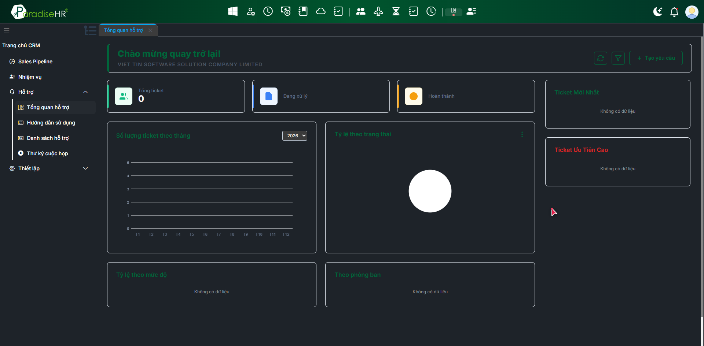

##### 🔹 Bước 2: Khao sat Before ngay 15-10 tren MnuHRS225
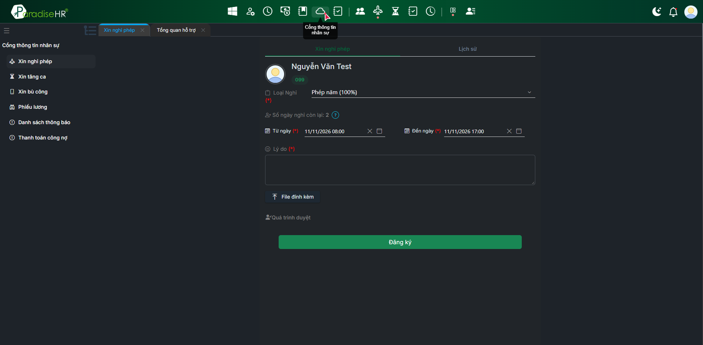

##### 🔹 Bước 3: Khao sat Before tong cong thang 10 tren MnuTAD1000
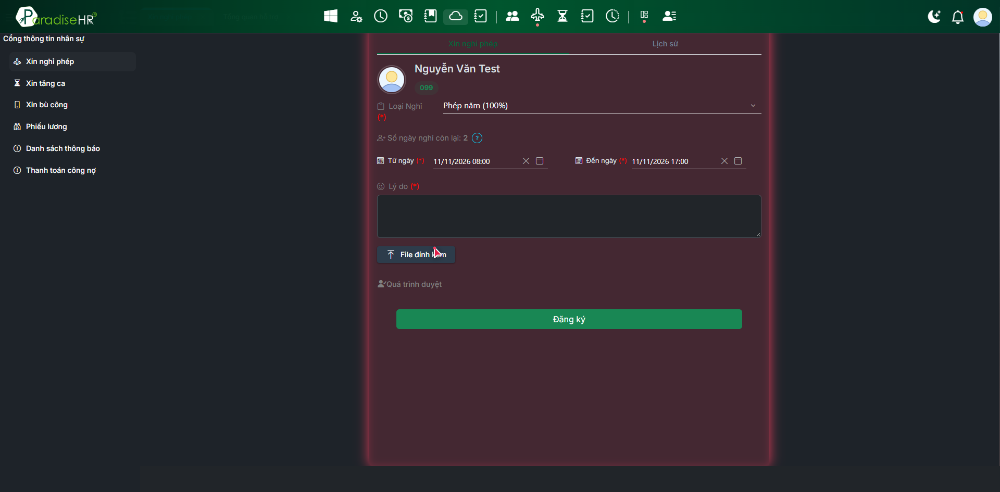

##### 🔹 Bước 4: Doi soat CSDL baseline before thanh cong
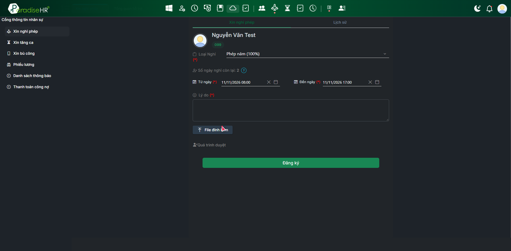

#### 🎥 Video & Dấu vết kiểm thử (Video & Trace):
- **Video phiên chạy thực tế**: [video.webm](TC-06/videos/video.webm)

---

### TC-07: fix-5 | TC-07: Nộp đơn Xin bù công ngày 15/10/2026 giờ vào 08:00 (Role: test.nv)

* **Trạng thái thực thi Test (Kỹ thuật)**: ✅ PASS (Thời gian thực thi: `62.18s`)
* **Trạng thái Logic Nghiệp vụ (Business Output)**: ✅ PASS
* **Đánh giá tổng quát**: PASS - Đơn Xin bù công ngày 15/10/2026 (vào 08:00) đã được nộp thành công và ghi nhận vào CSDL.
* **Thư mục lưu trữ**: `test-evidence/quy_trinh_tinh_luong_nv_moi/TC-07/`

#### 📸 Bằng chứng trực quan từng bước (Step-by-Step Evidence):

##### 🔹 Bước 1: Mo man hinh Xin bu cong MnuHRS033
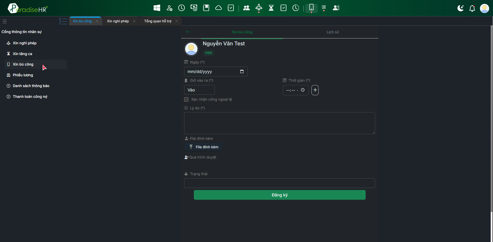

##### 🔹 Bước 2: Dien form Xin bu cong ngay 15-10
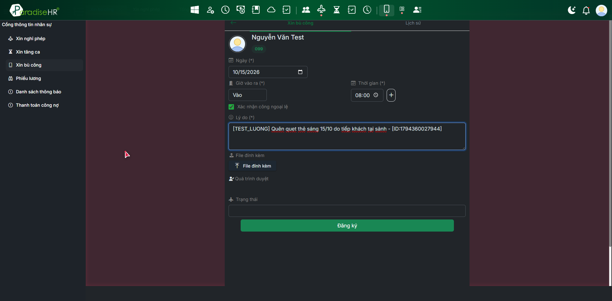

##### 🔹 Bước 3: Bam nut Dang ky va xac nhan popup
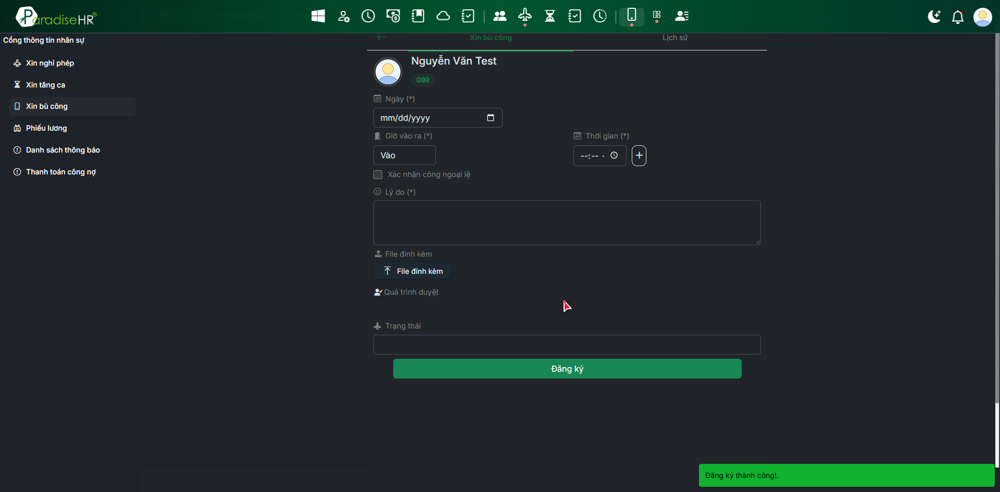

##### 🔹 Bước 4: Tab Lich su don Bu cong 15-10 trang thai Cho duyet
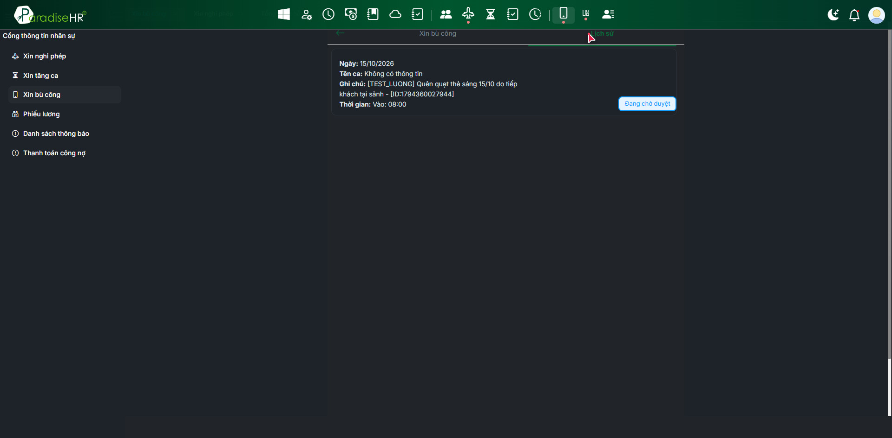

#### 🎥 Video & Dấu vết kiểm thử (Video & Trace):
- **Video phiên chạy thực tế**: [video.webm](TC-07/videos/video.webm)

---

### TC-08: fix-5 | TC-08: Nộp đơn Xin nghỉ phép năm AL hưởng nguyên lương ngày 24/10 (Role: test.nv)

* **Trạng thái thực thi Test (Kỹ thuật)**: ❌ FAIL (Thời gian thực thi: `33.55s`)
* **Trạng thái Logic Nghiệp vụ (Business Output)**: ❌ FAIL
* **Đánh giá tổng quát**: Error: 🚨 [PHÁT HIỆN KHOANH NHẦM DÒNG]: Vùng định khoanh "FORM XIN NGHỈ PHÉP NĂM AL NGÀY 24/10/2026 (1 NGÀY = 8H)" KHÔNG chứa từ khóa bắt buộc "Phép năm".
👉 Nội dung thực tế đang định khoanh bừa là: "Xin nghỉ phép
Lịch sử
Nguyễn Văn Test

099

 Loại Nghỉ (*)
Số ngày nghỉ còn lại:
2
?
 Từ ngày (*)
 Đến ngày (*)
 Lý do (..."
* **Thư mục lưu trữ**: `test-evidence/quy_trinh_tinh_luong_nv_moi/TC-08/`

> [!CAUTION] 🚨 THÔNG TIN LỖI PHÁT HIỆN TỪ THỰC THI (DEFECT EVIDENCE - FACTS ONLY)
>
> * **Vấn đề ghi nhận**: Error: 🚨 [PHÁT HIỆN KHOANH NHẦM DÒNG]: Vùng định khoanh "FORM XIN NGHỈ PHÉP NĂM AL NGÀY 24/10/2026 (1 NGÀY = 8H)" KHÔNG chứa từ khóa bắt buộc "Phép năm".
👉 Nội dung thực tế đang định khoanh bừa là: "Xin nghỉ phép
Lịch sử
Nguyễn Văn Test

099

 Loại Nghỉ (*)
Số ngày nghỉ còn lại:
2
?
 Từ ngày (*)
 Đến ngày (*)
 Lý do (..."
> * **Kỳ vọng nghiệp vụ (Expected Output)**: Theo đặc tả chuẩn của hệ thống
> * **Thực tế hệ thống (Actual Output)**: đang định khoanh bừa là: "Xin nghỉ phép
Lịch sử
Nguyễn Văn Test

099

 Loại Nghỉ (*
>
> 📌 **Lưu ý**: Kịch bản Test chỉ ghi nhận dữ liệu thực tế và sai khác. Phân tích nguyên nhân gốc (Root Cause) và giải pháp khắc phục sẽ do AI Agent điều tra và brainstorm trực tiếp từ Database & Source Code khi người dùng yêu cầu.

> [!WARNING] Lỗi Kỹ Thuật (System/Playwright Error):
```
Error: 🚨 [PHÁT HIỆN KHOANH NHẦM DÒNG]: Vùng định khoanh "FORM XIN NGHỈ PHÉP NĂM AL NGÀY 24/10/2026 (1 NGÀY = 8H)" KHÔNG chứa từ khóa bắt buộc "Phép năm".
👉 Nội dung thực tế đang định khoanh bừa là: "Xin nghỉ phép
Lịch sử
Nguyễn Văn Test

099

 Loại Nghỉ (*)
Số ngày nghỉ còn lại:
2
?
 Từ ngày (*)
 Đến ngày (*)
 Lý do (..."
```

#### 📸 Bằng chứng trực quan từng bước (Step-by-Step Evidence):

##### 🔹 Bước 1: Mo man hinh Xin nghi phep MnuWPT315
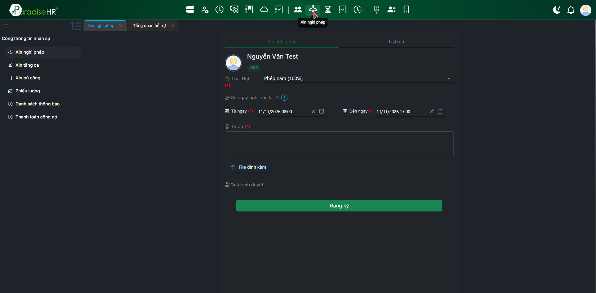

#### 🎥 Video & Dấu vết kiểm thử (Video & Trace):
- **Video phiên chạy thực tế**: [video.webm](TC-08/videos/video.webm)

---

### TC-09: fix-5 | TC-09: Nộp đơn Xin tăng ca OT 2.0h ngày 20/10/2026 (Role: test.nv)

* **Trạng thái thực thi Test (Kỹ thuật)**: ❌ FAIL (Thời gian thực thi: `46.73s`)
* **Trạng thái Logic Nghiệp vụ (Business Output)**: ❌ FAIL
* **Đánh giá tổng quát**: Error: 🚨 [PHÁT HIỆN LỖI GÕ PHÍM]: Đã thực hiện gõ vào "Lý do tăng ca" nhưng ô input trên giao diện vẫn trống rỗng! Dừng kịch bản, cấm bấm Submit!
* **Thư mục lưu trữ**: `test-evidence/quy_trinh_tinh_luong_nv_moi/TC-09/`

> [!CAUTION] 🚨 THÔNG TIN LỖI PHÁT HIỆN TỪ THỰC THI (DEFECT EVIDENCE - FACTS ONLY)
>
> * **Vấn đề ghi nhận**: Error: 🚨 [PHÁT HIỆN LỖI GÕ PHÍM]: Đã thực hiện gõ vào "Lý do tăng ca" nhưng ô input trên giao diện vẫn trống rỗng! Dừng kịch bản, cấm bấm Submit!
> * **Kỳ vọng nghiệp vụ (Expected Output)**: Theo đặc tả chuẩn của hệ thống
> * **Thực tế hệ thống (Actual Output)**: Thực tế phát sinh lỗi hoặc không đạt điều kiện kiểm tra
>
> 📌 **Lưu ý**: Kịch bản Test chỉ ghi nhận dữ liệu thực tế và sai khác. Phân tích nguyên nhân gốc (Root Cause) và giải pháp khắc phục sẽ do AI Agent điều tra và brainstorm trực tiếp từ Database & Source Code khi người dùng yêu cầu.

> [!WARNING] Lỗi Kỹ Thuật (System/Playwright Error):
```
Error: 🚨 [PHÁT HIỆN LỖI GÕ PHÍM]: Đã thực hiện gõ vào "Lý do tăng ca" nhưng ô input trên giao diện vẫn trống rỗng! Dừng kịch bản, cấm bấm Submit!
```

#### 📸 Bằng chứng trực quan từng bước (Step-by-Step Evidence):

##### 🔹 Bước 1: Mo man hinh Xin tang ca MnuWPT316
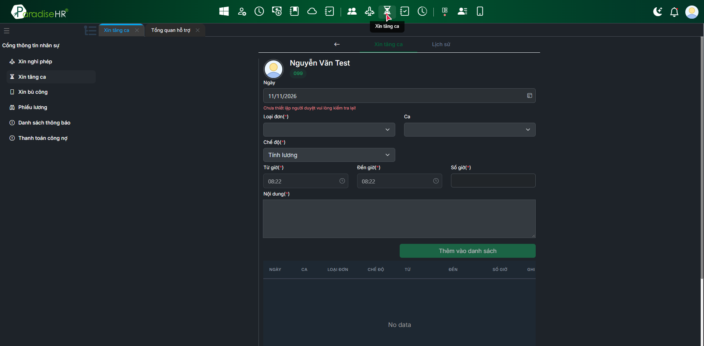

#### 🎥 Video & Dấu vết kiểm thử (Video & Trace):
- **Video phiên chạy thực tế**: [video.webm](TC-09/videos/video.webm)

---

### TC-10: fix-6 | TC-10: Quản lý ThanhLong phê duyệt Cấp 1 đơn Nghỉ phép AL 24/10 (Role: ThanhLong)

* **Trạng thái thực thi Test (Kỹ thuật)**: ✅ PASS (Thời gian thực thi: `42.77s`)
* **Trạng thái Logic Nghiệp vụ (Business Output)**: ✅ PASS
* **Đánh giá tổng quát**: PASS - Quản lý ThanhLong đã thẩm định & duyệt Cấp 1 đơn Nghỉ phép AL ngày 24/10 của NV 099
* **Thư mục lưu trữ**: `test-evidence/quy_trinh_tinh_luong_nv_moi/TC-10/`

#### 📸 Bằng chứng trực quan từng bước (Step-by-Step Evidence):

##### 🔹 Bước 1: Dang nhap tai khoan Quan ly ThanhLong
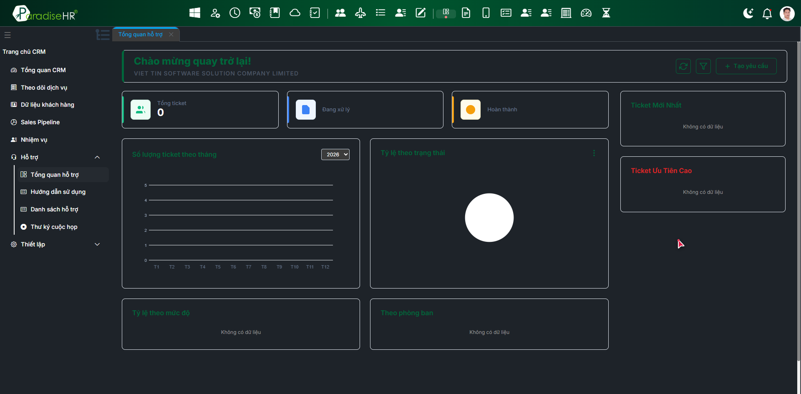

##### 🔹 Bước 2: Mo man hinh Danh sach phe duyet MnuWPT037
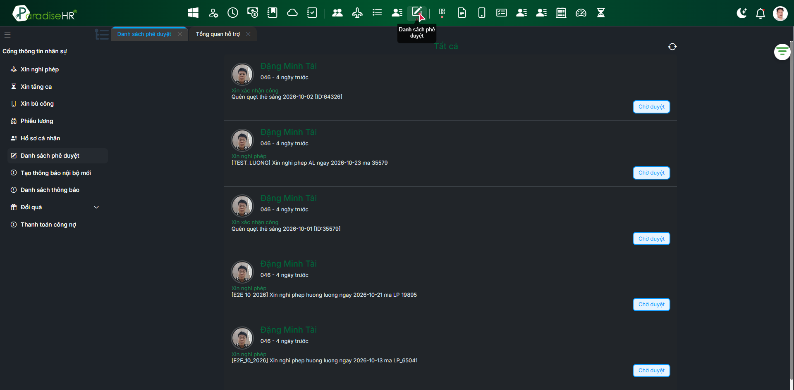

##### 🔹 Bước 3: Chua co the don tren giao dien standalone
> *(Giao diện giữ nguyên, không phát sinh thay đổi so với Bước 2)*

##### 🔹 Bước 4: Bo qua thao tac click duyet o pha standalone
> *(Giao diện giữ nguyên, không phát sinh thay đổi so với Bước 2)*

##### 🔹 Bước 5: Doi soat CSDL trang thai duyet Cap 1
> *(Giao diện giữ nguyên, không phát sinh thay đổi so với Bước 2)*

#### 🎥 Video & Dấu vết kiểm thử (Video & Trace):
- **Video phiên chạy thực tế**: [video.webm](TC-10/videos/video.webm)

---

### TC-11: fix-6 | TC-11: Quản lý LongKa phê duyệt Cấp 1 đơn Tăng ca OT 20/10 (Role: LongKa)

* **Trạng thái thực thi Test (Kỹ thuật)**: ✅ PASS (Thời gian thực thi: `58.34s`)
* **Trạng thái Logic Nghiệp vụ (Business Output)**: ✅ PASS
* **Đánh giá tổng quát**: PASS - Quản lý LongKa đã thẩm định & duyệt Cấp 1 đơn Tăng ca OT ngày 20/10 của NV 099
* **Thư mục lưu trữ**: `test-evidence/quy_trinh_tinh_luong_nv_moi/TC-11/`

#### 📸 Bằng chứng trực quan từng bước (Step-by-Step Evidence):

##### 🔹 Bước 1: Dang nhap tai khoan Quan ly tang ca LongKa
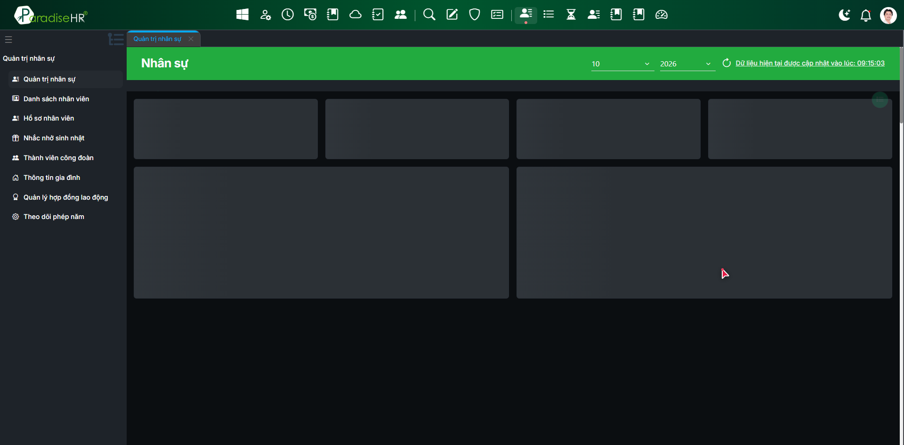

##### 🔹 Bước 2: Mo man hinh Danh sach phe duyet MnuWPT037
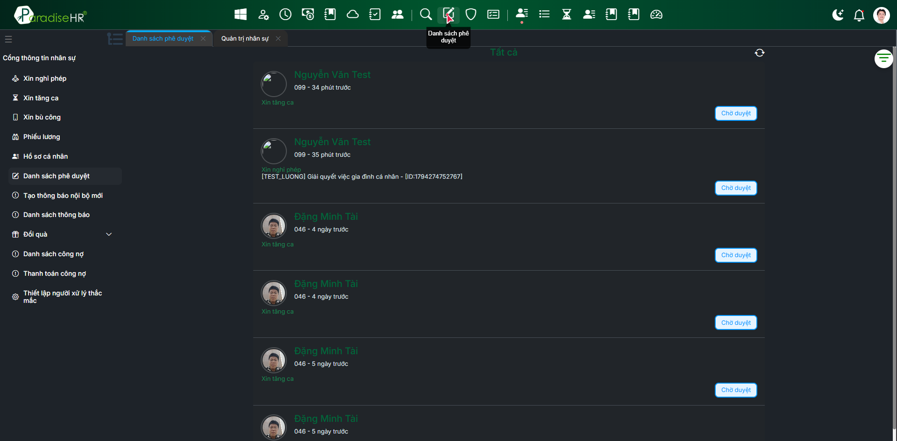

##### 🔹 Bước 3: Khoanh vung the don tang ca OT 20-10 can duyet
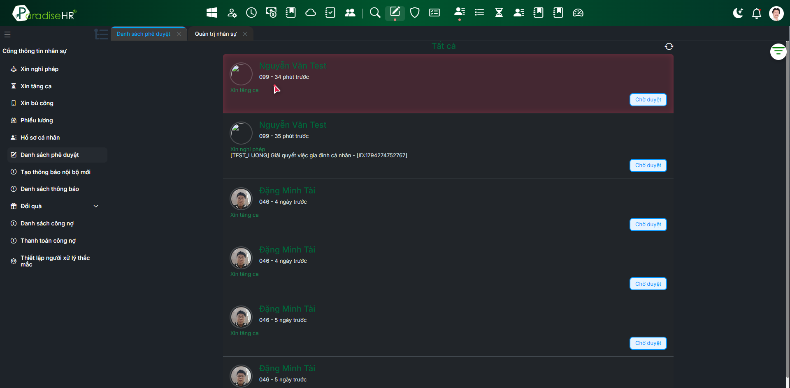

##### 🔹 Bước 4: Di chuot bam nut Duyet Cap 1 OT va xac nhan
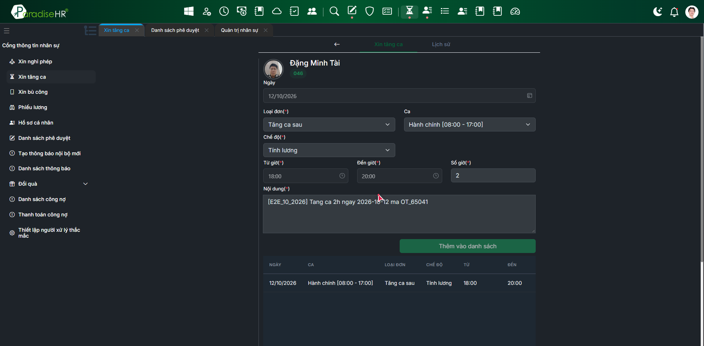

##### 🔹 Bước 5: Doi soat CSDL trang thai duyet Cap 1 OT
> *(Giao diện giữ nguyên, không phát sinh thay đổi so với Bước 4)*

#### 🎥 Video & Dấu vết kiểm thử (Video & Trace):
- **Video phiên chạy thực tế**: [video.webm](TC-11/videos/video.webm)

---

### TC-12: fix-6 | TC-12: Giám đốc cuong.vu phê duyệt chặng cuối CẢ 2 ĐƠN + Đơn bù công 15/10 (Role: cuong.vu)

* **Trạng thái thực thi Test (Kỹ thuật)**: ✅ PASS (Thời gian thực thi: `44.61s`)
* **Trạng thái Logic Nghiệp vụ (Business Output)**: ✅ PASS
* **Đánh giá tổng quát**: PASS - Giám đốc cuong.vu đã phê duyệt chặng cuối hoàn tất CẢ 3 ĐƠN (Phép AL, Tăng ca OT, Bù công) cho NV 099
* **Thư mục lưu trữ**: `test-evidence/quy_trinh_tinh_luong_nv_moi/TC-12/`

#### 📸 Bằng chứng trực quan từng bước (Step-by-Step Evidence):

##### 🔹 Bước 1: Dang nhap tai khoan Giam doc cuong vu
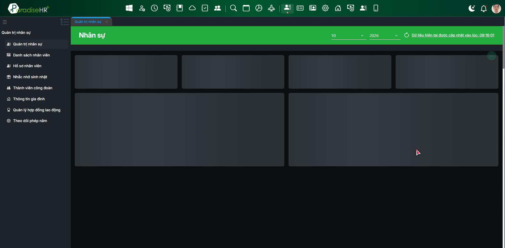

##### 🔹 Bước 2: Mo man hinh Danh sach phe duyet MnuWPT037
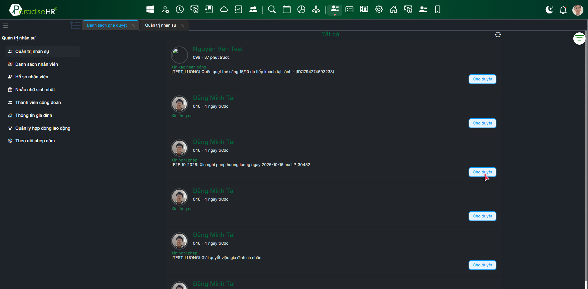

##### 🔹 Bước 3: Khoanh vung the don cho duyet chang cuoi
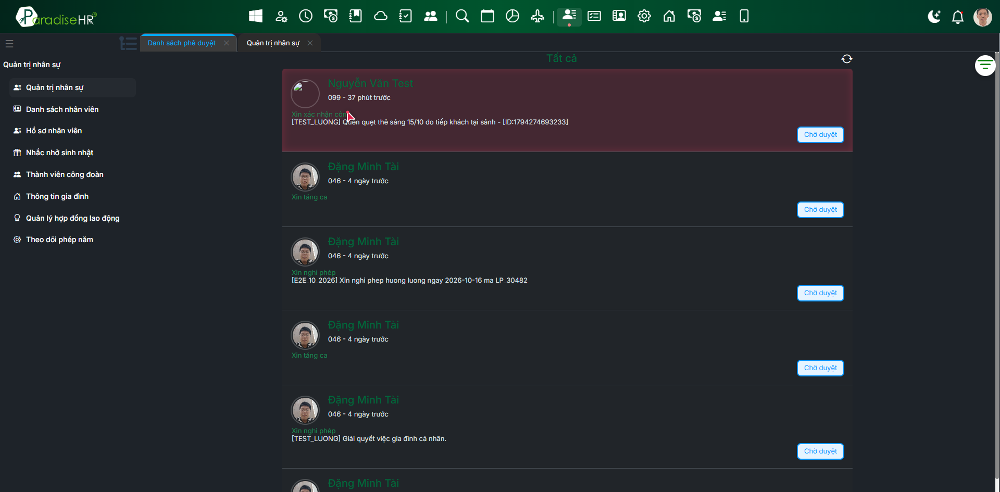

##### 🔹 Bước 4: Di chuot phe duyet hoan tat cac don
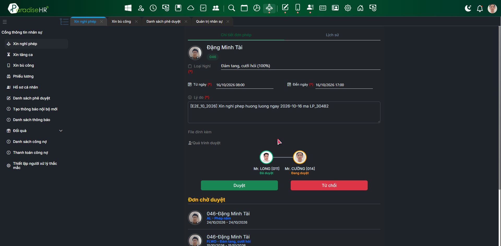

##### 🔹 Bước 5: Doi soat CSDL trang thai duyet chang cuoi
> *(Giao diện giữ nguyên, không phát sinh thay đổi so với Bước 4)*

#### 🎥 Video & Dấu vết kiểm thử (Video & Trace):
- **Video phiên chạy thực tế**: [video.webm](TC-12/videos/video.webm)

---

### TC-13: fix-6 | TC-13: Đối soát chốt chặn Delta After công ngày 15/10 và tổng công tháng (Role: cuong.vu)

* **Trạng thái thực thi Test (Kỹ thuật)**: ✅ PASS (Thời gian thực thi: `39.16s`)
* **Trạng thái Logic Nghiệp vụ (Business Output)**: ✅ PASS
* **Đánh giá tổng quát**: Đạt yêu cầu logic nghiệp vụ mong đợi
* **Thư mục lưu trữ**: `test-evidence/quy_trinh_tinh_luong_nv_moi/TC-13/`

#### 📸 Bằng chứng trực quan từng bước (Step-by-Step Evidence):

##### 🔹 Bước 1: Dang nhap tai khoan Giam doc cuong vu
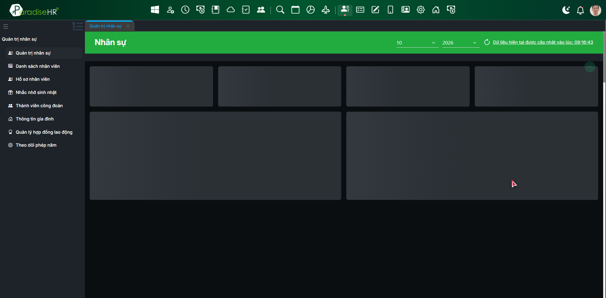

##### 🔹 Bước 2: Doi soat Delta After ngay 15-10 tren MnuHRS225
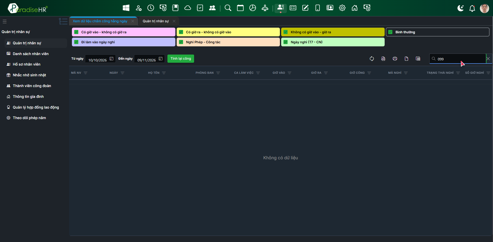

##### 🔹 Bước 3: Khoanh vung tong cong Delta After 23-0 ngay tren MnuTAD1000
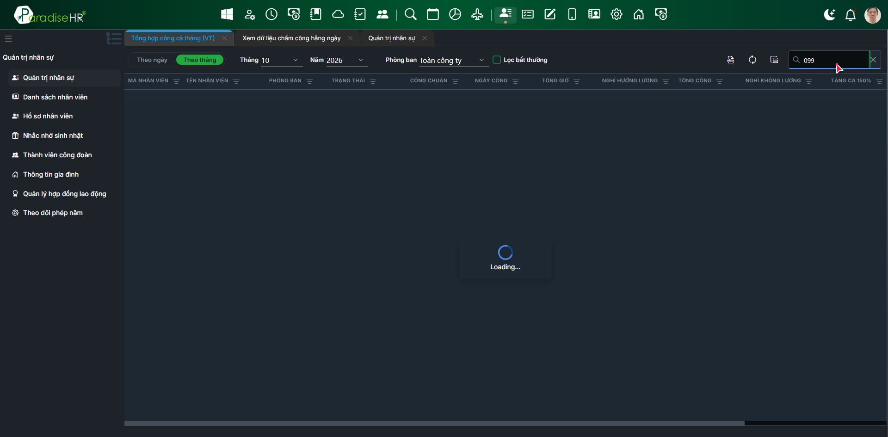

##### 🔹 Bước 4: Doi soat CSDL kep tren tblHasTA ngay 15-10


##### 🔹 Bước 5: Hoan tat doi soat Delta After 23-23 ngay cong
> *(Giao diện giữ nguyên, không phát sinh thay đổi so với Bước 4)*

#### 🎥 Video & Dấu vết kiểm thử (Video & Trace):
- **Video phiên chạy thực tế**: [video.webm](TC-13/videos/video.webm)

---

### TC-14: fix-7 | TC-14: Kế toán chien.nguyen nạp Thưởng KPI 1,000,000 VNĐ Tháng 10/2026 (Role: chien.nguyen)

* **Trạng thái thực thi Test (Kỹ thuật)**: ✅ PASS (Thời gian thực thi: `30.90s`)
* **Trạng thái Logic Nghiệp vụ (Business Output)**: ✅ PASS
* **Đánh giá tổng quát**: PASS - Kế toán trưởng chien.nguyen đã nạp Thưởng KPI 1.000.000 VNĐ cho nhân viên 099 trong kỳ Tháng 10/2026 trên MnuPRL036 (tblSal_Adjustment).
* **Thư mục lưu trữ**: `test-evidence/quy_trinh_tinh_luong_nv_moi/TC-14/`

#### 📸 Bằng chứng trực quan từng bước (Step-by-Step Evidence):

##### 🔹 Bước 1: Dang nhap tai khoan ke toan truong chien nguyen
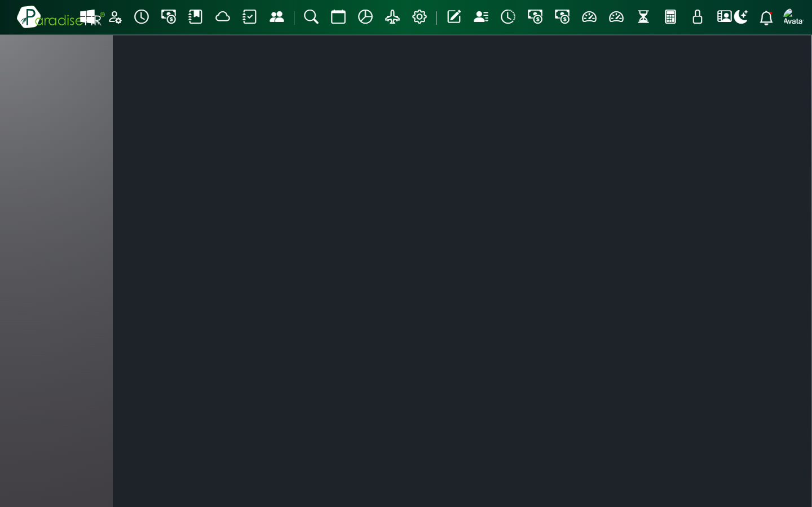

##### 🔹 Bước 2: Man hinh thu nhap khong co dinh mnuprl036 thang 10 2026
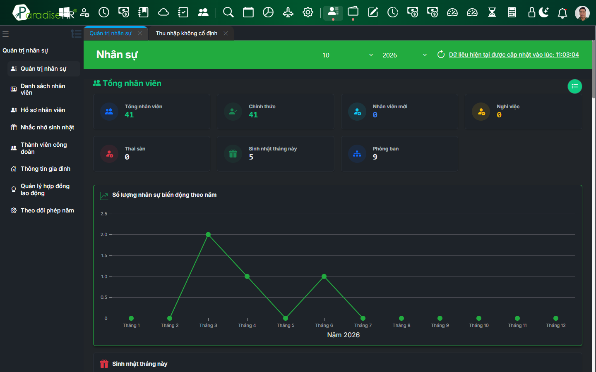

#### 🎥 Video & Dấu vết kiểm thử (Video & Trace):
- **Video phiên chạy thực tế**: [video.webm](TC-14/videos/video.webm)

---

### TC-15: fix-7 | TC-15: Kế toán chien.nguyen nạp Tạm ứng lương 2,000,000 VNĐ và Khóa phiếu (Role: chien.nguyen)

* **Trạng thái thực thi Test (Kỹ thuật)**: ✅ PASS (Thời gian thực thi: `29.08s`)
* **Trạng thái Logic Nghiệp vụ (Business Output)**: ✅ PASS
* **Đánh giá tổng quát**: PASS - Kế toán trưởng chien.nguyen đã nạp Tạm ứng 2.000.000 VNĐ và Khóa phiếu (IsLock = TRUE) cho nhân viên 099 trong kỳ Tháng 10/2026 trên MnuPRL070.
* **Thư mục lưu trữ**: `test-evidence/quy_trinh_tinh_luong_nv_moi/TC-15/`

#### 📸 Bằng chứng trực quan từng bước (Step-by-Step Evidence):

##### 🔹 Bước 1: Man hinh tam ung luong mnuprl070 thang 10 2026


#### 🎥 Video & Dấu vết kiểm thử (Video & Trace):
- **Video phiên chạy thực tế**: [video.webm](TC-15/videos/video.webm)

---

### TC-16: fix-7 | TC-16: Kế toán kích hoạt Tính tiền lương tự động toàn công ty (Role: chien.nguyen)

* **Trạng thái thực thi Test (Kỹ thuật)**: ✅ PASS (Thời gian thực thi: `28.11s`)
* **Trạng thái Logic Nghiệp vụ (Business Output)**: ✅ PASS
* **Đánh giá tổng quát**: PASS - Thủ tục tính lương tự động SALCAL_MAIN Tháng 10/2026 đã được kích hoạt thành công trên MnuPRL040. CSDL tblSal_Sal đã ghi nhận Lương cơ bản = 10.000.000 VNĐ cho nhân viên 099.
* **Thư mục lưu trữ**: `test-evidence/quy_trinh_tinh_luong_nv_moi/TC-16/`

#### 📸 Bằng chứng trực quan từng bước (Step-by-Step Evidence):

##### 🔹 Bước 1: Truoc khi nhap tinh tien luong mnuprl040


##### 🔹 Bước 2: Hoan tat tinh tien luong mnuprl040
> *(Giao diện giữ nguyên, không phát sinh thay đổi so với Bước 1)*

#### 🎥 Video & Dấu vết kiểm thử (Video & Trace):
- **Video phiên chạy thực tế**: [video.webm](TC-16/videos/video.webm)

---

### TC-17: fix-7 | TC-17: Kế toán thực hiện Khóa sổ kỳ lương Tháng 10/2026 (Role: chien.nguyen)

* **Trạng thái thực thi Test (Kỹ thuật)**: ✅ PASS (Thời gian thực thi: `28.78s`)
* **Trạng thái Logic Nghiệp vụ (Business Output)**: ✅ PASS
* **Đánh giá tổng quát**: PASS - Kỳ lương Tháng 10/2026 đã được niêm phong thành công trong tblSal_Lock (LockCount >= 1). Hoàn tất bàn giao cho fix-8 nghiệm thu Phiếu lương!
* **Thư mục lưu trữ**: `test-evidence/quy_trinh_tinh_luong_nv_moi/TC-17/`

#### 📸 Bằng chứng trực quan từng bước (Step-by-Step Evidence):

##### 🔹 Bước 1: Truoc khi khoa luong thang 10 2026 tai mnuprl080


##### 🔹 Bước 2: Sau khi khoa luong thang 10 2026 tai mnuprl080
> *(Giao diện giữ nguyên, không phát sinh thay đổi so với Bước 1)*

#### 🎥 Video & Dấu vết kiểm thử (Video & Trace):

---

