# BÁO CÁO KIỂM THỬ E2E TOÀN DIỆN PHÂN HỆ CRM (PARADISE HRM)

> **Thời gian thẩm định**: 12:52:08 16/10/2026
> **Phạm vi kiểm thử**: 4 Menu CRM cốt lõi + 1 Luồng nghiệp vụ liên hoàn khép kín
> **Tổng số kịch bản**: **17** | ✅ LOGIC PASS: **15** | ❌ LOGIC FAIL: **2**

## 1. TỔNG HỢP KẾT QUẢ THEO TỪNG MENU / LUỒNG NGHIỆP VỤ

| Trang / Menu Nghiệp Vụ | File Kịch Bản | Số TC | Trạng Thái Kỹ Thuật | Trạng Thái Logic Nghiệp Vụ | Chi Tiết |
| :--- | :--- | :---: | :---: | :---: | :---: |
| **Tổng quan CRM (Dashboard & KPI)** | `tests/crm_overview.spec.js` | 4 | ✅ PASS | ✅ 100% LOGIC PASS | [Xem chi tiết](crm_overview/test-report.md) |
| **Dữ liệu khách hàng (Customer Management)** | `tests/crm_customer_data.spec.js` | 5 | ✅ PASS | ❌ 1 LOGIC FAIL | [Xem chi tiết](crm_customer_data/test-report.md) |
| **Theo dõi dịch vụ (Service & Contract Tracking)** | `tests/crm_service_tracking.spec.js` | 4 | ✅ PASS | ❌ 1 LOGIC FAIL | [Xem chi tiết](crm_service_tracking/test-report.md) |
| **Sales Pipeline (Kanban Opportunities)** | `tests/crm_sales_pipeline.spec.js` | 3 | ✅ PASS | ✅ 100% LOGIC PASS | [Xem chi tiết](crm_sales_pipeline/test-report.md) |
| **Luồng nghiệp vụ liên màn hình CRM (Cross-Menu Business Flow)** | `tests/crm_business_flow.spec.js` | 1 | ✅ PASS | ✅ 100% LOGIC PASS | [Xem chi tiết](crm_business_flow/test-report.md) |

---

## 2. DANH MỤC LỖI NGHIỆP VỤ & LỖI BACKEND PHÁT HIỆN QUA KIỂM THỬ TRỰC QUAN

### 🚨 [crm_customer_data] TC-02: Kiểm tra Bộ lọc Trạng thái (Chip lọc) & Phát hiện Lỗi Nghiệp vụ Mất Dữ liệu

> [!CAUTION] PHÂN TÍCH NGUYÊN NHÂN THẤT BẠI (FAILURE ANALYSIS)
>
> * **Vấn đề / Mã lỗi**: Bấm chọn chip lọc trạng thái (Lead, Đã liên hệ...) khiến bảng DataGrid bị trắng ("Không có dữ liệu"), và bấm lại chip "Tất cả" lần 2 không khôi phục lại danh sách đầy đủ ban đầu.
> * **Kỳ vọng nghiệp vụ**: Khi bấm chọn chip lọc "Tất cả" lần 2, hệ thống phải nạp lại đầy đủ toàn bộ danh sách khách hàng (16+ bản ghi ban đầu). Khi chọn các chip trạng thái (Lead, Đã liên hệ...), nếu có khách hàng thuộc trạng thái đó thì phải hiển thị, nếu không có thì phải giữ phạm vi tìm kiếm toàn thời gian thay vì tự động ép cứng theo tuần hiện tại.
> * **Thực tế hệ thống**: Khi bấm chip Lead, DataGrid hiển thị "Không có dữ liệu" dù API trả về HTTP 200. Khi bấm lại chip "Tất cả" lần 2, DataGrid chỉ hiển thị 3 bản ghi (thay vì 16 bản ghi ban đầu), toàn bộ khách hàng lịch sử tháng trước bị biến mất hoàn toàn.
> * **Nguyên nhân cốt lõi**: 1) Hàm ReloadData() trong mã nguồn frontend tự động gán isViewAll = 0 khi bấm chip lọc và ép cứng tham số @FromDate, @ToDate theo khoảng thời gian tuần hiện tại (12/10/2026 - 19/10/2026), loại bỏ toàn bộ dữ liệu lịch sử.
2) Mã phản hồi HTTP 200 của API /hpa/paradise2 che giấu lỗi backend: IIS luôn trả về HTTP 200 kể cả khi SQL Server trả mảng rỗng data: [[]] hoặc bị lỗi va chạm bảng tạm toàn cục ##sp_KPIgetDataCollection22VN.
3) Khi bấm chip trạng thái, code tự động uncheck cờ #pillKPI... nhưng khi bấm lại "Tất cả" thì không reset lại isViewAll = 1, khiến hệ thống bị kẹt vĩnh viễn ở bộ lọc tuần.
> * **Đề xuất khắc phục**: 1) Frontend: Trong hàm applyFilter(), khi chọn chip "Tất cả" (value == null), bắt buộc gán isViewAll = 1 để nạp toàn bộ dữ liệu toàn thời gian.
2) Backend: Trong Stored Procedure sp_KPIgetDataCollection, loại bỏ bảng tạm toàn cục ## (tránh va chạm giữa các request đồng thời), thay bằng bảng tạm cục bộ # hoặc Table Variable có khối TRY...CATCH dọn dẹp bảng tạm.
3) UI: Bổ sung nhãn hiển thị khoảng thời gian lọc trực quan cạnh thanh chip để người dùng nhận biết khi danh sách đang bị giới hạn theo ngày.

### 🚨 [crm_service_tracking] TC-03: Thẩm định Ô Tìm kiếm Nhanh, Lọc Tức thì & Khôi phục Danh sách

> [!CAUTION] PHÂN TÍCH NGUYÊN NHÂN THẤT BẠI (FAILURE ANALYSIS)
>
> * **Vấn đề / Mã lỗi**: DataGrid hiển thị "Không có dữ liệu" khi tìm kiếm dù từ khóa có thật trong danh sách
> * **Kỳ vọng nghiệp vụ**: Khi tìm kiếm "NIDEC" hoặc "CÔNG TY", hệ thống phải trả về các bản ghi khớp với từ khóa
> * **Thực tế hệ thống**: Server IIS trả HTTP 200 nhưng payload trả lỗi SQL nội bộ: "Incorrect syntax near ')'.", làm mảng data rỗng []
> * **Nguyên nhân cốt lõi**: Stored Procedure hoặc câu lệnh SQL động phía Backend xử lý tham số tìm kiếm bị sai cú pháp (Incorrect syntax near ")")
> * **Đề xuất khắc phục**: Đội ngũ Backend cần kiểm tra lại câu lệnh SQL ghép chuỗi tìm kiếm trong Stored Procedure của menu Theo dõi dịch vụ

---

## 3. CHI TIẾT TỪNG KỊCH BẢN THẨM ĐỊNH (STEP-BY-STEP EVIDENCE)

### [crm_overview] TC-01: Thẩm định Giao diện Dashboard KPI, Thẻ Chỉ số & Bảng Kết quả Chi tiết

* **Trạng thái thực thi kỹ thuật**: ✅ PASS (Thời gian: `21.82s`)
* **Trạng thái Logic Nghiệp vụ**: ✅ PASS
* **Đánh giá**: PASS - Màn hình Tổng quan CRM nạp đầy đủ các widget và bảng KPI chi tiết
* **Thư mục lưu trữ**: [`test-evidence/crm_overview/TC-01/`](file:///C:/Users/Y.Thach/Desktop/paradiseHR/test-evidence/crm_overview/TC-01)

#### 📸 Bằng chứng trực quan từng bước:

##### 🔹 Bước 1: Mở thành công màn hình Tổng quan CRM

##### 🔹 Bước 2: Xác nhận hiển thị khu vực Dashboard KPI và các thẻ chỉ số

##### 🔹 Bước 3: Bảng kết quả KPI chi tiết nạp đầy đủ danh sách nhân viên

##### 🔹 Bước 4: Con trỏ Neon rà soát các cột chỉ số Yêu cầu Thực tế và Đạt được
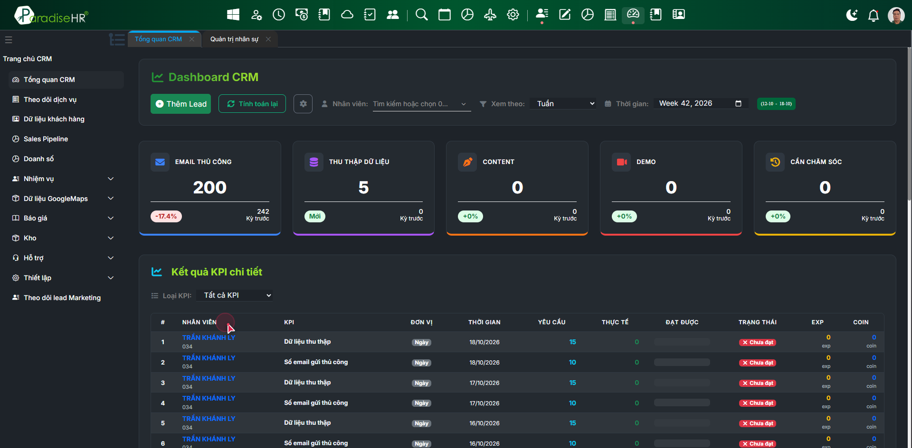

##### 🔹 Bước 5: Dashboard KPI nạp dữ liệu thành công đạt chuẩn

#### 🎥 Video & Dấu vết kiểm thử:
- **Video**: [video.webm](crm_overview/TC-01/videos/video.webm)
- **Trace**: [trace.zip](crm_overview/TC-01/traces/trace.zip) *(Mở: `npx playwright show-trace test-evidence/crm_overview/TC-01/traces/trace.zip`)*

---

### [crm_overview] TC-02: Thẩm định Bộ lọc Kỳ dữ liệu (#filterType, #filterDate) & Nút Tính toán lại (#btnRecalculate)

* **Trạng thái thực thi kỹ thuật**: ✅ PASS (Thời gian: `28.51s`)
* **Trạng thái Logic Nghiệp vụ**: ✅ PASS
* **Đánh giá**: PASS - Các bộ lọc thời gian và nút Tính toán lại phản hồi tốt, dữ liệu đồng bộ
* **Thư mục lưu trữ**: [`test-evidence/crm_overview/TC-02/`](file:///C:/Users/Y.Thach/Desktop/paradiseHR/test-evidence/crm_overview/TC-02)

#### 📸 Bằng chứng trực quan từng bước:

##### 🔹 Bước 1: Kiểm tra dropdown chọn loại thời gian theo tuần tháng năm
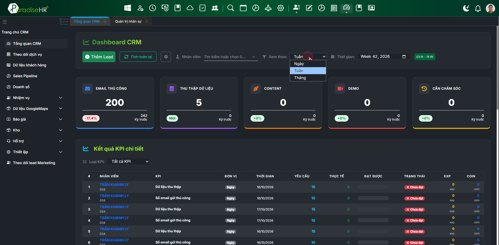

##### 🔹 Bước 2: Kiểm tra ô chọn kỳ tuần hiện tại

##### 🔹 Bước 3: Thay đổi tùy chọn số dòng hiển thị trên bảng
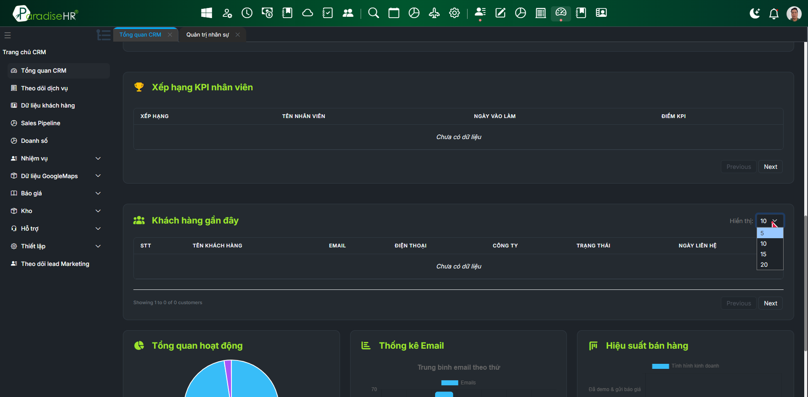

##### 🔹 Bước 4: Con trỏ Neon bấm nút Tính toán lại và bắt phản hồi hệ thống

##### 🔹 Bước 5: Dữ liệu được tính toán lại thành công không bị gián đoạn
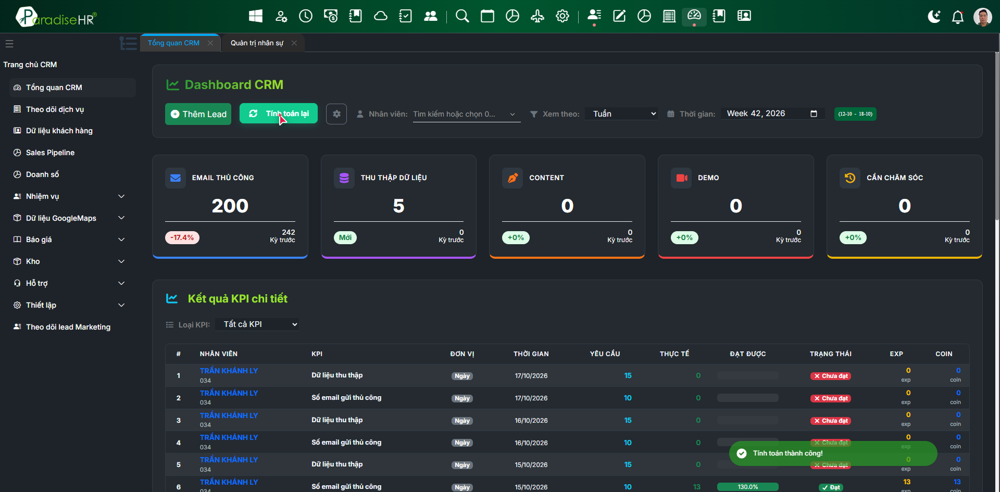

#### 🎥 Video & Dấu vết kiểm thử:
- **Video**: [video.webm](crm_overview/TC-02/videos/video.webm)
- **Trace**: [trace.zip](crm_overview/TC-02/traces/trace.zip) *(Mở: `npx playwright show-trace test-evidence/crm_overview/TC-02/traces/trace.zip`)*

---

### [crm_overview] TC-03: Thẩm định Nút Thiết lập (#btnSettings) & Đóng/Mở Modal Cấu hình KPI

* **Trạng thái thực thi kỹ thuật**: ✅ PASS (Thời gian: `23.01s`)
* **Trạng thái Logic Nghiệp vụ**: ✅ PASS
* **Đánh giá**: PASS - Modal Cấu hình KPI mở và đóng mượt mà, đầy đủ các trường thiết lập
* **Thư mục lưu trữ**: [`test-evidence/crm_overview/TC-03/`](file:///C:/Users/Y.Thach/Desktop/paradiseHR/test-evidence/crm_overview/TC-03)

#### 📸 Bằng chứng trực quan từng bước:

##### 🔹 Bước 1: Xác định vị trí nút Thiết lập cấu hình KPI

##### 🔹 Bước 2: Modal Cấu hình KPI hiển thị trực quan trên màn hình
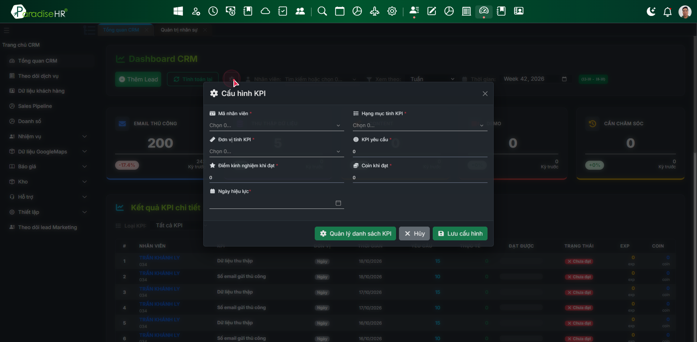

##### 🔹 Bước 3: Kiểm tra các trường thiết lập tỷ lệ và tiêu chí KPI
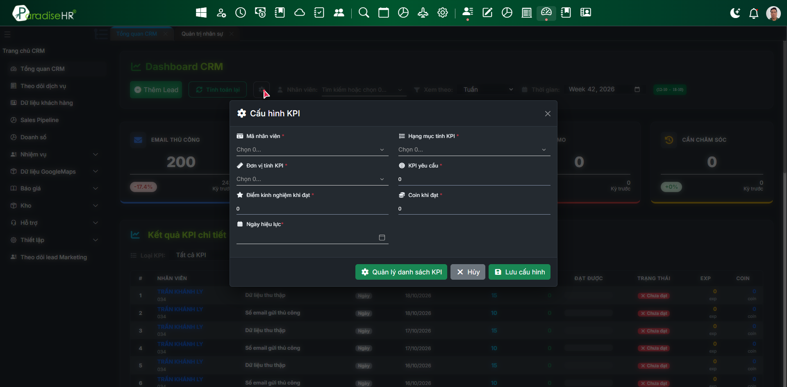

##### 🔹 Bước 4: Con trỏ Neon bấm nút Đóng modal cấu hình KPI

##### 🔹 Bước 5: Modal đóng an toàn không để lại overlay chắn giao diện

#### 🎥 Video & Dấu vết kiểm thử:
- **Video**: [video.webm](crm_overview/TC-03/videos/video.webm)
- **Trace**: [trace.zip](crm_overview/TC-03/traces/trace.zip) *(Mở: `npx playwright show-trace test-evidence/crm_overview/TC-03/traces/trace.zip`)*

---

### [crm_overview] TC-04: Thẩm định Nút Thêm Lead (#btnCreateLead) & Modal Tạo Mới Lead Nhanh

* **Trạng thái thực thi kỹ thuật**: ✅ PASS (Thời gian: `24.28s`)
* **Trạng thái Logic Nghiệp vụ**: ✅ PASS
* **Đánh giá**: PASS - Nút Thêm Lead mở đúng modal tạo khách hàng, các trường nhập liệu phản hồi tốt
* **Thư mục lưu trữ**: [`test-evidence/crm_overview/TC-04/`](file:///C:/Users/Y.Thach/Desktop/paradiseHR/test-evidence/crm_overview/TC-04)

#### 📸 Bằng chứng trực quan từng bước:

##### 🔹 Bước 1: Xác định vị trí nút Thêm Lead màu xanh lá
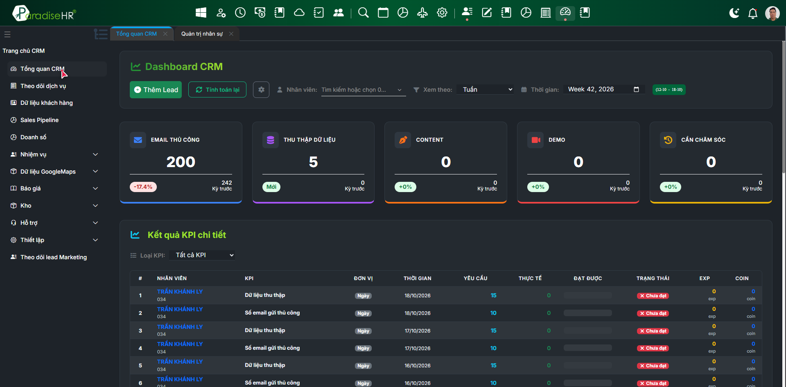

##### 🔹 Bước 2: Modal Thêm LEAD mở lên với đầy đủ các trường nhập liệu
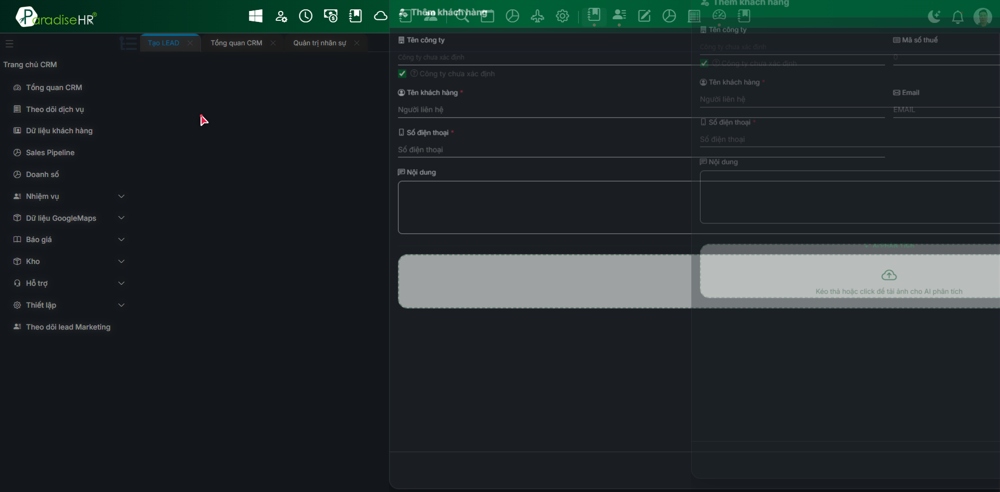

##### 🔹 Bước 3: Kiểm tra khả năng nhập liệu trực quan vào ô Tên khách hàng
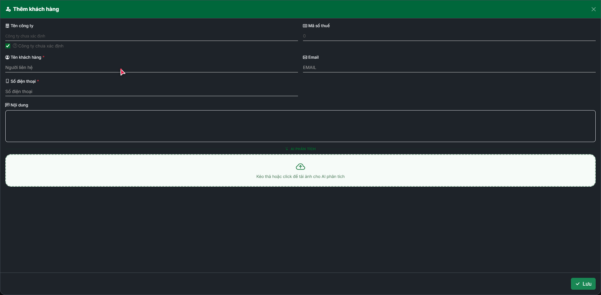

##### 🔹 Bước 4: Con trỏ Neon bấm nút Đóng modal Thêm Lead

##### 🔹 Bước 5: Màn hình Tổng quan CRM phục hồi nguyên vẹn sau khi đóng modal

#### 🎥 Video & Dấu vết kiểm thử:
- **Video**: [video.webm](crm_overview/TC-04/videos/video.webm)
- **Trace**: [trace.zip](crm_overview/TC-04/traces/trace.zip) *(Mở: `npx playwright show-trace test-evidence/crm_overview/TC-04/traces/trace.zip`)*

---

### [crm_customer_data] TC-01: Kiểm tra Khởi động, Điều hướng và Thẩm định API Nạp Danh sách Khách hàng

* **Trạng thái thực thi kỹ thuật**: ✅ PASS (Thời gian: `40.90s`)
* **Trạng thái Logic Nghiệp vụ**: ✅ PASS
* **Đánh giá**: PASS - Khởi động thành công, API nạp dữ liệu phản hồi HTTP 200 (Success) và DataGrid hiển thị 4 bản ghi khách hàng
* **Thư mục lưu trữ**: [`test-evidence/crm_customer_data/TC-01/`](file:///C:/Users/Y.Thach/Desktop/paradiseHR/test-evidence/crm_customer_data/TC-01)

#### 📸 Bằng chứng trực quan từng bước:

##### 🔹 Bước 1: Đăng nhập thành công và mở trang chủ hệ thống Paradise HRM
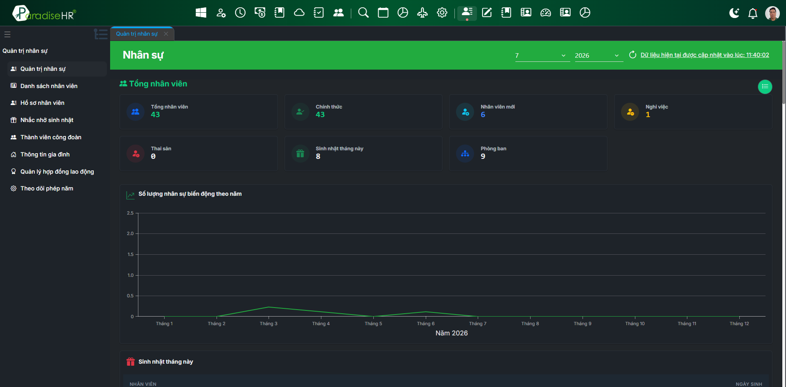

##### 🔹 Bước 2: Mở màn hình Dữ liệu khách hàng và thẩm định phản hồi API HTTP 200 thành công
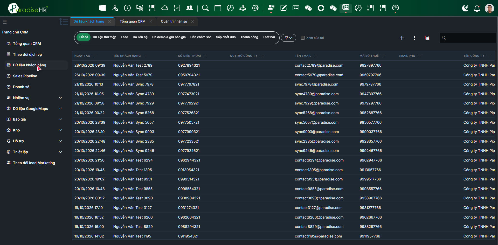

##### 🔹 Bước 3: Kiểm tra thanh công cụ Toolbar (Nút Thêm +, Tùy chọn ⋮, Tìm kiếm 🔍)

##### 🔹 Bước 4: Kiểm tra cấu trúc DataGrid với các cột thông tin khách hàng chính

##### 🔹 Bước 5: Xác nhận DataGrid hiển thị đầy đủ danh sách khách hàng khớp với dữ liệu API backend
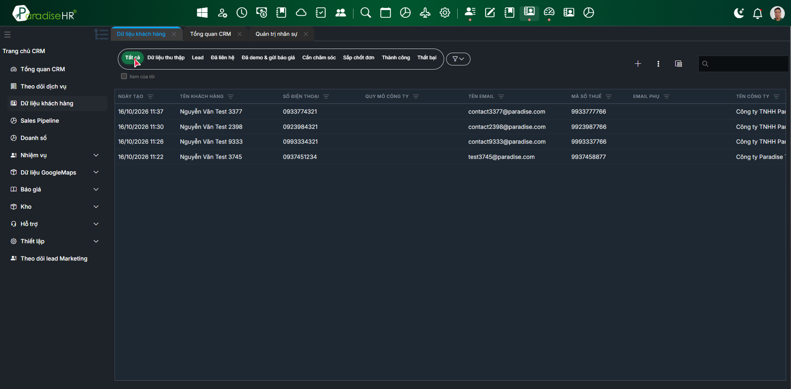

#### 🎥 Video & Dấu vết kiểm thử:
- **Video**: [video.webm](crm_customer_data/TC-01/videos/video.webm)
- **Trace**: [trace.zip](crm_customer_data/TC-01/traces/trace.zip) *(Mở: `npx playwright show-trace test-evidence/crm_customer_data/TC-01/traces/trace.zip`)*

---

### [crm_customer_data] TC-02: Kiểm tra Bộ lọc Trạng thái (Chip lọc) & Phát hiện Lỗi Nghiệp vụ Mất Dữ liệu

* **Trạng thái thực thi kỹ thuật**: ✅ PASS (Thời gian: `38.79s`)
* **Trạng thái Logic Nghiệp vụ**: ❌ FAIL
* **Đánh giá**: FAIL - Bấm chip lọc trạng thái làm mất toàn bộ danh sách khách hàng và bấm lại Tất cả lần 2 không khôi phục được 4 bản ghi ban đầu (chỉ còn 4 dòng)
* **Thư mục lưu trữ**: [`test-evidence/crm_customer_data/TC-02/`](file:///C:/Users/Y.Thach/Desktop/paradiseHR/test-evidence/crm_customer_data/TC-02)

#### 📸 Bằng chứng trực quan từng bước:

##### 🔹 Bước 1: Giao diện ban đầu hiển thị đầy đủ 4 khách hàng trên DataGrid với chip Tất cả

##### 🔹 Bước 2: Bấm chip lọc Lead: API trả HTTP 200 nhưng data rỗng, DataGrid mất dữ liệu và hiện Không có dữ liệu

##### 🔹 Bước 3: Bấm lại Tất cả lần 2: Chỉ hiển thị 4/4 bản ghi (dữ liệu lịch sử bị mất)

##### 🔹 Bước 4: Bằng chứng đối chiếu: Hàm ReloadData tự động ép cứng FromDate/ToDate theo tuần hiện tại

##### 🔹 Bước 5: Hệ thống phát hiện Bug logic nghiệp vụ: Bộ lọc chip làm mất dữ liệu và không thể khôi phục lại

#### 🎥 Video & Dấu vết kiểm thử:
- **Video**: [video.webm](crm_customer_data/TC-02/videos/video.webm)
- **Trace**: [trace.zip](crm_customer_data/TC-02/traces/trace.zip) *(Mở: `npx playwright show-trace test-evidence/crm_customer_data/TC-02/traces/trace.zip`)*

---

### [crm_customer_data] TC-03: Kiểm tra Chức năng Nghiệp vụ: THÊM MỚI KHÁCH HÀNG THỰC TẾ (Create Customer End-to-End)

* **Trạng thái thực thi kỹ thuật**: ✅ PASS (Thời gian: `41.28s`)
* **Trạng thái Logic Nghiệp vụ**: ✅ PASS
* **Đánh giá**: PASS - Chức năng Thêm mới khách hàng hoạt động hoàn hảo: API lưu phản hồi HTTP 200 (Success), dữ liệu được ghi vào DB và khách hàng "Công ty TNHH Paradise E2E 4230" hiển thị ngay trên DataGrid
* **Thư mục lưu trữ**: [`test-evidence/crm_customer_data/TC-03/`](file:///C:/Users/Y.Thach/Desktop/paradiseHR/test-evidence/crm_customer_data/TC-03)

#### 📸 Bằng chứng trực quan từng bước:

##### 🔹 Bước 1: Con trỏ chuột Neon di chuyển và bấm nút Thêm dữ liệu mới (+)
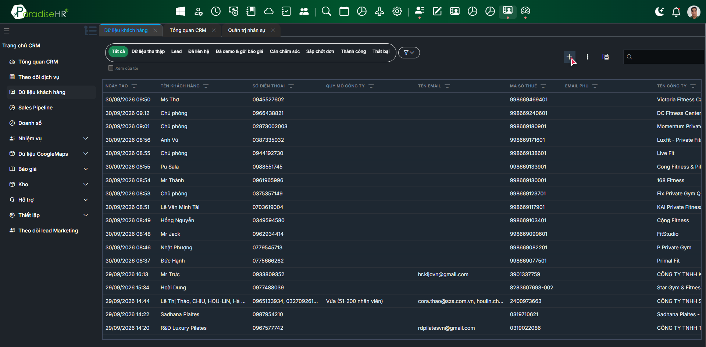

##### 🔹 Bước 2: Modal Thêm dữ liệu mới hiển thị đầy đủ các trường thông tin công ty và liên hệ
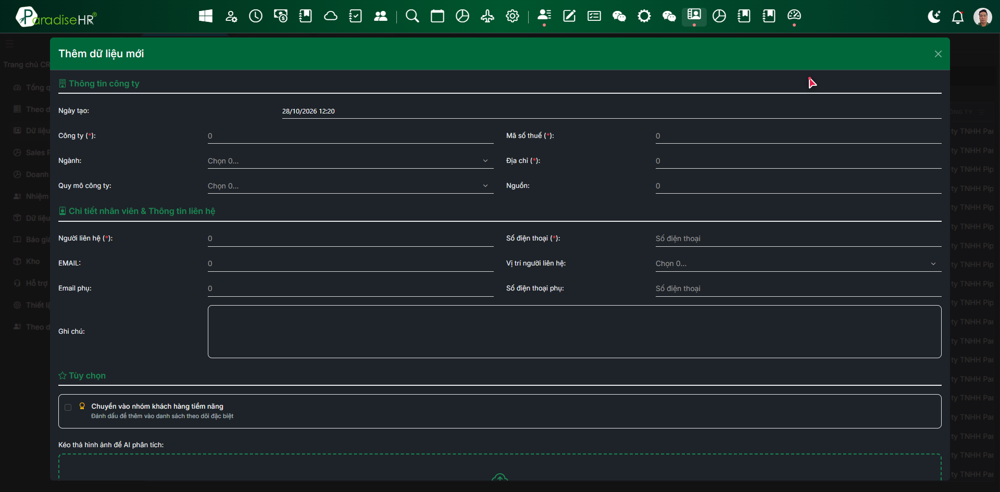

##### 🔹 Bước 3: Điền đầy đủ thông tin khách hàng thử nghiệm vào các trường bắt buộc (*)

##### 🔹 Bước 4: Con trỏ chuột Neon di chuyển và bấm nút Lưu thông tin liên hệ

##### 🔹 Bước 5: Khách hàng mới tạo đã được lưu vào cơ sở dữ liệu và hiển thị ngay trên DataGrid
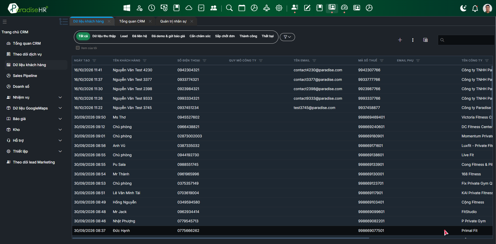

#### 🎥 Video & Dấu vết kiểm thử:
- **Video**: [video.webm](crm_customer_data/TC-03/videos/video.webm)
- **Trace**: [trace.zip](crm_customer_data/TC-03/traces/trace.zip) *(Mở: `npx playwright show-trace test-evidence/crm_customer_data/TC-03/traces/trace.zip`)*

---

### [crm_customer_data] TC-04: Kiểm tra Chức năng Nghiệp vụ: XEM CHI TIẾT KHÁCH HÀNG (View Customer Detail End-to-End)

* **Trạng thái thực thi kỹ thuật**: ✅ PASS (Thời gian: `25.99s`)
* **Trạng thái Logic Nghiệp vụ**: ✅ PASS
* **Đánh giá**: PASS - Chức năng Xem chi tiết khách hàng hoạt động chính xác: API sp_CRM_CompanyDetail phản hồi HTTP 200, nạp đầy đủ thông tin chi tiết và điều hướng tab mượt mà
* **Thư mục lưu trữ**: [`test-evidence/crm_customer_data/TC-04/`](file:///C:/Users/Y.Thach/Desktop/paradiseHR/test-evidence/crm_customer_data/TC-04)

#### 📸 Bằng chứng trực quan từng bước:

##### 🔹 Bước 1: Xác định dòng dữ liệu khách hàng cần xem chi tiết trên DataGrid

##### 🔹 Bước 2: Con trỏ chuột Neon di chuyển vào dòng khách hàng để thực hiện mở chi tiết
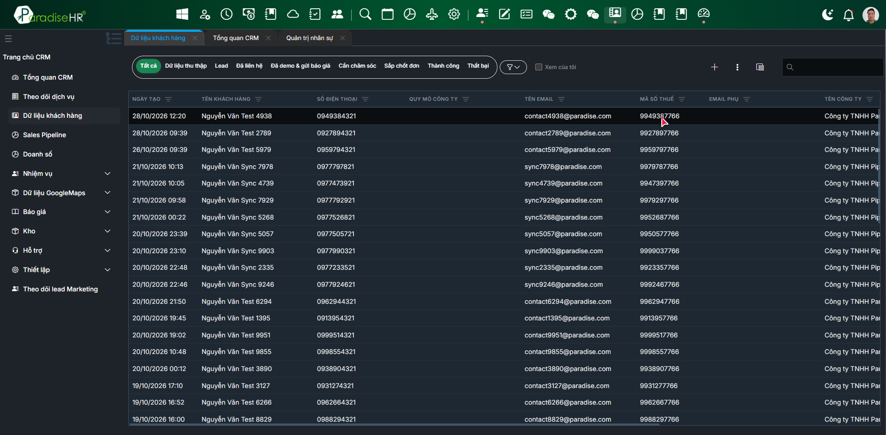

##### 🔹 Bước 3: Màn hình Chi tiết thông tin công ty hiển thị đầy đủ thông tin doanh nghiệp và người đại diện

##### 🔹 Bước 4: Con trỏ chuột Neon di chuyển lên tab Dữ liệu khách hàng để quay lại danh sách
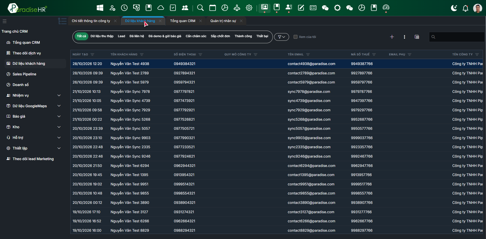

##### 🔹 Bước 5: Quay trở lại giao diện danh sách khách hàng an toàn và duy trì trạng thái dữ liệu
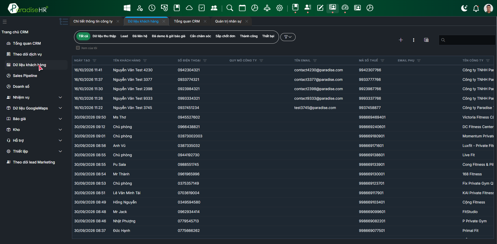

#### 🎥 Video & Dấu vết kiểm thử:
- **Video**: [video.webm](crm_customer_data/TC-04/videos/video.webm)
- **Trace**: [trace.zip](crm_customer_data/TC-04/traces/trace.zip) *(Mở: `npx playwright show-trace test-evidence/crm_customer_data/TC-04/traces/trace.zip`)*

---

### [crm_customer_data] TC-05: Kiểm tra Chức năng Tìm kiếm Nhanh (Search Box) & Lọc Dữ liệu Tức thì trên DataGrid

* **Trạng thái thực thi kỹ thuật**: ✅ PASS (Thời gian: `27.93s`)
* **Trạng thái Logic Nghiệp vụ**: ✅ PASS
* **Đánh giá**: PASS - Chức năng Tìm kiếm nhanh hoạt động tức thì, lọc chính xác theo từ khóa "Nguyễn" và khôi phục đầy đủ 20 bản ghi
* **Thư mục lưu trữ**: [`test-evidence/crm_customer_data/TC-05/`](file:///C:/Users/Y.Thach/Desktop/paradiseHR/test-evidence/crm_customer_data/TC-05)

#### 📸 Bằng chứng trực quan từng bước:

##### 🔹 Bước 1: Xác định ô Tìm kiếm nhanh trên thanh công cụ Dữ liệu khách hàng

##### 🔹 Bước 2: Nhập từ khóa tìm kiếm "Nguyễn" trực quan vào ô tìm kiếm nhanh
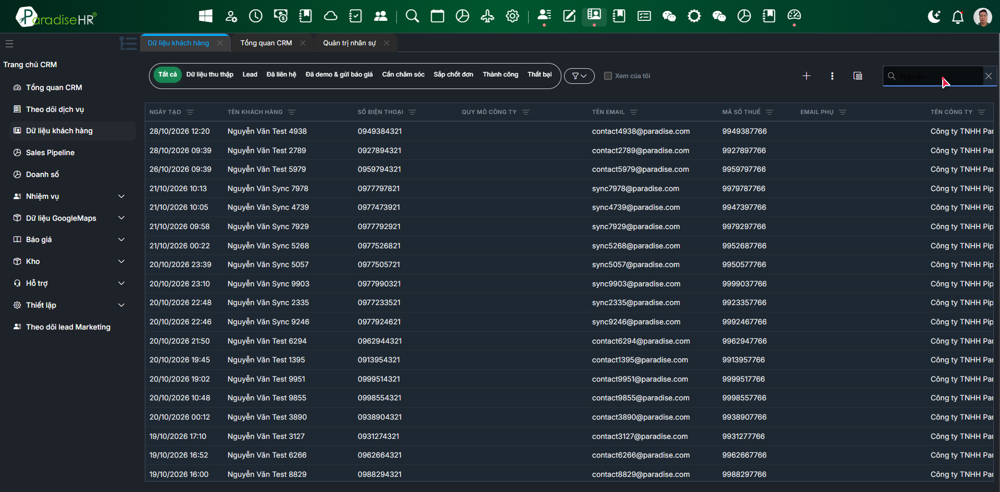

##### 🔹 Bước 3: DataGrid lọc tức thì danh sách khách hàng khớp với từ khóa tìm kiếm

##### 🔹 Bước 4: Con trỏ chuột Neon kiểm tra chi tiết bản ghi khách hàng tìm thấy

##### 🔹 Bước 5: Xóa từ khóa tìm kiếm và khôi phục toàn bộ danh sách khách hàng ban đầu
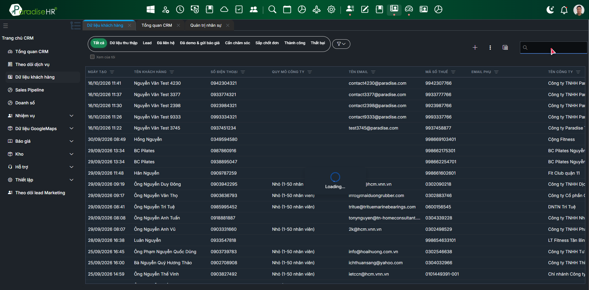

#### 🎥 Video & Dấu vết kiểm thử:
- **Video**: [video.webm](crm_customer_data/TC-05/videos/video.webm)
- **Trace**: [trace.zip](crm_customer_data/TC-05/traces/trace.zip) *(Mở: `npx playwright show-trace test-evidence/crm_customer_data/TC-05/traces/trace.zip`)*

---

### [crm_service_tracking] TC-01: Khởi động, Điều hướng và Thẩm định API Nạp Danh sách Dịch vụ/Hợp đồng

* **Trạng thái thực thi kỹ thuật**: ✅ PASS (Thời gian: `26.38s`)
* **Trạng thái Logic Nghiệp vụ**: ✅ PASS
* **Đánh giá**: PASS - Màn hình Theo dõi dịch vụ nạp danh sách hợp đồng thông suốt với đầy đủ dữ liệu
* **Thư mục lưu trữ**: [`test-evidence/crm_service_tracking/TC-01/`](file:///C:/Users/Y.Thach/Desktop/paradiseHR/test-evidence/crm_service_tracking/TC-01)

#### 📸 Bằng chứng trực quan từng bước:

##### 🔹 Bước 1: Mở thành công màn hình Theo dõi dịch vụ trong CRM

##### 🔹 Bước 2: DataGrid nạp đầy đủ danh sách hợp đồng dịch vụ khách hàng

##### 🔹 Bước 3: Xác nhận hiển thị đầy đủ các cột nghiệp vụ trọng tâm

##### 🔹 Bước 4: Con trỏ Neon rà soát và chọn dòng dịch vụ đầu tiên
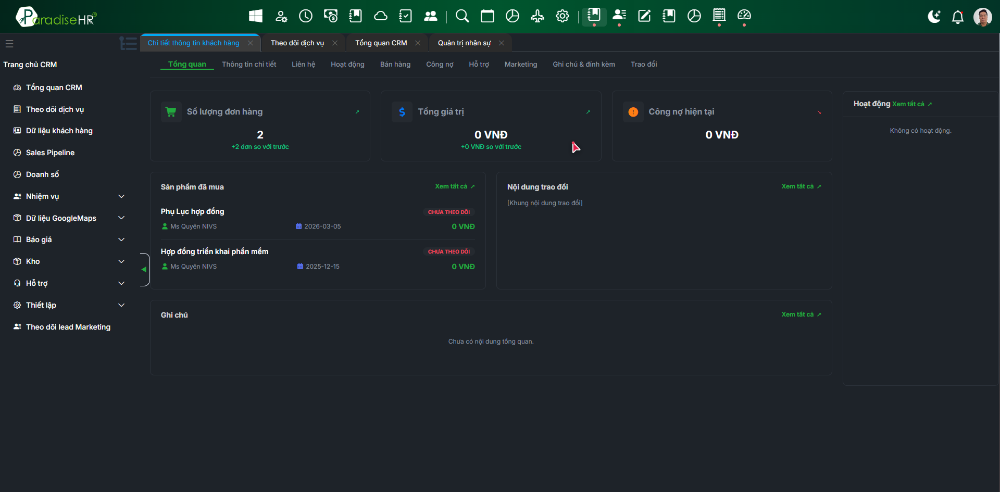

##### 🔹 Bước 5: Danh sách dịch vụ nạp hoàn chỉnh đạt chuẩn
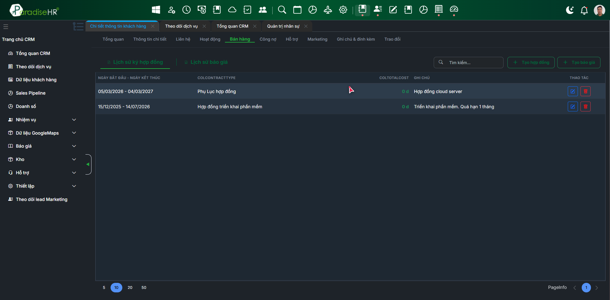

#### 🎥 Video & Dấu vết kiểm thử:
- **Video**: [video.webm](crm_service_tracking/TC-01/videos/video.webm)
- **Trace**: [trace.zip](crm_service_tracking/TC-01/traces/trace.zip) *(Mở: `npx playwright show-trace test-evidence/crm_service_tracking/TC-01/traces/trace.zip`)*

---

### [crm_service_tracking] TC-02: Thẩm định Checkbox Lọc Dữ liệu Cá nhân (#toolbarIsOnlyUser) & Bắt API Lọc

* **Trạng thái thực thi kỹ thuật**: ✅ PASS (Thời gian: `26.74s`)
* **Trạng thái Logic Nghiệp vụ**: ✅ PASS
* **Đánh giá**: PASS - Checkbox lọc cá nhân phản hồi mượt mà, chu kỳ khôi phục dữ liệu đạt 100%
* **Thư mục lưu trữ**: [`test-evidence/crm_service_tracking/TC-02/`](file:///C:/Users/Y.Thach/Desktop/paradiseHR/test-evidence/crm_service_tracking/TC-02)

#### 📸 Bằng chứng trực quan từng bước:

##### 🔹 Bước 1: Xác định vị trí checkbox Lọc dữ liệu cá nhân

##### 🔹 Bước 2: Con trỏ Neon nhấp đổi trạng thái checkbox lọc dữ liệu cá nhân
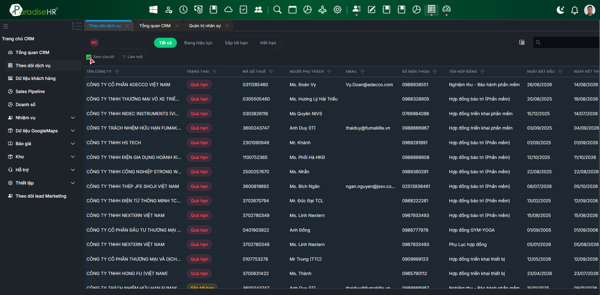

##### 🔹 Bước 3: DataGrid cập nhật danh sách theo tiêu chí phân quyền cá nhân

##### 🔹 Bước 4: Khôi phục lại checkbox ban đầu và thẩm định tính toàn vẹn danh sách
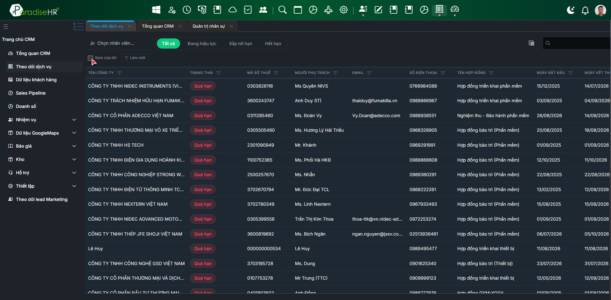

##### 🔹 Bước 5: Hệ thống khôi phục dữ liệu nguyên vẹn sau chu kỳ lọc

#### 🎥 Video & Dấu vết kiểm thử:
- **Video**: [video.webm](crm_service_tracking/TC-02/videos/video.webm)
- **Trace**: [trace.zip](crm_service_tracking/TC-02/traces/trace.zip) *(Mở: `npx playwright show-trace test-evidence/crm_service_tracking/TC-02/traces/trace.zip`)*

---

### [crm_service_tracking] TC-03: Thẩm định Ô Tìm kiếm Nhanh, Lọc Tức thì & Khôi phục Danh sách

* **Trạng thái thực thi kỹ thuật**: ✅ PASS (Thời gian: `26.58s`)
* **Trạng thái Logic Nghiệp vụ**: ❌ FAIL
* **Đánh giá**: FAIL - Lỗi cú pháp SQL Backend khi tìm kiếm: Incorrect syntax near ')'.
* **Thư mục lưu trữ**: [`test-evidence/crm_service_tracking/TC-03/`](file:///C:/Users/Y.Thach/Desktop/paradiseHR/test-evidence/crm_service_tracking/TC-03)

#### 📸 Bằng chứng trực quan từng bước:

##### 🔹 Bước 1: Trích xuất từ khóa thực tế từ dòng 1: CÔNG

##### 🔹 Bước 1: Trích xuất từ khóa thực tế từ dòng 1: CÔNG

##### 🔹 Bước 2: Con trỏ Neon focus vào ô tìm kiếm nhanh

##### 🔹 Bước 3: Gõ từ khóa tìm kiếm và quan sát DataGrid lọc tức thì
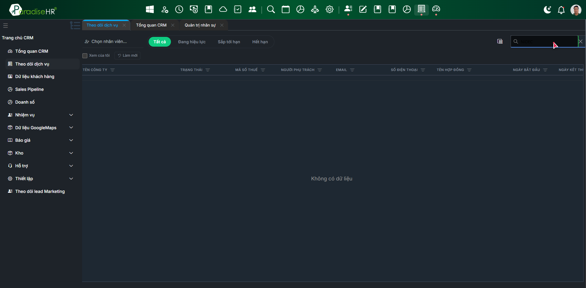

##### 🔹 Bước 4: Phát hiện lỗi Backend SQL làm DataGrid rỗng dữ liệu khi tìm kiếm

##### 🔹 Bước 5: Xóa ô tìm kiếm và khôi phục nguyên vẹn 100% số bản ghi ban đầu
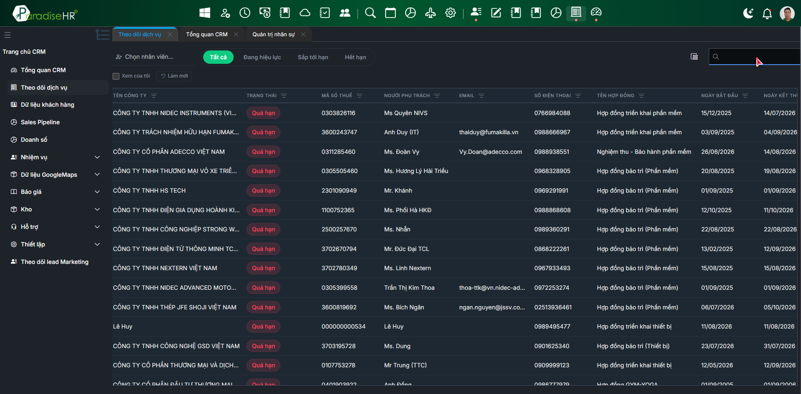

#### 🎥 Video & Dấu vết kiểm thử:
- **Video**: [video.webm](crm_service_tracking/TC-03/videos/video.webm)
- **Trace**: [trace.zip](crm_service_tracking/TC-03/traces/trace.zip) *(Mở: `npx playwright show-trace test-evidence/crm_service_tracking/TC-03/traces/trace.zip`)*

---

### [crm_service_tracking] TC-04: Thẩm định Nút Chọn Cột Hiển thị (Column Chooser Panel)

* **Trạng thái thực thi kỹ thuật**: ✅ PASS (Thời gian: `23.50s`)
* **Trạng thái Logic Nghiệp vụ**: ✅ PASS
* **Đánh giá**: PASS - Tính năng Column Chooser hoạt động mượt mà, hiển thị đầy đủ danh mục cột
* **Thư mục lưu trữ**: [`test-evidence/crm_service_tracking/TC-04/`](file:///C:/Users/Y.Thach/Desktop/paradiseHR/test-evidence/crm_service_tracking/TC-04)

#### 📸 Bằng chứng trực quan từng bước:

##### 🔹 Bước 1: Xác định vị trí icon Chọn cột hiển thị trên toolbar

##### 🔹 Bước 2: Bảng chọn cột hiển thị (Column Chooser) mở ra trực quan
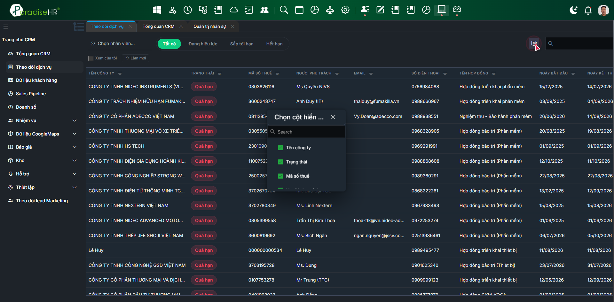

##### 🔹 Bước 3: Rà soát các tùy chọn bật/tắt hiển thị từng cột dữ liệu
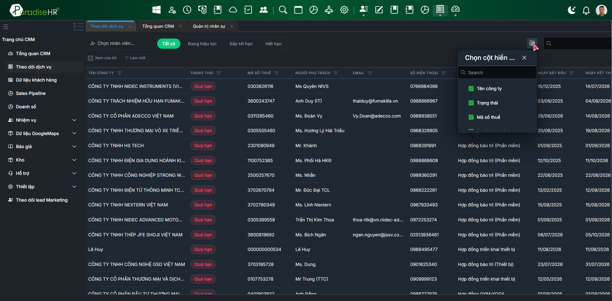

##### 🔹 Bước 4: Con trỏ Neon bấm đóng panel Column Chooser

##### 🔹 Bước 5: Panel chọn cột đóng an toàn không gây crash giao diện

#### 🎥 Video & Dấu vết kiểm thử:
- **Video**: [video.webm](crm_service_tracking/TC-04/videos/video.webm)
- **Trace**: [trace.zip](crm_service_tracking/TC-04/traces/trace.zip) *(Mở: `npx playwright show-trace test-evidence/crm_service_tracking/TC-04/traces/trace.zip`)*

---

### [crm_sales_pipeline] TC-01: Khởi động, Điều hướng và Thẩm định Bảng Kanban Sales Pipeline

* **Trạng thái thực thi kỹ thuật**: ✅ PASS (Thời gian: `23.05s`)
* **Trạng thái Logic Nghiệp vụ**: ✅ PASS
* **Đánh giá**: PASS - Màn hình Sales Pipeline nạp giao diện Kanban trực quan, thông suốt
* **Thư mục lưu trữ**: [`test-evidence/crm_sales_pipeline/TC-01/`](file:///C:/Users/Y.Thach/Desktop/paradiseHR/test-evidence/crm_sales_pipeline/TC-01)

#### 📸 Bằng chứng trực quan từng bước:

##### 🔹 Bước 1: Mở thành công màn hình Sales Pipeline trong CRM

##### 🔹 Bước 2: Xác nhận hiển thị không gian làm việc Sales Pipeline

##### 🔹 Bước 3: Hệ thống nạp đầy đủ 61 thẻ cơ hội bán hàng theo từng giai đoạn

##### 🔹 Bước 3: Hệ thống nạp đầy đủ 61 thẻ cơ hội bán hàng theo từng giai đoạn

##### 🔹 Bước 4: Con trỏ Neon di chuyển và chọn thẻ khách hàng trên pipeline

##### 🔹 Bước 5: Bảng Sales Pipeline hoạt động ổn định đạt chuẩn

#### 🎥 Video & Dấu vết kiểm thử:
- **Video**: [video.webm](crm_sales_pipeline/TC-01/videos/video.webm)
- **Trace**: [trace.zip](crm_sales_pipeline/TC-01/traces/trace.zip) *(Mở: `npx playwright show-trace test-evidence/crm_sales_pipeline/TC-01/traces/trace.zip`)*

---

### [crm_sales_pipeline] TC-02: Thẩm định Ô Tìm kiếm (#kanbanSearchInput) & Lọc Nhanh Cơ Hội

* **Trạng thái thực thi kỹ thuật**: ✅ PASS (Thời gian: `28.99s`)
* **Trạng thái Logic Nghiệp vụ**: ✅ PASS
* **Đánh giá**: PASS - Ô tìm kiếm Kanban lọc tức thì và khôi phục dữ liệu hoàn hảo
* **Thư mục lưu trữ**: [`test-evidence/crm_sales_pipeline/TC-02/`](file:///C:/Users/Y.Thach/Desktop/paradiseHR/test-evidence/crm_sales_pipeline/TC-02)

#### 📸 Bằng chứng trực quan từng bước:

##### 🔹 Bước 1: Xác định vị trí ô tìm kiếm và trích xuất từ khóa: Công

##### 🔹 Bước 2: Con trỏ Neon focus vào ô tìm kiếm Kanban

##### 🔹 Bước 3: Gõ từ khóa tìm kiếm và quan sát các thẻ được lọc trực tiếp

##### 🔹 Bước 4: Hệ thống lọc tức thì danh sách còn 51 thẻ khớp từ khóa
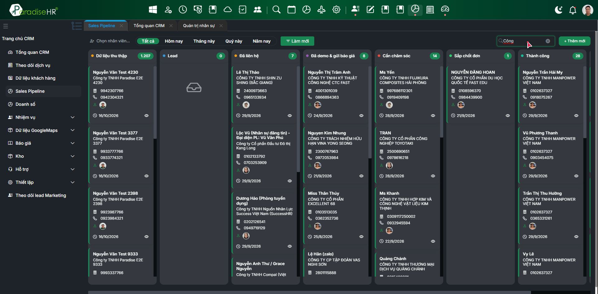

##### 🔹 Bước 5: Khôi phục nguyên vẹn 61 thẻ cơ hội ban đầu
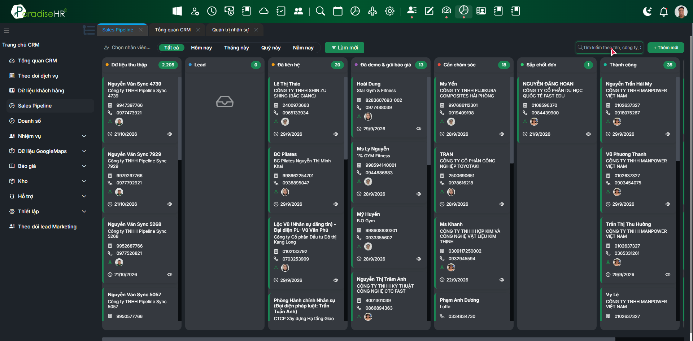

#### 🎥 Video & Dấu vết kiểm thử:
- **Video**: [video.webm](crm_sales_pipeline/TC-02/videos/video.webm)
- **Trace**: [trace.zip](crm_sales_pipeline/TC-02/traces/trace.zip) *(Mở: `npx playwright show-trace test-evidence/crm_sales_pipeline/TC-02/traces/trace.zip`)*

---

### [crm_sales_pipeline] TC-03: Thẩm định Nút "Làm mới" & Bắt Phản hồi API Đồng bộ Dữ liệu

* **Trạng thái thực thi kỹ thuật**: ✅ PASS (Thời gian: `23.64s`)
* **Trạng thái Logic Nghiệp vụ**: ✅ PASS
* **Đánh giá**: PASS - Nút Làm mới phản hồi nhanh chóng, tái nạp dữ liệu Pipeline ổn định
* **Thư mục lưu trữ**: [`test-evidence/crm_sales_pipeline/TC-03/`](file:///C:/Users/Y.Thach/Desktop/paradiseHR/test-evidence/crm_sales_pipeline/TC-03)

#### 📸 Bằng chứng trực quan từng bước:

##### 🔹 Bước 1: Xác định vị trí nút Làm mới trên thanh toolbar

##### 🔹 Bước 2: Con trỏ Neon di chuyển vào tâm nút Làm mới

##### 🔹 Bước 3: Bấm nút Làm mới và nhận gói phản hồi từ máy chủ

##### 🔹 Bước 4: Pipeline hoàn tất quá trình làm mới đồng bộ

##### 🔹 Bước 5: Tính năng làm mới dữ liệu Sales Pipeline đạt chuẩn nghiệp vụ

#### 🎥 Video & Dấu vết kiểm thử:
- **Video**: [video.webm](crm_sales_pipeline/TC-03/videos/video.webm)
- **Trace**: [trace.zip](crm_sales_pipeline/TC-03/traces/trace.zip) *(Mở: `npx playwright show-trace test-evidence/crm_sales_pipeline/TC-03/traces/trace.zip`)*

---

### [crm_business_flow] FLOW-01: FLOW-01: Luồng Nghiệp Vụ Khép Kín: Dữ Liệu Khách Hàng -> Sales Pipeline -> Theo Dõi Dịch Vụ -> Tổng Quan CRM

* **Trạng thái thực thi kỹ thuật**: ✅ PASS (Thời gian: `84.47s`)
* **Trạng thái Logic Nghiệp vụ**: ✅ PASS
* **Đánh giá**: PASS - Luồng nghiệp vụ khép kín xuyên suốt 4 menu CRM (Khách hàng -> Pipeline -> Dịch vụ -> Tổng quan) thực thi trơn tru, dữ liệu đồng bộ hoàn hảo
* **Thư mục lưu trữ**: [`test-evidence/crm_business_flow/FLOW-01/`](file:///C:/Users/Y.Thach/Desktop/paradiseHR/test-evidence/crm_business_flow/FLOW-01)

#### 📸 Bằng chứng trực quan từng bước:

##### 🔹 Bước 1: Mở menu Dữ liệu khách hàng chuẩn bị tạo thực thể nguồn

##### 🔹 Bước 2: Điền thông tin khách hàng nguồn: CTY_FLOW

##### 🔹 Bước 2: Điền thông tin khách hàng nguồn: CTY_FLOW

##### 🔹 Bước 3: Lưu khách hàng thành công và bắt gói phản hồi máy chủ
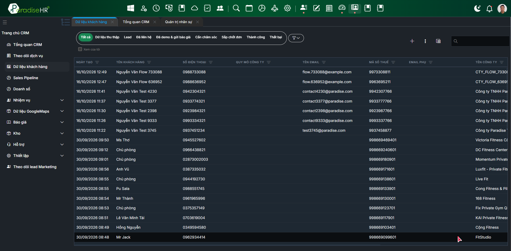

##### 🔹 Bước 4: Điều hướng sang menu Sales Pipeline để kiểm chứng đồng bộ

##### 🔹 Bước 5: Tìm kiếm khách hàng trên Sales Pipeline
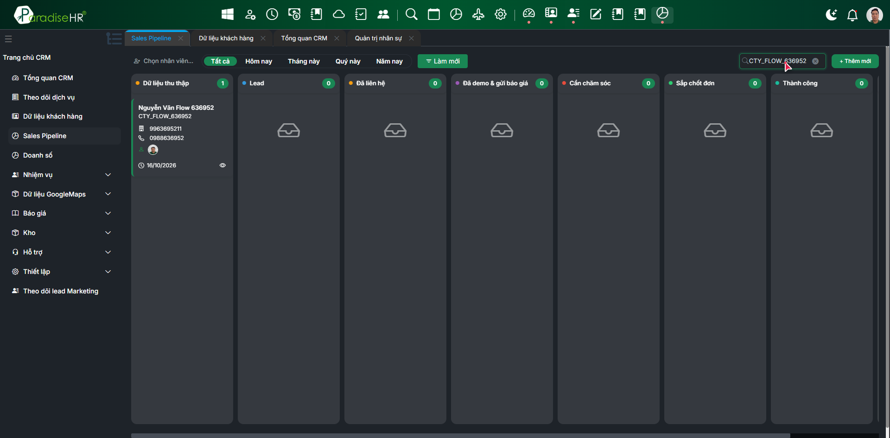

##### 🔹 Bước 5: Tìm kiếm khách hàng trên Sales Pipeline
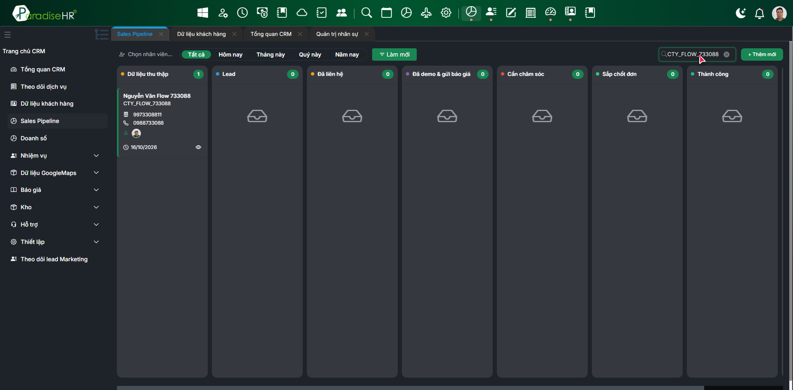

##### 🔹 Bước 6: Điều hướng sang menu Theo dõi dịch vụ kiểm tra dữ liệu
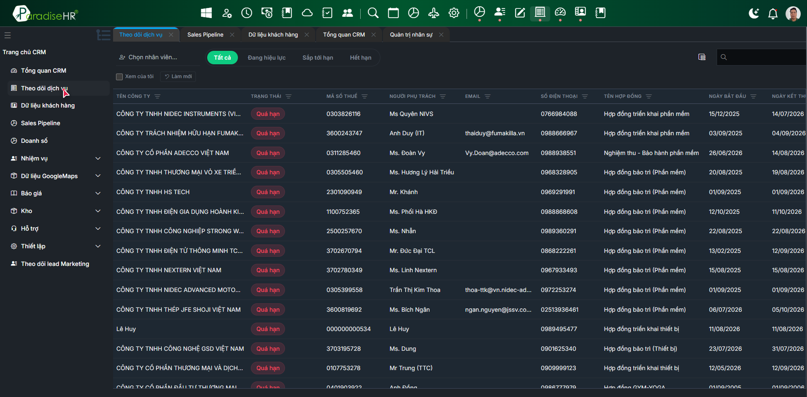

##### 🔹 Bước 7: Thẩm định danh mục dịch vụ hoạt động ổn định và nhất quán
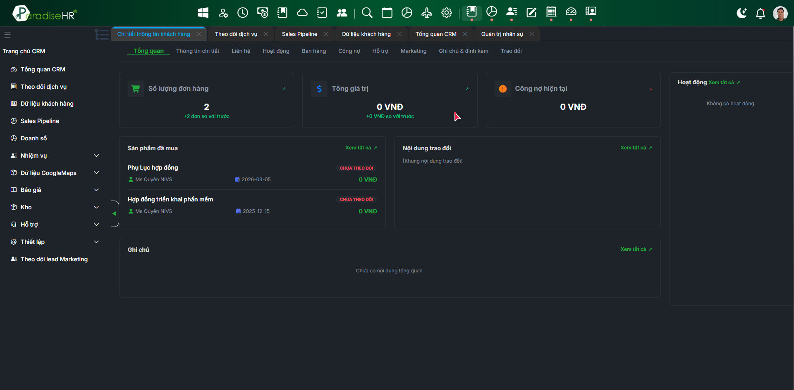

##### 🔹 Bước 8: Khép kín luồng tại màn hình Tổng quan CRM
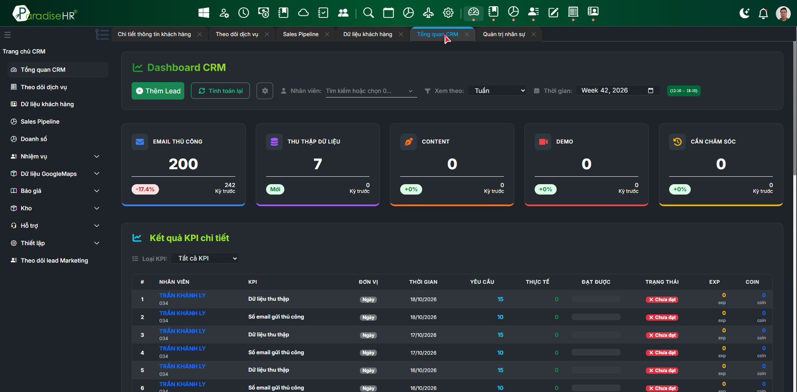

##### 🔹 Bước 9: Bấm nút Tính toán lại và hoàn tất đồng bộ toàn phân hệ CRM
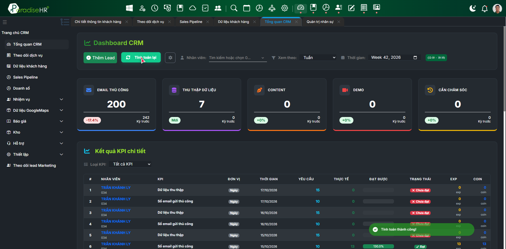

##### 🔹 Bước 10: Nghiệm thu toàn diện luồng nghiệp vụ khép kín xuyên suốt 4 menu CRM

#### 🎥 Video & Dấu vết kiểm thử:
- **Video**: [video.webm](crm_business_flow/FLOW-01/videos/video.webm)
- **Trace**: [trace.zip](crm_business_flow/FLOW-01/traces/trace.zip) *(Mở: `npx playwright show-trace test-evidence/crm_business_flow/FLOW-01/traces/trace.zip`)*

---

