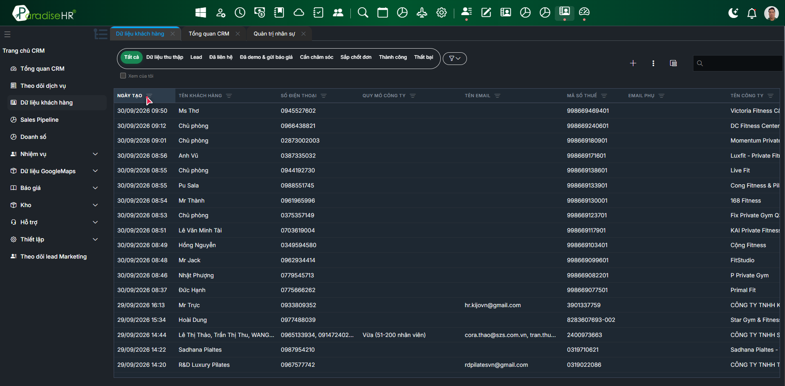
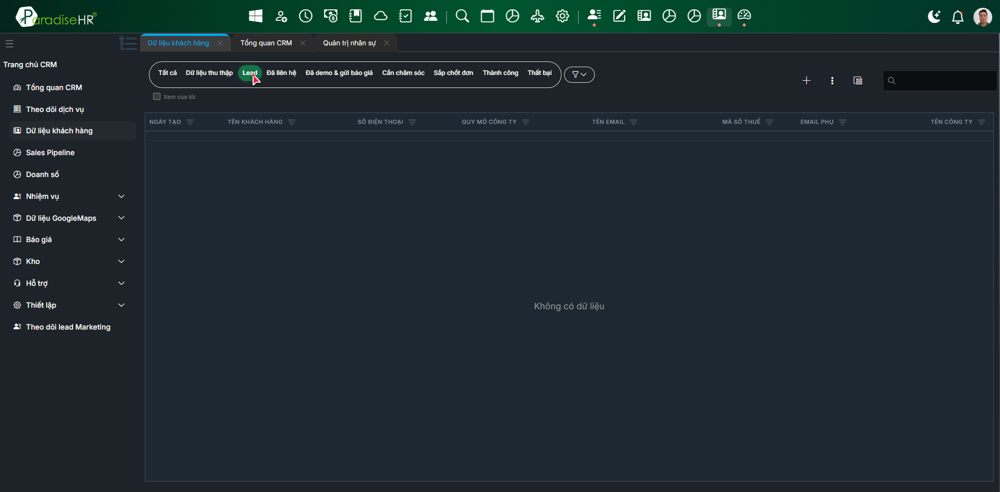
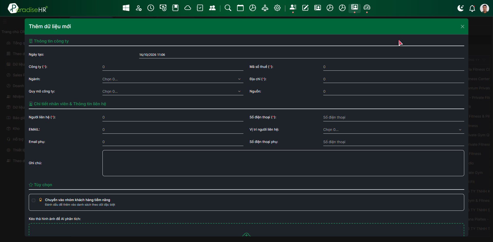
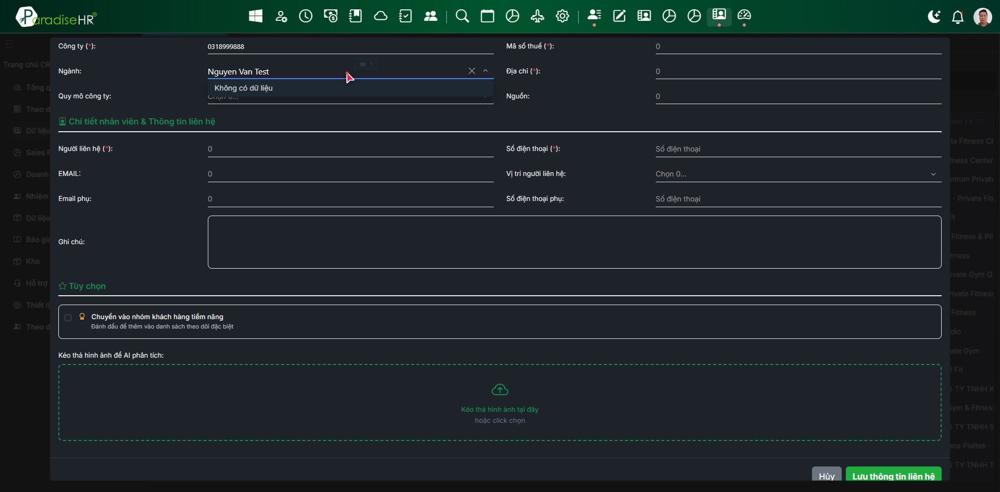
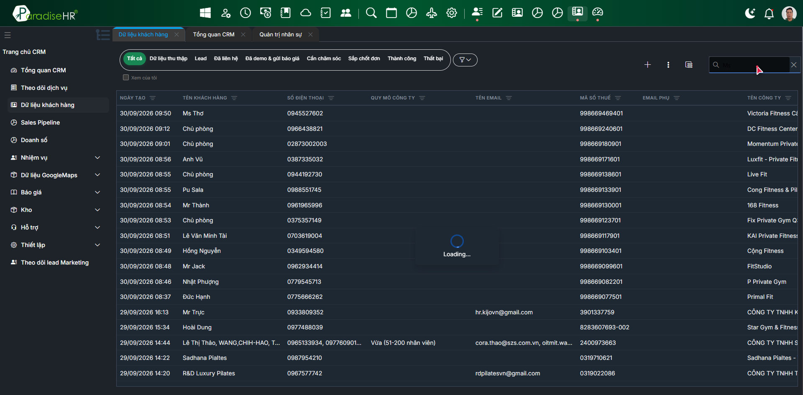
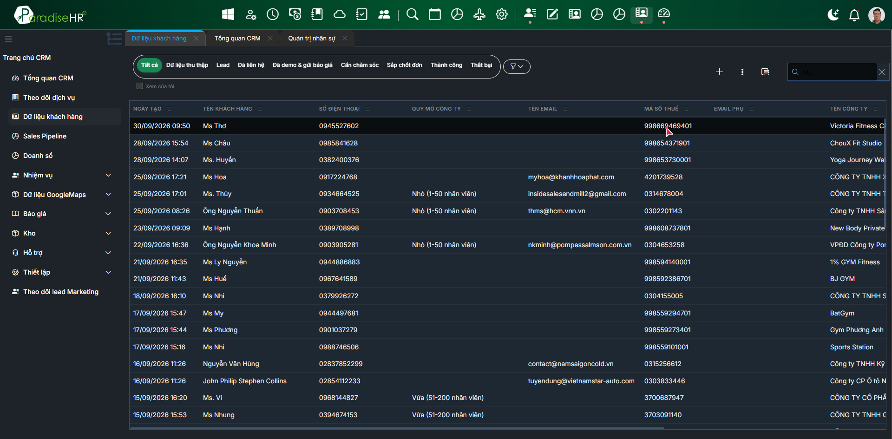
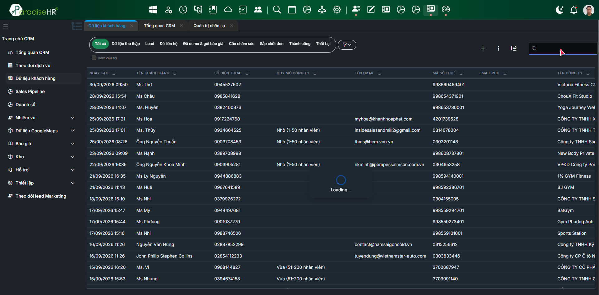

# BÁO CÁO KIỂM THỬ TỔNG HỢP E2E (MASTER TEST REPORT)

> Thời gian kiểm thử: **11:07:11 16/10/2026**
> Tổng số trang: **1** | Tổng số kịch bản: **4**

## 1. TỔNG QUAN THEO TỪNG TRANG / MENU

| Trang / Menu | File Kịch Bản | Số Test Case | Trạng thái Logic | Báo cáo chi tiết |
| :--- | :--- | :--- | :--- | :--- |
| **crm_customer_data** | `tests/crm_customer_data.spec.js` | 4 | ✅ 100% LOGIC PASS | [Xem chi tiết](crm_customer_data/test-report.md) |

---

## 2. CHI TIẾT TẤT CẢ TEST CASES

### [crm_customer_data] TC-01: Kiểm tra Khởi động, Điều hướng và Hiển thị Giao diện Dữ liệu khách hàng (Header, DataGrid, Toolbar)

* **Trạng thái thực thi Test (Kỹ thuật)**: ✅ PASS (Thời gian thực thi: `24.38s`)
* **Trạng thái Logic Nghiệp vụ (Business Output)**: ✅ PASS
* **Đánh giá chi tiết**: PASS - Giao diện Dữ liệu khách hàng hiển thị hoàn chỉnh, thanh công cụ sẵn sàng và DataGrid nạp thành công 20 dòng dữ liệu
* **Thư mục bằng chứng**: [`test-evidence/crm_customer_data/TC-01/`](file:///C:/Users/Y.Thach/Desktop/paradiseHR/test-evidence/crm_customer_data/TC-01)

#### 📸 Bằng chứng trực quan từng bước (Step-by-Step Evidence):

##### 🔹 Bước 1: Đăng nhập thành công và mở trang chủ hệ thống Paradise HRM

##### 🔹 Bước 2: Mở màn hình Dữ liệu khách hàng từ menu phân hệ CRM

##### 🔹 Bước 3: Kiểm tra thanh công cụ Toolbar và các nút chức năng thao tác

##### 🔹 Bước 4: Kiểm tra bảng DataGrid danh sách khách hàng và các cột dữ liệu chính

##### 🔹 Bước 5: Hệ thống nạp đầy đủ danh sách khách hàng và hiển thị DataGrid thành công

#### 🎥 Video & Dấu vết kiểm thử (Video & Trace):
- **Video**: [video.webm](crm_customer_data/TC-01/videos/video.webm)
- **Trace**: [trace.zip](crm_customer_data/TC-01/traces/trace.zip)

---

### [crm_customer_data] TC-02: Kiểm tra Bộ lọc Trạng thái (Status Pills) & Tùy chọn "Xem của tôi"

* **Trạng thái thực thi Test (Kỹ thuật)**: ✅ PASS (Thời gian thực thi: `33.42s`)
* **Trạng thái Logic Nghiệp vụ (Business Output)**: ✅ PASS
* **Đánh giá chi tiết**: PASS - Các nút bộ lọc trạng thái và tùy chọn Xem của tôi phản hồi tức thì, chuyển đổi mượt mà
* **Thư mục bằng chứng**: [`test-evidence/crm_customer_data/TC-02/`](file:///C:/Users/Y.Thach/Desktop/paradiseHR/test-evidence/crm_customer_data/TC-02)

#### 📸 Bằng chứng trực quan từng bước (Step-by-Step Evidence):

##### 🔹 Bước 1: Kiểm tra thanh bộ lọc trạng thái mặc định (Tất cả đang kích hoạt)

##### 🔹 Bước 2: Chọn bộ lọc trạng thái Lead và kiểm tra phản hồi của DataGrid

##### 🔹 Bước 3: Chuyển đổi sang bộ lọc Đã liên hệ và kiểm tra danh sách lọc

##### 🔹 Bước 4: Kích hoạt tùy chọn lọc Xem của tôi để lọc dữ liệu phụ trách

##### 🔹 Bước 5: Khôi phục bộ lọc Tất cả và hoàn tất kiểm tra chuyển đổi trạng thái

#### 🎥 Video & Dấu vết kiểm thử (Video & Trace):
- **Video**: [video.webm](crm_customer_data/TC-02/videos/video.webm)
- **Trace**: [trace.zip](crm_customer_data/TC-02/traces/trace.zip)

---

### [crm_customer_data] TC-03: Kiểm tra Modal "Thêm dữ liệu mới" (+) - Ràng buộc (*) & Nhập liệu an toàn

* **Trạng thái thực thi Test (Kỹ thuật)**: ✅ PASS (Thời gian thực thi: `37.27s`)
* **Trạng thái Logic Nghiệp vụ (Business Output)**: ✅ PASS
* **Đánh giá chi tiết**: PASS - Modal Thêm dữ liệu mới hiển thị đầy đủ trường thông tin, kiểm soát ràng buộc chặt chẽ và đóng an toàn
* **Thư mục bằng chứng**: [`test-evidence/crm_customer_data/TC-03/`](file:///C:/Users/Y.Thach/Desktop/paradiseHR/test-evidence/crm_customer_data/TC-03)

#### 📸 Bằng chứng trực quan từng bước (Step-by-Step Evidence):

##### 🔹 Bước 1: Con trỏ chuột Neon di chuyển và bấm nút Thêm dữ liệu mới (+)

##### 🔹 Bước 2: Modal Thêm dữ liệu mới hiển thị chi tiết 2 phân vùng thông tin

##### 🔹 Bước 3: Kiểm tra các trường ràng buộc bắt buộc có dấu sao đỏ trên form

##### 🔹 Bước 4: Nhập thông tin thử nghiệm trực quan vào các trường trên form

##### 🔹 Bước 5: Đóng Modal an toàn và quay trở về giao diện danh sách khách hàng

#### 🎥 Video & Dấu vết kiểm thử (Video & Trace):
- **Video**: [video.webm](crm_customer_data/TC-03/videos/video.webm)
- **Trace**: [trace.zip](crm_customer_data/TC-03/traces/trace.zip)

---

### [crm_customer_data] TC-04: Kiểm tra Ô Tìm kiếm nhanh (Search Box) & Lọc dữ liệu tức thì trên DataGrid

* **Trạng thái thực thi Test (Kỹ thuật)**: ✅ PASS (Thời gian thực thi: `29.54s`)
* **Trạng thái Logic Nghiệp vụ (Business Output)**: ✅ PASS
* **Đánh giá chi tiết**: PASS - Ô tìm kiếm nhanh phản hồi tức thì, lọc chính xác theo từ khóa "Ms" và khôi phục đầy đủ 20 bản ghi
* **Thư mục bằng chứng**: [`test-evidence/crm_customer_data/TC-04/`](file:///C:/Users/Y.Thach/Desktop/paradiseHR/test-evidence/crm_customer_data/TC-04)

#### 📸 Bằng chứng trực quan từng bước (Step-by-Step Evidence):

##### 🔹 Bước 1: Xác định ô Tìm kiếm nhanh trên thanh công cụ Dữ liệu khách hàng

##### 🔹 Bước 2: Nhập từ khóa tìm kiếm "Ms" trực quan vào ô tìm kiếm nhanh

##### 🔹 Bước 3: DataGrid lọc tức thì danh sách khách hàng khớp với từ khóa tìm kiếm

##### 🔹 Bước 4: Con trỏ chuột Neon kiểm tra chi tiết bản ghi khách hàng tìm thấy

##### 🔹 Bước 5: Xóa từ khóa tìm kiếm và khôi phục toàn bộ danh sách khách hàng ban đầu

#### 🎥 Video & Dấu vết kiểm thử (Video & Trace):
- **Video**: [video.webm](crm_customer_data/TC-04/videos/video.webm)
- **Trace**: [trace.zip](crm_customer_data/TC-04/traces/trace.zip)

---

