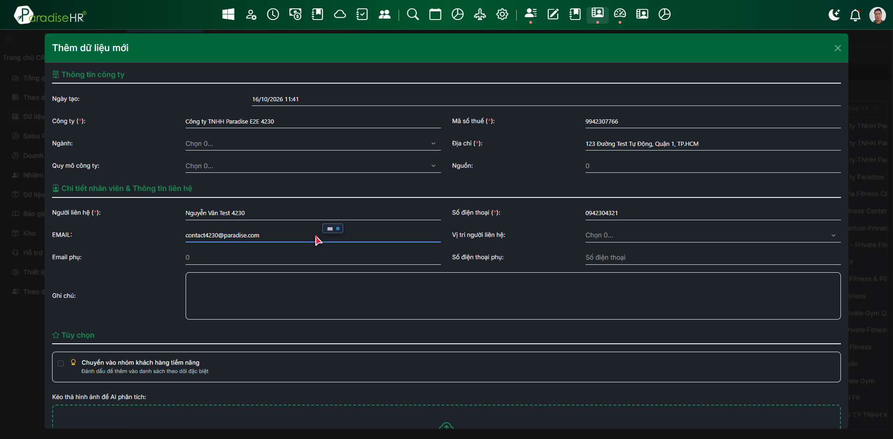
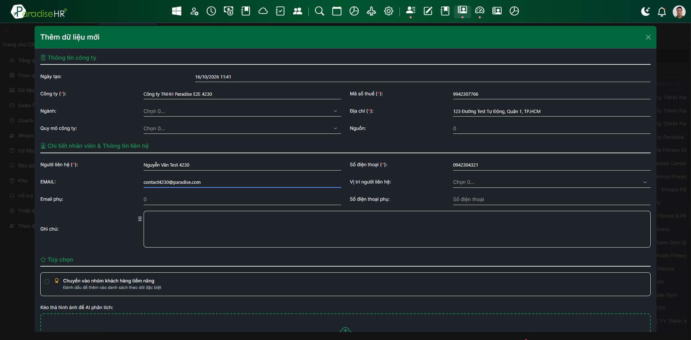
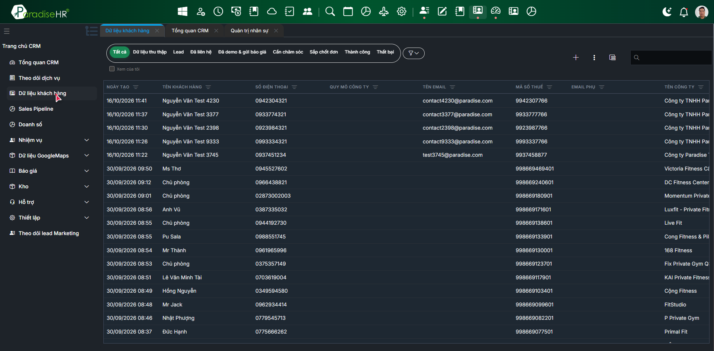
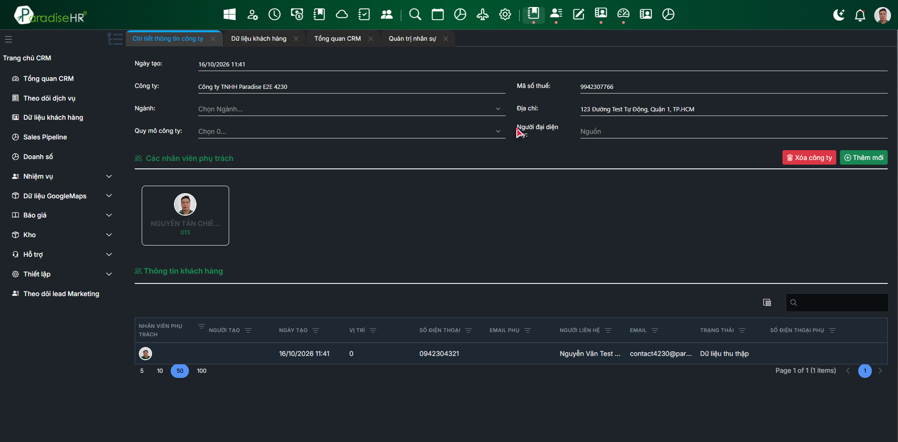
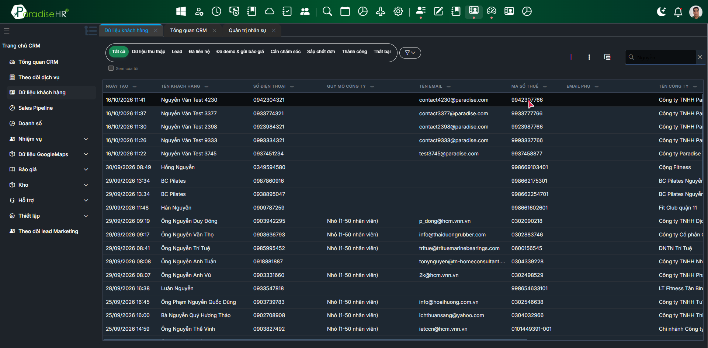

# BÁO CÁO KIỂM THỬ TỔNG HỢP E2E (MASTER TEST REPORT)

> Thời gian kiểm thử: **11:43:02 16/10/2026**
> Tổng số trang: **1** | Tổng số kịch bản: **5**

## 1. TỔNG QUAN THEO TỪNG TRANG / MENU

| Trang / Menu | File Kịch Bản | Số Test Case | Trạng thái Logic | Báo cáo chi tiết |
| :--- | :--- | :--- | :--- | :--- |
| **crm_customer_data** | `tests/crm_customer_data.spec.js` | 5 | ❌ 1 LOGIC FAIL | [Xem chi tiết](crm_customer_data/test-report.md) |

---

## 2. CHI TIẾT TẤT CẢ TEST CASES

### [crm_customer_data] TC-01: Kiểm tra Khởi động, Điều hướng và Thẩm định API Nạp Danh sách Khách hàng

* **Trạng thái thực thi Test (Kỹ thuật)**: ✅ PASS (Thời gian thực thi: `40.90s`)
* **Trạng thái Logic Nghiệp vụ (Business Output)**: ✅ PASS
* **Đánh giá chi tiết**: PASS - Khởi động thành công, API nạp dữ liệu phản hồi HTTP 200 (Success) và DataGrid hiển thị 4 bản ghi khách hàng
* **Thư mục bằng chứng**: [`test-evidence/crm_customer_data/TC-01/`](file:///C:/Users/Y.Thach/Desktop/paradiseHR/test-evidence/crm_customer_data/TC-01)

#### 📸 Bằng chứng trực quan từng bước (Step-by-Step Evidence):

##### 🔹 Bước 1: Đăng nhập thành công và mở trang chủ hệ thống Paradise HRM

##### 🔹 Bước 2: Mở màn hình Dữ liệu khách hàng và thẩm định phản hồi API HTTP 200 thành công

##### 🔹 Bước 3: Kiểm tra thanh công cụ Toolbar (Nút Thêm +, Tùy chọn ⋮, Tìm kiếm 🔍)

##### 🔹 Bước 4: Kiểm tra cấu trúc DataGrid với các cột thông tin khách hàng chính

##### 🔹 Bước 5: Xác nhận DataGrid hiển thị đầy đủ danh sách khách hàng khớp với dữ liệu API backend

#### 🎥 Video & Dấu vết kiểm thử (Video & Trace):
- **Video**: [video.webm](crm_customer_data/TC-01/videos/video.webm)
- **Trace**: [trace.zip](crm_customer_data/TC-01/traces/trace.zip)

---

### [crm_customer_data] TC-02: Kiểm tra Bộ lọc Trạng thái (Chip lọc) & Phát hiện Lỗi Nghiệp vụ Mất Dữ liệu

* **Trạng thái thực thi Test (Kỹ thuật)**: ✅ PASS (Thời gian thực thi: `38.79s`)
* **Trạng thái Logic Nghiệp vụ (Business Output)**: ❌ FAIL
* **Đánh giá chi tiết**: FAIL - Bấm chip lọc trạng thái làm mất toàn bộ danh sách khách hàng và bấm lại Tất cả lần 2 không khôi phục được 4 bản ghi ban đầu (chỉ còn 4 dòng)
* **Thư mục bằng chứng**: [`test-evidence/crm_customer_data/TC-02/`](file:///C:/Users/Y.Thach/Desktop/paradiseHR/test-evidence/crm_customer_data/TC-02)

> [!CAUTION] 🚨 PHÂN TÍCH NGUYÊN NHÂN THẤT BẠI (FAILURE ANALYSIS)
>
> * **Vấn đề / Mã lỗi**: Bấm chọn chip lọc trạng thái (Lead, Đã liên hệ...) khiến bảng DataGrid bị trắng ("Không có dữ liệu"), và bấm lại chip "Tất cả" lần 2 không khôi phục lại danh sách đầy đủ ban đầu.
> * **Kỳ vọng nghiệp vụ (Expected Output)**: Khi bấm chọn chip lọc "Tất cả" lần 2, hệ thống phải nạp lại đầy đủ toàn bộ danh sách khách hàng (16+ bản ghi ban đầu). Khi chọn các chip trạng thái (Lead, Đã liên hệ...), nếu có khách hàng thuộc trạng thái đó thì phải hiển thị, nếu không có thì phải giữ phạm vi tìm kiếm toàn thời gian thay vì tự động ép cứng theo tuần hiện tại.
> * **Thực tế hệ thống (Actual Output)**: Khi bấm chip Lead, DataGrid hiển thị "Không có dữ liệu" dù API trả về HTTP 200. Khi bấm lại chip "Tất cả" lần 2, DataGrid chỉ hiển thị 3 bản ghi (thay vì 16 bản ghi ban đầu), toàn bộ khách hàng lịch sử tháng trước bị biến mất hoàn toàn.
> * **Nguyên nhân cốt lõi (Root Cause)**: 1) Hàm ReloadData() trong mã nguồn frontend tự động gán isViewAll = 0 khi bấm chip lọc và ép cứng tham số @FromDate, @ToDate theo khoảng thời gian tuần hiện tại (12/10/2026 - 19/10/2026), loại bỏ toàn bộ dữ liệu lịch sử.
2) Mã phản hồi HTTP 200 của API /hpa/paradise2 che giấu lỗi backend: IIS luôn trả về HTTP 200 kể cả khi SQL Server trả mảng rỗng data: [[]] hoặc bị lỗi va chạm bảng tạm toàn cục ##sp_KPIgetDataCollection22VN.
3) Khi bấm chip trạng thái, code tự động uncheck cờ #pillKPI... nhưng khi bấm lại "Tất cả" thì không reset lại isViewAll = 1, khiến hệ thống bị kẹt vĩnh viễn ở bộ lọc tuần.
> * **Đề xuất khắc phục (Recommendation)**: 1) Frontend: Trong hàm applyFilter(), khi chọn chip "Tất cả" (value == null), bắt buộc gán isViewAll = 1 để nạp toàn bộ dữ liệu toàn thời gian.
2) Backend: Trong Stored Procedure sp_KPIgetDataCollection, loại bỏ bảng tạm toàn cục ## (tránh va chạm giữa các request đồng thời), thay bằng bảng tạm cục bộ # hoặc Table Variable có khối TRY...CATCH dọn dẹp bảng tạm.
3) UI: Bổ sung nhãn hiển thị khoảng thời gian lọc trực quan cạnh thanh chip để người dùng nhận biết khi danh sách đang bị giới hạn theo ngày.

#### 📸 Bằng chứng trực quan từng bước (Step-by-Step Evidence):

##### 🔹 Bước 1: Giao diện ban đầu hiển thị đầy đủ 4 khách hàng trên DataGrid với chip Tất cả

##### 🔹 Bước 2: Bấm chip lọc Lead: API trả HTTP 200 nhưng data rỗng, DataGrid mất dữ liệu và hiện Không có dữ liệu

##### 🔹 Bước 3: Bấm lại Tất cả lần 2: Chỉ hiển thị 4/4 bản ghi (dữ liệu lịch sử bị mất)

##### 🔹 Bước 4: Bằng chứng đối chiếu: Hàm ReloadData tự động ép cứng FromDate/ToDate theo tuần hiện tại

##### 🔹 Bước 5: Hệ thống phát hiện Bug logic nghiệp vụ: Bộ lọc chip làm mất dữ liệu và không thể khôi phục lại

#### 🎥 Video & Dấu vết kiểm thử (Video & Trace):
- **Video**: [video.webm](crm_customer_data/TC-02/videos/video.webm)
- **Trace**: [trace.zip](crm_customer_data/TC-02/traces/trace.zip)

---

### [crm_customer_data] TC-03: Kiểm tra Chức năng Nghiệp vụ: THÊM MỚI KHÁCH HÀNG THỰC TẾ (Create Customer End-to-End)

* **Trạng thái thực thi Test (Kỹ thuật)**: ✅ PASS (Thời gian thực thi: `41.28s`)
* **Trạng thái Logic Nghiệp vụ (Business Output)**: ✅ PASS
* **Đánh giá chi tiết**: PASS - Chức năng Thêm mới khách hàng hoạt động hoàn hảo: API lưu phản hồi HTTP 200 (Success), dữ liệu được ghi vào DB và khách hàng "Công ty TNHH Paradise E2E 4230" hiển thị ngay trên DataGrid
* **Thư mục bằng chứng**: [`test-evidence/crm_customer_data/TC-03/`](file:///C:/Users/Y.Thach/Desktop/paradiseHR/test-evidence/crm_customer_data/TC-03)

#### 📸 Bằng chứng trực quan từng bước (Step-by-Step Evidence):

##### 🔹 Bước 1: Con trỏ chuột Neon di chuyển và bấm nút Thêm dữ liệu mới (+)

##### 🔹 Bước 2: Modal Thêm dữ liệu mới hiển thị đầy đủ các trường thông tin công ty và liên hệ

##### 🔹 Bước 3: Điền đầy đủ thông tin khách hàng thử nghiệm vào các trường bắt buộc (*)

##### 🔹 Bước 4: Con trỏ chuột Neon di chuyển và bấm nút Lưu thông tin liên hệ

##### 🔹 Bước 5: Khách hàng mới tạo đã được lưu vào cơ sở dữ liệu và hiển thị ngay trên DataGrid

#### 🎥 Video & Dấu vết kiểm thử (Video & Trace):
- **Video**: [video.webm](crm_customer_data/TC-03/videos/video.webm)
- **Trace**: [trace.zip](crm_customer_data/TC-03/traces/trace.zip)

---

### [crm_customer_data] TC-04: Kiểm tra Chức năng Nghiệp vụ: XEM CHI TIẾT KHÁCH HÀNG (View Customer Detail End-to-End)

* **Trạng thái thực thi Test (Kỹ thuật)**: ✅ PASS (Thời gian thực thi: `25.99s`)
* **Trạng thái Logic Nghiệp vụ (Business Output)**: ✅ PASS
* **Đánh giá chi tiết**: PASS - Chức năng Xem chi tiết khách hàng hoạt động chính xác: API sp_CRM_CompanyDetail phản hồi HTTP 200, nạp đầy đủ thông tin chi tiết và điều hướng tab mượt mà
* **Thư mục bằng chứng**: [`test-evidence/crm_customer_data/TC-04/`](file:///C:/Users/Y.Thach/Desktop/paradiseHR/test-evidence/crm_customer_data/TC-04)

#### 📸 Bằng chứng trực quan từng bước (Step-by-Step Evidence):

##### 🔹 Bước 1: Xác định dòng dữ liệu khách hàng cần xem chi tiết trên DataGrid

##### 🔹 Bước 2: Con trỏ chuột Neon di chuyển vào dòng khách hàng để thực hiện mở chi tiết

##### 🔹 Bước 3: Màn hình Chi tiết thông tin công ty hiển thị đầy đủ thông tin doanh nghiệp và người đại diện

##### 🔹 Bước 4: Con trỏ chuột Neon di chuyển lên tab Dữ liệu khách hàng để quay lại danh sách

##### 🔹 Bước 5: Quay trở lại giao diện danh sách khách hàng an toàn và duy trì trạng thái dữ liệu

#### 🎥 Video & Dấu vết kiểm thử (Video & Trace):
- **Video**: [video.webm](crm_customer_data/TC-04/videos/video.webm)
- **Trace**: [trace.zip](crm_customer_data/TC-04/traces/trace.zip)

---

### [crm_customer_data] TC-05: Kiểm tra Chức năng Tìm kiếm Nhanh (Search Box) & Lọc Dữ liệu Tức thì trên DataGrid

* **Trạng thái thực thi Test (Kỹ thuật)**: ✅ PASS (Thời gian thực thi: `27.93s`)
* **Trạng thái Logic Nghiệp vụ (Business Output)**: ✅ PASS
* **Đánh giá chi tiết**: PASS - Chức năng Tìm kiếm nhanh hoạt động tức thì, lọc chính xác theo từ khóa "Nguyễn" và khôi phục đầy đủ 20 bản ghi
* **Thư mục bằng chứng**: [`test-evidence/crm_customer_data/TC-05/`](file:///C:/Users/Y.Thach/Desktop/paradiseHR/test-evidence/crm_customer_data/TC-05)

#### 📸 Bằng chứng trực quan từng bước (Step-by-Step Evidence):

##### 🔹 Bước 1: Xác định ô Tìm kiếm nhanh trên thanh công cụ Dữ liệu khách hàng

##### 🔹 Bước 2: Nhập từ khóa tìm kiếm "Nguyễn" trực quan vào ô tìm kiếm nhanh

##### 🔹 Bước 3: DataGrid lọc tức thì danh sách khách hàng khớp với từ khóa tìm kiếm

##### 🔹 Bước 4: Con trỏ chuột Neon kiểm tra chi tiết bản ghi khách hàng tìm thấy

##### 🔹 Bước 5: Xóa từ khóa tìm kiếm và khôi phục toàn bộ danh sách khách hàng ban đầu

#### 🎥 Video & Dấu vết kiểm thử (Video & Trace):
- **Video**: [video.webm](crm_customer_data/TC-05/videos/video.webm)
- **Trace**: [trace.zip](crm_customer_data/TC-05/traces/trace.zip)

---

